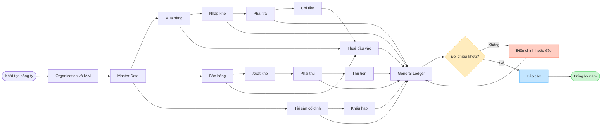

# Mô phỏng công ty giả vận hành ERP trong một năm

> Tài liệu nghiệp vụ–kỹ thuật chi tiết, được đối chiếu với Django router và code hiện tại của dự án.

## 1. Mục tiêu và cách hiểu “sử dụng toàn bộ API”

Tài liệu mô phỏng Công ty TNHH Thương mại Sao Việt hoạt động từ 01/01/2026 đến 31/12/2026. Kịch bản đi qua tất cả phân hệ API hiện có: Common, Organization, IAM, Master Data, Purchases, Accounts Payable, Sales, Accounts Receivable, Cash, Bank, Inventory, Fixed Assets, Tax, General Ledger, Reporting và Audit.

“Sử dụng toàn bộ API” được hiểu theo hai lớp:

- Luồng chính sử dụng mọi nhóm resource và action cần thiết để tạo ra số liệu kinh doanh cuối năm.
- Luồng kiểm soát sử dụng các action đối nghịch như reject, cancel, reverse, error và terminate trên các chứng từ thử riêng. Các chứng từ này bị hủy hoặc đảo hoàn toàn nên không làm sai báo cáo cuối năm.

Không thể vừa duyệt và từ chối, hoặc vừa ghi sổ và hủy cùng một chứng từ. Do đó mỗi nhánh trạng thái phải dùng một bản ghi riêng.

Đơn vị trong các bảng tài chính: **triệu VND**. Ví dụ `5.000` nghĩa là 5 tỷ VND.

## 2. Giả định kinh doanh

| Chỉ tiêu | Giả định cả năm |
| --- | ---: |
| Vốn góp bằng chuyển khoản | 5.000 |
| Mua 12.000 kg hàng, giá 0,3 triệu/kg | 3.600 |
| Thuế GTGT đầu vào của hàng hóa 10% | 360 |
| Bán 10.000 kg hàng, giá 0,6 triệu/kg | 6.000 |
| Thuế GTGT đầu ra 10% | 600 |
| Giá vốn hàng đã bán | 3.000 |
| Tồn kho cuối năm: 2.000 kg × 0,3 triệu | 600 |
| Thuê văn phòng và dịch vụ chưa VAT | 600 |
| Thuế GTGT đầu vào của dịch vụ | 60 |
| Mua máy móc chưa VAT vào tháng 1 | 1.200 |
| Thuế GTGT đầu vào của máy móc | 120 |
| Khấu hao máy móc cả năm | 240 |
| Lương và chi phí nhân sự | 1.200 |
| Phí ngân hàng | 60 |
| Thuế suất thuế TNDN giả định | 20% |

Các giả định được đơn giản hóa để minh họa cách hệ thống cộng/trừ và đối chiếu; không thay thế tư vấn kế toán hoặc thuế thực tế.

## 3. Kết quả cuối năm dự kiến

### 3.1. Báo cáo kết quả kinh doanh

```text
Doanh thu chưa VAT                              6.000
(-) Giá vốn hàng bán                           (3.000)
                                                -----
Lợi nhuận gộp                                   3.000
(-) Thuê văn phòng và dịch vụ                    (600)
(-) Lương và chi phí nhân sự                   (1.200)
(-) Khấu hao                                     (240)
(-) Phí ngân hàng                                 (60)
                                                -----
Lợi nhuận trước thuế                              900
(-) Thuế TNDN 20%                                (180)
                                                -----
Lợi nhuận sau thuế                                720
```

### 3.2. Thuế GTGT

```text
Thuế GTGT đầu ra từ bán hàng                      600
(-) GTGT đầu vào hàng hóa                        (360)
(-) GTGT đầu vào dịch vụ                          (60)
(-) GTGT đầu vào máy móc                         (120)
                                                -----
Thuế GTGT phải nộp                                 60
```

### 3.3. Công nợ cuối năm

```text
Phải thu khách hàng:
  Hóa đơn bán hàng gồm VAT                       6.600
  (-) Tiền khách đã trả                         (6.100)
                                                -----
  Phải thu cuối năm                                500

Phải trả nhà cung cấp:
  Hàng hóa gồm VAT                               3.960
  Dịch vụ gồm VAT                                  660
  Máy móc gồm VAT                                1.320
                                                -----
  Tổng hóa đơn mua                               5.940
  (-) Đã thanh toán                             (5.500)
                                                -----
  Phải trả cuối năm                                440
```

### 3.4. Tiền cuối năm

```text
Vốn góp đầu năm                                  5.000
(+) Thu khách hàng                               6.100
(-) Trả nhà cung cấp                            (5.500)
(-) Trả lương                                   (1.200)
(-) Phí ngân hàng                                  (60)
(-) Nộp thuế GTGT                                  (60)
(-) Nộp thuế TNDN                                 (180)
                                                -----
Tiền cuối năm                                    4.100
```

### 3.5. Bảng cân đối cuối năm

| Tài sản | Số tiền | Nguồn vốn | Số tiền |
| --- | ---: | --- | ---: |
| Tiền ngân hàng | 4.100 | Phải trả nhà cung cấp | 440 |
| Phải thu khách hàng | 500 | Vốn góp | 5.000 |
| Hàng tồn kho | 600 | Lợi nhuận sau thuế chưa phân phối | 720 |
| Máy móc nguyên giá | 1.200 |  |  |
| Hao mòn lũy kế | (240) |  |  |
| **Tổng tài sản** | **6.160** | **Tổng nguồn vốn** | **6.160** |

Phương trình kiểm tra:

```text
Tài sản 6.160 = Nợ phải trả 440 + Vốn chủ sở hữu 5.720
```

## 4. Sơ đồ vận hành toàn hệ thống



## 5. Dòng tiền và lợi nhuận theo 12 tháng

Mỗi tháng công ty ghi nhận doanh thu chưa VAT 500, dịch vụ 50, lương 100, khấu hao 20 và phí ngân hàng 5. Giá vốn bình quân mỗi tháng là 250. Máy móc 1.200 và VAT 120 phát sinh riêng trong tháng 1.

| Tháng | Tiền đầu kỳ | Thu khách | Trả NCC | Lương | Phí NH | Nộp VAT | Nộp TNDN | Tiền cuối kỳ | LNTT tháng |
| --- | ---: | ---: | ---: | ---: | ---: | ---: | ---: | ---: | ---: |
| 01 | 5.000 | 500 | (1.705) | (100) | (5) | 0 | 0 | 3.690 | 75 |
| 02 | 3.690 | 500 | (345) | (100) | (5) | 0 | 0 | 3.740 | 75 |
| 03 | 3.740 | 500 | (345) | (100) | (5) | 0 | 0 | 3.790 | 75 |
| 04 | 3.790 | 500 | (345) | (100) | (5) | 0 | 0 | 3.840 | 75 |
| 05 | 3.840 | 500 | (345) | (100) | (5) | 0 | 0 | 3.890 | 75 |
| 06 | 3.890 | 500 | (345) | (100) | (5) | 0 | 0 | 3.940 | 75 |
| 07 | 3.940 | 500 | (345) | (100) | (5) | 0 | 0 | 3.990 | 75 |
| 08 | 3.990 | 500 | (345) | (100) | (5) | 0 | 0 | 4.040 | 75 |
| 09 | 4.040 | 500 | (345) | (100) | (5) | 0 | 0 | 4.090 | 75 |
| 10 | 4.090 | 500 | (345) | (100) | (5) | 0 | 0 | 4.140 | 75 |
| 11 | 4.140 | 500 | (345) | (100) | (5) | 0 | 0 | 4.190 | 75 |
| 12 | 4.190 | 600 | (345) | (100) | (5) | (60) | (180) | 4.100 | 75 |
| **Cả năm** |  | **6.100** | **(5.500)** | **(1.200)** | **(60)** | **(60)** | **(180)** | **4.100** | **900** |

Giải thích tháng 1:

```text
5.000 + 500 - 1.705 - 100 - 5 = 3.690
```

`1.705` trả nhà cung cấp tháng 1 gồm hàng 330, dịch vụ 55 và máy móc 1.320. Từ tháng 2 đến tháng 12, hóa đơn mua mỗi tháng là 385 nhưng chỉ trả 345, nên phải trả tăng 40 mỗi tháng và đạt `40 × 11 = 440` cuối năm.

## 6. Các bút toán cộng/trừ chính

| Nghiệp vụ | Nợ | Có | Số tiền | Tác động |
| --- | --- | --- | ---: | --- |
| Góp vốn | 112 Tiền gửi | 411 Vốn góp | 5.000 | Tiền +5.000, vốn +5.000 |
| Mua hàng | 156 Hàng hóa | 331 Phải trả | 3.600 | Tồn kho +3.600, nợ NCC +3.600 |
| VAT hàng mua | 1331 VAT khấu trừ | 331 Phải trả | 360 | VAT đầu vào +360, nợ NCC +360 |
| Mua dịch vụ | 642 Chi phí | 331 Phải trả | 600 | Chi phí +600, nợ NCC +600 |
| VAT dịch vụ | 1331 VAT khấu trừ | 331 Phải trả | 60 | VAT đầu vào +60, nợ NCC +60 |
| Mua máy móc | 211 TSCĐ | 331 Phải trả | 1.200 | TSCĐ +1.200, nợ NCC +1.200 |
| VAT máy móc | 1331 VAT khấu trừ | 331 Phải trả | 120 | VAT đầu vào +120, nợ NCC +120 |
| Bán hàng | 131 Phải thu | 511 Doanh thu | 6.000 | Phải thu +6.000, doanh thu +6.000 |
| VAT bán ra | 131 Phải thu | 3331 VAT đầu ra | 600 | Phải thu +600, thuế phải nộp +600 |
| Xuất kho | 632 Giá vốn | 156 Hàng hóa | 3.000 | Chi phí +3.000, tồn kho -3.000 |
| Thu khách | 112 Tiền gửi | 131 Phải thu | 6.100 | Tiền +6.100, phải thu -6.100 |
| Trả nhà cung cấp | 331 Phải trả | 112 Tiền gửi | 5.500 | Phải trả -5.500, tiền -5.500 |
| Trả lương | 642 Chi phí | 112 Tiền gửi | 1.200 | Chi phí +1.200, tiền -1.200 |
| Phí ngân hàng | 635 Chi phí tài chính | 112 Tiền gửi | 60 | Chi phí +60, tiền -60 |
| Khấu hao | 642 Chi phí | 214 Hao mòn | 240 | Chi phí +240, giá trị ròng TSCĐ -240 |
| Khấu trừ VAT | 3331 VAT đầu ra | 1331 VAT đầu vào | 540 | Xóa VAT đầu vào, giảm VAT đầu ra |
| Nộp VAT | 3331 VAT phải nộp | 112 Tiền gửi | 60 | Thuế phải trả -60, tiền -60 |
| Ghi nhận TNDN | 8211 Chi phí thuế | 3334 Thuế TNDN | 180 | Chi phí thuế +180, thuế phải trả +180 |
| Nộp TNDN | 3334 Thuế TNDN | 112 Tiền gửi | 180 | Thuế phải trả -180, tiền -180 |

## 7. Chuỗi API từ lúc khởi tạo đến cuối năm

### 7.1. Common Services — tài khoản và không gian làm việc

| API | Cách dùng trong mô phỏng | Tác dụng |
| --- | --- | --- |
| `POST /common/auth/register/` | Đăng ký chủ doanh nghiệp | Tạo tài khoản ban đầu |
| `POST /common/auth/verify-registration/` | Xác minh mã đăng ký | Kích hoạt tài khoản |
| `POST /common/auth/login/` hoặc `/api/token/` | Đăng nhập | Nhận access/refresh token |
| `POST /api/token/refresh/` | Làm mới token | Duy trì phiên làm việc |
| `GET/PATCH /common/profile/` | Xem/cập nhật hồ sơ | Quản lý thông tin cá nhân |
| `POST /common/profile/confirm-email/` | Xác nhận email mới | Bảo vệ thay đổi email |
| `POST /common/companies/create/` | Tạo Sao Việt | Bootstrap doanh nghiệp và quyền chủ sở hữu |
| `GET /common/companies/mine/` | Lấy danh sách công ty | Hiển thị workspace được phép truy cập |
| `GET /common/companies/search/` | Tìm Sao Việt | Phục vụ yêu cầu gia nhập |
| `POST /common/companies/switch/` | Chuyển company context | Đặt doanh nghiệp làm việc hiện tại |
| CRUD `/common/join-requests/` | Tạo và xem yêu cầu của nhân viên | Xin gia nhập công ty |
| `POST /common/join-requests/<id>/cancel/` | Chạy trên yêu cầu thử | Kiểm tra nhánh hủy yêu cầu |
| GET `/common/company-join-requests/` | Chủ doanh nghiệp xem yêu cầu | Quản trị yêu cầu đến |
| `POST /common/company-join-requests/<id>/decide/` | Chấp thuận nhân viên thật; từ chối yêu cầu thử | Cập nhật kết quả gia nhập |
| GET/PATCH `/common/settings/` | Thiết lập tiền tệ, múi giờ | Cấu hình cấp doanh nghiệp |
| `GET /common/search/` | Tìm chứng từ xuyên module | Tra cứu tổng hợp |
| `GET /common/dashboard/` | Xem KPI năm | Tổng hợp số liệu vận hành |
| GET `/common/notifications/` | Xem thông báo duyệt/đến hạn | Hộp thông báo |
| `POST /common/notifications/<id>/read/` | Đánh dấu đã đọc | Quản lý trạng thái đọc |
| `POST /common/notifications/<id>/hide/` | Ẩn thông báo thử | Quản lý hiển thị |
| `POST /common/notifications/read-all/` | Đọc toàn bộ | Dọn hộp thông báo |
| GET `/common/ai/` và `POST /common/ai/query/` | Hỏi biến động lợi nhuận | Tạo phiên phân tích AI |
| `POST /common/ai/<id>/confirm/` | Xác nhận đề xuất thử | Ghi nhận quyết định người dùng |
| `POST /common/auth/password-reset/request/` và `/confirm/` | Chạy bằng tài khoản thử | Kiểm tra vòng đời khôi phục mật khẩu |
| `POST /common/auth/logout/` | Kết thúc phiên | Thu hồi/đưa refresh token vào blacklist |

### 7.2. Organization — cơ cấu công ty

| Resource API | Dữ liệu mẫu | Tác dụng |
| --- | --- | --- |
| `/organization/companies/` | Công ty Sao Việt | Pháp nhân hạch toán |
| `/organization/branches/` | Trụ sở TP.HCM, Chi nhánh Hà Nội | Phạm vi chi nhánh |
| `/organization/departments/` | Kinh doanh, Mua hàng, Kế toán, Kho | Chiều quản trị |
| `/organization/positions/` | Kế toán trưởng, kế toán viên, thủ kho | Chức danh |
| `/organization/employees/` | Các nhân viên giả | Hồ sơ nhân sự |
| `/organization/employee-assignments/` | Nhân viên → chi nhánh/phòng ban/chức vụ | Lịch sử phân công |

Các API hỗ trợ tạo, xem và cập nhật. Assignment là dữ liệu lịch sử nên không dùng sửa/xóa tùy tiện.

### 7.3. IAM — phân quyền và phạm vi dữ liệu

| Resource/action | Cách dùng | Tác dụng |
| --- | --- | --- |
| `/iam/users/` | Tạo maker, approver, poster, cashier, storekeeper | Tài khoản nghiệp vụ |
| `/iam/memberships/` | Gắn user vào Sao Việt | Xác định thành viên công ty |
| `/iam/roles/` | Tạo các vai trò | Gom quyền theo nhiệm vụ |
| `POST /iam/roles/<id>/clone/` | Sao chép role kế toán cho chi nhánh | Tái sử dụng cấu hình |
| GET `/iam/permission-resources/` | Đọc danh mục resource | Hiển thị màn hình phân quyền |
| GET `/iam/permission-actions/` | Đọc danh mục action | Hiển thị loại thao tác |
| GET `/iam/permissions/` | Đọc permission nguyên tử | Chọn quyền cấp role |
| `/iam/permission-bundles/` | Tạo gói quyền kế toán | Nhóm permission |
| `/iam/role-permissions/` | Gắn quyền lẻ | Tinh chỉnh quyền |
| `/iam/role-permission-bundles/` | Gắn gói quyền | Cấp nhanh nhiều quyền |
| `/iam/data-scopes/` | Tạo scope HCM/Hà Nội | Hạn chế dữ liệu |
| `/iam/data-scope-branches/` | Gắn chi nhánh | Phạm vi branch |
| `/iam/data-scope-departments/` | Gắn phòng ban | Phạm vi department |
| `/iam/data-scope-warehouses/` | Gắn kho | Phạm vi warehouse |
| `/iam/data-scope-bank-accounts/` | Gắn tài khoản ngân hàng | Phạm vi tài khoản ngân hàng |
| `/iam/data-scope-projects/` | Gắn dự án | Phạm vi project |
| `/iam/data-scope-cost-centers/` | Gắn trung tâm chi phí | Phạm vi cost center |
| `/iam/role-assignments/` | Cấp role có thời hạn | Kích hoạt quyền thực tế |
| `POST /iam/role-assignments/<id>/revoke/` | Thu hồi assignment thử | Kết thúc quyền nhưng giữ lịch sử |

### 7.4. Master Data — dữ liệu dùng chung

| Resource API | Dữ liệu sử dụng trong năm | Tác dụng |
| --- | --- | --- |
| `/master-data/currencies/` | VND, USD | Loại tiền |
| `/master-data/exchange-rate-types/` | Tỷ giá hạch toán | Kiểu tỷ giá |
| `/master-data/exchange-rates/` | Tỷ giá USD/VND thử | Quy đổi ngoại tệ |
| `/master-data/banks/` | Vietcombank | Danh mục ngân hàng |
| `/master-data/company-bank-accounts/` | Tài khoản 112 của Sao Việt | Tài khoản tiền gửi |
| `/master-data/document-types/` | PO, GRN, SI, PI, JV | Phân loại chứng từ |
| `/master-data/document-numbering-rules/` | `PO-2026-#####`... | Sinh số chứng từ |
| `/master-data/payment-terms/` | NET30 | Tính hạn thanh toán |
| `/master-data/tax-rates/` | VAT10, CIT20 | Thuế suất |
| `/master-data/projects/` | Mở rộng thị trường 2026 | Chiều dự án |
| `/master-data/cost-centers/` | CC-SALES, CC-ADMIN | Trung tâm chi phí |
| `/master-data/parties/` | NCC A, Khách hàng B | Chủ thể giao dịch |
| `/master-data/party-roles/` | Vendor, Customer | Vai trò của party |
| `/master-data/party-addresses/` | Địa chỉ hóa đơn/giao hàng | Thông tin địa chỉ |
| `/master-data/party-contacts/` | Email, điện thoại | Người liên hệ |
| `/master-data/party-bank-accounts/` | Tài khoản của NCC | Thông tin thanh toán |
| `/master-data/vendor-profiles/` | Hồ sơ NCC A | Thuộc tính nhà cung cấp |
| `/master-data/customer-profiles/` | Hồ sơ khách hàng B | Thuộc tính khách hàng |
| `/master-data/item-categories/` | Hàng thương mại | Phân nhóm hàng |
| `/master-data/units-of-measure/` | kg, thùng | Đơn vị tính |
| `/master-data/items/` | Hàng X | Mặt hàng |
| `/master-data/item-uom-conversions/` | 1 thùng = 10 kg | Quy đổi đơn vị |
| `/master-data/warehouses/` | Kho HCM | Kho hàng |
| `/master-data/inventory-locations/` | Kệ A01 | Vị trí tồn |

Mỗi resource được gọi POST để tạo dữ liệu, GET để kiểm tra, PATCH để thử cập nhật hợp lệ và chuyển `status=INACTIVE` cho một bản ghi thử thay vì xóa dữ liệu đã sử dụng.

## 8. Chu trình mua hàng đến thanh toán

### 8.1. Purchases

| API/action | Vai trò trong kịch bản |
| --- | --- |
| CRUD `/purchases/purchase-requests/` | Tạo nhu cầu mua 1.000 kg/tháng |
| `/purchase-requests/<id>/submit|approve/` | Gửi và duyệt nhu cầu thật |
| `/purchase-requests/<id>/reject/` | Từ chối yêu cầu thử sai ngân sách |
| `/purchase-requests/<id>/cancel/` | Hủy yêu cầu thử không còn nhu cầu |
| `/purchase-requests/<id>/approval-history/` | Xem dấu vết duyệt |
| CRUD `/purchase-contracts/` | Hợp đồng khung mua 12.000 kg |
| `/purchase-contracts/<id>/submit|approve/` | Phê duyệt hợp đồng |
| `/purchase-contracts/<id>/terminate/` | Kết thúc hợp đồng thử/hết hiệu lực |
| CRUD `/purchase-orders/` | 12 đơn mua hàng tháng |
| `/purchase-orders/<id>/submit|approve/` | Duyệt PO |
| `/purchase-orders/<id>/tracking/` | Theo dõi đặt–nhận–hóa đơn |
| `/purchase-orders/<id>/close/` | Đóng PO đã nhận đủ |
| `/purchase-orders/<id>/cancel/` | Hủy PO thử |
| CRUD `/purchases/receipts/` | Phiếu nhận 1.000 kg/tháng |
| `/receipts/<id>/confirm/` | Xác nhận thực nhận |
| GET `/purchases/approvals/` | Lịch sử quyết định mua hàng |

Tác động số lượng năm: `0 + 12.000 nhập - 10.000 xuất = 2.000 kg tồn`.

### 8.2. Accounts Payable

| API/action | Vai trò trong kịch bản |
| --- | --- |
| CRUD `/accounts-payable/invoices/` | Ghi hóa đơn hàng, dịch vụ, máy móc tổng 5.940 |
| `/invoices/<id>/submit|approve/` | Duyệt hóa đơn thật |
| `/invoices/<id>/reject/` | Từ chối hóa đơn thử sai số tiền |
| `/invoices/<id>/match/` | Đối chiếu PO–receipt–invoice |
| `/invoices/<id>/post/` | Ghi nhận công nợ phải trả |
| `/invoices/<id>/reverse/` | Đảo hóa đơn thử đã post sai |
| GET `/accounts-payable/payables/` | Xem công nợ và tuổi nợ |
| CRUD `/accounts-payable/payment-requests/` | Đề nghị thanh toán 5.500 |
| `/payment-requests/<id>/submit|approve|reject/` | Workflow thanh toán |
| CRUD `/accounts-payable/payments/` | Chứng từ trả nhà cung cấp |
| `/payments/<id>/allocate/` | Phân bổ 5.500 vào hóa đơn mở |
| CRUD `/accounts-payable/nettings/` | Bù trừ thử AP/AR |
| `/nettings/<id>/post/` | Ghi nhận bù trừ |
| CRUD `/accounts-payable/adjustments/` | Điều chỉnh công nợ nhỏ |
| `/adjustments/<id>/post|reverse/` | Ghi/đảo điều chỉnh thử |
| GET `/accounts-payable/approvals/` | Tra lịch sử duyệt |

Kết quả: `5.940 phát sinh Có 331 - 5.500 phát sinh Nợ 331 = 440 phải trả`.

## 9. Chu trình bán hàng đến thu tiền

### 9.1. Sales

| API/action | Vai trò trong kịch bản |
| --- | --- |
| CRUD `/sales/quotations/` | Báo giá 0,6 triệu/kg |
| `/quotations/<id>/submit|approve/` | Duyệt báo giá |
| `/quotations/<id>/send/` | Gửi khách hàng |
| `/quotations/<id>/accept/` | Khách chấp thuận |
| `/quotations/<id>/decline/` | Khách từ chối báo giá thử |
| CRUD `/sales/contracts/` | Hợp đồng bán 10.000 kg |
| `/contracts/<id>/submit|approve/` | Phê duyệt hợp đồng |
| `/contracts/<id>/extend/` | Gia hạn hợp đồng thử |
| `/contracts/<id>/terminate/` | Chấm dứt hợp đồng thử |
| CRUD `/sales/orders/` | Đơn bán hàng tháng |
| `/orders/<id>/submit|approve/` | Duyệt đơn |
| `/orders/<id>/tracking/` | Theo dõi giao và lập hóa đơn |
| `/orders/<id>/close/` | Đóng đơn đã hoàn thành |
| `/orders/<id>/cancel/` | Hủy đơn thử |
| CRUD `/sales/deliveries/` | Phiếu giao 10.000 kg |
| `/deliveries/<id>/confirm/` | Xác nhận giao hàng |
| CRUD `/sales/invoice-requests/` | Yêu cầu phát hành hóa đơn 6.600 gồm VAT |
| `/invoice-requests/<id>/submit/` | Chuyển yêu cầu sang bộ phận hóa đơn |
| `/invoice-requests/<id>/cancel/` | Hủy yêu cầu thử |
| GET `/sales/approvals/` | Lịch sử duyệt bán hàng |

### 9.2. Accounts Receivable

| API/action | Vai trò trong kịch bản |
| --- | --- |
| CRUD `/accounts-receivable/documents/` | Tạo chứng từ phải thu tổng 6.600 |
| `/documents/<id>/submit|approve|post/` | Duyệt và ghi nhận phải thu |
| `/documents/<id>/reject/` | Từ chối chứng từ thử |
| `/documents/<id>/reverse/` | Đảo chứng từ thử đã ghi sai |
| GET `/accounts-receivable/receivables/` | Danh sách công nợ |
| `GET /receivables/summary/` | Tổng hợp phải thu 500 cuối năm |
| CRUD `/accounts-receivable/credit-policies/` | Hạn mức tín dụng khách B |
| `POST /credit-policies/check/` | Kiểm tra trước khi nhận đơn |
| CRUD `/accounts-receivable/collection-plans/` | Kế hoạch thu nợ |
| `/collection-plans/<id>/remind/` | Gửi nhắc nợ |
| CRUD `/accounts-receivable/receipts/` | Ghi nhận 6.100 đã thu |
| `/receipts/<id>/allocate/` | Cấn thu vào hóa đơn |
| CRUD `/accounts-receivable/nettings/` | Bù trừ thử |
| `/nettings/<id>/post|reverse/` | Ghi/đảo bù trừ |
| CRUD `/accounts-receivable/confirmations/` | Thư xác nhận công nợ 500 |
| `/confirmations/<id>/send|respond/` | Gửi và ghi phản hồi xác nhận |
| CRUD `/accounts-receivable/adjustments/` | Điều chỉnh thử |
| `/adjustments/<id>/post|reverse/` | Ghi/đảo điều chỉnh |
| GET `/accounts-receivable/approvals/` | Lịch sử phê duyệt |

Kết quả: `6.600 Nợ 131 - 6.100 Có 131 = 500 phải thu`.

## 10. Tiền mặt và ngân hàng

### 10.1. Cash Management

Công ty chủ yếu dùng ngân hàng, nhưng mở một quỹ tiền mặt nhỏ và dùng các chứng từ thử đã tất toán để bao phủ API.

| API/action | Tác dụng |
| --- | --- |
| CRUD `/cash/funds/` | Mở quỹ tại trụ sở |
| `GET /cash/funds/<id>/ledger/` | Xem sổ quỹ |
| CRUD `/cash/transactions/` | Phiếu thu/chi tiền mặt thử |
| `/transactions/<id>/submit|approve|confirm|post-gl/` | Workflow và đẩy GL |
| `/transactions/<id>/reject/` | Từ chối phiếu thử |
| `/transactions/<id>/reverse/` | Đảo phiếu đã ghi thử |
| CRUD `/cash/transfers/` | Điều chuyển quỹ thử |
| `/transfers/<id>/dispatch/` | Xuất quỹ chuyển |
| `/transfers/<id>/receive/` | Quỹ đích nhận |
| CRUD `/cash/advances/` | Tạm ứng nhân viên |
| `/advances/<id>/submit|approve|disburse|settle/` | Từ yêu cầu đến quyết toán |
| `/advances/<id>/reject/` | Từ chối tạm ứng thử |
| GET `/cash/settlements/` | Xem lịch sử quyết toán |
| CRUD `/cash/counts/` | Kiểm kê quỹ |
| `/counts/<id>/confirm|adjust/` | Xác nhận và tạo điều chỉnh |
| CRUD `/cash/revaluations/` | Đánh giá lại ngoại tệ thử |
| GET `/cash/approvals/` | Lịch sử duyệt |

Các giao dịch thử được đảo hoặc tất toán về 0 nên tiền cuối năm vẫn là 4.100 ở ngân hàng.

### 10.2. Bank Management

| API/action | Vai trò trong số liệu chính |
| --- | --- |
| CRUD `/bank/accounts/` | Hồ sơ tài khoản Vietcombank |
| `GET /bank/accounts/<id>/ledger/` | Sổ ngân hàng, kết quả 4.100 |
| CRUD `/bank/transactions/` | Góp vốn, thu 6.100, chi 7.000 |
| `/transactions/<id>/submit|approve|post/` | Workflow giao dịch |
| `/transactions/<id>/send-bank/` | Gửi lệnh thanh toán tích hợp |
| `/transactions/<id>/post-gl/` | Sinh/đẩy bút toán GL |
| `/transactions/<id>/reject/` | Từ chối lệnh thử |
| `/transactions/<id>/reverse/` | Đảo giao dịch thử |
| CRUD `/bank/transfers/` | Điều chuyển giữa hai tài khoản thử |
| `/transfers/<id>/confirm/` | Xác nhận cả hai vế chuyển |
| CRUD `/bank/statements/` | Sao kê 12 tháng |
| GET `/bank/reconciliations/` | Danh sách đối chiếu |
| `POST /bank/reconciliations/match/` | Khớp sổ với sao kê |
| GET `/bank/integrations/` | Theo dõi lệnh gửi ngân hàng |
| `/bank/integrations/<id>/result/` | Nhận kết quả ngân hàng |
| CRUD `/bank/revaluations/` | Đánh giá lại số dư ngoại tệ thử |
| GET `/bank/approvals/` | Lịch sử duyệt |

Tổng tiền chi qua ngân hàng: `5.500 + 1.200 + 60 + 60 + 180 = 7.000`. Dòng tiền ròng sau vốn và thu khách: `5.000 + 6.100 - 7.000 = 4.100`.

## 11. Inventory — số lượng và giá trị hàng tồn

| API/action | Vai trò |
| --- | --- |
| CRUD `/inventory/policies/` | Chính sách FIFO/bình quân và âm kho |
| CRUD `/inventory/lot-serials/` | Lô hàng thử |
| `GET /lot-serials/<id>/trace/` | Truy nguồn nhập–xuất |
| CRUD `/inventory/transactions/` | 12 phiếu nhập và các phiếu xuất |
| `/transactions/<id>/submit|approve|post|post-gl/` | Duyệt, cập nhật kho, đẩy GL |
| `/transactions/<id>/reject|cancel/` | Nhánh lỗi trước ghi sổ |
| `/transactions/<id>/reverse/` | Đảo giao dịch kho thử |
| `/transactions/<id>/gl-error/` | Ghi nhận lỗi tích hợp GL thử |
| GET `/inventory/balances/` | Tồn hiện tại 2.000 kg, giá trị 600 |
| `GET /balances/<id>/history/` | Lịch sử biến động |
| `GET /balances/as-of/` | Tồn tại một ngày quá khứ |
| GET `/inventory/movements/` | Nhật ký nhập/xuất |
| CRUD `/inventory/counts/` | Kiểm kê cuối năm |
| `/counts/<id>/create-adjustment/` | Tạo điều chỉnh thử nếu lệch |
| CRUD `/inventory/assemblies/` | Lắp ráp thử một bộ hàng |
| `/assemblies/<id>/post/` | Xuất thành phần/nhập thành phẩm |
| POST/GET `/inventory/valuations/` | Chạy định giá tồn kho |
| CRUD `/inventory/periods/` | Kỳ kho 12 tháng |
| GET `/inventory/approvals/` | Lịch sử duyệt |

Phép tính tồn cuối năm:

```text
Số lượng: 12.000 - 10.000 = 2.000 kg
Giá trị: 3.600 - 3.000 = 600 triệu
Đơn giá: 600 / 2.000 = 0,3 triệu/kg
```

## 12. Fixed Assets — máy móc và khấu hao

| API/action | Vai trò |
| --- | --- |
| CRUD `/fixed-assets/categories/` | Nhóm máy móc, thời gian 5 năm |
| CRUD `/fixed-assets/assets/` | Ghi tăng máy nguyên giá 1.200 |
| `GET /assets/<id>/history/` | Lịch sử tài sản |
| CRUD `/fixed-assets/transactions/` | Giao dịch ghi tăng/điều chỉnh thử |
| `/transactions/<id>/submit|approve|post|post-gl/` | Duyệt, ghi sổ tài sản và GL |
| `/transactions/<id>/reject|cancel/` | Nhánh không được ghi sổ |
| `/transactions/<id>/reverse/` | Đảo giao dịch thử |
| `/transactions/<id>/gl-error/` | Ghi nhận lỗi tích hợp thử |
| CRUD `/fixed-assets/calculations/` | Tạo đợt tính khấu hao |
| `/calculations/<id>/calculate/` | Tính 20 mỗi tháng |
| `/calculations/<id>/post/` | Ghi khấu hao 240 cả năm |
| CRUD `/fixed-assets/periods/` | Quản lý kỳ tài sản |
| GET `/fixed-assets/approvals/` | Lịch sử duyệt |

```text
Nguyên giá cuối năm             1.200
(-) Hao mòn lũy kế               240
Giá trị còn lại                  960
```

## 13. Tax — hóa đơn, kê khai và nghĩa vụ

| API/action | Vai trò |
| --- | --- |
| CRUD `/tax/invoices/` | Hóa đơn đầu vào và đầu ra |
| `/invoices/<id>/validate/` | Kiểm tra MST, số tiền và thuế |
| `/invoices/<id>/issue/` | Phát hành hóa đơn bán |
| `/invoices/<id>/cancel/` | Hủy hóa đơn thử |
| `GET /invoices/<id>/history/` | Lịch sử trạng thái |
| CRUD `/tax/document-links/` | Liên kết hóa đơn với mua/bán/AP/AR |
| CRUD `/tax/periods/` | 12 kỳ/tháng hoặc 4 quý |
| GET `/tax/summaries/` | Đọc bảng tổng hợp thuế |
| `POST /tax/summaries/build/` | Tổng hợp VAT đầu ra 600, đầu vào 540 |
| CRUD `/tax/filings/` | Tờ khai VAT và TNDN |
| `/filings/<id>/submit/` | Gửi tờ khai |
| `/filings/<id>/submission-result/` | Nhận kết quả chấp nhận/từ chối |
| CRUD `/tax/obligations/` | Nghĩa vụ VAT 60 và TNDN 180 |
| `/obligations/<id>/link-payment/` | Nối khoản nộp ngân hàng với nghĩa vụ |
| GET `/tax/reconciliations/` | Danh sách đối chiếu thuế |
| `POST /tax/reconciliations/run/` | Đối chiếu invoice–filing–GL |
| CRUD `/tax/connectors/` | Cấu hình cổng thuế thử |
| GET `/tax/integrations/` | Theo dõi giao dịch tích hợp |
| `/tax/integrations/<id>/result/` | Nhận phản hồi cổng thuế |
| POST/GET `/tax/exports/` | Tạo gói dữ liệu nộp |
| `/tax/exports/<id>/submission-result/` | Cập nhật kết quả xuất/nộp |

Sau `link-payment`, nghĩa vụ VAT 60 và TNDN 180 được gắn với hai giao dịch ngân hàng tương ứng và còn phải nộp bằng 0.

## 14. General Ledger — hội tụ toàn bộ số liệu

Các API và quy tắc chi tiết đã được mô tả tại [Database và API General Ledger](./GENERAL_LEDGER_DATABASE_API.md). Trong mô phỏng này:

| API/action | Cách dùng |
| --- | --- |
| `/general-ledger/account-classes/` | Tạo loại tài sản, nợ, vốn, doanh thu, chi phí |
| `/general-ledger/charts-of-accounts/` | Tạo hệ thống tài khoản TT99 giả định |
| `/general-ledger/accounts/` | Tạo 112, 131, 1331, 156, 211, 214, 331, 3331, 3334, 411, 421, 511, 632, 635, 642, 8211, 911 |
| CRUD `/general-ledger/periods/` | Tạo 12 kỳ tháng |
| `/periods/<id>/aggregate/` | Tính lại số dư từng kỳ |
| `/periods/<id>/close/` | Đóng 12 kỳ sau đối chiếu |
| `/periods/<id>/reopen/` | Mở lại một kỳ thử có lý do, sửa và đóng lại |
| CRUD `/general-ledger/budgets/` | Ngân sách dịch vụ 600, lương 1.200 |
| CRUD `/general-ledger/journals/` | Nhận các bút toán nguồn và bút toán trực tiếp |
| `/journals/<id>/submit|approve|post/` | Workflow bút toán thật |
| `/journals/<id>/reject|cancel/` | Bút toán thử không ảnh hưởng sổ |
| `/journals/<id>/reverse/` | Đảo bút toán thử sai |
| GET `/general-ledger/balances/` | Đọc số dư tài khoản |
| `GET /balances/trial-balance/` | Kiểm tra tổng Nợ bằng tổng Có |
| `GET /balances/ledger/` | Truy vết sổ chi tiết |
| CRUD `/general-ledger/allocation-rules/` | Phân bổ chi phí quản lý cho cost center |
| `/allocation-rules/<id>/run/` | Tạo bút toán phân bổ tự động |
| GET `/general-ledger/allocation-runs/` | Kiểm tra lần chạy và idempotency key |
| CRUD `/general-ledger/closing-rules/` | Khai báo kết chuyển doanh thu/chi phí |
| `/closing-rules/<id>/run/` | Kết chuyển qua 911 rồi sang 421 |
| GET `/general-ledger/closing-runs/` | Kiểm tra không chạy trùng |
| GET `/general-ledger/reconciliations/` | Lịch sử đối chiếu |
| `/reconciliations/run/` | Đối chiếu AP, AR, CASH, BANK, INV, FA, TAX |
| `/reconciliations/<id>/resolve/` | Ghi lý do xử lý chênh lệch thử |
| GET `/general-ledger/approvals/` | Lịch sử submit/approve/reject |

### 14.1. Kết chuyển cuối năm

```text
Nợ 511 / Có 911                              6.000
Nợ 911 / Có 632                              3.000
Nợ 911 / Có 642                              2.040
Nợ 911 / Có 635                                 60
Số dư Có 911 trước thuế                        900

Nợ 8211 / Có 3334                              180
Nợ 911 / Có 8211                               180
Số dư Có 911 sau thuế                          720

Nợ 911 / Có 421                                720
```

Chi phí 642 là `600 dịch vụ + 1.200 lương + 240 khấu hao = 2.040`.

## 15. Reporting và Audit — kết quả cuối cùng

| API/action | Kết quả nhận được |
| --- | --- |
| CRUD `/reports/definitions/` | Định nghĩa Bảng cân đối, KQKD, Lưu chuyển tiền tệ |
| CRUD `/reports/line-mappings/` | Map tài khoản vào chỉ tiêu báo cáo |
| `POST /reports/engine/execute/` | Chạy báo cáo tại 31/12/2026 |
| GET `/reports/runs/` | Lịch sử lần chạy và snapshot |
| `GET /reports/runs/<id>/drill-down/` | Từ chỉ tiêu 720 truy xuống tài khoản 421 và bút toán |
| `POST /reports/runs/<id>/export/` | Tạo file xuất |
| GET `/reports/exports/` | Tải/kiểm tra lịch sử file |
| `GET /audit/logs/?company_id=...` | Kiểm tra ai tạo, duyệt, ghi sổ, đảo, mở/đóng kỳ |

Ba báo cáo chính phải trả về:

- Kết quả kinh doanh: lợi nhuận sau thuế 720.
- Bảng cân đối: tổng tài sản và nguồn vốn cùng bằng 6.160.
- Lưu chuyển tiền: tiền cuối kỳ 4.100.

## 16. Ma trận đối chiếu cuối năm

| Nguồn | Sổ chi tiết | GL | Chênh lệch mong đợi |
| --- | ---: | ---: | ---: |
| AP phải trả | 440 | Có 331 = 440 | 0 |
| AR phải thu | 500 | Nợ 131 = 500 | 0 |
| Kho | 600 | Nợ 156 = 600 | 0 |
| Ngân hàng | 4.100 | Nợ 112 = 4.100 | 0 |
| TSCĐ nguyên giá | 1.200 | Nợ 211 = 1.200 | 0 |
| Hao mòn | 240 | Có 214 = 240 | 0 |
| VAT phải nộp | 0 sau thanh toán | 3331 = 0 | 0 |
| TNDN phải nộp | 0 sau thanh toán | 3334 = 0 | 0 |

## 17. Thứ tự chạy đề xuất

1. Common auth và bootstrap doanh nghiệp.
2. Organization và IAM.
3. Master Data và hệ thống tài khoản.
4. Tạo kỳ GL, kho, tài sản và thuế.
5. Góp vốn và đối chiếu ngân hàng đầu kỳ.
6. Mỗi tháng: mua hàng → nhận kho → hóa đơn AP → thanh toán.
7. Mỗi tháng: báo giá/đơn bán → giao hàng → hóa đơn AR → thu tiền.
8. Mỗi tháng: khấu hao, lương, dịch vụ, phí ngân hàng và thuế.
9. Post GL từ từng phân hệ, aggregate và chạy trial balance.
10. Chạy các chứng từ thử cho reject/cancel/reverse/error và bảo đảm ảnh hưởng ròng bằng 0.
11. Cuối năm: kiểm kê, phân bổ, kết chuyển, đối chiếu toàn bộ phân hệ.
12. Lập báo cáo, drill-down, export, xem Audit Log và đóng kỳ.

Các endpoint hỗ trợ kỹ thuật cũng được dùng để kiểm tra hệ thống:

| Endpoint | Tác dụng |
| --- | --- |
| `GET /api/schema/` | Lấy OpenAPI schema hiện hành |
| `GET /api/docs/` | Thử API qua Swagger UI |
| `GET /api/redoc/` | Đọc tài liệu API dạng Redoc |
| `/admin/` | Quản trị dữ liệu nền trong môi trường được phép |

## 18. Điều kiện nghiệm thu mô phỏng

Kịch bản được coi là chạy đúng khi đồng thời đạt:

- Tổng Nợ bằng tổng Có ở mọi bút toán và toàn kỳ.
- Tiền ngân hàng cuối năm bằng 4.100.
- Phải thu bằng 500; phải trả bằng 440.
- Tồn kho bằng 2.000 kg và 600.
- Giá trị còn lại của tài sản bằng 960.
- VAT và TNDN phải nộp bằng 0 sau khi liên kết thanh toán.
- Lợi nhuận sau thuế bằng 720.
- Tổng tài sản và tổng nguồn vốn đều bằng 6.160.
- Tất cả đối chiếu có `difference=0` hoặc có lý do xử lý rõ ràng.
- Các API nhánh lỗi không để lại ảnh hưởng tài chính ròng.
- Mọi thao tác quan trọng có Audit Log và truy vết được về chứng từ nguồn.

## 19. Lưu ý về mức độ thực thi

Đây là kịch bản mô phỏng và bộ dữ liệu chuẩn để triển khai thành integration test hoặc management command. Tài liệu không tuyên bố các request đã được bắn vào database phát triển hiện tại. Khi tự động hóa, nên chạy toàn bộ kịch bản trong test database riêng và tạo assertion cho các chỉ tiêu tại mục 18 để không làm bẩn dữ liệu thật.

## 20. Kết quả kiểm tra code hiện tại

Đã chạy toàn bộ test backend hiện có bằng:

```powershell
.\venv\Scripts\python.exe manage.py test --keepdb --verbosity 1
```

Kết quả: **56/56 test pass**, Django system check không phát hiện lỗi. Kết quả này xác nhận các test hiện có đang chạy ổn định, nhưng chưa thay thế một integration test duy nhất thực thi trọn bộ kịch bản 12 tháng và kiểm tra toàn bộ chỉ tiêu tại mục 18.

## 21. Thống kê toàn bộ API hiện có

Số liệu được đếm trực tiếp từ Django URL resolver, đã loại bỏ route định dạng trùng như `.json` và route `api-root` do DRF tự sinh.

Có hai cách đếm:

- **Endpoint path**: một mẫu URL cụ thể, ví dụ `/journals/` hoặc `/journals/<id>/post/`.
- **HTTP operation**: một cặp method + URL. Ví dụ `GET /journals/` và `POST /journals/` là hai operation trên cùng một endpoint path.

| Phân hệ | Endpoint path | HTTP operation |
| --- | ---: | ---: |
| Master Data | 48 | 120 |
| Organization | 12 | 28 |
| IAM | 36 | 76 |
| Audit | 2 | 2 |
| General Ledger | 41 | 70 |
| Purchases | 28 | 40 |
| Accounts Payable | 27 | 42 |
| Sales | 32 | 47 |
| Accounts Receivable | 33 | 54 |
| Cash | 32 | 50 |
| Bank | 27 | 42 |
| Inventory | 33 | 58 |
| Fixed Assets | 23 | 43 |
| Tax | 31 | 56 |
| Reporting | 11 | 19 |
| Common Services | 30 | 36 |
| **Tổng API v1** | **446** | **783** |

Ngoài API v1 còn có 5 endpoint kỹ thuật:

- `POST /api/token/`;
- `POST /api/token/refresh/`;
- `GET /api/schema/`;
- `GET /api/docs/`;
- `GET /api/redoc/`.

Vì vậy tổng toàn dự án là:

```text
451 endpoint path
788 HTTP operation
```

Con số không tính `/admin/` là REST API, không tính static/media và không nhân đôi các URL có format suffix.
