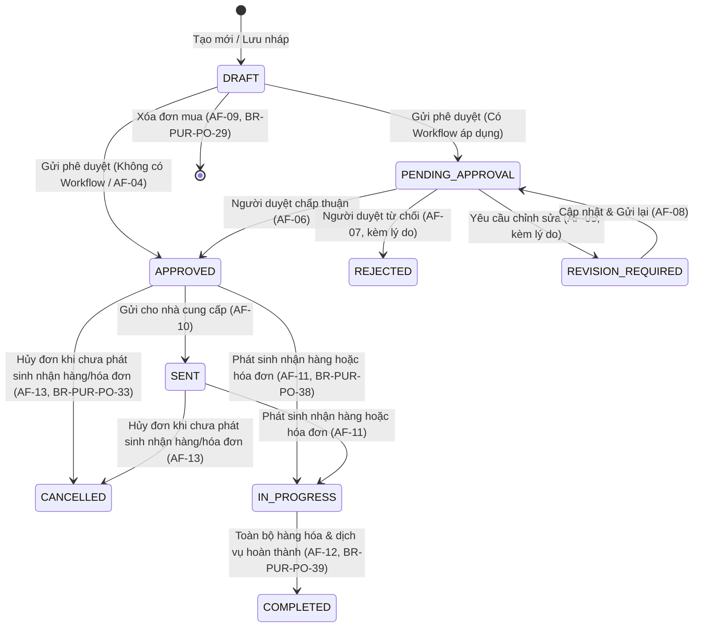

# UC-PUR-02: Quản lý đơn mua hàng (Purchase Order Management API)

Backend cung cấp nghiệp vụ quản lý đơn mua hàng (Purchase Order) tại endpoint `/api/v1/purchases/purchase-orders/`. Mọi thao tác yêu cầu xác thực người dùng, quyền hạn `PUR.ORDER.*` và phạm vi dữ liệu (Data Scope) hợp lệ trong doanh nghiệp.

Luôn gửi `company_id=<uuid>` trên query string khi thực hiện các yêu cầu `GET`, `PATCH`, `DELETE`, `POST /submit/`, `POST /approve/`, `POST /reject/`, `POST /request-revision/`, `POST /send/`, `POST /cancel/`, `GET /tracking/`, hoặc gửi `company` trong body khi tạo mới (`POST`).

---

## 1. Thông tin đơn mua hàng

### 1.1. Thông tin chung (Header)

| Trường dữ liệu | Kiểu dữ liệu | Bắt buộc | Mô tả |
| :--- | :--- | :---: | :--- |
| `number` | String (max 80) | Tự động | Số đơn mua duy nhất trong doanh nghiệp. Hệ thống tự sinh theo quy tắc đánh số chứng từ. Người dùng không được sửa (BR-PUR-PO-05). |
| `document_date` | Date (YYYY-MM-DD) | Có | Ngày lập đơn mua hàng (BR-PUR-PO-06). |
| `supplier` | UUID (Party) | Có | Nhà cung cấp đang hoạt động (`ACTIVE`) có vai trò VENDOR (BR-PUR-PO-06, 07). |
| `contact_person` | String (max 255) | Không | Người liên hệ của nhà cung cấp. |
| `branch` | UUID (Branch) | Có | Chi nhánh thực hiện mua hàng thuộc Data Scope của User (BR-PUR-PO-06). |
| `buyer` | UUID (UserAccount) | Có | Người mua hàng, mặc định là User đang đăng nhập nếu không truyền. |
| `purchase_request` | UUID (PurchaseRequest) | Không | Yêu cầu mua hàng được dùng để lập đơn. |
| `delivery_date` | Date (YYYY-MM-DD) | Có | Ngày dự kiến nhận hàng/hoàn thành dịch vụ (`delivery_date >= document_date`) (BR-PUR-PO-06, 12). |
| `receiving_location` | String (max 255) | Có | Địa điểm tiếp nhận hoặc tên kho nhận (BR-PUR-PO-06). |
| `receiving_warehouse`| UUID (Warehouse) | Không | Kho nhận mặc định của đơn. |
| `payment_term` | UUID (PaymentTerm) | Không | Điều khoản thanh toán áp dụng. |
| `payment_method_config` | UUID (PaymentMethod) | Không | Phương thức thanh toán áp dụng. |
| `contract_or_quotation_no` | String (max 100) | Không | Số hợp đồng hoặc số báo giá liên quan của nhà cung cấp. |
| `currency` | UUID (Currency) | Có | Tiền tệ của đơn mua hàng. |
| `exchange_rate` | Decimal | Không | Tỷ giá quy đổi (mặc định 1). |
| `notes` | String (max 500) | Không | Diễn giải, nội dung chung (tối đa 500 ký tự) (BR-PUR-PO-13). |
| `attachments` | Array of Objects | Không | Tệp đính kèm ($\le$ 10 MB, định dạng: PDF, DOCX, XLSX, PNG, JPG, JPEG) (BR-PUR-PO-41). |
| `status` | Choice | Tự động | Trạng thái xử lý (`DRAFT`, `PENDING_APPROVAL`, `REVISION_REQUIRED`, `APPROVED`, `SENT`, `IN_PROGRESS`, `COMPLETED`, `REJECTED`, `CANCELLED`). |
| `receiving_status` | Choice | Tự động | Tiến độ nhận hàng (`NOT_RECEIVED`, `PARTIALLY_RECEIVED`, `FULLY_RECEIVED`). |
| `invoicing_status` | Choice | Tự động | Tiến độ hóa đơn (`NOT_INVOICED`, `PARTIALLY_INVOICED`, `FULLY_INVOICED`). |
| `version` | Integer | Tự động | Phiên bản dữ liệu phục vụ khóa lạc quan (Optimistic Concurrency Control) (EF-11). |
| `total_amount` | Decimal (20, 4) | Tự động | Tổng giá trị đơn hàng (tổng thành tiền các dòng) (BR-PUR-PO-19). |

### 1.2. Chi tiết hàng hóa, dịch vụ (Lines)

| Trường dữ liệu | Kiểu dữ liệu | Bắt buộc | Mô tả |
| :--- | :--- | :---: | :--- |
| `line_no` | Integer | Tự động | Thứ tự dòng trong đơn mua hàng (1, 2, 3...). |
| `item` | UUID (Item) | Có | Vật tư/Hàng hóa/Dịch vụ đang hoạt động (`ACTIVE`). |
| `description` | Text | Không | Diễn giải, mô tả chi tiết cho từng dòng. |
| `warehouse` | UUID (Warehouse) | Có điều kiện | Bắt buộc đối với hàng hóa theo dõi qua kho (`track_inventory=True` hoặc không phải `SERVICE`) (BR-PUR-PO-09). |
| `uom` | UUID (UnitOfMeasure) | Có | Đơn vị tính của hàng hóa/dịch vụ. |
| `quantity` | Decimal (20, 6) | Có | Số lượng đặt ($> 0$, tối đa 6 chữ số thập phân) (BR-PUR-PO-10). |
| `unit_price` | Decimal (18, 4) | Có | Đơn giá ($\ge 0$) (BR-PUR-PO-11). |
| `discount_rate` | Decimal (5, 2) | Không | Tỷ lệ chiết khấu ($0\% \le \text{discount\_rate} \le 100\%$) (BR-PUR-PO-11). |
| `discount_amount` | Decimal (20, 4) | Tự động | Tiền chiết khấu = `quantity * unit_price * discount_rate / 100` (BR-PUR-PO-15). |
| `pre_tax_amount` | Decimal (20, 4) | Tự động | Tiền trước thuế = `(quantity * unit_price) - discount_amount` (BR-PUR-PO-16). |
| `tax_rate` | UUID (TaxRate) | Không | Thuế suất dự kiến áp dụng. |
| `tax_amount` | Decimal (20, 4) | Tự động | Tiền thuế = `pre_tax_amount * tax_percentage` (BR-PUR-PO-17). |
| `line_total` | Decimal (20, 4) | Tự động | Thành tiền = `pre_tax_amount + tax_amount` (BR-PUR-PO-18). |
| `delivery_date` | Date (YYYY-MM-DD) | Không | Ngày giao riêng của dòng. Nếu để trống, lấy theo `delivery_date` chung. |
| `notes` | String (max 500) | Không | Ghi chú dòng hàng (tối đa 500 ký tự) (BR-PUR-PO-13). |
| `received_quantity` | Decimal (20, 6) | Tự động | Số lượng đã nhận kho hoặc đã nghiệm thu dịch vụ. |
| `invoiced_quantity` | Decimal (20, 6) | Tự động | Số lượng đã ghi nhận hóa đơn. |
| `cancelled_quantity`| Decimal (20, 6) | Tự động | Số lượng đã hủy bỏ nghĩa vụ. |
| `remaining_quantity`| Decimal (20, 6) | Tự động | Số lượng còn lại phải thực hiện = `quantity - received_quantity - cancelled_quantity`. |
| `request_links` | Array | Không | Danh sách liên kết với dòng của Purchase Request (`request_line`, `quantity`). |

---

## 2. Vòng đời trạng thái (Document Lifecycle)

---

## 3. Bảng tổng hợp API Endpoints & Quyền hạn

| Hành động | Endpoint | HTTP Method | Quyền IAM | Mô tả |
| :--- | :--- | :---: | :--- | :--- |
| **Danh sách đơn mua** | `/api/v1/purchases/purchase-orders/` | `GET` | `PUR.ORDER.VIEW` | Xem danh sách đơn mua thuộc Data Scope |
| **Chi tiết đơn mua** | `/api/v1/purchases/purchase-orders/{id}/` | `GET` | `PUR.ORDER.VIEW` | Xem chi tiết thông tin, các dòng hàng và tệp đính kèm |
| **Tạo mới (Lưu nháp)** | `/api/v1/purchases/purchase-orders/` | `POST` | `PUR.ORDER.CREATE` | Tạo đơn mua mới ở trạng thái `DRAFT` |
| **Cập nhật nội dung** | `/api/v1/purchases/purchase-orders/{id}/` | `PATCH` | `PUR.ORDER.EDIT` | Chỉ cho phép khi trạng thái là `DRAFT` hoặc `REVISION_REQUIRED` (BR-PUR-PO-28) |
| **Xóa đơn mua** | `/api/v1/purchases/purchase-orders/{id}/` | `DELETE` | `PUR.ORDER.DELETE` | Chỉ xóa khi trạng thái `DRAFT` chưa nhận hàng; hoàn lại số lượng PR (AF-09) |
| **Gửi phê duyệt** | `/api/v1/purchases/purchase-orders/{id}/submit/` | `POST` | `PUR.ORDER.SUBMIT` | Chuyển sang `PENDING_APPROVAL` hoặc tự động `APPROVED` nếu không có workflow |
| **Phê duyệt** | `/api/v1/purchases/purchase-orders/{id}/approve/` | `POST` | `PUR.ORDER.APPROVE` | Chấp thuận đơn mua hàng (AF-06) |
| **Từ chối** | `/api/v1/purchases/purchase-orders/{id}/reject/` | `POST` | `PUR.ORDER.REJECT` | Từ chối đơn mua (bắt buộc `comment`) (AF-07) |
| **Yêu cầu chỉnh sửa**| `/api/v1/purchases/purchase-orders/{id}/request-revision/` | `POST` | `PUR.ORDER.APPROVE` | Chuyển sang `REVISION_REQUIRED` (bắt buộc `comment`) (AF-05) |
| **Gửi nhà cung cấp**| `/api/v1/purchases/purchase-orders/{id}/send/` | `POST` | `PUR.ORDER.SEND` | Đánh dấu đơn `APPROVED` đã gửi cho NCC -> chuyển sang `SENT` (AF-10) |
| **Hủy đơn mua hàng** | `/api/v1/purchases/purchase-orders/{id}/cancel/` | `POST` | `PUR.ORDER.CANCEL` | Hủy đơn `APPROVED`/`SENT` chưa nhận hàng; hoàn lại số lượng PR (AF-13) |
| **Đóng đơn mua** | `/api/v1/purchases/purchase-orders/{id}/close/` | `POST` | `PUR.ORDER.CLOSE` | Chuyển đơn sang `COMPLETED` |
| **Theo dõi thực hiện** | `/api/v1/purchases/purchase-orders/{id}/tracking/` | `GET` | `PUR.ORDER.VIEW` | Theo dõi chi tiết tiến độ nhận hàng, hóa đơn, thanh toán (BR-PUR-PO-40) |
| **Lịch sử phê duyệt**| `/api/v1/purchases/purchase-orders/{id}/approval-history/` | `GET` | `PUR.ORDER.VIEW` | Xem lịch sử các quyết định và ý kiến phê duyệt |

---

## 4. Xử lý ngoại lệ và Thông báo lỗi chuẩn hóa (Exception Flows)

| Mã lỗi | Điều kiện phát sinh | HTTP Status | Thông báo lỗi tiếng Việt |
| :--- | :--- | :---: | :--- |
| **EF-01** | User không có quyền lập đơn mua hàng | 403 Forbidden | `Bạn không có quyền lập đơn mua hàng.` |
| **EF-02** | Yêu cầu mua hàng không còn trạng thái cho phép hoặc hết số lượng | 400 Bad Request | `Yêu cầu mua hàng không còn số lượng có thể đặt mua.` |
| **EF-03** | Thiếu trường bắt buộc (nhà cung cấp, ngày, chi nhánh, địa điểm nhận...) | 400 Bad Request | `Vui lòng nhập đầy đủ các trường bắt buộc.` |
| **EF-04** | Đơn không có dòng hàng hóa, dịch vụ nào | 400 Bad Request | `Đơn mua hàng phải có ít nhất một dòng hàng.` |
| **EF-05** | Số lượng đặt nhỏ hơn hoặc bằng 0 | 400 Bad Request | `Số lượng đặt phải lớn hơn 0.` |
| **EF-06** | Số lượng đặt vượt quá số lượng còn lại của yêu cầu mua hàng | 400 Bad Request | `Số lượng đặt vượt quá số lượng còn lại của yêu cầu mua hàng.` |
| **EF-07** | Ngày giao dự kiến trước Ngày đặt hàng | 400 Bad Request | `Ngày giao dự kiến không được trước Ngày đặt hàng.` |
| **EF-08** | Nhà cung cấp hoặc dữ liệu danh mục đã ngừng sử dụng (`INACTIVE`) | 400 Bad Request | `Dữ liệu được chọn đã ngừng sử dụng. Vui lòng chọn lại.` |
| **EF-09** | Quyền truy cập hoặc Data Scope của người dùng đã thay đổi | 403 Forbidden | `Quyền truy cập của bạn đã thay đổi. Vui lòng tải lại trang.` |
| **EF-10** | Không xác định được người phê duyệt trong workflow | 400 Bad Request | `Không xác định được người phê duyệt. Vui lòng liên hệ Admin doanh nghiệp.` |
| **EF-11** | Đơn mua đã bị người dùng khác chỉnh sửa (xung đột `version`) | 409 Conflict | `Dữ liệu đã được người khác cập nhật. Vui lòng tải lại trang.` |
| **EF-12** | Hủy đơn khi đơn đã phát sinh nhận hàng hoặc hóa đơn | 400 Bad Request | `Đơn mua hàng đã phát sinh dữ liệu liên quan và không thể hủy.` |
| **EF-13** | Phiên đăng nhập hết hạn | 401 Unauthorized| `Phiên đăng nhập đã hết hạn. Vui lòng đăng nhập lại.` |
| **EF-14** | Mất kết nối hoặc lỗi gián đoạn hệ thống | 500 / 503 | `Không thể lưu đơn mua hàng. Vui lòng kiểm tra kết nối và thử lại.` |

---

## 5. Danh mục các quy tắc nghiệp vụ cốt lõi (Business Rules)

- **BR-PUR-PO-05**: Mã chứng từ tự sinh theo quy tắc doanh nghiệp (`PO-XXXX`), duy nhất trong doanh nghiệp và User không thể chỉnh sửa.
- **BR-PUR-PO-08**: Đơn mua hàng bắt buộc phải có ít nhất một dòng vật tư, hàng hóa hoặc dịch vụ.
- **BR-PUR-PO-09**: Hàng hóa theo dõi qua kho (`track_inventory=True`) bắt buộc phải có kho nhận (`warehouse` trên dòng hoặc `receiving_warehouse` trên header). Hàng dịch vụ (`SERVICE`) không bắt buộc kho nhận.
- **BR-PUR-PO-10 / 11**: Số lượng đặt $> 0$ (tối đa 6 chữ số thập phân); đơn giá $\ge 0$; chiết khấu $0\% \le \text{rate} \le 100\%$.
- **BR-PUR-PO-14..19**: Tự động tính tiền chiết khấu, tiền trước thuế, tiền thuế, thành tiền từng dòng và tổng tiền đơn mua.
- **BR-PUR-PO-20..25**: Chỉ cho phép lập đơn từ Purchase Request có trạng thái `APPROVED` hoặc `PARTIALLY_ORDERED`. Số lượng đặt không vượt quá số lượng còn lại của từng dòng PR. Khi xóa hoặc hủy đơn mua, số lượng đã đặt của PR được hoàn lại tự động.
- **BR-PUR-PO-28**: Chỉ cho phép chỉnh sửa đơn hàng khi trạng thái là `DRAFT` hoặc `REVISION_REQUIRED`. Khóa chỉnh sửa đối với đơn `APPROVED`, `SENT`, `IN_PROGRESS`, `COMPLETED`, `CANCELLED`, `REJECTED`.
- **BR-PUR-PO-33 / 34**: Đơn chỉ được hủy khi ở trạng thái `APPROVED` hoặc `SENT` và chưa phát sinh nhận hàng/hóa đơn; bắt buộc phải nhập lý do hủy từ 1–500 ký tự.
- **BR-PUR-PO-41**: Tệp đính kèm tối đa 10 MB/tệp; định dạng cho phép: PDF, DOCX, XLSX, PNG, JPG, JPEG.
- **BR-PUR-PO-43 / 44**: Tự động ghi nhận Audit Log cho mọi hành vi tạo, sửa, xóa, gửi duyệt, phê duyệt, từ chối, yêu cầu chỉnh sửa, gửi nhà cung cấp, hủy đơn và đóng đơn.

---

## 6. Kết quả kiểm thử tự động (Automated Test Suite)

Toàn bộ 15 nhóm kiểm thử nghiệp vụ của `UC-PUR-02` được triển khai tại [`purchases/test_purchase_order.py`](file:///c:/Users/Admin/LapTrinh/Thue/purchases/test_purchase_order.py):

| Test Method | Tình huống kiểm thử | Kết quả |
| :--- | :--- | :---: |
| `test_01_permissions_and_scope` | Phân quyền truy cập `PUR.ORDER.VIEW`, `CREATE`, Data Scope chi nhánh (BR-PUR-PO-01..04, EF-01) | PASS |
| `test_02_header_field_validation` | Xác thực trường thông tin chung: tự sinh mã, bắt buộc, ngày giao $\ge$ ngày đặt, catalog ngừng hoạt động (BR-PUR-PO-05..07, 12, EF-03, EF-07, EF-08) | PASS |
| `test_03_line_field_validation` | Xác thực chi tiết dòng: ít nhất 1 dòng, số lượng $> 0$, kho nhận bắt buộc cho hàng kho, đơn giá $\ge 0$, chiết khấu $\le 100\%$ (BR-PUR-PO-08..11, 13, EF-04, EF-05) | PASS |
| `test_04_amount_calculations` | Tính toán tiền trước chiết khấu, chiết khấu, trước thuế, tiền thuế, thành tiền và tổng tiền (BR-PUR-PO-14..19) | PASS |
| `test_05_create_direct_po_without_pr` | Lập đơn mua trực tiếp không qua PR (AF-01, BR-PUR-PO-26, 27) và kiểm tra Audit Log (BR-PUR-PO-43) | PASS |
| `test_06_create_po_from_pr_auto_populate_and_quantities` | Lập đơn từ PR: auto populate, kiểm tra trạng thái PR, chặn vượt số lượng duyệt, chia tách nhiều PO (AF-02, BR-PUR-PO-20..23, EF-02, EF-06) | PASS |
| `test_07_approval_lifecycle_no_workflow_vs_with_workflow` | Submit không có workflow $\rightarrow$ `APPROVED` trực tiếp (AF-04, BR-PUR-PO-31). Submit có workflow $\rightarrow$ `PENDING_APPROVAL` $\rightarrow$ `APPROVE` (AF-06, BR-PUR-PO-30, 32) | PASS |
| `test_08_revision_flow_and_editing_in_draft_vs_approved` | Yêu cầu chỉnh sửa (AF-05), sửa đơn ở `REVISION_REQUIRED` (AF-08), cấm sửa khi `APPROVED` (BR-PUR-PO-28) | PASS |
| `test_09_rejection_flow` | Người phê duyệt từ chối (AF-07, kèm lý do) | PASS |
| `test_10_delete_draft_po_and_pr_quantity_reversal` | Xóa đơn ở `DRAFT` hoàn lại số lượng PR (AF-09, BR-PUR-PO-24, 29). Chặn xóa đơn ngoài `DRAFT` | PASS |
| `test_11_send_order_to_vendor` | Gửi đơn cho nhà cung cấp: chỉ đơn `APPROVED` mới được gửi $\rightarrow$ chuyển sang `SENT` (AF-10) | PASS |
| `test_12_cancel_order_and_execution_blocking` | Hủy đơn mua: hoàn lại số lượng PR (AF-13, BR-PUR-PO-24). Chặn hủy khi đã phát sinh nhận hàng (EF-12, BR-PUR-PO-33). Yêu cầu lý do hủy (BR-PUR-PO-34) | PASS |
| `test_13_tracking_endpoint_and_receipts_progress` | Theo dõi tiến độ nhận hàng và đóng đơn hoàn thành (BR-PUR-PO-35..40, AF-11, AF-12) | PASS |
| `test_14_attachments_validation` | Xác thực tệp đính kèm: dung lượng $\le 10$ MB, định dạng PDF, DOCX, XLSX, PNG, JPG, JPEG (BR-PUR-PO-41) | PASS |
| `test_15_optimistic_locking_and_audit_trail` | Khóa lạc quan concurrency control (EF-11) và ghi nhận đầy đủ Audit Log (BR-PUR-PO-43, 44) | PASS |
