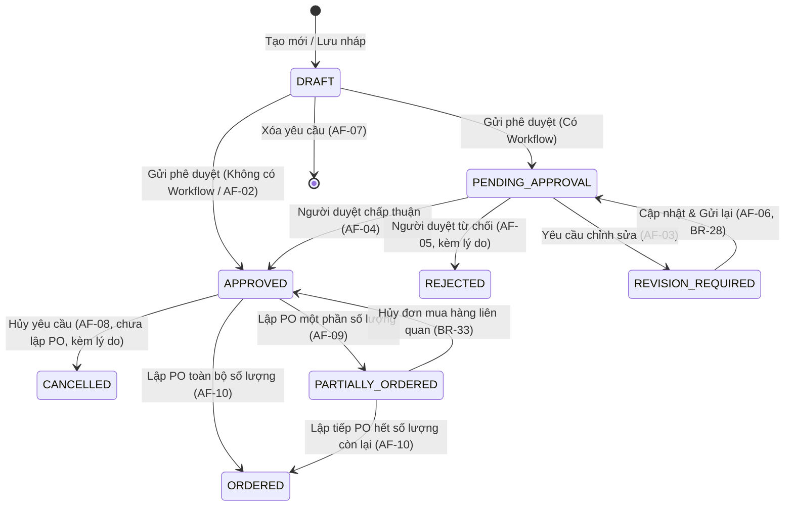

# UC-PUR-01: Quản lý yêu cầu mua hàng (API)

Backend cung cấp nghiệp vụ quản lý yêu cầu mua hàng (Purchase Requisition) tại endpoint `/api/v1/purchases/purchase-requests/`. Mọi thao tác yêu cầu xác thực người dùng, quyền hạn `PUR.REQUEST.*` và phạm vi dữ liệu (Data Scope) hợp lệ trong doanh nghiệp.

Luôn gửi `company_id=<uuid>` trên query string khi thực hiện các yêu cầu `GET`, `PATCH`, `DELETE`, `POST /submit/`, `POST /approve/`, `POST /reject/`, `POST /request-revision/`, `POST /cancel/`, hoặc gửi `company` trong body khi tạo mới (`POST`).

---

## 1. Thông tin yêu cầu mua hàng

### 1.1. Thông tin chung (Header)

| Trường dữ liệu | Kiểu dữ liệu | Bắt buộc | Mô tả |
| :--- | :--- | :---: | :--- |
| `number` | String (max 50) | Tự động | Số yêu cầu mua hàng duy nhất trong doanh nghiệp. Hệ thống tự sinh theo quy tắc đánh số chứng từ. Người dùng không được sửa. |
| `request_date` | Date (YYYY-MM-DD) | Có | Ngày lập yêu cầu mua hàng. |
| `requester` | UUID (UserAccount) | Có | Người yêu cầu. Mặc định là User đang đăng nhập nếu không truyền. |
| `branch` | UUID (Branch) | Có | Chi nhánh phát sinh nhu cầu mua hàng (trong Data Scope của User). |
| `department` | UUID (Department) | Có | Phòng ban đề nghị mua hàng (thuộc chi nhánh đã chọn). |
| `required_date` | Date (YYYY-MM-DD) | Có | Ngày dự kiến cần nhận hàng (`required_date >= request_date`). |
| `purpose` | Text | Có | Lý do hoặc mục đích sử dụng. |
| `receiving_location` | String (max 255) | Không | Kho hoặc địa điểm dự kiến tiếp nhận hàng. |
| `notes` | String (max 500) | Không | Ghi chú bổ sung, tối đa 500 ký tự. |
| `attachments` | Array of Objects | Không | Danh sách tệp đính kèm. Mỗi tệp $\le$ 10 MB, định dạng: PDF, DOCX, XLSX, PNG, JPG, JPEG. |
| `status` | Choice | Tự động | Trạng thái chứng từ (`DRAFT`, `PENDING_APPROVAL`, `REVISION_REQUIRED`, `APPROVED`, `REJECTED`, `CANCELLED`, `PARTIALLY_ORDERED`, `ORDERED`). |
| `version` | Integer | Tự động | Phiên bản dữ liệu phục vụ kiểm soát xung đột ghi đồng thời (Optimistic Concurrency Control). |
| `total_estimated_amount` | Decimal | Tự động | Tổng giá trị dự kiến bằng tổng thành tiền của các dòng chi tiết. |

### 1.2. Chi tiết hàng hóa, dịch vụ (Lines)

| Trường dữ liệu | Kiểu dữ liệu | Bắt buộc | Mô tả |
| :--- | :--- | :---: | :--- |
| `line_no` | Integer | Tự động | Thứ tự dòng trong yêu cầu (1, 2, 3...). |
| `item` | UUID (Item) | Có | Vật tư/Hàng hóa/Dịch vụ thuộc danh mục đang hoạt động (`ACTIVE`). |
| `description` | Text | Không | Diễn giải, mô tả chi tiết cho từng dòng. |
| `uom` | UUID (Uom) | Có | Đơn vị tính lấy theo danh mục hàng hóa đang hoạt động. |
| `quantity` | Decimal (20, 6) | Có | Số lượng yêu cầu ($> 0$), tối đa 6 chữ số thập phân. |
| `estimated_unit_price`| Decimal (18, 4) | Không | Đơn giá dự kiến ($\ge 0$). Giá trị tham khảo, không phải giá mua chính thức. |
| `estimated_amount` | Decimal (20, 4) | Tự động | Thành tiền dự kiến = `quantity * (estimated_unit_price or 0)`. |
| `required_date` | Date (YYYY-MM-DD) | Không | Ngày cần hàng riêng của dòng. Nếu để trống, kế thừa từ `required_date` của phần chung. |
| `notes` | String (max 500) | Không | Ghi chú riêng cho từng dòng, tối đa 500 ký tự. |
| `ordered_quantity` | Decimal (20, 6) | Tự động | Số lượng đã đưa vào đơn mua hàng (`PurchaseOrder`). |
| `remaining_quantity` | Decimal (20, 6) | Tự động | Số lượng còn lại chưa đặt mua = `quantity - ordered_quantity`. |

---

## 2. Vòng đời trạng thái (Document Lifecycle)

---

## 3. Bảng tổng hợp API Endpoints & Quyền hạn

| Hành động | Endpoint | HTTP Method | Quyền IAM | Mô tả |
| :--- | :--- | :---: | :--- | :--- |
| **Danh sách yêu cầu** | `/api/v1/purchases/purchase-requests/` | `GET` | `PUR.REQUEST.VIEW` | Xem danh sách yêu cầu thuộc Data Scope |
| **Chi tiết yêu cầu** | `/api/v1/purchases/purchase-requests/{id}/` | `GET` | `PUR.REQUEST.VIEW` | Xem chi tiết thông tin, các dòng hàng và tệp đính kèm |
| **Tạo mới (Lưu nháp)** | `/api/v1/purchases/purchase-requests/` | `POST` | `PUR.REQUEST.CREATE` | Tạo yêu cầu mới ở trạng thái `DRAFT` |
| **Cập nhật nội dung** | `/api/v1/purchases/purchase-requests/{id}/` | `PATCH` | `PUR.REQUEST.EDIT` | Chỉ cho phép khi trạng thái là `DRAFT` hoặc `REVISION_REQUIRED` |
| **Xóa yêu cầu** | `/api/v1/purchases/purchase-requests/{id}/` | `DELETE` | `PUR.REQUEST.DELETE` | Chỉ xóa khi trạng thái `DRAFT` và chưa liên kết dữ liệu |
| **Gửi phê duyệt** | `/api/v1/purchases/purchase-requests/{id}/submit/` | `POST` | `PUR.REQUEST.SUBMIT` | Chuyển sang `PENDING_APPROVAL` hoặc `APPROVED` |
| **Phê duyệt** | `/api/v1/purchases/purchase-requests/{id}/approve/` | `POST` | `PUR.REQUEST.APPROVE` | Chấp thuận yêu cầu mua hàng |
| **Từ chối** | `/api/v1/purchases/purchase-requests/{id}/reject/` | `POST` | `PUR.REQUEST.REJECT` | Từ chối yêu cầu (bắt buộc truyền `comment`) |
| **Yêu cầu chỉnh sửa**| `/api/v1/purchases/purchase-requests/{id}/request-revision/` | `POST` | `PUR.REQUEST.APPROVE` | Chuyển sang `REVISION_REQUIRED` (bắt buộc `comment`) |
| **Hủy yêu cầu đã duyệt** | `/api/v1/purchases/purchase-requests/{id}/cancel/` | `POST` | `PUR.REQUEST.CANCEL` | Hủy yêu cầu `APPROVED` chưa lập PO (bắt buộc `reason`) |
| **Lịch sử phê duyệt**| `/api/v1/purchases/purchase-requests/{id}/approval-history/` | `GET` | `PUR.REQUEST.VIEW` | Xem các quyết định phê duyệt và nhận xét |

---

## 4. Xử lý ngoại lệ và Thông báo lỗi chuẩn hóa (Exception Flows)

| Mã lỗi | Điều kiện phát sinh | HTTP Status | Thông báo lỗi tiếng Việt |
| :--- | :--- | :---: | :--- |
| **EF-01** | User không có quyền lập/xem yêu cầu mua hàng | 403 Forbidden | `Bạn không có quyền lập yêu cầu mua hàng.` |
| **EF-02** | Thiếu trường dữ liệu bắt buộc (ngày, chi nhánh, phòng ban, mục đích...) | 400 Bad Request | `Vui lòng nhập đầy đủ các trường bắt buộc.` |
| **EF-03** | Yêu cầu không có dòng hàng hóa, dịch vụ nào | 400 Bad Request | `Yêu cầu mua hàng phải có ít nhất một dòng hàng.` |
| **EF-04** | Số lượng yêu cầu dòng $\le 0$ | 400 Bad Request | `Số lượng yêu cầu phải lớn hơn 0.` |
| **EF-05** | Ngày cần hàng trước Ngày yêu cầu | 400 Bad Request | `Ngày cần hàng không được trước Ngày yêu cầu.` |
| **EF-06** | Vật tư, hàng hóa, chi nhánh, phòng ban đã ngừng sử dụng (`INACTIVE`) | 400 Bad Request | `Dữ liệu được chọn đã ngừng sử dụng. Vui lòng chọn lại.` |
| **EF-07** | Quyền hạn hoặc Data Scope của người dùng đã thay đổi | 403 Forbidden | `Quyền truy cập của bạn đã thay đổi. Vui lòng tải lại trang.` |
| **EF-08** | Có Workflow phê duyệt nhưng không xác định được người phê duyệt | 400 Bad Request | `Không xác định được người phê duyệt. Vui lòng liên hệ Admin doanh nghiệp.` |
| **EF-09** | Xung đột phiên bản khi chỉnh sửa (Optimistic Lock) | 409 Conflict | `Dữ liệu đã được người khác cập nhật. Vui lòng tải lại trang.` |
| **EF-10** | Phiên đăng nhập hết hạn | 401 Unauthorized| `Phiên đăng nhập đã hết hạn. Vui lòng đăng nhập lại.` |
| **EF-11** | Gián đoạn kết nối hoặc lỗi xử lý hệ thống | 500 / 503 | `Không thể lưu yêu cầu mua hàng. Vui lòng kiểm tra kết nối và thử lại.` |

---

## 5. Quy tắc nghiệp vụ cốt lõi (Business Rules)

- **BR-PUR-REQ-06**: Số yêu cầu do hệ thống tự sinh theo cấu hình đánh số chứng từ và phải duy nhất trong doanh nghiệp. Người dùng không được tự sửa.
- **BR-PUR-REQ-10**: Số lượng yêu cầu tối đa 6 chữ số thập phân, lớn hơn 0.
- **BR-PUR-REQ-15**: Yêu cầu mua hàng **không làm phát sinh** bút toán kế toán, công nợ, nhập kho hoặc thanh toán.
- **BR-PUR-REQ-17**: Chỉ yêu cầu ở `DRAFT` hoặc `REVISION_REQUIRED` mới được sửa nội dung.
- **BR-PUR-REQ-18 & 19**: Chỉ yêu cầu ở `DRAFT` và chưa liên kết dữ liệu mới được xóa. Các trạng thái khác bị chặn xóa.
- **BR-PUR-REQ-20**: Yêu cầu `APPROVED` chỉ được hủy khi chưa phát sinh đơn mua hàng (`PurchaseOrder`). User phải nhập lý do hủy từ 1–500 ký tự.
- **BR-PUR-REQ-24 & 25**: Khi gửi phê duyệt: nếu có Workflow áp dụng, chuyển sang `PENDING_APPROVAL`; nếu không có Workflow hoặc không yêu cầu phê duyệt, chuyển trực tiếp sang `APPROVED`.
- **BR-PUR-REQ-29 & 30**: Chỉ yêu cầu ở `APPROVED` hoặc `PARTIALLY_ORDERED` mới được dùng để lập đơn mua hàng tại `UC-PUR-02`. Tổng số lượng đặt không được vượt quá số lượng còn lại.
- **BR-PUR-REQ-31 & 32**: Tự động chuyển trạng thái sang `PARTIALLY_ORDERED` khi đặt một phần và `ORDERED` khi đặt toàn bộ.
- **BR-PUR-REQ-33**: Việc hủy đơn mua hàng cập nhật lại `ordered_quantity` và khôi phục trạng thái `APPROVED` hoặc `PARTIALLY_ORDERED` của yêu cầu mua.
- **BR-PUR-REQ-34**: Tệp đính kèm không vượt quá 10 MB/tệp; định dạng cho phép gồm PDF, DOCX, XLSX, PNG, JPG, JPEG.
- **BR-PUR-REQ-36 & 37**: Ghi Audit Log với đầy đủ Mã yêu cầu, User thực hiện, hành động, trạng thái trước, trạng thái sau, thời điểm và kết quả.
