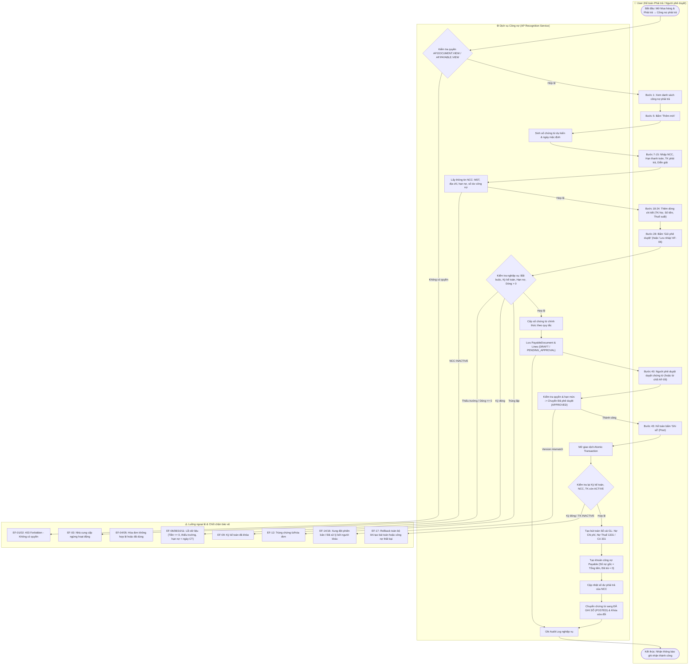
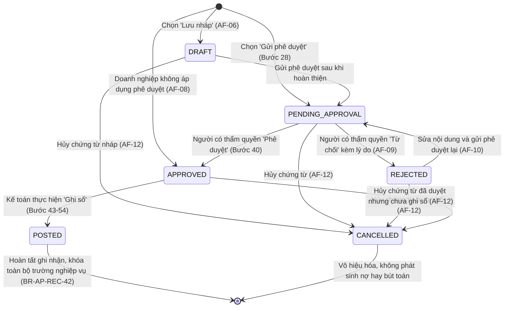
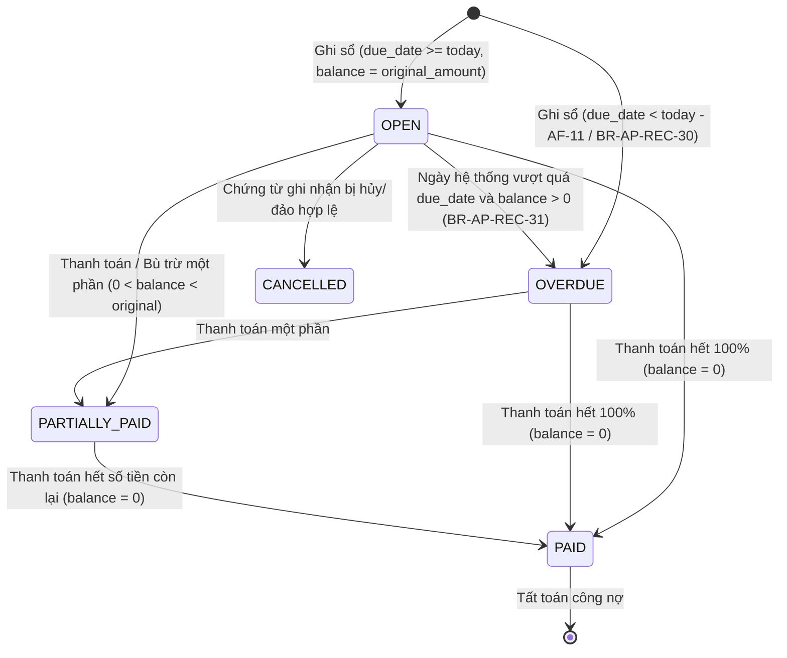

# UC-AP-01: Ghi nhận công nợ phải trả (Accounts Payable Recognition) - Backend Architecture & API Specification

Tài liệu thiết kế kiến trúc kỹ thuật và đặc tả API Backend cho nghiệp vụ **UC-AP-01: Ghi nhận công nợ phải trả**.  
Hệ thống tuân thủ toàn diện 47 quy tắc nghiệp vụ (**BR-AP-REC-01** đến **BR-AP-REC-47**), luồng chính (**Activity Flow 1–56**), 12 luồng thay thế (**AF-01** đến **AF-12**) và 19 chốt chặn ngoại lệ (**EF-01** đến **EF-19**).

---

## 1. Tổng quan Kiến trúc Backend

```
┌────────────────────────────────────────────────────────────────────────┐
│                        CÁC NGUỒN PHÁT SINH CÔNG NỢ                     │
│  A. Trực tiếp (Direct): User lập chứng từ công nợ phải trả khác       │
│  B. Tự động (Automated): Mua hàng hóa, dịch vụ, chi phí mua hàng       │
└───────────────────────────────────┬────────────────────────────────────┘
                                    │
                                    ▼
       ┌─────────────────────────────────────────────────────────┐
       │                UC-AP-01 Recognition Service             │
       │  - Kiểm tra điều kiện tiên quyết & phân quyền IAM        │
       │  - Kiểm tra kỳ kế toán mở & tài khoản kế toán hợp lệ     │
       │  - Tự sinh số chứng từ theo DocumentNumberingRule        │
       │  - Quy trình phê duyệt cấp thẩm quyền (Workflow)        │
       │  - Hạch toán đồng bộ Sổ cái (GL) & Sổ công nợ (AP)      │
       │  - Giao dịch nguyên tử (Atomic Transaction Rollback)     │
       └────────────────────────────┬────────────────────────────┘
                                    │
            ┌───────────────────────┴───────────────────────┐
            ▼                                               ▼
┌──────────────────────────────┐              ┌──────────────────────────────┐
│     ap_payable_document      │1           N │  ap_payable_document_line    │
│  - number (CNPT-YYYY-XXXXX)  │─────────────▶│  - line_no, description      │
│  - supplier_id, due_date     │              │  - debit_account (TK Nợ)     │
│  - payable_account (TK 331)  │              │  - amount (> 0), tax_amount  │
│  - subtotal, tax, total      │              │  - cost_center, expense_item │
│  - status (DRAFT -> POSTED)  │              └──────────────────────────────┘
└──────────────┬───────────────┘
               │ 1 (khi GHI SỔ / POSTED)
               ├────────────────────────────────────────────┐
               ▼ 1                                          ▼ 1
┌──────────────────────────────┐              ┌──────────────────────────────┐
│          ap_payable          │              │       gl_journal_entry       │
│  - original_amount, balance  │              │  - Nợ TK Chi phí/Tài sản     │
│  - due_date, status          │              │  - Nợ TK 1331 (Thuế GTGT)    │
│  - is_overdue (cảnh báo)     │              │  - Có TK 331 (Phải trả NCC)  │
└──────────────────────────────┘              └──────────────────────────────┘
```

---

## 2. Sơ đồ Hoạt động (Activity Diagram - Mermaid)



---

## 3. Vòng đời Trạng thái Chứng từ & Công nợ (State Diagram)

### 3.1. Vòng đời Chứng từ Công nợ Phải trả (`PayableDocument.status`)



### 3.2. Vòng đời Khoản Công nợ Phải trả (`Payable.status`)



---

## 4. Mô hình Dữ liệu (Database Models)

### 4.1. `PayableDocument` (`ap_payable_document`)
Lưu trữ thông tin chứng từ ghi nhận công nợ phải trả (lập trực tiếp hoặc liên kết nguồn):

| Trường | Kiểu dữ liệu | Ràng buộc | Mô tả |
|---|---|---|---|
| `id` | UUID | PK, default uuid4 | Định danh duy nhất |
| `company` | FK Company | on_delete PROTECT | Doanh nghiệp sở hữu |
| `branch` | FK Branch | null, blank, PROTECT | Chi nhánh hạch toán |
| `number` | CharField(80) | uq(company, number) | Số chứng từ (CNPT-YYYY-XXXXX) |
| `document_date` | DateField | Bắt buộc | Ngày chứng từ phát sinh nghĩa vụ nợ |
| `posting_date` | DateField | Bắt buộc | Ngày hạch toán vào sổ kế toán |
| `supplier` | FK Party | on_delete PROTECT | Nhà cung cấp phải thanh toán |
| `source_type` | CharField(20) | PURCHASE / OTHER | Nguồn phát sinh công nợ |
| `source_document_type` | CharField(50) | blank=True | Loại chứng từ nguồn (nếu có) |
| `source_document_id` | CharField(100) | blank=True | ID chứng từ nguồn |
| `source_document_number`| CharField(100) | blank=True | Số chứng từ nguồn |
| `due_date` | DateField | Bắt buộc | Hạn thanh toán (>= document_date) |
| `payment_term` | FK PaymentTerm | null, blank, PROTECT | Điều khoản nợ được thỏa thuận |
| `payable_account` | FK Account | PROTECT (TK 331) | Tài khoản công nợ của nhà cung cấp |
| `tax_account` | FK Account | null, blank, PROTECT | Tài khoản thuế GTGT khấu trừ (TK 1331) |
| `invoice` | FK SupplierInvoice | null, blank, PROTECT | Hóa đơn đầu vào liên quan |
| `currency` | FK Currency | on_delete PROTECT | Loại tiền tệ giao dịch |
| `exchange_rate` | Decimal(20, 8) | > 0, default 1 | Tỷ giá quy đổi |
| `subtotal` | Decimal(20, 4) | >= 0 | Tổng tiền trước thuế các dòng |
| `tax_amount` | Decimal(20, 4) | >= 0 | Tổng tiền thuế GTGT |
| `total_amount` | Decimal(20, 4) | > 0 (= subtotal + tax) | Tổng tiền phải trả nhà cung cấp |
| `description` | CharField(500) | blank=True | Diễn giải chung của chứng từ |
| `attachments` | JSONField | default list | Danh sách tệp đính kèm (hợp đồng, biên bản) |
| `status` | CharField(30) | DocumentStatus | DRAFT, PENDING_APPROVAL, APPROVED... |
| `approval_required` | BooleanField | default True | Yêu cầu phê duyệt theo chính sách |
| `workflow_snapshot` | JSONField | default dict | Cấu hình cấp duyệt snapshot |
| `journal_entry` | OneToOne GL | null, blank, PROTECT | Bút toán hạch toán trên Sổ cái |
| `posting_reference` | CharField(120) | blank=True | Mã tham chiếu ghi sổ |
| `created_by` | FK UserAccount | on_delete PROTECT | Người lập chứng từ |
| `submitted_at` | DateTimeField | null, blank | Thời điểm gửi duyệt |
| `approved_at` | DateTimeField | null, blank | Thời điểm phê duyệt |
| `posted_at` | DateTimeField | null, blank | Thời điểm ghi sổ thành công |
| `cancelled_at` | DateTimeField | null, blank | Thời điểm hủy |
| `cancellation_reason` | CharField(500) | blank=True | Lý do hủy chứng từ |
| `rejection_reason` | CharField(500) | blank=True | Lý do người duyệt từ chối |
| `version` | PositiveIntegerField | default 1 | Phiên bản kiểm soát đồng thời (OCC) |

### 4.2. `PayableDocumentLine` (`ap_payable_document_line`)
Chi tiết các khoản chi phí, tài sản, dịch vụ cấu thành công nợ:

| Trường | Kiểu dữ liệu | Ràng buộc | Mô tả |
|---|---|---|---|
| `id` | UUID | PK, default uuid4 | Định danh duy nhất của dòng |
| `document` | FK PayableDocument | on_delete CASCADE | Liên kết chứng từ công nợ cha |
| `line_no` | PositiveIntegerField | uq(document, line_no) | Số thứ tự dòng (1, 2, 3...) |
| `description` | CharField(500) | Bắt buộc | Nội dung khoản phải trả |
| `debit_account` | FK Account | on_delete PROTECT | Tài khoản ghi Nợ (TK chi phí/tài sản) |
| `amount` | Decimal(20, 4) | > 0 (BR-AP-REC-22) | Số tiền trước thuế |
| `tax_rate` | FK TaxRate | null, blank, PROTECT | Thuế suất GTGT áp dụng |
| `tax_rate_percent` | Decimal(9, 4) | null, blank | Phần trăm thuế suất (%) |
| `tax_amount` | Decimal(20, 4) | >= 0 | Tiền thuế GTGT của dòng |
| `total_amount` | Decimal(20, 4) | = amount + tax_amount | Tổng tiền của dòng |
| `cost_center` | FK CostCenter | null, blank, PROTECT | Bộ phận / Trung tâm chi phí |
| `expense_item` | FK ExpenseItem | null, blank, PROTECT | Khoản mục chi phí |
| `statistical_code` | FK StatisticalCode | null, blank, PROTECT | Mã thống kê quản trị |

### 4.3. Cập nhật `Payable` (`ap_payable`)
Mở rộng liên kết nguồn cho `Payable` để hỗ trợ chứng từ ghi nhận công nợ trực tiếp:
- Thêm trường: `document = models.OneToOneField(PayableDocument, on_delete=models.PROTECT, related_name="payable", null=True, blank=True)`.
- Ràng buộc nguồn duy nhất `ck_ap_payable_one_source`: Đảm bảo mỗi khoản công nợ chỉ trỏ về đúng 1 nguồn (`invoice`, `goods_purchase`, `purchase_cost`, hoặc `document`).
- Bổ sung property cảnh báo quá hạn `is_overdue` và trạng thái `OVERDUE` tự động tính theo ngày hệ thống (BR-AP-REC-30, BR-AP-REC-31).

---

## 5. Đặc tả Danh mục API Endpoints

Base URL: `/api/v1/accounts-payable/documents/`

### 5.1. Xem số chứng từ dự kiến (`GET /preview-number/`)
- **Mục đích**: Đáp ứng Bước 8 của Activity Flow. Hiển thị số chứng từ dự kiến khi mở form thêm mới mà không làm phát sinh chứng từ trong CSDL (BR-AP-REC-01).
- **Query Params**: `company_id` (bắt buộc), `branch_id` (tùy chọn), `document_date` (tùy chọn).
- **Phản hồi 200 OK**:
  ```json
  {
    "preview_number": "CNPT-2026-00001",
    "document_date": "2026-10-08",
    "posting_date": "2026-10-08"
  }
  ```

### 5.2. Tra cứu thông tin Nhà cung cấp (`GET /supplier-info/`)
- **Mục đích**: Đáp ứng Bước 11 của Activity Flow. Hiển thị MST, địa chỉ, điều khoản nợ mặc định và số dư nợ hiện tại của NCC.
- **Query Params**: `company_id` (bắt buộc), `supplier_id` (bắt buộc).
- **Phản hồi 200 OK**:
  ```json
  {
    "supplier_id": "3fa85f64-5717-4562-b3fc-2c963f66afa6",
    "supplier_code": "NCC-VINAFOOD",
    "supplier_name": "Công ty TNHH Vinafood",
    "tax_code": "0101234567",
    "address": "123 Phố Huế, Hai Bà Trưng, Hà Nội",
    "payment_term_id": "9b1deb4d-3b7d-4bad-9bdd-2b0d7b3dcb6d",
    "payment_term_code": "NET30",
    "due_days": 30,
    "current_balance": "45000000.0000",
    "status": "ACTIVE"
  }
  ```

### 5.3. Tạo mới chứng từ công nợ (Lưu nháp hoặc Gửi phê duyệt) (`POST /`)
- **Quyền yêu cầu**: `AP.DOCUMENT.CREATE`
- **Request Body**:
  ```json
  {
    "company": "c8ff5419-4567-4279-9134-8c01ba47cf1c",
    "branch": "a910ea76-13ea-44fb-811c-c2b61ff6fe60",
    "document_date": "2026-10-08",
    "posting_date": "2026-10-08",
    "supplier": "3fa85f64-5717-4562-b3fc-2c963f66afa6",
    "source_type": "OTHER",
    "due_date": "2026-11-07",
    "payment_term": "9b1deb4d-3b7d-4bad-9bdd-2b0d7b3dcb6d",
    "payable_account": "10000000-0000-0000-0000-000000000331",
    "tax_account": "10000000-0000-0000-0000-000000001331",
    "invoice": null,
    "currency": "20000000-0000-0000-0000-000000000001",
    "exchange_rate": "1.00000000",
    "description": "Chi phí thuê văn phòng tháng 10/2026",
    "action": "SUBMIT",
    "lines": [
      {
        "line_no": 1,
        "description": "Tiền thuê văn phòng tầng 5",
        "debit_account": "10000000-0000-0000-0000-000000000642",
        "amount": "20000000.0000",
        "tax_rate": "30000000-0000-0000-0000-000000000010",
        "tax_rate_percent": "10.0000",
        "tax_amount": "2000000.0000"
      }
    ],
    "attachments": [
      {
        "file_name": "hop_dong_thue_vp.pdf",
        "file_size": 1048576,
        "content_type": "application/pdf",
        "url": "/media/attachments/hop_dong_thue_vp.pdf"
      }
    ]
  }
  ```
- **Xử lý**:
  - `action == "SAVE_DRAFT"` (AF-06): Kiểm tra thông tin tối thiểu, sinh số chứng từ chính thức, lưu trạng thái `DRAFT`.
  - `action == "SUBMIT"` (Bước 28): Kiểm tra toàn bộ điều kiện ràng buộc (BR-AP-REC-29 đến 34), sinh số chứng từ chính thức, lưu trạng thái `PENDING_APPROVAL` (hoặc `APPROVED` nếu AF-08). Ghi Audit Log.
- **Phản hồi 201 Created**: Trả về dữ liệu chi tiết của `PayableDocument`.

### 5.4. Phê duyệt chứng từ (`POST /{id}/approve/`)
- **Quyền yêu cầu**: `AP.DOCUMENT.APPROVE`
- **Request Body**: `{"comment": "Duyệt chi phí hợp lệ"}`
- **Xử lý**: Kiểm tra quyền phê duyệt, hạn mức (nếu có), trạng thái `PENDING_APPROVAL`. Cập nhật `APPROVED`, ghi `approved_at` và lịch sử phê duyệt.

### 5.5. Từ chối chứng từ (`POST /{id}/reject/`)
- **Quyền yêu cầu**: `AP.DOCUMENT.REJECT`
- **Request Body**: `{"reason": "Sai tài khoản chi phí, yêu cầu hạch toán TK 6422"}` (Bắt buộc theo BR-AP-REC-45).
- **Xử lý**: Chuyển trạng thái sang `REJECTED`, ghi nhận `rejection_reason`.

### 5.6. Ghi sổ chứng từ (`POST /{id}/post/`)
- **Quyền yêu cầu**: `AP.DOCUMENT.POST`
- **Request Body**: `{"posting_reference": "GL-REF-2026-10-001"}`
- **Xử lý (Giao dịch Atomic Transaction Bước 43–55)**:
  1. Kiểm tra trạng thái chứng từ đang là `APPROVED` (BR-AP-REC-41, EF-15).
  2. Kiểm tra lại kỳ kế toán chưa khóa (BR-AP-REC-36, EF-09).
  3. Kiểm tra nhà cung cấp và tất cả tài khoản kế toán còn `ACTIVE` (BR-AP-REC-35, EF-03).
  4. Hạch toán Sổ cái:
     - Ghi Nợ các tài khoản theo từng dòng chi tiết (`line.debit_account`).
     - Ghi Nợ tài khoản thuế GTGT (`tax_account` - TK 1331) nếu `tax_amount > 0`.
     - Ghi Có tài khoản phải trả nhà cung cấp (`payable_account` - TK 331).
     - Kiểm tra cân bằng tổng Nợ = tổng Có = `total_amount` (BR-AP-REC-37).
  5. Tạo khoản công nợ `Payable`:
     - `original_amount = total_amount`, `balance = total_amount`, `paid_amount = 0`.
     - Trạng thái `OPEN` (hoặc `OVERDUE` nếu `due_date < today` - AF-11).
  6. Cập nhật số dư công nợ của nhà cung cấp.
  7. Khóa chứng từ ở trạng thái `POSTED` (BR-AP-REC-42).
  8. Ghi Audit Log thành công.

### 5.7. Hủy chứng từ chưa ghi sổ (`POST /{id}/cancel/`)
- **Quyền yêu cầu**: `AP.DOCUMENT.CANCEL`
- **Request Body**: `{"reason": "Hủy do thay đổi hợp đồng thuê"}` (Bắt buộc theo AF-12).
- **Xử lý**: Kiểm tra chứng từ chưa ghi sổ (`status != 'POSTED'`). Chuyển sang `CANCELLED`.

---

## 6. Ma trận Tuân thủ Quy tắc Nghiệp vụ (Business Rules Compliance)

| Mã quy tắc | Tóm tắt quy tắc | Triển khai Backend | Mã lỗi / Luồng |
|---|---|---|---|
| **BR-AP-REC-01** | Mở thêm mới không tự tạo chứng từ | Endpoint `/preview-number/` chỉ trả số dự kiến, không `INSERT` DB | Bước 7-8 |
| **BR-AP-REC-02** | Chứng từ chỉ tạo khi Lưu nháp hoặc Gửi duyệt | Kiểm tra payload `action` trong POST để tạo bản ghi | Bước 28, AF-06 |
| **BR-AP-REC-03** | Gửi phê duyệt tạo trực tiếp trạng thái Chờ phê duyệt | Gán `status = PENDING_APPROVAL` khi `action == "SUBMIT"` | Bước 36 |
| **BR-AP-REC-04** | Trạng thái Nháp chỉ khi người dùng chọn Lưu nháp | Gán `status = DRAFT` khi `action == "SAVE_DRAFT"` | AF-06 |
| **BR-AP-REC-05** | Thoát form chưa lưu không sinh số chính thức | Số chính thức chỉ cấp trong `perform_create` sau khi validate qua | AF-07 |
| **BR-AP-REC-06** | Số chứng từ duy nhất theo doanh nghiệp | Constraint `uq_ap_document_number (company, number)` | EF-13 |
| **BR-AP-REC-07** | Phân quyền tương ứng lập, duyệt, ghi sổ, hủy | Custom Permission `AccountsPayablePermission` kiểm tra IAM | EF-01, EF-02, EF-15 |
| **BR-AP-REC-08** | Quyền lập không bao gồm quyền duyệt hay ghi sổ | Các permission action tách bạch độc lập: `CREATE`, `APPROVE`, `POST` | EF-15 |
| **BR-AP-REC-09** | Chỉ chọn NCC và xem công nợ trong phạm vi phân quyền | Scope filter theo `company_id` và `branch_id` của user | Bước 2-3 |
| **BR-AP-REC-10** | Admin không mặc nhiên có quyền nghiệp vụ công nợ | Kiểm tra nghiêm ngặt `has_effective_permission` không bỏ qua cho admin | EF-01, EF-02 |
| **BR-AP-REC-11** | Mọi thao tác ghi nhận, duyệt, hủy phải ghi Audit Log | Gọi hàm `record_audit(module_code="AP", ...)` trong mọi state transition | Bước 37, 42, 55 |
| **BR-AP-REC-12** | Công nợ tạo tự động từ Mua hàng hoặc lập trực tiếp | Hỗ trợ 2 phương thức: Direct qua `PayableDocument` và Auto qua Purchase | Bước 1, AF-01 |
| **BR-AP-REC-13** | Chứng từ nguồn phải ghi sổ và còn số chưa thanh toán > 0 | Kiểm tra nguồn `status == POSTED` và `unpaid > 0` | AF-01 |
| **BR-AP-REC-14** | Mỗi nghĩa vụ phải trả nguồn chỉ ghi nhận 1 lần | Kiểm tra chống ghi nhận trùng theo nguồn và hóa đơn | EF-12 |
| **BR-AP-REC-15** | Công nợ tự động phải liên kết chứng từ nguồn | `Payable` liên kết `goods_purchase` hoặc `purchase_cost` | AF-01 |
| **BR-AP-REC-16** | Ghi sổ nguồn và tạo công nợ trong cùng transaction | Sử dụng `@transaction.atomic` khi post chứng từ mua hàng | AF-01 |
| **BR-AP-REC-17** | Rollback đồng thời nếu tạo công nợ tự động thất bại | Transaction context bọc cả ghi sổ nguồn và tạo công nợ | AF-01 |
| **BR-AP-REC-18** | Số tiền gốc bằng số tiền chưa thanh toán của chứng từ | `original_amount = total_amount - paid_amount` | AF-02 |
| **BR-AP-REC-19** | Tổng phải trả = Tổng trước thuế + Tổng tiền thuế | Tự động tính toán và kiểm tra `total_amount == subtotal + tax_amount` | Bước 24 |
| **BR-AP-REC-20** | Số tiền còn phải trả = Số gốc - Đã trả - Bù trừ + Điều chỉnh | Công thức tính toán `balance` trên model `Payable` | Bước 50 |
| **BR-AP-REC-21** | Số tiền còn phải trả không được nhỏ hơn 0 | CheckConstraint `balance__gte=0` | Bước 50 |
| **BR-AP-REC-22** | Số tiền trước thuế mỗi dòng phải lớn hơn 0 | CheckConstraint `amount__gt=0` trên `PayableDocumentLine` | EF-06 |
| **BR-AP-REC-23** | Thuế GTGT hạch toán riêng với giá trị hàng/chi phí | Hạch toán riêng dòng Nợ TK 1331 tách biệt với dòng Nợ chi phí | Bước 46-47 |
| **BR-AP-REC-24** | Hóa đơn hợp lệ mới được khấu trừ thuế GTGT | Kiểm tra hóa đơn tồn tại và thuộc đúng NCC | EF-04, AF-04 |
| **BR-AP-REC-25** | Hạn thanh toán nhập trực tiếp hoặc tính từ điều khoản | Tự động tính `due_date = document_date + due_days` nếu chọn term | Bước 15, AF-03 |
| **BR-AP-REC-26** | Hạn thanh toán không được nhỏ hơn ngày chứng từ | Kiểm tra `due_date >= document_date` | EF-10 |
| **BR-AP-REC-27** | Chưa thanh toán khi đã trả = 0 và chưa quá hạn | Trạng thái `OPEN` khi `paid == 0` và `today <= due_date` | Bước 51 |
| **BR-AP-REC-28** | Thanh toán một phần khi đã trả > 0 và nhỏ hơn nợ gốc | Trạng thái `PARTIALLY_PAID` | Bước 51 |
| **BR-AP-REC-29** | Đã thanh toán khi số tiền còn phải trả = 0 | Trạng thái `PAID` | Bước 51 |
| **BR-AP-REC-30** | Quá hạn khi còn nợ và ngày hiện tại > hạn thanh toán | Trạng thái `OVERDUE` khi `today > due_date` và `balance > 0` | AF-11 |
| **BR-AP-REC-31** | Trạng thái quá hạn cập nhật tự động theo ngày hệ thống | Dynamic property `is_overdue` so sánh với `timezone.localdate()` | Bước 51 |
| **BR-AP-REC-32** | Ghi Có tài khoản phải trả của nhà cung cấp | JournalLine: Credit `payable_account` (TK 331) | Bước 48 |
| **BR-AP-REC-33** | Tài khoản Nợ xác định theo hàng hóa/dịch vụ/chi phí | JournalLine: Debit `line.debit_account` | Bước 46 |
| **BR-AP-REC-34** | Tài khoản phải trả phải cấu hình theo dõi theo NCC | Kiểm tra `payable_account` có mã 331 hoặc `requires_party=True` | EF-07 |
| **BR-AP-REC-35** | Tài khoản kế toán phải đang hoạt động tại ngày hạch toán | Kiểm tra `status == ACTIVE` cho tất cả tài khoản | Bước 45, EF-17 |
| **BR-AP-REC-36** | Ngày hạch toán phải thuộc kỳ kế toán chưa khóa | Gọi `determine_period_for_date` kiểm tra kỳ đang `OPEN` | EF-09 |
| **BR-AP-REC-37** | Bút toán phải cân bằng tổng Nợ và tổng Có | Kiểm tra `total_debit == total_credit` trước khi post journal | Bước 46-48 |
| **BR-AP-REC-38** | Chứng từ, bút toán và công nợ cùng thành công hoặc cùng rollback | Context `@transaction.atomic` bao trùm toàn bộ bước Post | EF-17 |
| **BR-AP-REC-39** | Bút toán liên kết ngược về công nợ và chứng từ | `journal.source_entity_id = doc.id`, `doc.journal_entry = journal` | Bước 53 |
| **BR-AP-REC-40** | Chỉ chứng từ Nháp hoặc Bị từ chối mới được sửa | Chặn `PUT/PATCH` khi `status` không thuộc `{DRAFT, REJECTED}` | AF-10 |
| **BR-AP-REC-41** | Chỉ chứng từ Đã phê duyệt mới được ghi sổ | Kiểm tra `status == APPROVED` trước khi cho phép Post | EF-15 |
| **BR-AP-REC-42** | Chứng từ Đã ghi sổ không được sửa trực tiếp | Chặn cập nhật sau khi đã `POSTED` | Bước 54 |
| **BR-AP-REC-43** | Đã phát sinh thanh toán không được hủy ghi sổ trước khi hủy thanh toán | Kiểm tra `paid_amount == 0` và `netted_amount == 0` | BR-43 |
| **BR-AP-REC-44** | Khi hủy ghi sổ phải hoàn nguyên bút toán và số dư | Đảo bút toán Journal và khôi phục số dư nợ | BR-44 |
| **BR-AP-REC-45** | Người từ chối chứng từ bắt buộc nhập lý do | Validation bắt buộc trường `reason` khi gọi `/reject/` | AF-09 |
| **BR-AP-REC-46** | Nội dung tài chính đổi sau duyệt làm mất hiệu lực kết quả duyệt cũ | Tăng `version`, chuyển về `PENDING_APPROVAL` hoặc `DRAFT` khi sửa | EF-16 |
| **BR-AP-REC-47** | Chứng từ bị từ chối sau khi sửa phải gửi duyệt lại | Chuyển sang `PENDING_APPROVAL` khi submit lại | AF-10 |

---

## 7. Xử lý Luồng Ngoại lệ (Exception Flows - EF)

| Mã lỗi | HTTP Status | Điều kiện kích hoạt | Thông điệp phản hồi hệ thống |
|---|---|---|---|
| **EF-01** | `403 Forbidden` | User không có quyền xem danh sách | `"Bạn không có quyền xem công nợ phải trả."` |
| **EF-02** | `403 Forbidden` | User không có quyền lập chứng từ | `"Bạn không có quyền ghi nhận công nợ phải trả."` |
| **EF-03** | `400 Bad Request` | Nhà cung cấp ngừng hoạt động | `"Nhà cung cấp không còn hoạt động. Vui lòng chọn nhà cung cấp khác."` |
| **EF-04** | `400 Bad Request` | Hóa đơn không thuộc NCC chứng từ | `"Hóa đơn được chọn không thuộc nhà cung cấp của chứng từ."` |
| **EF-05** | `400 Bad Request` | Hóa đơn đã được sử dụng toàn bộ | `"Hóa đơn đã được sử dụng để ghi nhận công nợ."` |
| **EF-06** | `400 Bad Request` | Số tiền trước thuế <= 0 | `"Số tiền trước thuế phải lớn hơn 0."` |
| **EF-07** | `400 Bad Request` | TK không theo dõi công nợ NCC | `"Tài khoản được chọn không theo dõi công nợ theo nhà cung cấp."` |
| **EF-08** | `400 Bad Request` | Thiếu trường bắt buộc | `"Vui lòng nhập đầy đủ các trường bắt buộc."` |
| **EF-09** | `400 Bad Request` | Kỳ kế toán đã khóa | `"Ngày hạch toán thuộc kỳ kế toán đã khóa."` |
| **EF-10** | `400 Bad Request` | Hạn thanh toán < ngày chứng từ | `"Hạn thanh toán không được nhỏ hơn ngày chứng từ."` |
| **EF-11** | `400 Bad Request` | Không có dòng công nợ hợp lệ | `"Chứng từ phải có ít nhất một dòng chi tiết hợp lệ."` |
| **EF-12** | `400 Bad Request` | Công nợ bị ghi nhận trùng | `"Khoản công nợ đã được ghi nhận từ chứng từ hoặc hóa đơn này."` |
| **EF-13** | `500 Server Error` | Lỗi sinh số hoặc tạo chứng từ | `"Không thể tạo chứng từ công nợ phải trả. Vui lòng thử lại."` |
| **EF-14** | `409 Conflict` | Chứng từ đã xử lý bởi người khác | `"Chứng từ đã được xử lý bởi người dùng khác."` |
| **EF-15** | `403 Forbidden` | User không có quyền ghi sổ | `"Bạn không có quyền ghi sổ công nợ phải trả."` |
| **EF-16** | `409 Conflict` | Dữ liệu chứng từ bị thay đổi | `"Dữ liệu chứng từ đã thay đổi. Vui lòng kiểm tra và phê duyệt lại."` |
| **EF-17** | `500 / Rollback` | Tạo bút toán hoặc công nợ lỗi | `"Ghi sổ không thành công. Không có công nợ hoặc bút toán nào được tạo."` |
| **EF-18** | `400 Bad Request` | Tệp đính kèm không hợp lệ/quá lớn | `"Tệp đính kèm không đúng định dạng hoặc vượt quá dung lượng cho phép."` |
| **EF-19** | `401 Unauthorized`| Hết hạn phiên đăng nhập | `"Phiên đăng nhập đã hết hạn. Vui lòng đăng nhập lại."` |
