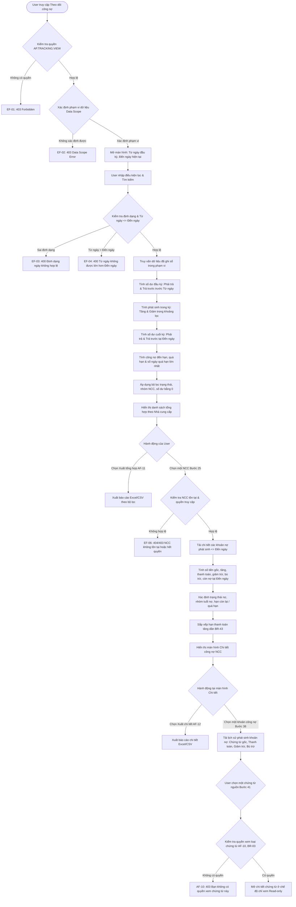
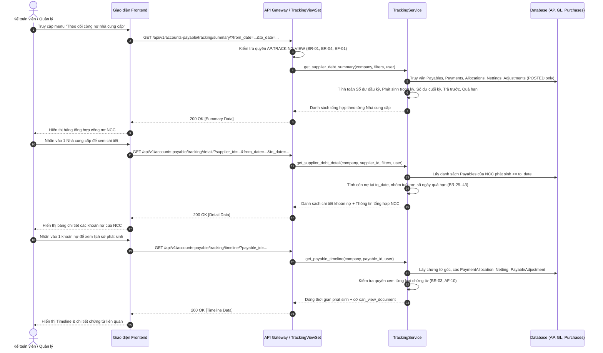

# TÀI LIỆU THIẾT KẾ KỸ THUẬT VÀ ĐẶC TẢ API BACKEND
## USE CASE UC-AP-02: THEO DÕI CÔNG NỢ NHÀ CUNG CẤP (SUPPLIER AP TRACKING & AGING)

---

### 1. Tổng quan Kiến trúc và Luồng Xử lý

Use case **UC-AP-02: Theo dõi công nợ nhà cung cấp** cung cấp khả năng giám sát tài chính đa chiều về các khoản nợ phải trả, các khoản thanh toán trước (ứng trước), công nợ phát sinh, lịch sử thanh toán, bù trừ, giảm trừ và phân tích tuổi nợ (Aging) tại bất kỳ thời điểm nào ($T = \text{Đến ngày}$).

#### 1.1. Activity Diagram (Luồng hoạt động tổng thể)



#### 1.2. Sequence Diagram (Tương tác API & Dịch vụ)



---

### 2. Các Quy tắc Tính toán và Phân loại Nghiệp vụ

#### 2.1. Công thức Tổng hợp Tài chính (BR-12 đến BR-20)
Tại kỳ theo dõi $[\text{from\_date}, \text{to\_date}]$:

1. **Số dư phải trả đầu kỳ (Opening Payable Balance)**:
   $$\text{opening\_payable\_balance} = \sum_{P \in \text{Payables}, \text{doc\_date} < \text{from\_date}} \max\left(0, \text{original} + \text{tăng trước} - \text{giảm trước}\right)$$
   Trong đó:
   - Nghiệp vụ tăng trước: Các khoản `PayableAdjustment` dương có `status="POSTED"` và `adjustment_date < from_date`.
   - Nghiệp vụ giảm trước:
     - Các `PaymentAllocation` có `payment.payment_date < from_date` (với `payment.status="CONFIRMED"`).
     - Các `Netting` có `status="POSTED"` và `netting_date < from_date`.
     - Các `PayableAdjustment` âm có `status="POSTED"` và `adjustment_date < from_date`.

2. **Khoản trả trước đầu kỳ (Opening Advance Balance)**:
   Số tiền doanh nghiệp đã trả trước cho nhà cung cấp nhưng chưa được phân bổ/bù trừ trước `from_date`:
   $$\text{opening\_advance\_balance} = \max\left(0, \sum_{\text{Payment} < \text{from\_date}} \text{amount} - \sum_{\text{Allocation} < \text{from\_date}} \text{allocated\_amount}\right)$$

3. **Phát sinh tăng trong kỳ (Period Increase)**:
   Tổng nghĩa vụ phải trả ghi nhận trong khoảng $[\text{from\_date}, \text{to\_date}]$:
   - Các khoản công nợ `Payable` phát sinh trong kỳ: $\sum \text{original\_amount}$.
   - Các khoản điều chỉnh tăng `PayableAdjustment` dương trong kỳ: $\sum \text{adjustment\_amount}$.

4. **Phát sinh giảm trong kỳ (Period Decrease)**:
   Tổng các nghiệp vụ thanh toán, giảm trừ, bù trừ phát sinh trong khoảng $[\text{from\_date}, \text{to\_date}]$:
   - Thanh toán trong kỳ: $\sum \text{PaymentAllocation.amount}$ của các `Payment` trong kỳ.
   - Bù trừ trong kỳ: $\sum \text{Netting.amount}$ trong kỳ.
   - Giảm trừ trong kỳ: $\sum |\text{PayableAdjustment.amount}|$ (các khoản điều chỉnh âm) trong kỳ.

5. **Số dư phải trả cuối kỳ (Closing Payable Balance)**:
   $$\text{closing\_payable\_balance} = \text{opening\_payable\_balance} + \text{period\_increase} - \text{period\_decrease}$$
   *(Đảm bảo BR-20: Số dư cuối kỳ tổng hợp của nhà cung cấp luôn bằng tổng số dư còn phải trả tại $\text{to\_date}$ của các khoản công nợ chi tiết)*.

6. **Khoản trả trước cuối kỳ (Closing Advance Balance)**:
   Số tiền thanh toán lũy kế đến hết ngày $\text{to\_date}$ chưa được bù trừ/phân bổ:
   $$\text{closing\_advance\_balance} = \max\left(0, \sum_{\text{Payment} \le \text{to\_date}} \text{amount} - \sum_{\text{Allocation} \le \text{to\_date}} \text{allocated\_amount}\right)$$

7. **Nguyên tắc không tự động bù trừ (BR-21, BR-22, AF-03)**:
   Khoản phải trả và khoản trả trước được theo dõi riêng biệt trên hai cột độc lập. Hệ thống tuyệt đối không tự ý cấn trừ nếu chưa có chứng từ `Netting` đã ghi sổ.

---

#### 2.2. Hạn thanh toán, Quá hạn và Trạng thái Công nợ (BR-25 đến BR-36)
Việc xác định trạng thái và quá hạn căn cứ trên ngày theo dõi $T = \text{to\_date}$:

| Tiêu chí | Điều kiện so sánh tại $\text{to\_date}$ | Kết quả hiển thị |
| :--- | :--- | :--- |
| **Chưa đến hạn** | $\text{due\_date} > \text{to\_date}$ | Tình trạng: `NOT_DUE`<br>Số ngày còn lại = $\text{due\_date} - \text{to\_date}$ |
| **Đến hạn** | $\text{due\_date} == \text{to\_date}$ | Tình trạng: `DUE`<br>Số ngày quá hạn = 0 |
| **Quá hạn** | $\text{due\_date} < \text{to\_date}$ và $\text{remaining\_amount} > 0$ | Tình trạng: `OVERDUE`<br>Số ngày quá hạn = $\text{to\_date} - \text{due\_date}$ |
| **Đã thanh toán** | $\text{remaining\_amount} == 0$ | Trạng thái: `PAID`<br>Không tính vào công nợ quá hạn (BR-31) |
| **Thanh toán một phần** | $0 < \text{remaining\_amount} < \text{original\_amount}$ | - Nếu chưa quá hạn: `PARTIALLY_PAID`<br>- Nếu đã quá hạn: Ưu tiên hiển thị `OVERDUE` (AF-08, BR-36) |
| **Chưa thanh toán** | Chưa thanh toán lần nào và chưa quá hạn | Trạng thái: `UNPAID` |

---

#### 2.3. Phân loại Nhóm tuổi nợ (Aging Buckets - BR-37 đến BR-42)

| Mã nhóm | Tên hiển thị | Khoảng ngày quá hạn tại $\text{to\_date}$ |
| :--- | :--- | :--- |
| `NOT_DUE` | Chưa đến hạn | Hạn thanh toán $\ge \text{to\_date}$ hoặc đã thanh toán hết |
| `1_30` | 1–30 ngày | Quá hạn từ 1 đến 30 ngày ($1 \le \text{overdue\_days} \le 30$) |
| `31_60` | 31–60 ngày | Quá hạn từ 31 đến 60 ngày ($31 \le \text{overdue\_days} \le 60$) |
| `61_90` | 61–90 ngày | Quá hạn từ 61 đến 90 ngày ($61 \le \text{overdue\_days} \le 90$) |
| `OVER_90` | Trên 90 ngày | Quá hạn trên 90 ngày ($\text{overdue\_days} > 90$) |

---

### 3. Đặc tả Chi tiết API Endpoints

Tất cả các endpoints nằm dưới prefix: `/api/v1/accounts-payable/tracking/`.

#### 3.1. Báo cáo Tổng hợp Công nợ Nhà cung cấp
- **URL**: `GET /api/v1/accounts-payable/tracking/summary/`
- **Quyền**: Yêu cầu quyền `AP.TRACKING.VIEW` hoặc `AP.PAYABLE.VIEW`.
- **Query Parameters**:
  - `company_id` (UUID, bắt buộc): Mã công ty.
  - `from_date` (YYYY-MM-DD, bắt buộc): Ngày bắt đầu kỳ (mặc định đầu kỳ).
  - `to_date` (YYYY-MM-DD, bắt buộc): Ngày kết thúc kỳ (mặc định ngày hiện tại).
  - `supplier_id` (UUID, tùy chọn, hỗ trợ multiple): Lọc 1 hoặc nhiều nhà cung cấp.
  - `supplier_group_id` (UUID, tùy chọn): Lọc theo nhóm nhà cung cấp.
  - `status` (String, tùy chọn): `UNPAID`, `PARTIALLY_PAID`, `PAID`, `OVERDUE`.
  - `due_status` (String, tùy chọn): `NOT_DUE`, `DUE`, `OVERDUE`.
  - `source_type` (String, tùy chọn): `DOCUMENT`, `INVOICE`, `GOODS_PURCHASE`, `PURCHASE_COST`.
  - `payable_account_id` (UUID, tùy chọn): Lọc theo tài khoản công nợ.
  - `assigned_to_id` (UUID, tùy chọn): Lọc theo người phụ trách.
  - `show_zero_balance` (Boolean, tùy chọn, mặc định `false`): Hiển thị NCC có số dư bằng 0.
  - `search` (String, tùy chọn): Tìm theo mã, tên NCC hoặc mã số thuế.
- **Phản hồi mẫu (200 OK)**:
```json
{
  "summary_metrics": {
    "total_suppliers": 12,
    "total_opening_payable": "540000000.0000",
    "total_opening_advance": "50000000.0000",
    "total_period_increase": "210000000.0000",
    "total_period_decrease": "180000000.0000",
    "total_closing_payable": "570000000.0000",
    "total_closing_advance": "30000000.0000",
    "total_due_amount": "45000000.0000",
    "total_overdue_amount": "120000000.0000"
  },
  "results": [
    {
      "supplier_id": "7a35da76-a4c3-4d0a-9d26-7f41162d0831",
      "supplier_code": "NCC001",
      "supplier_name": "Công ty TNHH Nhựa Tiền Phong",
      "tax_code": "0101234567",
      "opening_payable_balance": "100000000.0000",
      "opening_advance_balance": "0.0000",
      "period_increase": "50000000.0000",
      "period_decrease": "30000000.0000",
      "closing_payable_balance": "120000000.0000",
      "closing_advance_balance": "0.0000",
      "due_amount": "20000000.0000",
      "overdue_amount": "40000000.0000",
      "earliest_due_date": "2026-09-15",
      "max_overdue_days": 23,
      "unpaid_count": 3
    }
  ]
}
```

---

#### 3.2. Báo cáo Chi tiết Công nợ của một Nhà cung cấp
- **URL**: `GET /api/v1/accounts-payable/tracking/detail/`
- **Quyền**: Yêu cầu `AP.TRACKING.VIEW` hoặc `AP.PAYABLE.VIEW`.
- **Query Parameters**:
  - `company_id` (UUID, bắt buộc)
  - `supplier_id` (UUID, bắt buộc)
  - `from_date` (YYYY-MM-DD, bắt buộc)
  - `to_date` (YYYY-MM-DD, bắt buộc)
  - Các tham số lọc bổ sung (`status`, `due_status`, `source_type`).
- **Phản hồi mẫu (200 OK)**:
```json
{
  "supplier": {
    "id": "7a35da76-a4c3-4d0a-9d26-7f41162d0831",
    "code": "NCC001",
    "name": "Công ty TNHH Nhựa Tiền Phong",
    "tax_code": "0101234567",
    "opening_payable_balance": "100000000.0000",
    "opening_advance_balance": "0.0000",
    "period_increase": "50000000.0000",
    "period_decrease": "30000000.0000",
    "closing_payable_balance": "120000000.0000",
    "closing_advance_balance": "0.0000"
  },
  "results": [
    {
      "payable_id": "b1b594b2-a42e-4ca6-b8cb-fd83163152c1",
      "document_number": "AP-DOC-202610-0001",
      "document_date": "2026-09-10",
      "posting_date": "2026-09-10",
      "due_date": "2026-09-25",
      "source_type": "DOCUMENT",
      "source_document_id": "993a4087-9bb3-4ce4-8fa2-0d12e448b11a",
      "invoice_number": "HD-00912",
      "invoice_series": "1C26TAA",
      "currency_code": "VND",
      "original_amount": "50000000.0000",
      "increase_amount": "0.0000",
      "paid_amount": "10000000.0000",
      "discount_amount": "0.0000",
      "netted_amount": "0.0000",
      "remaining_amount": "40000000.0000",
      "days_remaining": 0,
      "overdue_days": 13,
      "due_status": "OVERDUE",
      "aging_bucket": "1_30",
      "status": "OVERDUE"
    }
  ]
}
```

---

#### 3.3. Dòng Thời gian / Lịch sử Phát sinh của Khoản Công nợ (Payable Timeline)
- **URL**: `GET /api/v1/accounts-payable/tracking/timeline/`
- **Query Parameters**:
  - `company_id` (UUID, bắt buộc)
  - `payable_id` (UUID, bắt buộc)
- **Phản hồi mẫu (200 OK)**:
```json
{
  "payable": {
    "id": "b1b594b2-a42e-4ca6-b8cb-fd83163152c1",
    "document_number": "AP-DOC-202610-0001",
    "document_date": "2026-09-10",
    "due_date": "2026-09-25",
    "original_amount": "50000000.0000",
    "remaining_amount": "40000000.0000",
    "supplier_name": "Công ty TNHH Nhựa Tiền Phong",
    "source_type": "DOCUMENT",
    "source_document_id": "993a4087-9bb3-4ce4-8fa2-0d12e448b11a"
  },
  "events": [
    {
      "event_type": "RECOGNITION",
      "event_date": "2026-09-10",
      "document_type": "AP.DOCUMENT",
      "document_number": "AP-DOC-202610-0001",
      "document_id": "993a4087-9bb3-4ce4-8fa2-0d12e448b11a",
      "amount": "50000000.0000",
      "description": "Ghi nhận công nợ mua nguyên vật liệu",
      "can_view_document": true
    },
    {
      "event_type": "PAYMENT",
      "event_date": "2026-09-20",
      "document_type": "AP.PAYMENT",
      "document_number": "PAY-202609-0012",
      "document_id": "78203d92-23bb-4c28-9844-48f888321da1",
      "amount": "-10000000.0000",
      "description": "Thanh toán ủy nhiệm chi đợt 1",
      "can_view_document": true
    }
  ]
}
```

---

#### 3.4. Xuất Báo cáo Excel / CSV (AF-11, AF-12, BR-05, BR-46)
- **URL**:
  - `GET /api/v1/accounts-payable/tracking/export-summary/` (Xuất báo cáo tổng hợp)
  - `GET /api/v1/accounts-payable/tracking/export-detail/` (Xuất báo cáo chi tiết theo NCC)
- **Content-Type**: `application/vnd.openxmlformats-officedocument.spreadsheetml.sheet` (kèm fallback CSV).
- **Định dạng bảng Excel**:
  - Header tiêu đề: Tên đơn vị, Báo cáo theo dõi công nợ, Kỳ theo dõi từ... đến..., Thời điểm xuất dữ liệu.
  - Format số tiền kế toán chuẩn `#,,##0.00`, căn lề và định dạng ô nổi bật cho các khoản quá hạn (BR-44).

---

### 4. Ma trận Đối chiếu Yêu cầu Nghiệp vụ (Requirements Traceability Matrix)

| Mã quy tắc / Luồng | Nội dung quy định | Triển khai mã nguồn |
| :--- | :--- | :--- |
| **BR-AP-TRK-01** | User phải có quyền Xem công nợ | `AccountsPayablePermission` kiểm tra `AP.TRACKING.VIEW` / `AP.PAYABLE.VIEW` |
| **BR-AP-TRK-02** | Phân quyền phạm vi nhà cung cấp và công ty | Lọc theo `CompanyMembership` và gán phân quyền dữ liệu |
| **BR-AP-TRK-03** | Quyền xem công nợ không mặc nhiên có quyền xem chứng từ liên quan | `verify_document_view_permission` kiểm tra quyền theo từng loại chứng từ (AF-10) |
| **BR-AP-TRK-04** | Admin không mặc nhiên có quyền xem dữ liệu công nợ | Sử dụng `enforce_strict_permissions` trong permission class |
| **BR-AP-TRK-05** | Dữ liệu xuất tuân theo cùng quyền và phạm vi | API `export-summary` và `export-detail` áp dụng cùng bộ lọc và quyền hạn |
| **BR-AP-TRK-06..10** | Chỉ tính chứng từ đã ghi sổ (POSTED), loại bỏ nháp/hủy/hủy ghi sổ | Filter `status=POSTED`, `Payment.status=CONFIRMED`, `PayableAdjustment.status=POSTED`, `Netting.status=POSTED` |
| **BR-AP-TRK-11** | Mọi số liệu tổng hợp phải truy vết được về chứng từ nguồn | `get_payable_timeline` liên kết trực tiếp `source_document_id` và các giao dịch phát sinh |
| **BR-AP-TRK-12..15** | Công thức số dư đầu kỳ, phát sinh tăng, phát sinh giảm, số dư cuối kỳ | `calculate_supplier_period_balances` triển khai chính xác các công thức kế toán |
| **BR-AP-TRK-16..17** | Số tiền còn phải trả $\ge 0$ | Hàm tính `remaining_amount` đảm bảo không âm |
| **BR-AP-TRK-18, 21..24** | Quản lý khoản trả trước riêng biệt, không tự ý bù trừ | Theo dõi `opening_advance_balance` và `closing_advance_balance` riêng rẽ với nợ phải trả |
| **BR-AP-TRK-25..32** | So sánh hạn thanh toán tại `to_date`, tính số ngày quá hạn / còn lại | `evaluate_debt_aging` so sánh `due_date` với `to_date` |
| **BR-AP-TRK-33..36** | Trạng thái công nợ: Chưa TT, TT một phần, Đã TT, Quá hạn (ưu tiên Quá hạn) | Logic xác định `status`: Quá hạn được ưu tiên hiển thị nếu còn nợ |
| **BR-AP-TRK-37..42** | Nhóm tuổi nợ: Chưa đến hạn, 1–30, 31–60, 61–90, trên 90 ngày | Hàm gán `aging_bucket` không chồng lấn và bao phủ đầy đủ khoảng ngày |
| **BR-AP-TRK-43** | Sắp xếp danh sách chi tiết theo hạn thanh toán tăng dần | `order_by('due_date')` |
| **BR-AP-TRK-44** | Dấu hiệu nhận biết quá hạn rõ ràng | Cờ `is_overdue = True`, `overdue_days > 0`, highlight trên file xuất |
| **BR-AP-TRK-46** | Dữ liệu xuất đồng nhất với dữ liệu hiển thị | Sử dụng chung query và logic tính toán cho cả màn hình và tệp xuất |
| **BR-AP-TRK-47** | Chức năng chỉ đọc, không cho phép sửa trực tiếp | Toàn bộ ViewSet kế thừa `ViewSet` chỉ đọc (GET only) |
| **AF-01..AF-13** | Xử lý đầy đủ các luồng thay thế (không chọn NCC, không có dữ liệu, trả trước, xuất Excel, ẩn số dư = 0) | Cấu hình các nhánh filter và hàm export tương ứng |
| **EF-01..EF-11** | Xử lý đầy đủ các ngoại lệ (chặn quyền, ngày sai định dạng, Từ ngày > Đến ngày, chứng từ bị hủy, v.v.) | Xử lý lỗi ValidationError và ném thông báo chuẩn bằng tiếng Việt |
