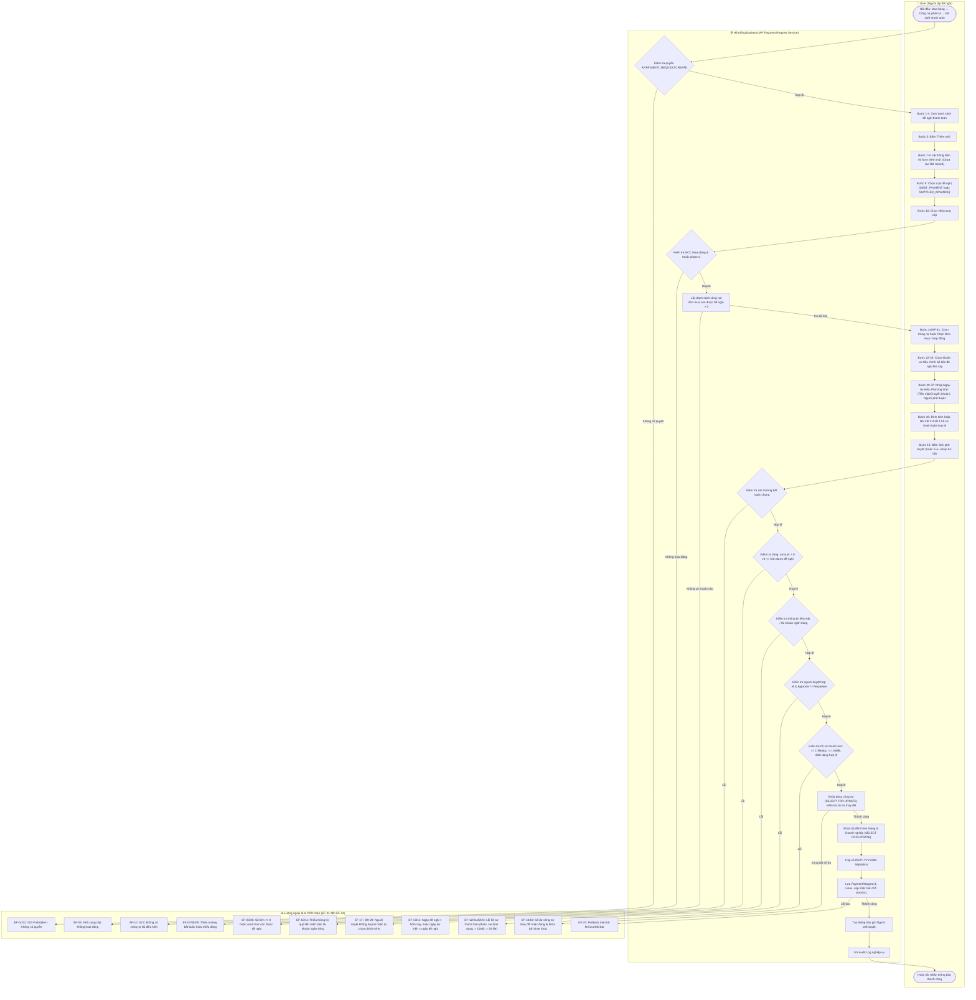
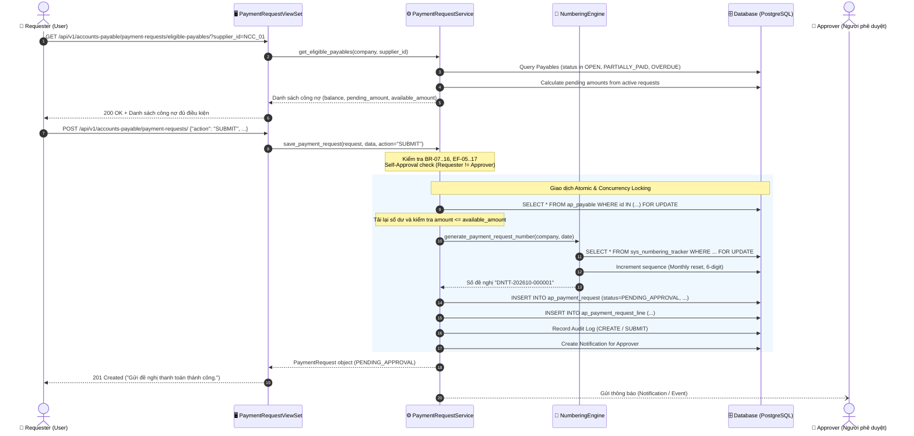

# UC-AP-03: Lập đề nghị thanh toán (Payment Request Creation) - Backend Architecture & Technical Specification

Tài liệu thiết kế kiến trúc kỹ thuật và đặc tả API Backend cho nghiệp vụ **UC-AP-03: Lập đề nghị thanh toán**.  
Phiên bản này **đã bỏ hoàn toàn trường Mức độ ưu tiên**, chuẩn hóa số bước theo Activity Flow (bước 1–64), 10 luồng thay thế (**AF-01** đến **AF-10**), 24 chốt chặn ngoại lệ (**EF-01** đến **EF-24**) và toàn diện 42 quy tắc nghiệp vụ (**BR-AP-REQ-01** đến **BR-AP-REQ-42**).

---

## 1. Tổng quan Kiến trúc Backend

```
┌────────────────────────────────────────────────────────────────────────┐
│                        LOẠI ĐỀ NGHỊ THANH TOÁN                         │
│  A. Thanh toán công nợ (DEBT_PAYMENT): Khoản nợ đã ghi sổ còn số dư   │
│  B. Tạm ứng nhà cung cấp (SUPPLIER_ADVANCE): Đơn mua / Hợp đồng đã duyệt│
└───────────────────────────────────┬────────────────────────────────────┘
                                    │
                                    ▼
       ┌─────────────────────────────────────────────────────────┐
       │             UC-AP-03 Payment Request Service            │
       │  - Kiểm tra điều kiện tiên quyết & phân quyền IAM        │
       │  - Chặn tự phê duyệt: Requester != Approver (BR-29)     │
       │  - Cấp số tự động DNTT-YYYYMM-NNNNNN có khóa bộ đếm     │
       │  - Giữ chỗ số tiền: "Đang được đề nghị" (Holding pool)   │
       │  - Tuyệt đối KHÔNG tạo bút toán GL & KHÔNG giảm công nợ │
       │  - Giao dịch nguyên tử (Atomic Lock & Rollback)          │
       └────────────────────────────┬────────────────────────────┘
                                    │
            ┌───────────────────────┴───────────────────────┐
            ▼                                               ▼
┌──────────────────────────────┐              ┌──────────────────────────────┐
│      ap_payment_request      │1           N │    ap_payment_request_line   │
│  - number: DNTT-YYYYMM-NNNNNN│─────────────▶│  - payable_id (khi DEBT)     │
│  - request_type (DEBT/ADVANCE│              │  - purchase_order_id (ADVANCE│
│  - payment_method (CASH/BANK)│              │  - amount: Số tiền đề nghị   │
│  - approver_id (FK User)     │              │  - note: Ghi chú chi tiết    │
│  - status (DRAFT/PENDING/...)│              └──────────────────────────────┘
│  - attachments (JSON / files)│
└──────────────────────────────┘
```

### Nguyên tắc tài chính cốt lõi (Financial Invariant):
1. **Lập đề nghị chỉ là bước đề xuất chi tiền**:
   - `BR-AP-REQ-33`: Lập đề nghị **KHÔNG** tạo bút toán kế toán (Không phát sinh `gl_journal_entry` hay `gl_journal_line`).
   - `BR-AP-REQ-34`: Lập đề nghị **KHÔNG** làm giảm số dư công nợ (`Payable.balance` giữ nguyên).
   - `BR-AP-REQ-35`: Công nợ chỉ giảm khi chứng từ thanh toán thực tế (phiếu chi/ủy nhiệm chi) được ghi sổ.
2. **Cơ chế giữ chỗ số tiền (Amount Reservation / Holding Pool)**:
   - Khi ở trạng thái `DRAFT`: **KHÔNG** giữ chỗ (`BR-AP-REQ-17`).
   - Khi ở trạng thái `PENDING_APPROVAL`, `APPROVED`, `PARTIALLY_PAID`: Số tiền đề nghị được cộng vào chỉ tiêu `Đang được đề nghị` (`BR-AP-REQ-18`).
   - Khi bị `REJECTED`, `PAID`, `CANCELED`: Số tiền giữ chỗ được giải phóng hoàn toàn (`BR-AP-REQ-19`, `BR-AP-REQ-36`).
   - `Còn được đề nghị = Còn phải trả - Đang được đề nghị` (`BR-AP-REQ-22`).

---

## 2. Sơ đồ Hoạt động (Activity Diagram - Mermaid)



---

## 3. Sơ đồ Tuần tự (Sequence Diagram - Mermaid)



---

## 4. Đặc tả Mô hình Dữ liệu (Database Schema)

### 4.1. Bảng `ap_payment_request` (Đề nghị thanh toán)
```sql
CREATE TABLE ap_payment_request (
    id UUID PRIMARY KEY DEFAULT gen_random_uuid(),
    company_id UUID NOT NULL REFERENCES org_company(id) ON DELETE PROTECT,
    branch_id UUID REFERENCES org_branch(id) ON DELETE PROTECT,
    number VARCHAR(80) NOT NULL, -- DNTT-YYYYMM-NNNNNN
    request_type VARCHAR(30) NOT NULL DEFAULT 'DEBT_PAYMENT', -- DEBT_PAYMENT, SUPPLIER_ADVANCE
    supplier_id UUID NOT NULL REFERENCES md_party(id) ON DELETE PROTECT,
    currency_id UUID NOT NULL REFERENCES md_currency(id) ON DELETE PROTECT,
    requested_date DATE NOT NULL,
    planned_payment_date DATE NOT NULL,
    payment_method VARCHAR(30) NOT NULL, -- CASH, BANK_TRANSFER
    
    -- Chi tiết phương thức thanh toán
    cash_fund_id UUID REFERENCES cm_cash_fund(id) ON DELETE PROTECT,
    company_bank_account_id UUID REFERENCES md_company_bank_account(id) ON DELETE PROTECT,
    beneficiary_name VARCHAR(255) NOT NULL,
    beneficiary_account_number VARCHAR(50) DEFAULT '',
    beneficiary_bank_name VARCHAR(255) DEFAULT '',
    
    -- Thông tin nội dung & người duyệt
    payment_content VARCHAR(500) NOT NULL,
    notes VARCHAR(1000) DEFAULT '',
    approver_id UUID NOT NULL REFERENCES iam_user_account(id) ON DELETE PROTECT,
    attachments JSONB NOT NULL DEFAULT '[]'::jsonb,
    
    -- Tổng giá trị & trạng thái
    total_amount NUMERIC(20, 4) NOT NULL DEFAULT 0,
    status VARCHAR(30) NOT NULL DEFAULT 'DRAFT', -- DRAFT, PENDING_APPROVAL, APPROVED, REJECTED, PARTIALLY_PAID, PAID, CANCELED
    approval_required BOOLEAN NOT NULL DEFAULT TRUE,
    workflow_snapshot JSONB NOT NULL DEFAULT '{}'::jsonb,
    
    created_by_id UUID NOT NULL REFERENCES iam_user_account(id) ON DELETE PROTECT,
    created_at TIMESTAMPTZ NOT NULL DEFAULT now(),
    updated_at TIMESTAMPTZ NOT NULL DEFAULT now(),
    
    CONSTRAINT uq_ap_payment_request_number UNIQUE (company_id, number),
    CONSTRAINT ck_ap_payment_request_dates CHECK (planned_payment_date >= requested_date),
    CONSTRAINT ck_ap_payment_request_amount CHECK (total_amount >= 0)
);
```

### 4.2. Bảng `ap_payment_request_line` (Dòng chi tiết đề nghị)
```sql
CREATE TABLE ap_payment_request_line (
    id UUID PRIMARY KEY DEFAULT gen_random_uuid(),
    request_id UUID NOT NULL REFERENCES ap_payment_request(id) ON DELETE CASCADE,
    payable_id UUID REFERENCES ap_payable(id) ON DELETE PROTECT, -- Dùng cho DEBT_PAYMENT
    purchase_order_id UUID REFERENCES pur_purchase_order(id) ON DELETE PROTECT, -- Dùng cho SUPPLIER_ADVANCE
    purchase_contract_id UUID REFERENCES pur_purchase_contract(id) ON DELETE PROTECT,
    line_no INTEGER NOT NULL DEFAULT 1,
    amount NUMERIC(20, 4) NOT NULL,
    note VARCHAR(500) DEFAULT '',
    
    CONSTRAINT ck_ap_payment_request_line_amount CHECK (amount > 0),
    CONSTRAINT ck_ap_payment_request_line_ref CHECK (
        (payable_id IS NOT NULL AND purchase_order_id IS NULL AND purchase_contract_id IS NULL) OR
        (payable_id IS NULL AND (purchase_order_id IS NOT NULL OR purchase_contract_id IS NOT NULL))
    )
);
```

---

## 5. Bảng Đối chiếu 42 Business Rules (BR-AP-REQ-01 đến BR-AP-REQ-42)

| Mã BR | Nội dung quy tắc | Hiện thực kỹ thuật & Kiểm soát Backend |
|---|---|---|
| **BR-AP-REQ-01** | Mở màn hình thêm mới không tạo bản ghi đề nghị | Frontend chỉ gọi `preview-number` và `eligible-payables`. Endpoint `POST` chỉ thực thi khi người dùng bấm Lưu/Gửi. |
| **BR-AP-REQ-02** | Đề nghị chỉ được tạo khi User chọn Lưu nháp hoặc Gửi phê duyệt | Backend tạo bản ghi qua action `SAVE_DRAFT` (status `DRAFT`) hoặc `SUBMIT` (status `PENDING_APPROVAL`). |
| **BR-AP-REQ-03** | Số đề nghị có cấu trúc `DNTT-YYYYMM-NNNNNN` | Pattern chuẩn `f"DNTT-{year}{month:02d}-{seq:06d}"`. |
| **BR-AP-REQ-04** | Bộ đếm được quản lý riêng theo doanh nghiệp và đặt lại mỗi tháng | Phân tách key `COMPANY:{company.id}:DNTT:{YYYYMM}` trong `NumberingSequenceTracker`. Reset mỗi đầu tháng. |
| **BR-AP-REQ-05** | Số đã cấp không được sử dụng lại, kể cả khi đề nghị bị hủy/thất bại | Khi số đã cấp và lưu vào DB/History, counter không bao giờ giảm lùi. Đề nghị bị CANCELED giữ nguyên số. |
| **BR-AP-REQ-06** | Khóa bộ đếm trong quá trình cấp số để tránh trùng mã | `NumberingSequenceTracker.objects.select_for_update()` trong atomic transaction. |
| **BR-AP-REQ-07** | Trường bắt buộc chung: Ngày đề nghị, Người đề nghị, Loại đề nghị, NCC, Ngày dự kiến TT, Phương thức TT, Người thụ hưởng, Nội dung TT, Người phê duyệt | Validation tại `validate_payment_request_data()` ném `ValidationError` chi tiết theo field. |
| **BR-AP-REQ-08** | Thanh toán công nợ phải có ít nhất 1 dòng gồm Khoản công nợ và Số tiền đề nghị | Kiểm tra `lines` không rỗng và mỗi dòng có `payable_id` và `amount > 0`. |
| **BR-AP-REQ-09** | Tạm ứng phải có Đơn mua/Hợp đồng và Số tiền đề nghị tạm ứng | Kiểm tra `purchase_order_id` hoặc `purchase_contract_id` và `amount > 0`. |
| **BR-AP-REQ-10** | Thanh toán tiền mặt bắt buộc chọn Quỹ tiền mặt dự kiến chi | Kiểm tra `payment_method == 'CASH'` thì `cash_fund` không được để trống (EF-10). |
| **BR-AP-REQ-11** | Chuyển khoản bắt buộc có TK ngân hàng chi, Số TK nhận, Ngân hàng nhận | Kiểm tra `company_bank_account`, `beneficiary_account_number`, `beneficiary_bank_name` (EF-11). |
| **BR-AP-REQ-12** | Mỗi đề nghị phải có ít nhất 1 hồ sơ thanh toán hợp lệ | Kiểm tra `len(attachments) >= 1` hoặc có chứng từ gốc liên kết hợp lệ (EF-12). |
| **BR-AP-REQ-13** | Đánh dấu trực tiếp từng trường hoặc dòng còn thiếu dữ liệu | Trả về JSON lỗi DRF chuẩn dạng `{"field_name": ["Thông báo lỗi"]}` và `{"lines": [{"amount": "..."}]}`. |
| **BR-AP-REQ-14** | Chỉ công nợ đã ghi sổ và còn số tiền phải trả mới được lựa chọn | Bộ lọc Query: `Payable.objects.filter(status__in=['OPEN', 'PARTIALLY_PAID', 'OVERDUE'], balance__gt=0)`. |
| **BR-AP-REQ-15** | Một đề nghị chỉ chứa công nợ của một nhà cung cấp | Kiểm tra tất cả `payable.supplier_id == request.supplier_id`. |
| **BR-AP-REQ-16** | Công nợ đã thanh toán hoặc đã hủy không được lựa chọn | Loại trừ các `Payable` có status `PAID`, `CANCELLED`, `REVERSED`. |
| **BR-AP-REQ-17** | Đề nghị Nháp không được tính vào số tiền Đang được đề nghị | Loại trừ status `DRAFT` khỏi tổng giữ chỗ `pending_amount`. |
| **BR-AP-REQ-18** | Đề nghị Chờ duyệt, Đã duyệt, Thanh toán một phần được tính vào Đang được đề nghị | `filter(request__status__in=['PENDING_APPROVAL', 'APPROVED', 'PARTIALLY_PAID'])`. |
| **BR-AP-REQ-19** | Đề nghị Bị từ chối, Đã thanh toán, Đã hủy không được tính vào Đang được đề nghị | Loại trừ `REJECTED`, `PAID`, `CANCELED` khỏi tổng giữ chỗ. |
| **BR-AP-REQ-20** | Còn phải trả = Nợ gốc + Tăng − Thanh toán − Giảm trừ − Bù trừ | Tính chuẩn theo `Payable.balance`. |
| **BR-AP-REQ-21** | Đang được đề nghị = Tổng số tiền chưa thanh toán trên các đề nghị còn hiệu lực | Tính tổng `amount - paid_amount` trên các dòng đề nghị còn hiệu lực. |
| **BR-AP-REQ-22** | Còn được đề nghị = Còn phải trả − Đang được đề nghị | Hàm `get_available_payable_amount(payable)`. |
| **BR-AP-REQ-23** | Số tiền đề nghị từng dòng phải > 0 và <= Còn được đề nghị | Kiểm tra chặn EF-05 và EF-06. |
| **BR-AP-REQ-24** | Hệ thống mặc định đề nghị toàn bộ số tiền còn được đề nghị; User được phép giảm | Trả về `available_amount` làm giá trị đề xuất mặc định tại API. |
| **BR-AP-REQ-25** | Tổng tiền đề nghị bằng tổng Số tiền đề nghị lần này của tất cả dòng | Tính tổng `sum(line.amount)` và gán vào `total_amount`. |
| **BR-AP-REQ-26** | Còn được tạm ứng = Giá trị được phép tạm ứng − Đã tạm ứng − Đang được đề nghị | Tính toán đối với `PurchaseOrder` / `PurchaseContract`. |
| **BR-AP-REQ-27** | User phải có quyền Lập đề nghị thanh toán | Kiểm tra quyền IAM `AP.PAYMENT_REQUEST.CREATE`. |
| **BR-AP-REQ-28** | Người phê duyệt phải là User đang hoạt động và có quyền Phê duyệt | Kiểm tra `approver.is_active` và approver có quyền `AP.PAYMENT_REQUEST.APPROVE`. |
| **BR-AP-REQ-29** | Người lập không được chọn chính mình làm người phê duyệt | `if approver.id == user.id: raise ValidationError("Người lập không được tự chọn chính mình làm người phê duyệt.")`. |
| **BR-AP-REQ-30** | Đề nghị sau khi gửi có trạng thái Chờ phê duyệt | Trạng thái chuyển thành `PENDING_APPROVAL`. |
| **BR-AP-REQ-31** | Đề nghị Chờ phê duyệt chưa được sử dụng để lập chứng từ thanh toán | Chặn tạo Phiếu chi / UNC nếu trạng thái đề nghị chưa `APPROVED`. |
| **BR-AP-REQ-32** | Chỉ đề nghị Đã phê duyệt hoặc Thanh toán 1 phần mới được tiếp tục thanh toán | Kiểm tra điều kiện tiên quyết khi lập phiếu thanh toán. |
| **BR-AP-REQ-33** | Lập đề nghị không tạo bút toán kế toán | Hoàn toàn không tạo `JournalEntry` / `JournalLine`. |
| **BR-AP-REQ-34** | Lập đề nghị không làm giảm số dư công nợ | Không làm thay đổi `Payable.balance`. |
| **BR-AP-REQ-35** | Công nợ chỉ giảm khi chứng từ thanh toán được ghi sổ | Quy trình ghi sổ thanh toán (UC-AP-04) mới cập nhật `Payable.paid_amount` và `balance`. |
| **BR-AP-REQ-36** | Khi đề nghị bị từ chối hoặc hủy, giải phóng toàn bộ số tiền Đang được đề nghị | Khi chuyển sang `REJECTED` hoặc `CANCELED`, khoản giữ chỗ tự động giải phóng do không còn thuộc status BR-18. |
| **BR-AP-REQ-37** | Việc tạo đề nghị và giữ chỗ số tiền công nợ phải cùng thành công hoặc cùng rollback | Thực thi trong một `@transaction.atomic` block duy nhất. |
| **BR-AP-REQ-38** | Chỉ đề nghị Nháp hoặc Bị từ chối mới được sửa | `if instance.status not in [DRAFT, REJECTED]: raise ValidationError(...)`. |
| **BR-AP-REQ-39** | Đề nghị Chờ phê duyệt chỉ được thu hồi khi chưa được người phê duyệt xử lý | Action `recall` chỉ cho phép khi status là `PENDING_APPROVAL` và chưa có quyết định duyệt. |
| **BR-AP-REQ-40** | Đề nghị đã phát sinh thanh toán không được hủy trước khi hủy chứng từ thanh toán | Kiểm tra `status != PARTIALLY_PAID` và không có thanh toán liên kết active. |
| **BR-AP-REQ-41** | Khi sửa số tiền của đề nghị bị từ chối, kiểm tra lại số dư công nợ trước khi gửi lại | Re-check `available_amount` trước khi chuyển sang `PENDING_APPROVAL`. |
| **BR-AP-REQ-42** | Mọi hành động tạo, sửa, gửi, thu hồi, duyệt, từ chối, hủy phải ghi Audit Log | Ghi qua `record_audit(module_code='AP', action_code=...)`. |

---

## 6. Danh mục Luồng Thay thế (Alternative Flows AF-01 đến AF-10)

| Mã AF | Bước phát sinh | Điều kiện | Xử lý Backend |
|---|---|---|---|
| **AF-01** | Bước 9 | User chọn Tạm ứng nhà cung cấp | Hệ thống chuyển sang chế độ `SUPPLIER_ADVANCE`, yêu cầu lấy đơn mua/hợp đồng. |
| **AF-02** | Sau AF-01 | User chọn đơn mua hoặc hợp đồng | API `eligible-orders` trả về đơn mua/hợp đồng đã duyệt, chưa hủy, còn giá trị tạm ứng. |
| **AF-03** | Sau AF-02 | Tính toán giá trị tạm ứng | Tính `Giá trị được phép tạm ứng`, `Đã tạm ứng`, `Đang được đề nghị`, `Còn được tạm ứng`. |
| **AF-04** | Bước 22 | User chọn nhiều khoản công nợ | Cho phép nhiều lines, bắt buộc tất cả thuộc cùng một nhà cung cấp (`supplier_id`). |
| **AF-05** | Bước 25 | Đề nghị thanh toán một phần | Chấp nhận `amount < available_amount`. Phần còn lại tiếp tục theo dõi công nợ bình thường. |
| **AF-06** | Bước 30 | User chọn Tiền mặt | Hiển thị & yêu cầu bắt buộc `cash_fund_id`. Ẩn/bỏ qua thông tin ngân hàng. |
| **AF-07** | Bước 30 | User chọn Chuyển khoản | Yêu cầu bắt buộc `company_bank_account_id`, `beneficiary_account_number`, `beneficiary_bank_name`. |
| **AF-08** | Trước bước 40 | User chọn Lưu nháp | Cấp số `DNTT-YYYYMM-NNNNNN`, lưu trạng thái `DRAFT`, không cộng vào `Đang được đề nghị`. |
| **AF-09** | Trước bước 40 | User đóng màn hình khi chưa lưu | Không gửi request lên server; cơ sở dữ liệu không tạo bản ghi rác. |
| **AF-10** | Bước 20 | Không có công nợ đủ điều kiện | Trả về mảng rỗng kèm message: *"Nhà cung cấp không có khoản công nợ nào còn được đề nghị thanh toán."* |

---

## 7. Danh mục Chốt chặn Ngoại lệ (Exception Flows EF-01 đến EF-24)

| Mã EF | Điều kiện ngoại lệ | HTTP Code | Mã lỗi / Message phản hồi |
|---|---|---|---|
| **EF-01** | User thiếu quyền xem đề nghị thanh toán | 403 Forbidden | `{"detail": "Bạn không có quyền xem đề nghị thanh toán."}` |
| **EF-02** | User thiếu quyền lập đề nghị thanh toán | 403 Forbidden | `{"detail": "Bạn không có quyền lập đề nghị thanh toán."}` |
| **EF-03** | Nhà cung cấp không còn hoạt động | 400 Bad Request | `{"supplier": ["Nhà cung cấp không còn hoạt động. Vui lòng chọn nhà cung cấp khác."]}` |
| **EF-04** | Không thể tải danh sách công nợ | 500 / 400 | `{"detail": "Không thể tải danh sách công nợ của nhà cung cấp. Vui lòng thử lại."}` |
| **EF-05** | Số tiền dòng <= 0 | 400 Bad Request | `{"lines": [{"amount": ["Số tiền đề nghị phải lớn hơn 0."]}]}` |
| **EF-06** | Số tiền vượt mức còn được đề nghị | 400 Bad Request | `{"lines": [{"amount": ["Số tiền đề nghị không được vượt quá số tiền còn được đề nghị."]}]}` |
| **EF-07** | Thiếu trường bắt buộc chung | 400 Bad Request | `{"<field_name>": ["Trường này là bắt buộc."], "detail": "Vui lòng nhập đầy đủ các trường bắt buộc."}` |
| **EF-08** | Không có dòng chi tiết nào | 400 Bad Request | `{"lines": ["Đề nghị phải có ít nhất một khoản cần thanh toán."]}` |
| **EF-09** | Dòng chi tiết thiếu công nợ hoặc số tiền | 400 Bad Request | `{"lines": [{"detail": ["Vui lòng chọn khoản công nợ và nhập số tiền đề nghị."]}]}` |
| **EF-10** | Chưa chọn quỹ tiền mặt khi thanh toán tiền mặt | 400 Bad Request | `{"cash_fund": ["Vui lòng chọn quỹ tiền mặt dự kiến chi."]}` |
| **EF-11** | Thiếu thông tin chuyển khoản | 400 Bad Request | `{"bank_transfer": ["Vui lòng nhập đầy đủ tài khoản ngân hàng chi và thông tin tài khoản nhận."]}` |
| **EF-12** | Thiếu hồ sơ thanh toán hợp lệ | 400 Bad Request | `{"attachments": ["Vui lòng liên kết hoặc tải lên ít nhất một hồ sơ thanh toán."]}` |
| **EF-13** | Ngày đề nghị lớn hơn ngày hiện tại | 400 Bad Request | `{"requested_date": ["Ngày đề nghị không được lớn hơn ngày hiện tại."]}` |
| **EF-14** | Ngày dự kiến thanh toán < Ngày đề nghị | 400 Bad Request | `{"planned_payment_date": ["Ngày dự kiến thanh toán không được nhỏ hơn ngày đề nghị."]}` |
| **EF-15** | Tổng số tiền đề nghị <= 0 | 400 Bad Request | `{"total_amount": ["Tổng số tiền đề nghị phải lớn hơn 0."]}` |
| **EF-16** | Quỹ hoặc tài khoản chi không còn hoạt động | 400 Bad Request | `{"fund_or_account": ["Quỹ hoặc tài khoản dự kiến chi không còn hoạt động."]}` |
| **EF-17** | Người duyệt không còn quyền hoặc đã ngừng hoạt động | 400 Bad Request | `{"approver": ["Người phê duyệt không còn quyền xử lý đề nghị thanh toán."]}` |
| **EF-18** | Số dư công nợ thay đổi trước khi gửi | 409 Conflict | `{"detail": "Số dư công nợ đã thay đổi. Vui lòng kiểm tra lại số tiền đề nghị."}` |
| **EF-19** | Công nợ đang bị User khác khóa xử lý | 409 Conflict | `{"detail": "Khoản công nợ đang được lập đề nghị thanh toán bởi người dùng khác."}` |
| **EF-20** | Lỗi hệ thống khi tạo đề nghị | 500 / Rollback | `{"detail": "Không thể tạo đề nghị thanh toán. Vui lòng thử lại."}` |
| **EF-21** | Đính kèm tệp sai định dạng | 400 Bad Request | `{"attachments": ["Định dạng tệp không được hỗ trợ."]}` |
| **EF-22** | Dung lượng tệp > 10 MB | 400 Bad Request | `{"attachments": ["Dung lượng mỗi tệp không được vượt quá 10 MB."]}` |
| **EF-23** | Số lượng tệp đính kèm > 20 | 400 Bad Request | `{"attachments": ["Mỗi đề nghị chỉ được đính kèm tối đa 20 tệp."]}` |
| **EF-24** | Phiên đăng nhập hết hạn | 401 Unauthorized| `{"detail": "Phiên đăng nhập đã hết hạn. Vui lòng đăng nhập lại."}` |

---

## 8. Đặc tả API Endpoints

### 8.1. Lấy danh sách công nợ đủ điều kiện lập đề nghị
- **Endpoint:** `GET /api/v1/accounts-payable/payment-requests/eligible-payables/`
- **Query Params:** `company_id=<UUID>&supplier_id=<UUID>`
- **Response 200 OK:**
```json
{
  "supplier": {
    "id": "c1f7a012-...",
    "name": "Công ty Cổ phần NCC Alpha",
    "bank_account_number": "0123456789",
    "bank_name": "Vietcombank CN Thăng Long"
  },
  "results": [
    {
      "payable_id": "9a0a1b2c-...",
      "voucher_number": "CNPT-2026-00012",
      "voucher_date": "2026-09-15",
      "invoice_number": "HD000987",
      "due_date": "2026-10-15",
      "original_amount": 50000000.0,
      "remaining_amount": 50000000.0,
      "pending_amount": 10000000.0,
      "available_amount": 40000000.0,
      "currency_code": "VND"
    }
  ]
}
```

### 8.2. Lấy danh sách đơn mua/hợp đồng đủ điều kiện tạm ứng
- **Endpoint:** `GET /api/v1/accounts-payable/payment-requests/eligible-orders/`
- **Query Params:** `company_id=<UUID>&supplier_id=<UUID>`
- **Response 200 OK:**
```json
{
  "results": [
    {
      "order_id": "b2c3d4e5-...",
      "order_number": "PO-2026-00045",
      "order_date": "2026-10-01",
      "contract_number": "HD-2026/01",
      "total_order_amount": 100000000.0,
      "allowed_advance_amount": 100000000.0,
      "advance_paid": 0.0,
      "pending_amount": 0.0,
      "available_advance_amount": 100000000.0,
      "currency_code": "VND"
    }
  ]
}
```

### 8.3. Xem trước số đề nghị thanh toán
- **Endpoint:** `GET /api/v1/accounts-payable/payment-requests/preview-number/`
- **Query Params:** `company_id=<UUID>&requested_date=2026-10-08`
- **Response 200 OK:**
```json
{
  "preview_number": "DNTT-202610-000001"
}
```

### 8.4. Tạo hoặc Lưu đề nghị thanh toán
- **Endpoint:** `POST /api/v1/accounts-payable/payment-requests/`
- **Request Body:**
```json
{
  "company": "c1f7a012-...",
  "action": "SUBMIT", // hoặc "SAVE_DRAFT"
  "request_type": "DEBT_PAYMENT",
  "supplier": "d2e3f4a5-...",
  "requested_date": "2026-10-08",
  "planned_payment_date": "2026-10-10",
  "payment_method": "BANK_TRANSFER",
  "company_bank_account": "a1b2c3d4-...",
  "beneficiary_name": "Công ty Cổ phần NCC Alpha",
  "beneficiary_account_number": "0123456789",
  "beneficiary_bank_name": "Vietcombank CN Thăng Long",
  "payment_content": "Thanh toán tiền hàng đợt 1 theo hóa đơn HD000987",
  "notes": "Ưu tiên chuyển buổi sáng",
  "approver": "e5f6a7b8-...",
  "attachments": [
    {
      "file_name": "hop_dong_nguyen_tac.pdf",
      "file_url": "https://storage.example.com/docs/hop_dong_nguyen_tac.pdf",
      "file_size": 2048576,
      "document_type": "CONTRACT"
    }
  ],
  "lines": [
    {
      "payable": "9a0a1b2c-...",
      "amount": 40000000.0,
      "note": "Thanh toán toàn bộ số còn được đề nghị"
    }
  ]
}
```
- **Response 201 Created:**
```json
{
  "id": "f8e7d6c5-...",
  "number": "DNTT-202610-000001",
  "status": "PENDING_APPROVAL",
  "total_amount": 40000000.0,
  "requested_date": "2026-10-08",
  "message": "Gửi đề nghị thanh toán thành công."
}
```

---

## 9. Đảm bảo Toàn vẹn & Hiệu năng Cao (Concurrency & Integrity)

1. **Khóa chống đua (Race Condition Prevention)**:
   - Khi `SUBMIT`, hệ thống thực hiện `Payable.objects.select_for_update().filter(id__in=p_ids)` để khóa các dòng công nợ trong phiên giao dịch.
   - Tránh việc 2 User cùng submit vượt quá số dư còn lại của cùng một khoản nợ.
2. **Khóa số chứng từ (Atomic Sequence Counter Lock)**:
   - Khóa bản ghi `NumberingSequenceTracker` tương ứng với chu kỳ tháng của doanh nghiệp (`select_for_update()`).
   - Đảm bảo số chứng từ duy nhất tuyệt đối, tăng dần đều, không có lỗ hổng (gap) ngoài dự kiến.
3. **Phân tách thẩm quyền (Segregation of Duties)**:
   - Nghiêm cấm người lập tự duyệt (`approver_id != user.id`).
   - Người duyệt phải có quyền `AP.PAYMENT_REQUEST.APPROVE` và thuộc cùng phạm vi phân quyền.
