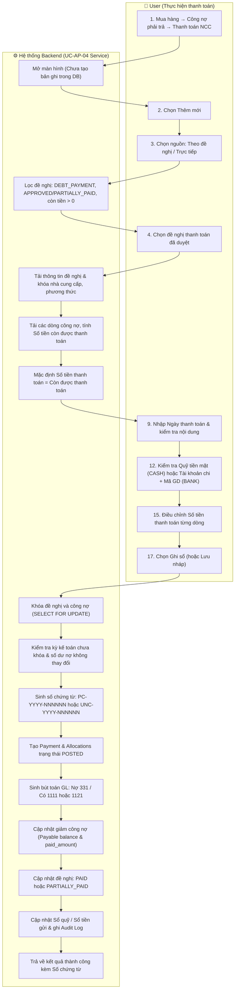
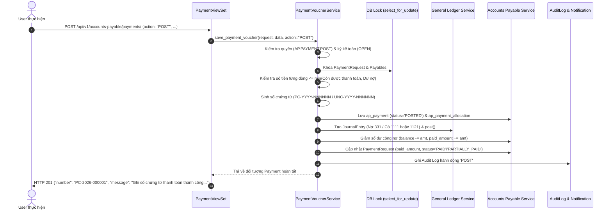

# UC-AP-04: Thanh toán công nợ nhà cung cấp (Supplier Debt Payment) - Backend Architecture & Technical Specification

Tài liệu thiết kế kiến trúc kỹ thuật và đặc tả API Backend cho nghiệp vụ **UC-AP-04: Thanh toán công nợ nhà cung cấp**.  
Chuẩn hóa theo Activity Flow (bước 1–33), 7 luồng thay thế (**AF-AP-PAY-01** đến **AF-AP-PAY-07**), 21 chốt chặn ngoại lệ (**EX-AP-PAY-01** đến **EX-AP-PAY-21**) và toàn diện 23 quy tắc nghiệp vụ (**BR-AP-PAY-01** đến **BR-AP-PAY-23**).

---

## 1. Tổng quan Kiến trúc Backend

```
┌────────────────────────────────────────────────────────────────────────┐
│                        NGUỒN CHỨNG TỪ THANH TOÁN                       │
│  A. Theo đề nghị thanh toán đã duyệt (PAYMENT_REQUEST): Loại DEBT_PAYMENT│
│  B. Thanh toán trực tiếp (DIRECT): Cần quyền AP.PAYMENT.POST_DIRECT    │
└───────────────────────────────────┬────────────────────────────────────┘
                                    │
                                    ▼
       ┌─────────────────────────────────────────────────────────┐
       │             UC-AP-04 Supplier Payment Service           │
       │  - Kiểm tra điều kiện tiên quyết & phân quyền IAM        │
       │  - Kiểm tra kỳ kế toán ngày thanh toán (OPEN)            │
       │  - Đánh số PC-YYYY-NNNNNN (tiền mặt) / UNC-YYYY-NNNNNN  │
       │  - Khóa chọn dòng công nợ & đề nghị (Atomic Lock)        │
       │  - Tạo chứng từ thanh toán & các dòng phân bổ công nợ    │
       │  - Sinh bút toán Sổ cái (GL): Nợ 331 / Có 1111 hoặc 1121│
       │  - Giảm công nợ (Payable.balance, Payable.paid_amount)   │
       │  - Cập nhật đề nghị: PAID hoặc PARTIALLY_PAID           │
       │  - Cập nhật sổ quỹ (CashTransaction) / ngân hàng (BankTx)│
       │  - Ghi Audit Log & thông báo                            │
       └────────────────────────────┬────────────────────────────┘
                                    │
            ┌───────────────────────┴───────────────────────┐
            ▼                                               ▼
┌──────────────────────────────┐              ┌──────────────────────────────┐
│          ap_payment          │1           N │     ap_payment_allocation    │
│  - number: PC-/UNC-YYYY-NNN  │─────────────▶│  - payable_id (FK Payable)   │
│  - payment_source (REQ/DIR)  │              │  - payment_request_line_id   │
│  - payment_method (CASH/BANK)│              │  - amount: Số tiền thanh toán│
│  - supplier_id (FK Party)    │              │  - line_no, note             │
│  - journal_entry_id (FK GL)  │              └──────────────────────────────┘
│  - status (DRAFT/POSTED/...) │
└──────────────────────────────┘
```

### Nguyên tắc tài chính & kế toán cốt lõi (Core Financial Invariants):
1. **Chỉ ghi sổ mới tác động tài chính (BR-AP-PAY-04)**:
   - Chứng từ ở trạng thái `DRAFT`: **Không** tạo bút toán GL, **không** giảm công nợ, **không** cập nhật số tiền đã thanh toán của đề nghị (`AF-AP-PAY-01`).
   - Chứng từ ở trạng thái `POSTED`: Tự động sinh bút toán sổ cái, ghi giảm công nợ nhà cung cấp, cập nhật trạng thái và số tiền đã thanh toán của đề nghị.
2. **Định khoản kế toán chuẩn mực (BR-AP-PAY-18, 27)**:
   - **Thanh toán tiền mặt (`CASH`)**:
     - **Nợ TK 331** (Phải trả cho người bán – chi tiết theo Nhà cung cấp).
     - **Có TK 1111** (Tiền mặt VND – chi tiết theo Quỹ tiền mặt).
   - **Thanh toán chuyển khoản (`BANK_TRANSFER`)**:
     - **Nợ TK 331** (Phải trả cho người bán – chi tiết theo Nhà cung cấp).
     - **Có TK 1121** (Tiền gửi ngân hàng – chi tiết theo Tài khoản ngân hàng trích tiền).
   - **Không ghi nhận thêm chi phí** và **không ghi nhận lại thuế GTGT đầu vào** (đã được ghi nhận ở chứng từ mua hàng/ghi nhận công nợ).
3. **Cơ chế cập nhật trạng thái đề nghị thanh toán (BR-AP-PAY-10)**:
   - Sau khi ghi sổ, nếu toàn bộ số tiền của các dòng đề nghị đã được thanh toán hết (`unpaid == 0`) $\rightarrow$ Đề nghị chuyển sang `PAID` (Đã thanh toán).
   - Nếu vẫn còn số tiền chưa thanh toán (`unpaid > 0`) $\rightarrow$ Đề nghị chuyển sang `PARTIALLY_PAID` (Thanh toán một phần).
4. **Hủy chứng từ đã ghi sổ (Reversal / Bút toán đảo - AF-AP-PAY-07)**:
   - Người dùng có quyền `AP.PAYMENT.CANCEL_POSTED` và phải nhập lý do hủy.
   - Hệ thống tự động sinh bút toán đảo (`reversal_journal_entry`): Nợ TK 1111/1121, Có TK 331.
   - Khôi phục công nợ cho các chứng từ công nợ liên quan (`balance += amount`, `paid_amount -= amount`).
   - Giảm số tiền đã thanh toán của đề nghị, hoàn trả trạng thái đề nghị về `APPROVED` hoặc `PARTIALLY_PAID`.
   - Chuyển trạng thái chứng từ thanh toán sang `CANCELED`. Số chứng từ đã cấp **không được sử dụng lại** (`BR-AP-PAY-16`).

---

## 2. Sơ đồ Hoạt động (Activity Diagram - Mermaid)



---

## 3. Sơ đồ Tuần tự (Sequence Diagram - Ghi sổ thanh toán)



---

## 4. Bảng Ánh xạ Quy tắc Nghiệp vụ (Business Rules Mapping)

| Mã BR | Nội dung quy tắc | Triển khai Backend |
| --- | --- | --- |
| **BR-AP-PAY-01** | Trạng thái chứng từ: `Nháp`, `Đã ghi sổ`, `Đã hủy`. | `PaymentStatus` choices: `DRAFT`, `POSTED`, `CANCELED`. |
| **BR-AP-PAY-02** | Mở màn hình thêm mới không tạo chứng từ trong DB. | Không tạo bản ghi cho đến khi gọi POST `save_payment_voucher`. |
| **BR-AP-PAY-03** | Trạng thái `Nháp` chỉ tạo khi User chủ động chọn `Lưu nháp`. | `action="SAVE_DRAFT"`, lưu dữ liệu tối thiểu. |
| **BR-AP-PAY-04** | Chỉ chứng từ `Đã ghi sổ` mới giảm nợ và tạo bút toán GL. | Chặn GL & debt reduction khi `status == DRAFT`. |
| **BR-AP-PAY-05** | Chứng từ `Đã ghi sổ` không được sửa trực tiếp. | Chặn PUT/PATCH khi `status == POSTED`, bắt buộc hủy. |
| **BR-AP-PAY-06** | Còn được thanh toán của dòng đề nghị = Số duyệt − Đã ghi sổ + Đã hủy. | Công thức `get_eligible_payment_requests` & `validate_payment_voucher_data`. |
| **BR-AP-PAY-07** | Còn phải trả của chứng từ công nợ = Gốc + Tăng − Thanh toán − Giảm − Bù trừ. | Dựa trên `Payable.balance`. |
| **BR-AP-PAY-08** | Tổng tiền thanh toán = Tổng số tiền thanh toán của các dòng > 0. | Tính toán `sum(line.amount for line in lines if line.amount > 0)`. |
| **BR-AP-PAY-09** | Số tiền dòng không vượt quá `min(còn được thanh toán, còn phải trả)`. | Chốt chặn `EX-AP-PAY-13` và `EX-AP-PAY-17`. |
| **BR-AP-PAY-10** | Cập nhật đề nghị: `PAID` nếu còn lại = 0, `PARTIALLY_PAID` nếu còn > 0. | Tự động chuyển trạng thái `PaymentRequest.status`. |
| **BR-AP-PAY-11** | Tiền mặt có mã `PC-YYYY-NNNNNN`. | Hàm `generate_payment_voucher_number` với tiền tố `PC-`. |
| **BR-AP-PAY-12** | Chuyển khoản có mã `UNC-YYYY-NNNNNN`. | Hàm `generate_payment_voucher_number` với tiền tố `UNC-`. |
| **BR-AP-PAY-13** | `YYYY` là năm thanh toán, `NNNNNN` là 6 số tuần tự bắt đầu từ 000001. | Format `{prefix}{year}-{seq:06d}`. |
| **BR-AP-PAY-14** | Bộ đếm quản lý theo công ty, loại chứng từ và năm. | Bộ đếm riêng biệt theo `(company, prefix, year)`. |
| **BR-AP-PAY-15** | Bộ đếm đặt lại từ `000001` vào ngày 01/01 hàng năm. | Tự động phân tách bộ đếm theo `year`. |
| **BR-AP-PAY-16** | Số đã cấp không sử dụng lại kể cả khi hủy chứng từ. | Khi hủy chỉ đổi `status = CANCELED`, không xóa số. |
| **BR-AP-PAY-17** | Khóa bộ đếm trong lúc cấp số để tránh trùng mã. | Khóa hàng `Company` bằng `select_for_update()`. |
| **BR-AP-PAY-18** | Không ghi nhận thêm chi phí và không tính lại thuế GTGT. | Chỉ định khoản Nợ 331 / Có 1111 hoặc 1121. |
| **BR-AP-PAY-19** | Nhà cung cấp phải trùng giữa đề nghị, chứng từ và công nợ. | Kiểm tra `payable.supplier_id == payment.supplier_id == request.supplier_id`. |
| **BR-AP-PAY-20** | Đề nghị loại `Tạm ứng nhà cung cấp` không dùng trong use case này. | Loại trừ `request_type == 'SUPPLIER_ADVANCE'`. |
| **BR-AP-PAY-21** | Thanh toán theo đề nghị không được đổi phương thức, tài khoản chi, thụ hưởng. | Kế thừa và khóa cứng thông tin ngân hàng/thụ hưởng từ đề nghị. |
| **BR-AP-PAY-22** | Mã giao dịch ngân hàng phải duy nhất theo tài khoản ngân hàng chi. | Kiểm tra trùng `bank_transaction_code` trên `company_bank_account`. |
| **BR-AP-PAY-23** | Giao dịch nguyên tử: Sinh chứng từ, bút toán, giảm nợ, cập nhật đề nghị. | Bọc toàn bộ trong `@transaction.atomic`. |

---

## 5. Bảng Ánh xạ Luồng Thay thế (Alternative Flows) & Ngoại lệ (Exception Flows)

### 5.1. Alternative Flows (AF)
- **AF-AP-PAY-01 (Lưu nháp)**: Ghi bản ghi `status='DRAFT'`, cấp số, không tạo bút toán, không giảm công nợ.
- **AF-AP-PAY-02 (Thanh toán một phần)**: Giảm công nợ theo số tiền thực thanh toán, cập nhật đề nghị thành `PARTIALLY_PAID`.
- **AF-AP-PAY-03 (Bỏ dòng khỏi lần thanh toán)**: Dòng nhập số tiền 0 sẽ không được tạo trong `ap_payment_allocation`.
- **AF-AP-PAY-04 (Thanh toán trực tiếp)**: Nguồn `DIRECT`, kiểm tra quyền `AP.PAYMENT.POST_DIRECT`, chọn NCC và công nợ trực tiếp, không cập nhật đề nghị.
- **AF-AP-PAY-05 (Sửa chứng từ nháp)**: Cho phép cập nhật chứng từ ở trạng thái `DRAFT` và thực hiện `Ghi sổ`.
- **AF-AP-PAY-06 (Hủy chứng từ nháp)**: Đổi `status` sang `CANCELED`, không ảnh hưởng công nợ.
- **AF-AP-PAY-07 (Hủy chứng từ đã ghi sổ)**: Kiểm tra quyền `AP.PAYMENT.CANCEL_POSTED`, tạo bút toán đảo, hoàn trả công nợ và cập nhật lại trạng thái đề nghị thanh toán.

### 5.2. Exception Flows (EX)
| Mã | Mô tả | Mã lỗi / HTTP Status |
| --- | --- | --- |
| **EX-AP-PAY-01** | Không còn đề nghị đủ điều kiện thanh toán | 400 Bad Request |
| **EX-AP-PAY-02** | Chưa nhập Ngày thanh toán | 400 `{"payment_date": "Vui lòng nhập Ngày thanh toán."}` |
| **EX-AP-PAY-03** | Ngày thanh toán lớn hơn ngày hiện tại | 400 `{"payment_date": "Ngày thanh toán không được lớn hơn ngày hiện tại."}` |
| **EX-AP-PAY-04** | Kỳ kế toán đã khóa | 400 `{"period": "Kỳ kế toán của ngày thanh toán đã bị khóa. Không thể ghi sổ chứng từ."}` |
| **EX-AP-PAY-05** | Nội dung thanh toán trống | 400 `{"payment_content": "Vui lòng nhập Nội dung thanh toán."}` |
| **EX-AP-PAY-06** | Chưa chọn Quỹ tiền mặt chi (tiền mặt) | 400 `{"cash_fund": "Vui lòng chọn Quỹ tiền mặt chi."}` |
| **EX-AP-PAY-07** | Chưa nhập Người nhận tiền (tiền mặt) | 400 `{"recipient_name": "Vui lòng nhập Người nhận tiền."}` |
| **EX-AP-PAY-08** | Đề nghị chưa có Tài khoản ngân hàng trích tiền | 400 `{"company_bank_account": "Đề nghị thanh toán chưa có Tài khoản ngân hàng trích tiền."}` |
| **EX-AP-PAY-09** | Thiếu thông tin người thụ hưởng | 400 `{"beneficiary": "Thông tin người thụ hưởng chưa đầy đủ. Vui lòng lập lại đề nghị thanh toán."}` |
| **EX-AP-PAY-10** | Chưa nhập Mã giao dịch ngân hàng | 400 `{"bank_transaction_code": "Vui lòng nhập Mã giao dịch ngân hàng."}` |
| **EX-AP-PAY-11** | Mã giao dịch ngân hàng bị trùng | 400 `{"bank_transaction_code": "Mã giao dịch ngân hàng đã được sử dụng cho chứng từ {Số chứng từ}."}` |
| **EX-AP-PAY-12** | Số tiền một dòng nhỏ hơn 0 | 400 `{"lines": "Số tiền thanh toán lần này không được nhỏ hơn 0."}` |
| **EX-AP-PAY-13** | Số tiền vượt quá số còn được thanh toán | 400 `{"lines": "Số tiền thanh toán của chứng từ {Số chứng từ công nợ} vượt quá số tiền còn được thanh toán là {Số tiền}."}` |
| **EX-AP-PAY-14** | Tổng tiền bằng 0 | 400 `{"amount": "Tổng tiền thanh toán phải lớn hơn 0."}` |
| **EX-AP-PAY-15** | Đề nghị đã bị thay đổi trạng thái | 400 `{"payment_request": "Đề nghị thanh toán không còn ở trạng thái cho phép thanh toán. Vui lòng tải lại dữ liệu."}` |
| **EX-AP-PAY-16** | Số dư không đủ và có kiểm soát số dư | 400 `{"balance": "Số dư khả dụng của {Quỹ/Tài khoản} không đủ để thực hiện thanh toán."}` |
| **EX-AP-PAY-17** | Khoản công nợ đã được thanh toán bởi giao dịch khác | 400 `{"lines": "Số tiền còn được thanh toán đã thay đổi. Vui lòng tải lại chứng từ."}` |
| **EX-AP-PAY-18** | Tệp sai định dạng (chỉ nhận PDF, PNG, JPG, JPEG) | 400 `{"attachments": "Tệp {Tên tệp} không đúng định dạng được hỗ trợ."}` |
| **EX-AP-PAY-19** | Tệp vượt quá 10 MB | 400 `{"attachments": "Tệp {Tên tệp} vượt quá dung lượng tối đa 10 MB."}` |
| **EX-AP-PAY-20** | User không có quyền ghi sổ | 403 Forbidden |
| **EX-AP-PAY-21** | Không tạo được bút toán | 500 / 400 Error |

---

## 6. Đặc tả REST API Endpoints

### 6.1. Xem trước số chứng từ
- **Endpoint**: `GET /api/v1/accounts-payable/payments/preview-number/`
- **Query Params**: `company_id`, `payment_method` (`CASH` hoặc `BANK_TRANSFER`), `payment_date` (YYYY-MM-DD).

### 6.2. Danh sách đề nghị thanh toán đủ điều kiện
- **Endpoint**: `GET /api/v1/accounts-payable/payments/eligible-requests/`
- **Query Params**: `company_id`, `supplier_id` (tùy chọn).

### 6.3. Chi tiết đề nghị kèm các dòng công nợ để lập phiếu chi/UNC
- **Endpoint**: `GET /api/v1/accounts-payable/payments/request-detail/`
- **Query Params**: `company_id`, `request_id`.

### 6.4. Tạo hoặc Ghi sổ chứng từ thanh toán
- **Endpoint**: `POST /api/v1/accounts-payable/payments/`
- **Actions**: `action="SAVE_DRAFT"` (Lưu nháp) hoặc `action="POST"` (Ghi sổ).

### 6.5. Hủy chứng từ thanh toán
- **Endpoint**: `POST /api/v1/accounts-payable/payments/{id}/cancel/`
- **Payload**: `{"reason": "Lý do hủy"}`.
