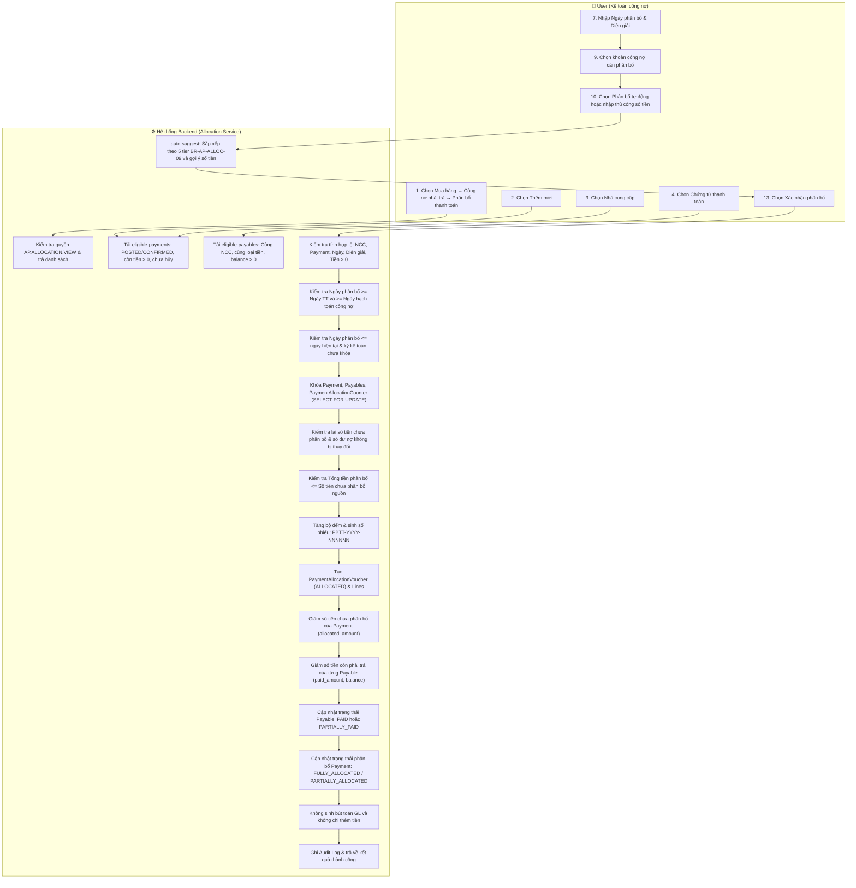

# UC-AP-05: Phân bổ thanh toán (Supplier Payment Allocation) - Backend Architecture & Technical Specification

Tài liệu thiết kế kiến trúc kỹ thuật và đặc tả API Backend cho nghiệp vụ **UC-AP-05: Phân bổ thanh toán**.  
Chuẩn hóa theo Activity Flow (bước 1–32), 5 luồng thay thế (**AF-AP-ALLOC-01** đến **AF-AP-ALLOC-05**), 23 chốt chặn ngoại lệ (**EX-AP-ALLOC-01** đến **EX-AP-ALLOC-23**) và toàn diện 22 quy tắc nghiệp vụ (**BR-AP-ALLOC-01** đến **BR-AP-ALLOC-22**).

---

## 1. Tổng quan Kiến trúc Backend

```
┌────────────────────────────────────────────────────────────────────────┐
│                      CHỨNG TỪ THANH TOÁN NGUỒN                         │
│  - Thanh toán trả trước / Chứng từ thanh toán đã ghi sổ (POSTED/CONFIRMED)│
│  - Số tiền chưa phân bổ (unallocated_amount) > 0                       │
│  - Chưa bị hủy (canceled_at is null, status != CANCELED)               │
└───────────────────────────────────┬────────────────────────────────────┘
                                    │
                                    ▼
       ┌─────────────────────────────────────────────────────────┐
       │           UC-AP-05 Payment Allocation Service           │
       │  - Phân quyền IAM (AP.ALLOCATION.* / AP.PAYMENT.*)      │
       │  - Kiểm tra kỳ kế toán ngày phân bổ (AccountingPeriod)  │
       │  - Kiểm tra cùng NCC & cùng loại tiền tệ (BR-15)        │
       │  - Khóa chứng từ nguồn & công nợ (SELECT FOR UPDATE)    │
       │  - Khóa bộ đếm & cấp số: PBTT-YYYY-NNNNNN (BR-10..14)   │
       │  - 5-Tier tự động sắp xếp ưu tiên (BR-AP-ALLOC-09):     │
       │     1. Quá hạn trước (due_date < allocation_date)       │
       │     2. Hạn thanh toán tăng dần (due_date asc)           │
       │     3. Không có hạn thanh toán xếp sau (None last)      │
       │     4. Cùng hạn -> Ngày hạch toán / chứng từ sớm hơn    │
       │     5. Cùng ngày chứng từ -> Ưu tiên tạo trước (created)│
       │  - KHÔNG tạo bút toán Sổ cái GL (Nợ 331 / Có 111, 112)  │
       │  - KHÔNG phát sinh khoản chi tiền mới (BR-20, BR-21)    │
       │  - Cập nhật số dư sổ phụ: Payable (paid, balance)       │
       │  - Cập nhật Payment.allocated_amount (BR-07..09)        │
       │  - Ghi Audit Log & thông báo kết quả (bước 31, 32)      │
       └────────────────────────────┬────────────────────────────┘
                                    │
            ┌───────────────────────┴───────────────────────┐
            ▼                                               ▼
┌──────────────────────────────┐              ┌──────────────────────────────┐
│  ap_payment_allocation_voucher│1           N │ap_payment_allocation_voucher_│
│  - number: PBTT-YYYY-NNNNNN  │─────────────▶│  line                        │
│  - payment_id (FK Payment)   │              │  - payable_id (FK Payable)   │
│  - allocation_date: Date     │              │  - line_no: Số thứ tự dòng   │
│  - total_amount: Decimal     │              │  - amount: Số tiền phân bổ   │
│  - status: ALLOCATED/REVERSED│              └──────────────────────────────┘
└──────────────────────────────┘
```

### Nguyên tắc tài chính & kế toán cốt lõi (Core Financial Invariants):
1. **Không phát sinh bút toán và dòng tiền mới (BR-AP-ALLOC-20, BR-AP-ALLOC-21)**:
   - Khoản chi tiền và bút toán định khoản Nợ TK 331 / Có TK 111, 112 đã được ghi nhận tại thời điểm ghi sổ chứng từ thanh toán/chi tiền (UC-AP-04).
   - Nghiệp vụ phân bổ thanh toán chỉ thực hiện gắn khoản tiền đã trả trước với các hóa đơn hoặc chứng từ công nợ cụ thể trên sổ chi tiết công nợ (subledger), do đó **tuyệt đối không tạo thêm chứng từ chi tiền** và **không tạo thêm bút toán kế toán mới**.
   - Tổng số dư công nợ thuần của nhà cung cấp (Net Supplier Balance) không thay đổi.
2. **Không sử dụng trạng thái Nháp (BR-3.4)**:
   - Phiếu phân bổ chỉ được tạo khi hoàn tất nghiệp vụ với trạng thái `ALLOCATED` (Đã phân bổ).
   - Khi đảo phân bổ, phiếu chuyển sang trạng thái `REVERSED` (Đã đảo phân bổ).
3. **Quy tắc đánh số và bộ đếm phiếu (BR-AP-ALLOC-10 đến BR-AP-ALLOC-14)**:
   - Cấu trúc số: `PBTT-YYYY-NNNNNN` (Ví dụ: `PBTT-2026-000001`).
   - `YYYY` là năm của Ngày phân bổ; `NNNNNN` gồm 6 chữ số bắt đầu từ `000001` vào ngày 01/01 hàng năm.
   - Quản lý theo từng doanh nghiệp và từng năm tài chính với khóa bi quan (`select_for_update`) để chống trùng lặp trong môi trường đồng thời cao.
   - Số đã cấp không bao giờ được tái sử dụng kể cả khi phiếu bị đảo phân bổ.
4. **Quy tắc sắp xếp phân bổ tự động 5 cấp (BR-AP-ALLOC-09 / Mục 3.3)**:
   - Hệ thống tự động phân bổ tiền theo thứ tự:
     1. Công nợ quá hạn trước (`due_date < allocation_date`).
     2. Hạn thanh toán tăng dần (`due_date` asc).
     3. Công nợ không có hạn thanh toán xếp sau công nợ có hạn (`due_date is None`).
     4. Nếu cùng hạn thanh toán, ưu tiên Ngày chứng từ/hạch toán sớm hơn (`posting_date` asc).
     5. Nếu cùng ngày chứng từ, ưu tiên công nợ được tạo trước (`created_at` asc).
   - Công thức phân bổ từng dòng: `Số tiền = Min(Còn lại chưa phân bổ, Còn phải trả của dòng)`.
5. **Cơ chế đảo phân bổ (AF-AP-ALLOC-04)**:
   - Người dùng có quyền `AP.ALLOCATION.REVERSE` hoặc `AP.PAYMENT.ALLOCATE` và bắt buộc nhập lý do đảo.
   - Hoàn trả số tiền đã phân bổ về chứng từ thanh toán (`allocated_amount`), khôi phục số dư công nợ (`balance += amount`, `paid_amount -= amount`) và trạng thái công nợ.
   - Không cho phép đảo một phiếu nhiều lần.

---

## 2. Sơ đồ Hoạt động (Activity Diagram - Mermaid)



---

## 3. Ma trận Quy tắc Nghiệp vụ (Business Rules Matrix)

| Mã quy tắc | Tên quy tắc | Nội dung chi tiết | Hiện thực hóa tại Source Code |
| :--- | :--- | :--- | :--- |
| **BR-AP-ALLOC-01** | Nhà cung cấp | Bắt buộc chọn một nhà cung cấp còn hoạt động | `allocation_services.py: create_allocation` |
| **BR-AP-ALLOC-02** | Chứng từ thanh toán | Trạng thái `Đã ghi sổ`, chưa bị hủy và còn tiền chưa phân bổ > 0 | `allocation_services.py: eligible_payments, create_allocation` |
| **BR-AP-ALLOC-03** | Ngày phân bổ | Không nhỏ hơn Ngày thanh toán & ngày hạch toán công nợ; không lớn hơn ngày hiện tại; thuộc kỳ chưa khóa | `allocation_services.py: create_allocation` |
| **BR-AP-ALLOC-04** | Diễn giải | Bắt buộc; tối đa 500 ký tự | `allocation_services.py: create_allocation` |
| **BR-AP-ALLOC-05** | Khoản công nợ | Phải chọn ít nhất một khoản công nợ | `allocation_services.py: create_allocation` |
| **BR-AP-ALLOC-06** | Số tiền phân bổ | Ít nhất một dòng phải có số tiền lớn hơn 0 | `allocation_services.py: create_allocation` |
| **BR-AP-ALLOC-07** | Số tiền chưa phân bổ | `Chưa phân bổ = Tổng tiền TT − Tổng tiền các phiếu Đã phân bổ` | `allocation_services.py: _remaining()` |
| **BR-AP-ALLOC-08** | Còn lại chưa phân bổ | `Còn lại = Số tiền chưa phân bổ − Tổng tiền phân bổ lần này` | `allocation_services.py: auto_suggest_allocation` |
| **BR-AP-ALLOC-09** | Phân bổ tự động | Thứ tự 5 cấp: 1. Quá hạn; 2. Hạn asc; 3. Không hạn xếp sau; 4. Ngày chứng từ asc; 5. Ngày tạo asc. Phân bổ = Min(Còn lại, Còn phải trả) | `allocation_services.py: auto_sort_key(), auto_suggest_allocation()` |
| **BR-AP-ALLOC-10** | Định dạng số phiếu | Cấu trúc `PBTT-YYYY-NNNNNN` (Ví dụ `PBTT-2026-000001`) | `allocation_services.py: create_allocation` |
| **BR-AP-ALLOC-11** | Thành phần số phiếu | `YYYY` là năm phân bổ; `NNNNNN` là số thứ tự 6 chữ số | `allocation_services.py: create_allocation` |
| **BR-AP-ALLOC-12** | Bộ đếm riêng biệt | Quản lý riêng theo Doanh nghiệp và Năm; bắt đầu từ 000001 vào ngày 01/01 | `models.PaymentAllocationCounter` |
| **BR-AP-ALLOC-13** | Không tái sử dụng | Số phiếu đã cấp không tái sử dụng kể cả khi phiếu bị đảo | `allocation_services.py: reverse_allocation` |
| **BR-AP-ALLOC-14** | Khóa bộ đếm | Khóa bi quan (`select_for_update`) khi cấp số để chống trùng lặp | `allocation_services.py: create_allocation` |
| **BR-AP-ALLOC-15** | Nhất quán NCC & Tiền tệ | Chứng từ thanh toán và các khoản công nợ phải cùng NCC và cùng loại tiền | `allocation_services.py: create_allocation` |
| **BR-AP-ALLOC-16** | Mối quan hệ N-N | Một khoản thanh toán phân bổ cho nhiều công nợ; một công nợ nhận phân bổ từ nhiều khoản thanh toán | Mô hình dữ liệu quan hệ qua `PaymentAllocationVoucherLine` |
| **BR-AP-ALLOC-17** | Giới hạn tiền nguồn | Tổng tiền phân bổ không vượt quá số tiền chưa phân bổ của chứng từ nguồn | `allocation_services.py: create_allocation` |
| **BR-AP-ALLOC-18** | Giới hạn tiền từng nợ | Số tiền phân bổ cho từng công nợ không vượt quá số tiền còn phải trả | `allocation_services.py: create_allocation` |
| **BR-AP-ALLOC-19** | Loại trừ đã phân bổ hết | Chứng từ thanh toán đã phân bổ hết không được hiển thị để phân bổ lại | `allocation_services.py: eligible_payments` |
| **BR-AP-ALLOC-20** | Không sinh chi & GL | Phân bổ không phát sinh khoản chi và không tạo bút toán Nợ 331/Có 111, 112 | Kiến trúc không gọi `general_ledger` khi phân bổ |
| **BR-AP-ALLOC-21** | Giữ nguyên dư nợ thuần | Không làm thay đổi tổng số dư công nợ thuần của nhà cung cấp | Subledger balance update only |
| **BR-AP-ALLOC-22** | Giao dịch nguyên tử | Tạo phiếu, cập nhật tiền chưa phân bổ và cập nhật công nợ thực hiện trong một Transaction (`@transaction.atomic`) | `allocation_services.py: create_allocation, reverse_allocation` |

---

## 4. Ma trận Luồng Ngoại lệ (Exception Flow Matrix)

| Mã ngoại lệ | Điều kiện kích hoạt | Thông báo hiển thị / Mã lỗi | Xử lý hệ thống |
| :--- | :--- | :--- | :--- |
| **EX-AP-ALLOC-01** | User không có quyền xem | `Bạn không có quyền xem phân bổ thanh toán.` | 403 Forbidden |
| **EX-AP-ALLOC-02** | User không có quyền tạo | `Bạn không có quyền thực hiện phân bổ thanh toán.` | 403 Forbidden |
| **EX-AP-ALLOC-03** | Chưa chọn Nhà cung cấp | `Vui lòng chọn Nhà cung cấp.` | 400 Bad Request |
| **EX-AP-ALLOC-04** | Không có chứng từ thanh toán phù hợp | `Nhà cung cấp không có chứng từ thanh toán còn số tiền chưa phân bổ.` | Trả về danh sách rỗng / 400 |
| **EX-AP-ALLOC-05** | Chưa chọn chứng từ thanh toán | `Vui lòng chọn Chứng từ thanh toán.` | 400 Bad Request |
| **EX-AP-ALLOC-06** | Không có công nợ phù hợp | `Nhà cung cấp không có khoản công nợ phù hợp để phân bổ.` | 400 Bad Request |
| **EX-AP-ALLOC-07** | Chưa nhập Ngày phân bổ | `Vui lòng nhập Ngày phân bổ.` | 400 Bad Request |
| **EX-AP-ALLOC-08** | Diễn giải để trống | `Vui lòng nhập Diễn giải.` | 400 Bad Request |
| **EX-AP-ALLOC-09** | Diễn giải vượt 500 ký tự | `Diễn giải không được vượt quá 500 ký tự.` | 400 Bad Request |
| **EX-AP-ALLOC-10** | Chưa chọn công nợ | `Vui lòng chọn ít nhất một khoản công nợ cần phân bổ.` | 400 Bad Request |
| **EX-AP-ALLOC-11** | Không có dòng nào có tiền lớn hơn 0 | `Vui lòng nhập số tiền phân bổ lớn hơn 0 cho ít nhất một khoản công nợ.` | 400 Bad Request |
| **EX-AP-ALLOC-12** | Ngày phân bổ nhỏ hơn Ngày thanh toán | `Ngày phân bổ không được nhỏ hơn Ngày thanh toán.` | 400 Bad Request |
| **EX-AP-ALLOC-13** | Ngày phân bổ nhỏ hơn ngày hạch toán công nợ | `Ngày phân bổ không được nhỏ hơn ngày hạch toán của chứng từ {Số chứng từ}.` | 400 Bad Request |
| **EX-AP-ALLOC-14** | Ngày phân bổ lớn hơn ngày hiện tại | `Ngày phân bổ không được lớn hơn ngày hiện tại.` | 400 Bad Request |
| **EX-AP-ALLOC-15** | Kỳ kế toán đã khóa | `Kỳ kế toán của ngày phân bổ đã bị khóa.` | 400 Bad Request |
| **EX-AP-ALLOC-16** | Khác nhà cung cấp | `Chứng từ thanh toán và công nợ phải thuộc cùng một nhà cung cấp.` | 400 Bad Request |
| **EX-AP-ALLOC-17** | Khác loại tiền | `Chứng từ thanh toán và công nợ phải sử dụng cùng loại tiền.` | 400 Bad Request |
| **EX-AP-ALLOC-18** | Số tiền chưa phân bổ đã thay đổi | `Số tiền chưa phân bổ đã thay đổi. Vui lòng tải lại dữ liệu.` | 400 Bad Request |
| **EX-AP-ALLOC-19** | Công nợ đã thay đổi | `Số tiền còn phải trả của chứng từ {Số chứng từ} đã thay đổi. Vui lòng tải lại dữ liệu.` | 400 Bad Request |
| **EX-AP-ALLOC-20** | Tổng tiền phân bổ vượt số tiền nguồn | `Tổng tiền phân bổ không được vượt quá số tiền chưa phân bổ là {Số tiền}.` | 400 Bad Request |
| **EX-AP-ALLOC-21** | Một dòng có số tiền nhỏ hơn hoặc bằng 0 | `Số tiền phân bổ cho chứng từ {Số chứng từ} phải lớn hơn 0.` | 400 Bad Request |
| **EX-AP-ALLOC-22** | Một dòng vượt số tiền còn phải trả | `Số tiền phân bổ cho chứng từ {Số chứng từ} không được vượt quá số tiền còn phải trả là {Số tiền}.` | 400 Bad Request |
| **EX-AP-ALLOC-23** | Lỗi cập nhật | `Không thể hoàn tất phân bổ. Dữ liệu chưa được thay đổi.` | Rollback giao dịch |

---

## 5. Đặc tả API Endpoints

### 5.1. Lấy danh sách chứng từ thanh toán còn tiền để phân bổ (Bước 3)
- **URL**: `GET /api/v1/accounts-payable/payment-allocations/eligible-payments/`
- **Query Params**:
  - `company_id` (UUID, bắt buộc)
  - `supplier_id` (UUID, bắt buộc)
- **Quyền**: `AP.ALLOCATION.VIEW` hoặc `AP.PAYMENT.VIEW`
- **Response**: `200 OK`
```json
[
  {
    "id": "e2d76538-2d88-444f-83ea-60724619baef",
    "number": "UNC-2026-000005",
    "payment_date": "2026-10-05",
    "payment_method": "BANK_TRANSFER",
    "currency": "23a83017-c8fc-4217-a06d-74d1264cba36",
    "currency_code": "VND",
    "amount": "10000000.0000",
    "allocated_amount": "0.0000",
    "unallocated_amount": "10000000.0000",
    "allocation_status": "UNALLOCATED"
  }
]
```

### 5.2. Lấy danh sách các khoản công nợ cần phân bổ (Bước 5, 6)
- **URL**: `GET /api/v1/accounts-payable/payment-allocations/eligible-payables/`
- **Query Params**:
  - `company_id` (UUID, bắt buộc)
  - `payment_id` (UUID, bắt buộc)
- **Quyền**: `AP.ALLOCATION.VIEW` hoặc `AP.PAYMENT.VIEW`
- **Response**: `200 OK`
```json
[
  {
    "id": "5cbb81b2-c0cb-4e94-8255-a0c6488d04ce",
    "number": "CN-2026-000012",
    "voucher_number": "CN-2026-000012",
    "invoice_number": "HD001",
    "document_date": "2026-10-01",
    "voucher_date": "2026-10-01",
    "due_date": "2026-10-10",
    "original_amount": "6000000.0000",
    "paid_amount": "0.0000",
    "balance": "6000000.0000",
    "currency": "23a83017-c8fc-4217-a06d-74d1264cba36",
    "currency_code": "VND"
  }
]
```

### 5.3. Gợi ý phân bổ tự động (Bước 10, AF-AP-ALLOC-01)
- **URL**: `POST /api/v1/accounts-payable/payment-allocations/auto-suggest/`
- **Query Params**: `company_id` (UUID, tùy chọn nếu gửi trong body)
- **Body**:
```json
{
  "company": "2919d7b9-6b5d-4f18-bb71-789a7fb665f8",
  "payment": "e2d76538-2d88-444f-83ea-60724619baef",
  "allocation_date": "2026-10-12",
  "payable_ids": [
    "5cbb81b2-c0cb-4e94-8255-a0c6488d04ce",
    "8a086950-c8f7-41a4-b040-4fe754c0eeb0"
  ]
}
```
- **Quyền**: `AP.ALLOCATION.CREATE` hoặc `AP.PAYMENT.ALLOCATE`
- **Response**: `200 OK` (Sắp xếp theo thứ tự 5 cấp BR-AP-ALLOC-09)
```json
{
  "payment_id": "e2d76538-2d88-444f-83ea-60724619baef",
  "payment_number": "UNC-2026-000005",
  "unallocated_amount": 10000000.0,
  "total_allocated": 10000000.0,
  "remaining_unallocated": 0.0,
  "lines": [
    {
      "payable_id": "5cbb81b2-c0cb-4e94-8255-a0c6488d04ce",
      "voucher_number": "CN-2026-000012",
      "invoice_number": "HD001",
      "due_date": "2026-10-10",
      "document_date": "2026-10-01",
      "balance": 6000000.0,
      "suggested_amount": 6000000.0,
      "remaining_balance": 0.0
    },
    {
      "payable_id": "8a086950-c8f7-41a4-b040-4fe754c0eeb0",
      "voucher_number": "CN-2026-000013",
      "invoice_number": "HD002",
      "due_date": "2026-10-25",
      "document_date": "2026-10-02",
      "balance": 8000000.0,
      "suggested_amount": 4000000.0,
      "remaining_balance": 4000000.0
    }
  ]
}
```

### 5.4. Xác nhận lập phiếu phân bổ thanh toán (Bước 13 đến 32)
- **URL**: `POST /api/v1/accounts-payable/payment-allocations/`
- **Query Params**: `company_id` (UUID, tùy chọn nếu gửi trong body)
- **Body**:
```json
{
  "company": "2919d7b9-6b5d-4f18-bb71-789a7fb665f8",
  "supplier": "7efb293c-cf57-41ea-bfcf-6d7b56a1bce4",
  "payment": "e2d76538-2d88-444f-83ea-60724619baef",
  "allocation_date": "2026-10-12",
  "description": "Phân bổ thanh toán từ chứng từ UNC-2026-000005",
  "mode": "MANUAL",
  "expected_unallocated_amount": "10000000.0000",
  "lines": [
    {
      "payable": "5cbb81b2-c0cb-4e94-8255-a0c6488d04ce",
      "amount": "6000000.0000",
      "expected_balance": "6000000.0000"
    },
    {
      "payable": "8a086950-c8f7-41a4-b040-4fe754c0eeb0",
      "amount": "4000000.0000",
      "expected_balance": "8000000.0000"
    }
  ]
}
```
- **Quyền**: `AP.ALLOCATION.CREATE` hoặc `AP.PAYMENT.ALLOCATE`
- **Response**: `201 Created`
```json
{
  "id": "18f56ae1-60a5-4eb4-972c-2b22bbbe4c87",
  "number": "PBTT-2026-000001",
  "allocation_date": "2026-10-12",
  "description": "Phân bổ thanh toán từ chứng từ UNC-2026-000005",
  "total_amount": "10000000.0000",
  "status": "ALLOCATED",
  "lines": [
    {
      "id": "2e0618ff-a05e-4448-8df0-cf8e29a99f11",
      "line_no": 1,
      "payable": "5cbb81b2-c0cb-4e94-8255-a0c6488d04ce",
      "amount": "6000000.0000",
      "voucher_number": "CN-2026-000012",
      "invoice_number": "HD001"
    },
    {
      "id": "9ac5ec68-4fe6-4eb9-bf2a-eef41b6dbcc0",
      "line_no": 2,
      "payable": "8a086950-c8f7-41a4-b040-4fe754c0eeb0",
      "amount": "4000000.0000",
      "voucher_number": "CN-2026-000013",
      "invoice_number": "HD002"
    }
  ],
  "message": "Phân bổ thanh toán thành công. Số phiếu: PBTT-2026-000001."
}
```

### 5.5. Đảo phân bổ thanh toán (AF-AP-ALLOC-04)
- **URL**: `POST /api/v1/accounts-payable/payment-allocations/{id}/reverse/`
- **Query Params**: `company_id` (UUID, tùy chọn nếu đã xác định)
- **Body**:
```json
{
  "reason": "Phân bổ nhầm chứng từ công nợ"
}
```
- **Quyền**: `AP.ALLOCATION.REVERSE` hoặc `AP.PAYMENT.ALLOCATE`
- **Response**: `200 OK`
```json
{
  "id": "18f56ae1-60a5-4eb4-972c-2b22bbbe4c87",
  "number": "PBTT-2026-000001",
  "status": "REVERSED",
  "reversed_at": "2026-10-12T09:40:00Z",
  "reversal_reason": "Phân bổ nhầm chứng từ công nợ"
}
```
