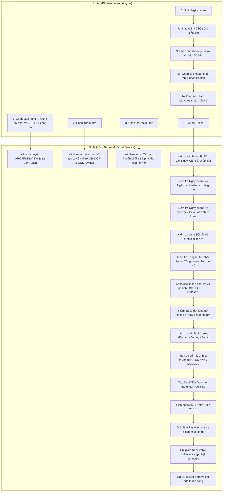

# UC-AP-06: Bù trừ công nợ phải trả (Debt Offset) - Backend Architecture & Technical Specification

Tài liệu thiết kế kiến trúc kỹ thuật và đặc tả API Backend cho nghiệp vụ **UC-AP-06: Bù trừ công nợ phải trả**.  
Chuẩn hóa theo Activity Flow (bước 1–31), 5 luồng thay thế (**AF-AP-OFFSET-01** đến **AF-AP-OFFSET-05**), 22 chốt chặn ngoại lệ (**EX-AP-OFFSET-01** đến **EX-AP-OFFSET-22**) và toàn diện 24 quy tắc nghiệp vụ (**BR-AP-OFFSET-01** đến **BR-AP-OFFSET-24**).

---

## 1. Tổng quan Kiến trúc Backend

```
┌────────────────────────────────────────────────────────────────────────┐
│                        ĐỐI TÁC LƯỠNG TÍNH (PARTNER)                    │
│  - Đối tác đồng thời liên kết vai trò Nhà cung cấp (VENDOR)            │
│    và Khách hàng (CUSTOMER) còn hiệu lực trong hệ thống                │
│  - Có công nợ phải trả (Payable > 0) và công nợ phải thu (Receivable > 0)│
└───────────────────────────────────┬────────────────────────────────────┘
                                    │
                                    ▼
       ┌─────────────────────────────────────────────────────────┐
       │             UC-AP-06 Debt Offset Service                │
       │  - Phân quyền IAM (AP.OFFSET.VIEW, CREATE, CANCEL)      │
       │  - Kiểm tra kỳ kế toán ngày bù trừ (AccountingPeriod)   │
       │  - Kiểm tra cùng loại tiền tệ (BR-AP-OFFSET-23)         │
       │  - Khóa chọn dòng nợ phải trả & phải thu (Atomic Lock)   │
       │  - Kiểm tra Tổng bù trừ phải trả == Tổng bù trừ phải thu│
       │  - Khóa bộ đếm & cấp số: BTCN-YYYY-NNNNNN (BR-16..20)   │
       │  - Tạo chứng từ bù trừ trạng thái Đã ghi sổ (POSTED)    │
       │  - Sinh bút toán Sổ cái GL (BR-AP-OFFSET-21):           │
       │     Nợ TK 331 (Phải trả NCC) / Có TK 131 (Phải thu KH)  │
       │  - KHÔNG phát sinh phiếu thu, phiếu chi, ngân hàng      │
       │  - Giảm số dư công nợ phải trả (Payable.balance)        │
       │  - Giảm số dư công nợ phải thu (Receivable.balance)     │
       │  - Cập nhật lịch thu tiền (ReceivableSchedule nếu có)   │
       │  - Cập nhật trạng thái công nợ: PAID / PARTIALLY_PAID   │
       │  - Ghi Audit Log & thông báo kết quả                    │
       └────────────────────────────┬────────────────────────────┘
                                    │
            ┌───────────────────────┴───────────────────────┐
            ▼                                               ▼
┌──────────────────────────────┐              ┌──────────────────────────────┐
│     ap_debt_offset_voucher   │1           N │ ap_debt_offset_payable_line  │
│  - number: BTCN-YYYY-NNNNNN  │─────────────▶│  - payable_id (FK Payable)   │
│  - partner_id (FK Party)     │              │  - line_no, amount           │
│  - currency_id (FK Currency) │              └──────────────────────────────┘
│  - offset_date: Date         │1           N ┌──────────────────────────────┐
│  - basis, description, amount│─────────────▶│ap_debt_offset_receivable_line│
│  - status: POSTED / CANCELLED│              │  - receivable_id (FK Receiv) │
│  - journal_entry_id (FK GL)  │              │  - line_no, amount           │
│  - reversal_journal_entry_id │              │  - schedule_allocations      │
└──────────────────────────────┘              └──────────────────────────────┘
```

### Nguyên tắc tài chính & kế toán cốt lõi (Core Financial Invariants):
1. **Bù trừ song phương cân bằng tuyệt đối (BR-AP-OFFSET-10 đến BR-AP-OFFSET-13)**:
   - Tổng bù trừ phải trả = Tổng số tiền các dòng phải trả.
   - Tổng bù trừ phải thu = Tổng số tiền các dòng phải thu.
   - Chênh lệch = Tổng bù trừ phải trả − Tổng bù trừ phải thu = 0.
   - Hệ thống chỉ cho phép ghi sổ khi hai tổng lớn hơn 0 và chênh lệch bằng 0.
2. **Định khoản kế toán chuẩn mực (BR-AP-OFFSET-21, BR-AP-OFFSET-22)**:
   - Khi ghi sổ:
     - **Nợ TK 331** (Phải trả cho người bán – đối tượng: Đối tác).
     - **Có TK 131** (Phải thu của khách hàng – đối tượng: Đối tác).
     - Số tiền: Tổng giá trị bù trừ.
   - Bù trừ không phát sinh phiếu thu, phiếu chi hoặc dòng tiền qua quỹ tiền mặt / tài khoản ngân hàng.
3. **Không sử dụng trạng thái Nháp (BR-3.4)**:
   - Chứng từ chỉ được tạo khi ghi sổ thành công ở trạng thái `POSTED` (Đã ghi sổ).
   - Khi hủy chứng từ, chuyển sang trạng thái `CANCELLED` (Đã hủy).
4. **Quy tắc đánh số và bộ đếm chứng từ (BR-AP-OFFSET-16 đến BR-AP-OFFSET-20)**:
   - Cấu trúc số: `BTCN-YYYY-NNNNNN` (Ví dụ: `BTCN-2026-000001`).
   - Quản lý riêng theo Doanh nghiệp và Năm với khóa bi quan (`select_for_update`).
   - Bắt đầu từ `000001` vào ngày 01/01 hàng năm.
   - Số đã cấp không bao giờ được tái sử dụng kể cả khi chứng từ bị hủy.
5. **Cơ chế Hủy chứng từ bù trừ đã ghi sổ (AF-AP-OFFSET-04)**:
   - Người dùng có quyền `AP.OFFSET.CANCEL` và bắt buộc nhập lý do hủy.
   - Tự động tạo bút toán đảo: **Nợ TK 131 / Có TK 331** (`reversal_journal_entry`).
   - Khôi phục công nợ cho các chứng từ phải trả (`balance += amount`, `netted_amount -= amount`).
   - Khôi phục công nợ cho các chứng từ phải thu và các kỳ lịch thu (`ReceivableSchedule`).
   - Chuyển trạng thái chứng từ bù trừ sang `CANCELLED`.
6. **Giao dịch nguyên tử (Atomic Transaction - BR-AP-OFFSET-24)**:
   - Tạo chứng từ bù trừ, sinh bút toán sổ cái GL và cập nhật số dư công nợ hai bên (AP/AR) được thực thi trong một Database Transaction duy nhất (`@transaction.atomic`). Nếu bất kỳ bước nào lỗi, toàn bộ thay đổi được hoàn tác.

---

## 2. Sơ đồ Hoạt động (Activity Diagram - Mermaid)



---

## 3. Ma trận Quy tắc Nghiệp vụ (Business Rules Matrix)

| Mã quy tắc | Tên quy tắc | Nội dung chi tiết | Hiện thực hóa tại Source Code |
| :--- | :--- | :--- | :--- |
| **BR-AP-OFFSET-01** | Đối tác bù trừ | Bắt buộc chọn đối tác liên kết với cả khách hàng và nhà cung cấp | `offset_services.py: _partner()` |
| **BR-AP-OFFSET-02** | Ngày bù trừ | Không nhỏ hơn ngày hạch toán công nợ; không lớn hơn ngày hiện tại; thuộc kỳ chưa khóa | `offset_services.py: post_offset()` |
| **BR-AP-OFFSET-03** | Căn cứ bù trừ | Bắt buộc; tối đa 255 ký tự | `offset_services.py: post_offset()` |
| **BR-AP-OFFSET-04** | Diễn giải | Bắt buộc; tối đa 500 ký tự | `offset_services.py: post_offset()` |
| **BR-AP-OFFSET-05** | Khoản phải trả | Chọn ít nhất một khoản và nhập số tiền lớn hơn 0 | `offset_services.py: _rows()` |
| **BR-AP-OFFSET-06** | Khoản phải thu | Chọn ít nhất một khoản và nhập số tiền lớn hơn 0 | `offset_services.py: _rows()` |
| **BR-AP-OFFSET-07** | Xác định cùng đối tác | Nhà cung cấp và khách hàng liên kết cùng một mã Party | `master_data.PartyRole` |
| **BR-AP-OFFSET-08** | Không dựa trên tên/SĐT | Không tự suy diễn cùng đối tác nếu chưa liên kết vai trò VENDOR/CUSTOMER | `offset_services.py: _partner()` |
| **BR-AP-OFFSET-09** | Yêu cầu liên kết | Phải thiết lập vai trò trước khi thực hiện bù trừ | `offset_services.py: eligible_partners()` |
| **BR-AP-OFFSET-10** | Tổng bù trừ phải trả | Bằng tổng số tiền bù trừ các dòng phải trả | `offset_services.py: post_offset()` |
| **BR-AP-OFFSET-11** | Tổng bù trừ phải thu | Bằng tổng số tiền bù trừ các dòng phải thu | `offset_services.py: post_offset()` |
| **BR-AP-OFFSET-12** | Chênh lệch | `Chênh lệch = Tổng bù trừ phải trả − Tổng bù trừ phải thu` | `offset_services.py: post_offset()` |
| **BR-AP-OFFSET-13** | Điều kiện cân bằng | Chỉ ghi sổ khi Chênh lệch = 0 và hai tổng > 0 | `offset_services.py: post_offset()` |
| **BR-AP-OFFSET-14** | Còn phải trả sau bù trừ | `Còn phải trả = Còn phải trả trước − Số tiền bù trừ` | `Payable.balance -= amount` |
| **BR-AP-OFFSET-15** | Còn phải thu sau bù trừ | `Còn phải thu = Còn phải thu trước − Số tiền bù trừ` | `Receivable.balance -= amount` |
| **BR-AP-OFFSET-16** | Định dạng số chứng từ | Cấu trúc `BTCN-YYYY-NNNNNN` | `offset_services.py: post_offset()` |
| **BR-AP-OFFSET-17** | Thành phần số chứng từ | `YYYY` là năm; `NNNNNN` là số thứ tự 6 chữ số | `offset_services.py: post_offset()` |
| **BR-AP-OFFSET-18** | Bộ đếm riêng biệt | Quản lý theo Doanh nghiệp và Năm; bắt đầu từ 000001 vào ngày 01/01 | `models.DebtOffsetCounter` |
| **BR-AP-OFFSET-19** | Không tái sử dụng | Số chứng từ đã cấp không được tái sử dụng kể cả khi bị hủy | `offset_services.py: cancel_offset()` |
| **BR-AP-OFFSET-20** | Khóa bộ đếm | Khóa bi quan (`select_for_update`) khi cấp số để tránh trùng lặp | `offset_services.py: post_offset()` |
| **BR-AP-OFFSET-21** | Định khoản kế toán | Nợ TK 331 (Phải trả NCC) / Có TK 131 (Phải thu KH) | `offset_services.py: _journal()` |
| **BR-AP-OFFSET-22** | Không phát sinh thu/chi | Bù trừ không phát sinh tiền mặt hoặc giao dịch ngân hàng | Không ghi nhận Sổ quỹ / Sổ ngân hàng |
| **BR-AP-OFFSET-23** | Cùng tiền tệ | Các khoản công nợ phải cùng một loại tiền tệ | `offset_services.py: post_offset()` |
| **BR-AP-OFFSET-24** | Giao dịch nguyên tử | Tạo chứng từ, sinh bút toán và giảm công nợ trong cùng một Transaction | `@transaction.atomic` |

---

## 4. Ma trận Luồng Ngoại lệ (Exception Flow Matrix)

| Mã ngoại lệ | Điều kiện kích hoạt | Thông báo hiển thị / Mã lỗi | Xử lý hệ thống |
| :--- | :--- | :--- | :--- |
| **EX-AP-OFFSET-01** | User không có quyền tạo | `Bạn không có quyền thực hiện bù trừ công nợ.` | 403 Forbidden |
| **EX-AP-OFFSET-02** | Chưa chọn đối tác | `Vui lòng chọn Đối tác bù trừ.` | 400 Bad Request |
| **EX-AP-OFFSET-03** | Chưa liên kết KH và NCC | `Đối tác chưa được liên kết đồng thời với khách hàng và nhà cung cấp.` | 400 Bad Request |
| **EX-AP-OFFSET-04** | Không có công nợ phải trả | `Đối tác không có khoản công nợ phải trả chưa thanh toán.` | 400 Bad Request |
| **EX-AP-OFFSET-05** | Không có công nợ phải thu | `Đối tác không có khoản công nợ phải thu chưa thu.` | 400 Bad Request |
| **EX-AP-OFFSET-06** | Chưa nhập Ngày bù trừ | `Vui lòng nhập Ngày bù trừ.` | 400 Bad Request |
| **EX-AP-OFFSET-07** | Chưa nhập Căn cứ bù trừ | `Vui lòng nhập Căn cứ bù trừ.` | 400 Bad Request |
| **EX-AP-OFFSET-08** | Chưa nhập Diễn giải | `Vui lòng nhập Diễn giải.` | 400 Bad Request |
| **EX-AP-OFFSET-09** | Chưa chọn khoản phải trả | `Vui lòng chọn ít nhất một khoản công nợ phải trả.` | 400 Bad Request |
| **EX-AP-OFFSET-10** | Chưa chọn khoản phải thu | `Vui lòng chọn ít nhất một khoản công nợ phải thu.` | 400 Bad Request |
| **EX-AP-OFFSET-11** | Có dòng tiền <= 0 | `Số tiền bù trừ của các dòng được chọn phải lớn hơn 0.` | 400 Bad Request |
| **EX-AP-OFFSET-12** | Ngày bù trừ < Ngày hạch toán nợ | `Ngày bù trừ không được nhỏ hơn ngày hạch toán của chứng từ {Số chứng từ}.` | 400 Bad Request |
| **EX-AP-OFFSET-13** | Ngày bù trừ > Hiện tại | `Ngày bù trừ không được lớn hơn ngày hiện tại.` | 400 Bad Request |
| **EX-AP-OFFSET-14** | Kỳ kế toán đã khóa | `Kỳ kế toán của ngày bù trừ đã bị khóa.` | 400 Bad Request |
| **EX-AP-OFFSET-15** | Khác đối tác | `Các khoản công nợ được chọn phải thuộc cùng một đối tác.` | 400 Bad Request |
| **EX-AP-OFFSET-16** | Khác loại tiền | `Các khoản công nợ được chọn phải sử dụng cùng một loại tiền.` | 400 Bad Request |
| **EX-AP-OFFSET-17** | Hai bên không bằng nhau | `Tổng bù trừ phải trả phải bằng Tổng bù trừ phải thu. Chênh lệch hiện tại: {Số tiền}.` | 400 Bad Request |
| **EX-AP-OFFSET-18** | Công nợ vừa thay đổi | `Số tiền công nợ của chứng từ {Số chứng từ} đã thay đổi. Vui lòng tải lại dữ liệu.` | 400 Bad Request |
| **EX-AP-OFFSET-19** | Vượt công nợ phải trả | `Số tiền bù trừ của chứng từ phải trả {Số chứng từ} vượt số tiền còn phải trả là {Số tiền}.` | 400 Bad Request |
| **EX-AP-OFFSET-20** | Vượt công nợ phải thu | `Số tiền bù trừ của chứng từ phải thu {Số chứng từ} vượt số tiền còn phải thu là {Số tiền}.` | 400 Bad Request |
| **EX-AP-OFFSET-21** | Tệp đính kèm không hợp lệ | `Tệp {Tên tệp} không đúng định dạng hoặc vượt quá dung lượng 10 MB.` | 400 Bad Request |
| **EX-AP-OFFSET-22** | Lỗi ghi sổ | `Không thể ghi sổ chứng từ bù trừ. Dữ liệu công nợ chưa được thay đổi.` | Rollback giao dịch |

---

## 5. Đặc tả API Endpoints

### 5.1. Lấy danh sách đối tác đủ điều kiện bù trừ (Bước 3)
- **URL**: `GET /api/v1/accounts-payable/debt-offsets/eligible-partners/`
- **Query Params**: `company_id` (UUID, bắt buộc)
- **Quyền**: `AP.OFFSET.VIEW`
- **Response**: `200 OK`
```json
[
  {
    "id": "7efb293c-cf57-41ea-bfcf-6d7b56a1bce4",
    "code": "DT-001",
    "name": "Công ty TNHH Song Hành"
  }
]
```

### 5.2. Lấy danh sách công nợ phải trả và phải thu của đối tác (Bước 4, 5)
- **URL**: `GET /api/v1/accounts-payable/debt-offsets/eligible-debts/`
- **Query Params**:
  - `company_id` (UUID, bắt buộc)
  - `partner_id` (UUID, bắt buộc)
- **Quyền**: `AP.OFFSET.VIEW`
- **Response**: `200 OK`
```json
{
  "payables": [
    {
      "id": "5cbb81b2-c0cb-4e94-8255-a0c6488d04ce",
      "number": "CN-2026-000012",
      "posting_date": "2026-10-01",
      "currency": "23a83017-c8fc-4217-a06d-74d1264cba36",
      "currency_code": "VND",
      "original_amount": "10000000.0000",
      "balance": "10000000.0000",
      "due_date": "2026-10-20"
    }
  ],
  "receivables": [
    {
      "id": "9bc66712-4218-4903-b09e-73cbbfa00412",
      "number": "AR-2026-000008",
      "posting_date": "2026-10-02",
      "currency": "23a83017-c8fc-4217-a06d-74d1264cba36",
      "currency_code": "VND",
      "original_amount": "12000000.0000",
      "balance": "12000000.0000",
      "due_date": "2026-10-25"
    }
  ]
}
```

### 5.3. Ghi sổ chứng từ bù trừ công nợ (Bước 15 đến 31)
- **URL**: `POST /api/v1/accounts-payable/debt-offsets/`
- **Query Params**: `company_id` (UUID, tùy chọn nếu gửi trong body)
- **Body**:
```json
{
  "company": "2919d7b9-6b5d-4f18-bb71-789a7fb665f8",
  "partner": "7efb293c-cf57-41ea-bfcf-6d7b56a1bce4",
  "offset_date": "2026-10-12",
  "basis": "Biên bản thỏa thuận bù trừ công nợ số 01/2026/BB-TT",
  "description": "Bù trừ công nợ với Công ty TNHH Song Hành",
  "attachments": [
    {
      "name": "bien_ban_bu_tru.pdf",
      "size": 1542000
    }
  ],
  "payable_lines": [
    {
      "payable": "5cbb81b2-c0cb-4e94-8255-a0c6488d04ce",
      "amount": "10000000.0000",
      "expected_balance": "10000000.0000"
    }
  ],
  "receivable_lines": [
    {
      "receivable": "9bc66712-4218-4903-b09e-73cbbfa00412",
      "amount": "10000000.0000",
      "expected_balance": "12000000.0000"
    }
  ]
}
```
- **Quyền**: `AP.OFFSET.CREATE`
- **Response**: `201 Created`
```json
{
  "id": "334e3221-7009-42b7-a3a0-f38b4df52b0a",
  "number": "BTCN-2026-000001",
  "partner": "7efb293c-cf57-41ea-bfcf-6d7b56a1bce4",
  "partner_name": "Công ty TNHH Song Hành",
  "partner_code": "DT-001",
  "currency_code": "VND",
  "offset_date": "2026-10-12",
  "basis": "Biên bản thỏa thuận bù trừ công nợ số 01/2026/BB-TT",
  "description": "Bù trừ công nợ với Công ty TNHH Song Hành",
  "amount": "10000000.0000",
  "status": "POSTED",
  "journal_entry_number": "GL-BTCN-2026-000001",
  "payable_lines": [
    {
      "id": "e0e2384a-9284-4822-ba7f-a68ba7a5491e",
      "line_no": 1,
      "payable": "5cbb81b2-c0cb-4e94-8255-a0c6488d04ce",
      "payable_number": "CN-2026-000012",
      "amount": "10000000.0000"
    }
  ],
  "receivable_lines": [
    {
      "id": "f5a04381-8173-455e-9f33-146313431102",
      "line_no": 1,
      "receivable": "9bc66712-4218-4903-b09e-73cbbfa00412",
      "receivable_number": "AR-2026-000008",
      "amount": "10000000.0000"
    }
  ],
  "message": "Ghi sổ chứng từ bù trừ thành công. Số chứng từ: BTCN-2026-000001."
}
```

### 5.4. Hủy chứng từ bù trừ đã ghi sổ (AF-AP-OFFSET-04)
- **URL**: `POST /api/v1/accounts-payable/debt-offsets/{id}/cancel/`
- **Query Params**: `company_id` (UUID, tùy chọn)
- **Body**:
```json
{
  "reason": "Hai bên thỏa thuận lại phương án thanh toán"
}
```
- **Quyền**: `AP.OFFSET.CANCEL`
- **Response**: `200 OK`
```json
{
  "id": "334e3221-7009-42b7-a3a0-f38b4df52b0a",
  "number": "BTCN-2026-000001",
  "status": "CANCELLED",
  "cancel_reason": "Hai bên thỏa thuận lại phương án thanh toán",
  "reversal_journal_entry_number": "GL-REV-BTCN-2026-000001"
}
```
