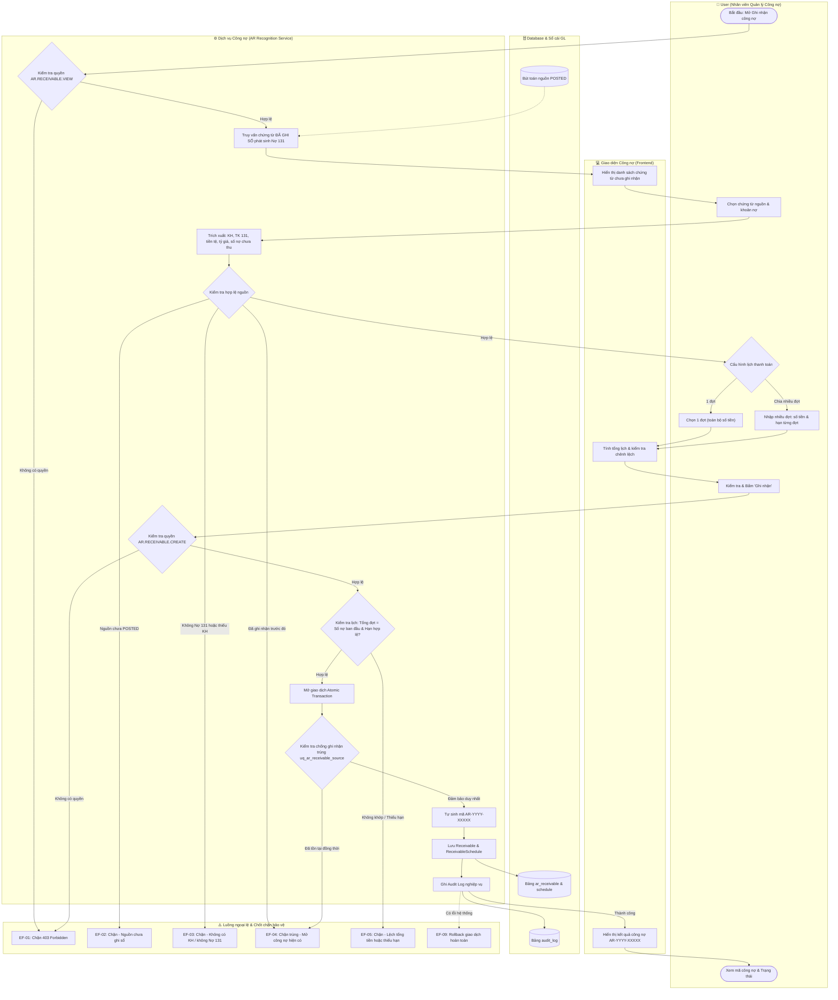
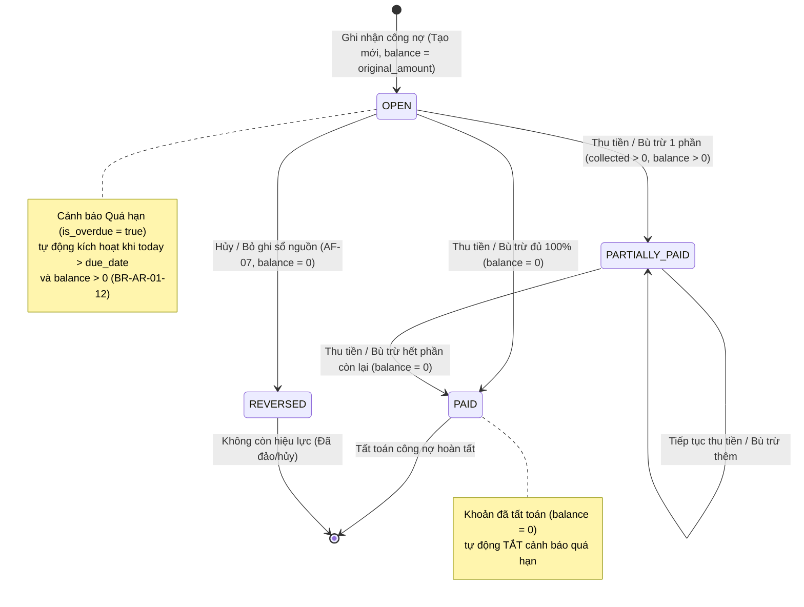

# UC-AR-01: Ghi nhận công nợ phải thu (Accounts Receivable Recognition) - Backend Architecture & API Specification

Tài liệu thiết kế kỹ thuật và đặc tả API backend cho use case **UC-AR-01: Ghi nhận công nợ phải thu**.
Triển khai tuân thủ toàn diện các quy tắc nghiệp vụ (**BR-AR-01-01** đến **BR-AR-01-15**), luồng hoạt động chính (**Activity Flow 1–7**), luồng thay thế (**AF-01** đến **AF-07**) và luồng ngoại lệ (**EF-01** đến **EF-09**).

---

## 1. Tổng quan Kiến trúc Backend

```
┌────────────────────────────────────────────────────────────────────────┐
│                   Chứng từ nguồn đã ghi sổ (POSTED)                    │
│  - Hóa đơn / Chứng từ bán hàng AR (ReceivableDocument)                  │
│  - Sổ cái chung (GL JournalEntry Line Nợ 131 - Khách hàng)             │
└───────────────────────────────────┬────────────────────────────────────┘
                                    │
                                    ▼
       ┌─────────────────────────────────────────────────────────┐
       │                UC-AR-01 Recognition Service              │
       │  - Anti-duplication (Mã nguồn + Line ID)                │
       │  - Tự sinh mã công nợ: AR-YYYY-XXXXX                    │
       │  - Lịch thanh toán (1 đợt hoặc chia nhiều đợt)          │
       │  - Không tạo thêm bút toán doanh thu/phải thu mới       │
       │  - Giao dịch đồng bộ (Atomic Transaction)               │
       └────────────────────────────┬────────────────────────────┘
                                    │
           ┌────────────────────────┴────────────────────────┐
           ▼                                                 ▼
┌──────────────────────────────┐          ┌──────────────────────────────┐
│       ar_receivable          │1       N │    ar_receivable_schedule    │
│  - code (AR-YYYY-XXXXX)      │─────────▶│  - installment_no            │
│  - original_amount           │          │  - amount / balance          │
│  - collected / netted        │          │  - due_date / status         │
│  - balance / status          │          │  - is_overdue (alert)        │
│  - is_overdue (alert)        │          └──────────────────────────────┘
└──────────────┬───────────────┘
               │ 1
               ▼ N
┌──────────────────────────────┐
│ar_receivable_schedule_history│
│  - old_schedule / new_sched  │
│  - reason / changed_by       │
└──────────────────────────────┘
```

---

## 1.1. Sơ đồ Hoạt động (Activity Diagram - Mermaid)

Sơ đồ thể hiện toàn diện luồng chính (Main Flow Bước 1–7), các điểm rẽ nhánh luồng thay thế (AF-01 đến AF-07) và các chốt chặn ngoại lệ (EF-01 đến EF-09) giữa 4 tác nhân: **User**, **Frontend**, **AR Recognition Service** và **Database / GL**:



---

## 1.2. Sơ đồ Vòng đời Trạng thái Công nợ (State Diagram - Mermaid)



---

## 2. Mô hình Dữ liệu (Database Models)

### 2.1. `Receivable` (`ar_receivable`)
- **Khóa chính**: `id` (UUID).
- **Mã công nợ**: `code` (CharField, tự sinh định dạng `AR-YYYY-XXXXX`, duy nhất trong công ty).
- **Liên kết nguồn**:
  - `source_document_type`: `AR_DOCUMENT` | `JOURNAL_ENTRY`.
  - `source_document_id`: ID chứng từ nguồn.
  - `source_document_number`: Số hiệu chứng từ nguồn.
  - `source_line_id`: ID dòng hạch toán nguồn (đối với Sổ cái JournalEntry).
  - `document`: OneToOneField liên kết `ReceivableDocument` (nếu nguồn là AR Document).
  - `journal_entry`: ForeignKey liên kết `JournalEntry` (nếu nguồn là GL JournalEntry).
  - `account`: ForeignKey `Account` (tài khoản 131).
- **Thông tin tài chính**:
  - `currency`, `exchange_rate`: Đồng tiền và tỷ giá nguyên tệ lấy từ nguồn.
  - `original_amount`: Số phải thu ban đầu (chỉ lấy phần phát sinh nợ chưa thanh toán ngay, BR-AR-01-04).
  - `collected_amount`: Số đã thu qua phiếu thu (`Receipt`).
  - `netted_amount`: Số đã bù trừ/đối trừ (`Netting`).
  - `adjustment_amount`: Số điều chỉnh (`ReceivableAdjustment`).
  - `balance`: Số còn phải thu = `original_amount - collected_amount - netted_amount + adjustment_amount`.
- **Hạn thanh toán & Trạng thái**:
  - `due_date`: Hạn thanh toán (kế thừa từ nguồn hoặc tính từ điều khoản thanh toán).
  - `status`: `OPEN` (Chưa thanh toán), `PARTIALLY_PAID` (Thanh toán một phần), `PAID` (Đã tất toán), `REVERSED` (Không còn hiệu lực).
  - `is_overdue`: Property cảnh báo riêng khi ngày hiện tại > `due_date` của đợt còn phải thu và `balance > 0`.
- **Ràng buộc toàn vẹn**:
  - `uq_ar_receivable_code`: Duy nhất `(company, code)`.
  - `uq_ar_receivable_source`: Duy nhất `(company, source_document_type, source_document_id, source_line_id)` chống ghi nhận trùng (BR-AR-01-05).

### 2.2. `ReceivableSchedule` (`ar_receivable_schedule`)
- Quản lý lịch thanh toán theo từng đợt:
  - `installment_no`: Số thứ tự đợt (1, 2, ...).
  - `amount`: Số tiền từng đợt (> 0; tổng các đợt = `original_amount`).
  - `due_date`: Hạn thanh toán từng đợt.
  - `collected_amount`: Số tiền đã thu/phân bổ cho đợt.
  - `balance`: Số còn phải thu của đợt = `amount - collected_amount`.
  - `status`: `OPEN` | `PARTIALLY_PAID` | `PAID` | `REVERSED`.
  - `is_overdue`: Property cảnh báo đợt quá hạn.

### 2.3. `ReceivableScheduleHistory` (`ar_receivable_schedule_history`)
- Lưu vết thay đổi lịch thanh toán (AF-05, BR-AR-01-07):
  - `changed_by`: Người thực hiện thay đổi.
  - `changed_at`: Thời điểm thay đổi.
  - `reason`: Lý do điều chỉnh lịch thanh toán (bắt buộc).
  - `old_schedule`: JSON snapshot lịch thanh toán trước khi sửa.
  - `new_schedule`: JSON snapshot lịch thanh toán sau khi sửa.

---

## 3. Danh mục API Endpoints

### 3.1. Danh sách nguồn chưa ghi nhận công nợ
- **URL**: `GET /api/v1/accounts-receivable/receivables/unrecognized-sources/`
- **Quyền yêu cầu**: `AR.RECEIVABLE.VIEW`
- **Query Params**:
  - `company_id`: (Bắt buộc) UUID công ty.
  - `branch_id`: (Tùy chọn) Lọc theo chi nhánh.
  - `customer_id`: (Tùy chọn) Lọc theo khách hàng.
  - `search`: (Tùy chọn) Tìm kiếm theo số chứng từ, tên/mã khách hàng, diễn giải.
- **Phản hồi 200 OK**:
  ```json
  [
    {
      "source_document_type": "AR_DOCUMENT",
      "source_document_id": "0df6186b-...",
      "source_document_number": "HD-2026-001",
      "source_line_id": "",
      "customer_id": "9ac5038c-...",
      "customer_code": "KH01",
      "customer_name": "Công ty TNHH An Bình",
      "account_id": null,
      "account_code": "131",
      "account_name": "Phải thu của khách hàng",
      "currency_id": "...",
      "currency_code": "VND",
      "exchange_rate": "1.00000000",
      "original_amount": "10000000.0000",
      "document_date": "2026-10-07",
      "posting_date": "2026-10-07",
      "due_date": "2026-11-06",
      "payment_term_id": "...",
      "payment_term_name": "Net 30",
      "sales_order_id": null,
      "sales_contract_id": null,
      "description": "Bán hàng hóa đợt 1"
    }
  ]
  ```

### 3.2. Ghi nhận công nợ (Đơn lẻ)
- **URL**: `POST /api/v1/accounts-receivable/receivables/recognize/`
- **Quyền yêu cầu**: `AR.RECEIVABLE.CREATE`
- **Request Body**:
  ```json
  {
    "company": "c8ff5419-...",
    "source_document_type": "AR_DOCUMENT",
    "source_document_id": "0df6186b-...",
    "source_line_id": "",
    "due_date": "2026-11-06",
    "description": "Ghi nhận công nợ HĐ-001",
    "schedules": [
      {
        "installment_no": 1,
        "amount": "6000000.0000",
        "due_date": "2026-10-20",
        "notes": "Đợt 1 - 60%"
      },
      {
        "installment_no": 2,
        "amount": "4000000.0000",
        "due_date": "2026-11-06",
        "notes": "Đợt 2 - 40%"
      }
    ]
  }
  ```
- **Phản hồi 201 Created**:
  ```json
  {
    "id": "e4587a82-...",
    "code": "AR-2026-00001",
    "customer": "9ac5038c-...",
    "customer_name": "Công ty TNHH An Bình",
    "customer_code": "KH01",
    "original_amount": "10000000.0000",
    "collected_amount": "0.0000",
    "netted_amount": "0.0000",
    "balance": "10000000.0000",
    "due_date": "2026-10-20",
    "status": "OPEN",
    "is_overdue": false,
    "schedules": [
      {
        "installment_no": 1,
        "amount": "6000000.0000",
        "balance": "6000000.0000",
        "collected_amount": "0.0000",
        "due_date": "2026-10-20",
        "status": "OPEN",
        "is_overdue": false,
        "notes": "Đợt 1 - 60%"
      },
      {
        "installment_no": 2,
        "amount": "4000000.0000",
        "balance": "4000000.0000",
        "collected_amount": "0.0000",
        "due_date": "2026-11-06",
        "status": "OPEN",
        "is_overdue": false,
        "notes": "Đợt 2 - 40%"
      }
    ]
  }
  ```

### 3.3. Tra cứu công nợ theo chứng từ nguồn (AF-02)
- **URL**: `GET /api/v1/accounts-receivable/receivables/by-source/`
- **Quyền yêu cầu**: `AR.RECEIVABLE.VIEW`
- **Query Params**: `company_id`, `source_document_type`, `source_document_id`, `source_line_id`
- **Phản hồi 200 OK**:
  - Nếu đã ghi nhận: `{"exists": true, "receivable": {...}}`
  - Nếu chưa ghi nhận: `{"exists": false, "can_recognize": true, "source_data": {...}}`

### 3.4. Ghi nhận hàng loạt (AF-04)
- **URL**: `POST /api/v1/accounts-receivable/receivables/bulk-recognize/`
- **Quyền yêu cầu**: `AR.RECEIVABLE.CREATE`
- **Request Body**:
  ```json
  {
    "company": "c8ff5419-...",
    "items": [
      { "source_document_type": "AR_DOCUMENT", "source_document_id": "uuid-1" },
      { "source_document_type": "AR_DOCUMENT", "source_document_id": "uuid-2" }
    ]
  }
  ```
- **Phản hồi 200 OK**:
  ```json
  {
    "results": [
      {
        "source_document_id": "uuid-1",
        "success": true,
        "receivable_id": "uuid-rec-1",
        "code": "AR-2026-00002",
        "error": null
      },
      {
        "source_document_id": "uuid-2",
        "success": false,
        "receivable_id": null,
        "code": null,
        "error": "Khoản phát sinh từ chứng từ nguồn đã được ghi nhận công nợ."
      }
    ]
  }
  ```

### 3.5. Cập nhật lịch thanh toán (AF-05)
- **URL**: `POST /api/v1/accounts-receivable/receivables/{id}/update-schedule/`
- **Quyền yêu cầu**: `AR.RECEIVABLE.EDIT`
- **Request Body**:
  ```json
  {
    "reason": "Khách hàng đề nghị gia hạn và phân kỳ lại thanh toán",
    "schedules": [
      { "installment_no": 1, "amount": "5000000", "due_date": "2026-10-25", "notes": "Gia hạn đợt 1" },
      { "installment_no": 2, "amount": "5000000", "due_date": "2026-11-15", "notes": "Đợt 2" }
    ]
  }
  ```
- **Ràng buộc**:
  - Lý do thay đổi bắt buộc không được để trống (BR-AR-01-07).
  - Tổng các đợt mới phải đúng bằng `original_amount` (BR-AR-01-06, EF-05).
  - Không được giảm số tiền của một đợt xuống dưới mức đã thu của đợt đó (AF-05).
  - Lưu snapshot trước/sau vào `ReceivableScheduleHistory`.

### 3.6. Hủy / Bỏ ghi nhận công nợ (AF-07, EF-08)
- **URL**: `POST /api/v1/accounts-receivable/receivables/{id}/reverse/`
- **Quyền yêu cầu**: `AR.RECEIVABLE.CANCEL`
- **Request Body**: `{"reason": "Chứng từ nguồn bị hủy bỏ hợp lệ"}`
- **Ràng buộc EF-08**:
  - Chặn hủy nếu `collected_amount > 0` hoặc `netted_amount > 0`. Báo lỗi yêu cầu hủy các phân bổ phụ thuộc trước.
  - Nếu hợp lệ: Cập nhật `status = REVERSED`, `balance = 0`, schedules `status = REVERSED`.

---

## 4. Tự động hóa tích hợp (Integration Automations)

1. **Ghi sổ tự động (AF-01)**: Khi người dùng thực hiện ghi sổ chứng từ AR (`POST /documents/{id}/post/`), hệ thống tự động sinh `Receivable` với mã tự tăng `AR-YYYY-XXXXX` và lịch thanh toán đợt 1 trong cùng một giao dịch cơ sở dữ liệu.
2. **Phân bổ thu tiền tuần tự (AF-06)**: Khi thực hiện `allocate` phiếu thu hoặc `post_netting` đối trừ, số tiền được phân bổ tuần tự cho các đợt (`ReceivableSchedule`) theo thứ tự `installment_no` từ nhỏ đến lớn. Đợt nào được thanh toán hết chuyển sang `PAID`, đợt thanh toán một phần chuyển sang `PARTIALLY_PAID`.
3. **Cảnh báo quá hạn động (BR-AR-01-12)**: `is_overdue` được tính toán tự động dựa trên ngày hiện tại và các đợt còn nợ (`balance > 0`). Khi khoản nợ đã tất toán (`PAID`), cờ cảnh báo quá hạn tự động tắt.

---

## 5. Kết quả Kiểm thử Tự động (Automated Test Verification)

Bộ test case hoàn chỉnh được đặt tại [`accounts_receivable/test_ar_recognition.py`](file:///c:/Users/Admin/LapTrinh/Thue/accounts_receivable/test_ar_recognition.py), kiểm thử độc lập 12 kịch bản tự động:

| STT | Kịch bản kiểm thử | Luồng & Quy tắc | Kết quả |
|---|---|---|---|
| 1 | `test_unrecognized_sources_listing_and_filtering` | Luồng chính B1-B3, BR-02, BR-03, BR-05 | PASSED |
| 2 | `test_recognize_from_receivable_document_single_and_split_schedule` | Luồng chính B4-B7, BR-04, BR-06, BR-14, BR-15 | PASSED |
| 3 | `test_recognize_from_journal_entry` | Nguồn GL JournalEntry, BR-02, BR-04, BR-14 | PASSED |
| 4 | `test_auto_recognition_on_post_document_af01` | AF-01 Ghi nhận tự động khi ghi sổ | PASSED |
| 5 | `test_by_source_lookup_af02` | AF-02 Mở tra cứu từ nguồn | PASSED |
| 6 | `test_bulk_recognize_af04` | AF-04 Ghi nhận nhiều chứng từ độc lập | PASSED |
| 7 | `test_update_payment_schedule_and_history_af05` | AF-05, BR-06, BR-07, EF-05 Sửa lịch thanh toán | PASSED |
| 8 | `test_receipt_allocation_updates_installments_af06` | AF-06, BR-08 Phân bổ thu tiền theo đợt | PASSED |
| 9 | `test_reverse_receivable_and_ef08_constraint` | AF-07, EF-08 Chặn hủy khi có thu tiền | PASSED |
| 10 | `test_rejection_unposted_source_ef02` | EF-02 Chặn nguồn chưa ghi sổ | PASSED |
| 11 | `test_duplicate_recognition_prevention_ef04_br05` | EF-04, BR-05 Chống ghi nhận trùng | PASSED |
| 12 | `test_overdue_warning_br12` | BR-12 Cảnh báo quá hạn | PASSED |
| 13 | `test_permission_checks_ef01_br01` | EF-01, BR-01 Phân quyền IAM (AR.RECEIVABLE.*) | PASSED |
| 14-15 | `accounts_receivable/tests.py` (3 test suites hiện hữu) | Nghiệp vụ AR, phê duyệt, đối trừ và hạn mức nợ | PASSED |

**Tổng số test cases**: 15/15 PASSED trong 6.223s, bảo toàn 100% các bài test AR hiện có.
