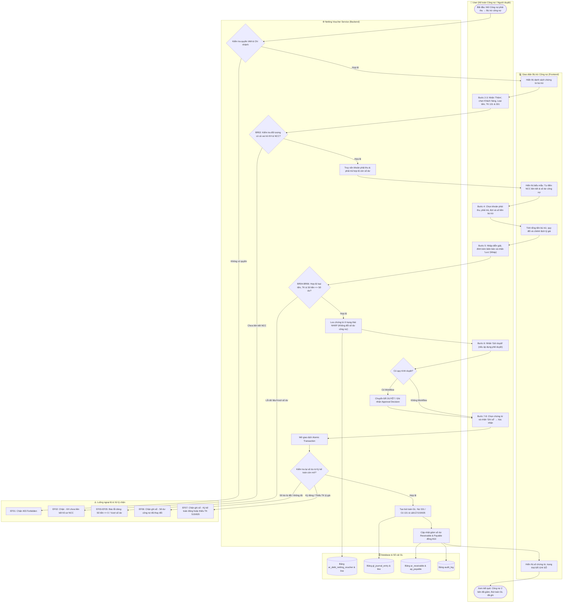
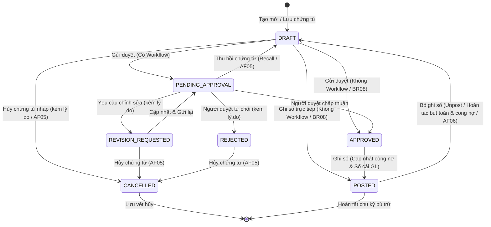

# UC-AR-05: Bù trừ công nợ phải thu (Debt Netting / Offset) - Backend Architecture & API Specification

Tài liệu thiết kế kỹ thuật và đặc tả API backend cho use case **UC-AR-05: Bù trừ công nợ phải thu**.
Triển khai tuân thủ toàn diện các quy tắc nghiệp vụ (**BR01** đến **BR14**), luồng hoạt động chính (**Activity Flow Bước 1–8**), luồng thay thế (**AF01** đến **AF06**) và luồng ngoại lệ (**EF01** đến **EF10**).

---

## 1. Sơ đồ Hoạt động (Activity Diagram - Mermaid)

Sơ đồ thể hiện luồng bù trừ công nợ giữa Khách hàng và Nhà cung cấp của cùng một đối tượng qua 4 phân vùng (swimlanes):

---

## 2. Sơ đồ Vòng đời Trạng thái Chứng từ (State Diagram - Mermaid)

---

## 3. Mô hình Dữ liệu (Database Models)

### 3.1. `DebtNettingVoucher` (`ar_debt_netting_voucher`)
- **Khóa chính**: `id` (UUID).
- **Mã chứng từ**: `number` (Tự sinh theo `DocumentNumberingRule` hoặc quy tắc `AR-NT-YYYY-00001`, duy nhất trong công ty).
- **Liên kết tổ chức & đối tượng**:
  - `company`: ForeignKey `Company`.
  - `branch`: ForeignKey `Branch`.
  - `customer`: ForeignKey `Party` (vai trò Khách hàng, `status = ACTIVE`).
  - `supplier`: ForeignKey `Party` (vai trò Nhà cung cấp liên kết cùng đối tượng, BR02).
- **Thông tin tài chính**:
  - `currency`: ForeignKey `Currency`.
  - `receivable_account`: ForeignKey `Account` (TK 131).
  - `payable_account`: ForeignKey `Account` (TK 331).
  - `total_amount`: DecimalField (Tổng tiền bù trừ = $\sum \text{amount}$).
- **Thời gian & Diễn giải**:
  - `document_date`, `posting_date`: DateField.
  - `description`: Mặc định "Bù trừ công nợ [Tên đối tượng]".
  - `agreement_reference`: Biên bản / thỏa thuận bù trừ đính kèm.
- **Trạng thái & Phê duyệt**:
  - `status`: `DRAFT` | `PENDING_APPROVAL` | `REVISION_REQUESTED` | `REJECTED` | `APPROVED` | `POSTED` | `CANCELLED`.
  - `journal_entry`: OneToOneField `JournalEntry` (bút toán Sổ cái khi Đã ghi sổ).
  - `posted_by`, `posted_at`, `unposted_by`, `unposted_at`, `unpost_reason`.
  - `cancelled_by`, `cancelled_at`, `cancel_reason`.

### 3.2. `DebtNettingVoucherLine` (`ar_debt_netting_voucher_line`)
- `voucher`: ForeignKey `DebtNettingVoucher`.
- `line_no`: Số thứ tự dòng.
- `receivable`: ForeignKey `Receivable` (Khoản phải thu đối ứng).
- `receivable_schedule`: ForeignKey `ReceivableSchedule` (Đợt thanh toán tùy chọn).
- `payable`: ForeignKey `Payable` (Khoản phải trả đối ứng).
- `amount`: Số tiền bù trừ nguyên tệ (> 0, BR05).
- `receivable_exchange_rate`, `payable_exchange_rate`: Tỷ giá ghi sổ ban đầu của 2 khoản.
- `receivable_converted_amount`: Giá trị phải thu quy đổi = $\text{amount} \times \text{receivable.exchange\_rate}$.
- `payable_converted_amount`: Giá trị phải trả quy đổi = $\text{amount} \times \text{payable.exchange\_rate}$.
- `exchange_gain_loss`: Chênh lệch tỷ giá = $\text{payable\_converted} - \text{receivable\_converted}$ (BR10).
- `netting_record`: ForeignKey `Netting` (liên kết bản ghi Netting phục vụ Sổ chi tiết công nợ).

---

## 4. Danh mục API Endpoints

Base URL: `/api/v1/accounts-receivable/debt-netting-vouchers/`

| Phương thức | Endpoint | Quyền IAM | Mô tả |
| :--- | :--- | :--- | :--- |
| `GET` | `/` | `AR.NETTING_VOUCHER.VIEW` | Danh sách chứng từ bù trừ (lọc theo `company_id`, `branch_id`, `customer_id`, trạng thái). |
| `POST` | `/` | `AR.NETTING_VOUCHER.CREATE` | Lập chứng từ bù trừ mới ở trạng thái `DRAFT` (BR07). |
| `GET` | `/{id}/` | `AR.NETTING_VOUCHER.VIEW` | Chi tiết chứng từ và các dòng bù trừ. |
| `PATCH` | `/{id}/` | `AR.NETTING_VOUCHER.EDIT` | Sửa chứng từ ở trạng thái `DRAFT`, `REVISION_REQUESTED`, `REJECTED`. |
| `GET` | `/eligible-debts/` | `AR.NETTING_VOUCHER.VIEW` | Truy vấn các khoản phải thu và phải trả đủ điều kiện để lập bù trừ (Bước 3, AF04). |
| `POST` | `/{id}/submit/` | `AR.NETTING_VOUCHER.SUBMIT` | Gửi duyệt chứng từ (tự duyệt nếu không có workflow / BR08). |
| `POST` | `/{id}/recall/` | `AR.NETTING_VOUCHER.EDIT` | Thu hồi chứng từ đang chờ duyệt về `DRAFT`. |
| `POST` | `/{id}/approve/` | `AR.NETTING_VOUCHER.APPROVE` | Phê duyệt chứng từ bù trừ. |
| `POST` | `/{id}/reject/` | `AR.NETTING_VOUCHER.APPROVE` | Từ chối duyệt chứng từ (kèm `reason`). |
| `POST` | `/{id}/request-revision/` | `AR.NETTING_VOUCHER.APPROVE` | Yêu cầu chỉnh sửa chứng từ (kèm `reason`). |
| `POST` | `/{id}/cancel/` | `AR.NETTING_VOUCHER.CANCEL` | Hủy chứng từ chưa ghi sổ (kèm `reason` / AF05). |
| `POST` | `/{id}/post/` | `AR.NETTING_VOUCHER.POST` | Ghi sổ bù trừ, sinh bút toán GL, cập nhật công nợ 2 bên (Bước 7-8). |
| `POST` | `/{id}/unpost/` | `AR.NETTING_VOUCHER.UNPOST` | Bỏ ghi sổ, hoàn tác bút toán GL và phục hồi số dư công nợ (AF06). |

---

## 5. Bảng Đối chiếu Quy tắc Nghiệp vụ (Business Rules)

| Mã BR | Tóm tắt quy tắc | Hiện thực hóa trong Backend | Trạng thái |
| :--- | :--- | :--- | :---: |
| **BR01** | Kiểm tra quyền và phạm vi dữ liệu chi nhánh | `AccountsReceivablePermission` kiểm tra quyền IAM và `branch_id`. | ✅ Đạt |
| **BR02** | Bù trừ cùng một đối tượng (liên kết KH - NCC) | `get_linked_supplier` kiểm tra vai trò `CUSTOMER` và `VENDOR` của cùng đối tượng. | ✅ Đạt |
| **BR03** | Công nợ từ chứng từ đã ghi sổ, còn số dư | Kiểm tra `status in (OPEN, PARTIALLY_PAID)` và `balance > 0`. | ✅ Đạt |
| **BR04** | Một loại tiền, một TK phải thu, một TK phải trả | Toàn bộ dòng bù trừ phải khớp `currency`, `receivable_account`, `payable_account`. | ✅ Đạt |
| **BR05** | Số tiền dòng > 0, không trùng lặp cặp công nợ | `amount > 0` và ràng buộc duy nhất cặp `(rec, sched, payable)` trong chứng từ. | ✅ Đạt |
| **BR06** | Bù trừ không vượt số dư; kiểm tra lại khi ghi sổ | Kiểm tra cộng dồn tại lúc lưu và kiểm tra khóa `select_for_update` khi ghi sổ. | ✅ Đạt |
| **BR07** | Lưu Nháp không giữ chỗ và không đổi số dư | Lưu `DRAFT` không tạo bút toán và không thay đổi `balance` công nợ. | ✅ Đạt |
| **BR08** | Điều kiện ghi sổ (APPROVED hoặc DRAFT nếu không workflow) | Kiểm tra `workflow_snapshot` hoặc cho phép ghi sổ trực tiếp khi không workflow. | ✅ Đạt |
| **BR09** | Bút toán Sổ cái: Nợ 331 / Có 131; không thu chi tiền | Sinh `JournalEntry` đúng Nợ 331, Có 131, không sinh dòng quỹ/ngân hàng. | ✅ Đạt |
| **BR10** | Tỷ giá ghi sổ còn lại; chênh lệch hạch toán 515/635 | Tính `fx_diff`: Lãi ghi Có 515, Lỗ ghi Nợ 635; cân đối Nợ = Có tuyệt đối. | ✅ Đạt |
| **BR11** | Tiền ứng trước xử lý tại UC-AR-04, không đưa vào đây | Chỉ bù trừ các chứng từ công nợ phát sinh Nợ 131 và Có 331 còn hiệu lực. | ✅ Đạt |
| **BR12** | Chặn bỏ ghi sổ nguồn khi còn bù trừ có hiệu lực | Kiểm tra liên kết `netting_lines` khi chứng từ nguồn thực hiện unpost. | ✅ Đạt |
| **BR13** | Bút toán & cập nhật công nợ thành công đồng thời, Idempotent | Bọc toàn bộ trong `@transaction.atomic`; gửi lặp `post` trả lại cùng kết quả. | ✅ Đạt |
| **BR14** | Lưu Audit Log, người thực hiện, thời gian, lý do hủy/bỏ ghi sổ | Ghi `audit_log` với hành động `POST`, `UNPOST`, `CANCEL`, `REJECT` kèm snapshot. | ✅ Đạt |
