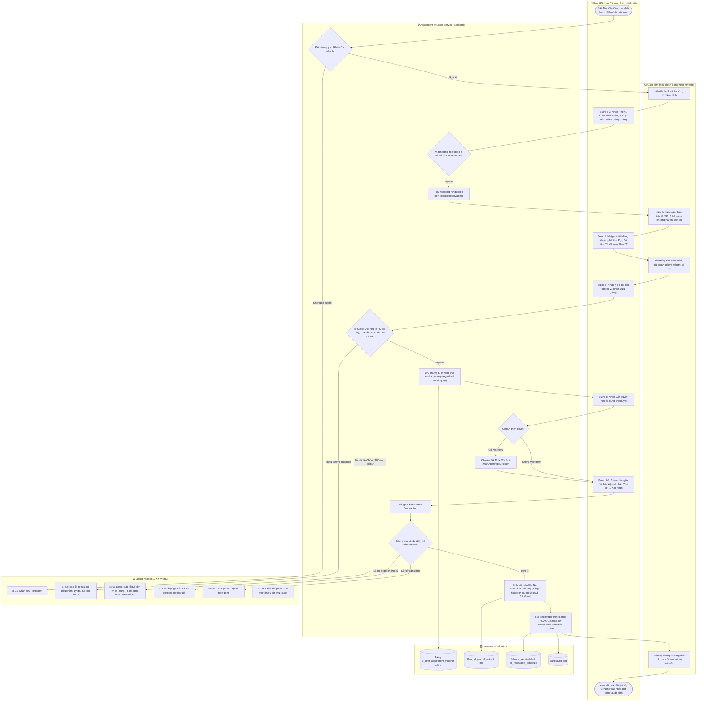
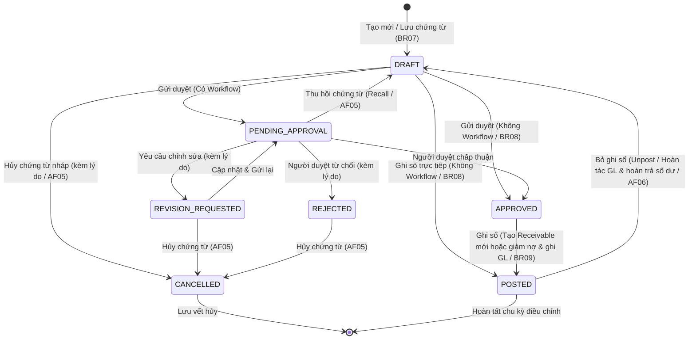

# UC-AR-06: Điều chỉnh công nợ phải thu (AR Debt Adjustment) - Backend Architecture & API Specification

Tài liệu thiết kế kỹ thuật và đặc tả API backend cho use case **UC-AR-06: Điều chỉnh công nợ phải thu**.
Triển khai tuân thủ toàn diện các quy tắc nghiệp vụ (**BR01** đến **BR14**), luồng hoạt động chính (**Activity Flow Bước 1–8**), luồng thay thế (**AF01** đến **AF06**) và luồng ngoại lệ (**EF01** đến **EF10**).

---

## 1. Sơ đồ Hoạt động (Activity Diagram - Mermaid)

Sơ đồ thể hiện luồng xử lý điều chỉnh tăng / giảm công nợ khách hàng qua các phân vùng (swimlanes):

---

## 2. Sơ đồ Vòng đời Trạng thái Chứng từ (State Diagram - Mermaid)

---

## 3. Mô hình Dữ liệu (Database Models)

### 3.1. `DebtAdjustmentVoucher` (`ar_debt_adjustment_voucher`)
- **Khóa chính**: `id` (UUID).
- **Mã chứng từ**: `number` (Tự sinh theo `DocumentNumberingRule` hoặc quy tắc `AR-ADJ-YYYY-00001`, duy nhất trong công ty).
- **Liên kết tổ chức & khách hàng**:
  - `company`: ForeignKey `Company`.
  - `branch`: ForeignKey `Branch`.
  - `customer`: ForeignKey `Party` (vai trò Khách hàng, trạng thái `ACTIVE`).
- **Phân loại & Tài chính**:
  - `adjustment_type`: `INCREASE` (Tăng công nợ) hoặc `DECREASE` (Giảm công nợ) (Bắt buộc, không mặc định).
  - `currency`: ForeignKey `Currency`.
  - `receivable_account`: ForeignKey `Account` (TK 131).
  - `total_amount`: DecimalField (Tổng tiền nguyên tệ = $\sum \text{amount}$).
  - `total_converted_amount`: DecimalField (Tổng giá trị quy đổi theo đồng tiền hạch toán).
- **Lý do & Hồ sơ căn cứ**:
  - `adjustment_reason`: Bắt buộc, nội dung và nguyên nhân điều chỉnh (BR03).
  - `document_basis`: Bắt buộc, biên bản đối chiếu, quyết định hoặc tài liệu xác nhận (BR03).
  - `description`: Mặc định `"[Tăng/Giảm] công nợ [Tên khách hàng]"`, cho phép sửa.
  - `attachments`: JSONField, danh sách tài liệu đính kèm.
- **Trạng thái & Phê duyệt**:
  - `status`: `DRAFT` | `PENDING_APPROVAL` | `REVISION_REQUESTED` | `REJECTED` | `APPROVED` | `POSTED` | `CANCELLED`.
  - `approval_required`: Boolean.
  - `journal_entry`: OneToOneField `JournalEntry` (bút toán Sổ cái khi Đã ghi sổ).
  - `posted_by`, `posted_at`, `unposted_by`, `unposted_at`, `unpost_reason`.
  - `cancelled_by`, `cancelled_at`, `cancel_reason`.

### 3.2. `DebtAdjustmentVoucherLine` (`ar_debt_adjustment_voucher_line`)
- `voucher`: ForeignKey `DebtAdjustmentVoucher`.
- `line_no`: Số thứ tự dòng.
- `receivable`: ForeignKey `Receivable` (Bắt buộc khi giảm công nợ; tùy chọn khi tăng công nợ có liên kết khoản cũ).
- `receivable_schedule`: ForeignKey `ReceivableSchedule` (Bắt buộc khi giảm khoản có nhiều đợt còn dư).
- `offset_account`: ForeignKey `Account` (Tài khoản đối ứng hoạt động, không trùng `receivable_account`).
- `amount`: Số tiền điều chỉnh nguyên tệ (> 0, BR05).
- `exchange_rate`: Tỷ giá (> 0). Tăng: lấy tỷ giá hạch toán / người dùng nhập. Giảm: lấy theo giá trị ghi sổ của khoản phải thu.
- `converted_amount`: Giá trị quy đổi = $\text{amount} \times \text{exchange\_rate}$.
- `new_due_date`: Hạn thanh toán mới (chỉ áp dụng khi điều chỉnh tăng).
- `description`: Nội dung chi tiết dòng điều chỉnh.
- `created_receivable`: ForeignKey `Receivable` (Khoản phải thu mới sinh ra khi ghi sổ điều chỉnh tăng, AF01).
- `legacy_adjustment`: ForeignKey `ReceivableAdjustment` (Bản ghi lưu vết điều chỉnh giảm phục vụ Sổ chi tiết công nợ).

---

## 4. Danh mục API Endpoints

Base URL: `/api/v1/accounts-receivable/debt-adjustment-vouchers/`

| Phương thức | Endpoint | Quyền IAM | Mô tả |
| :--- | :--- | :--- | :--- |
| `GET` | `/` | `AR.ADJUSTMENT_VOUCHER.VIEW` | Danh sách chứng từ điều chỉnh (lọc theo `company_id`, `branch_id`, `customer_id`, `status`). |
| `POST` | `/` | `AR.ADJUSTMENT_VOUCHER.CREATE` | Lập chứng từ điều chỉnh mới ở trạng thái `DRAFT` (BR07). |
| `GET` | `/{id}/` | `AR.ADJUSTMENT_VOUCHER.VIEW` | Chi tiết chứng từ và các dòng điều chỉnh. |
| `PATCH` | `/{id}/` | `AR.ADJUSTMENT_VOUCHER.EDIT` | Sửa chứng từ ở trạng thái `DRAFT`, `REVISION_REQUESTED`, `REJECTED`. |
| `GET` | `/eligible-receivables/` | `AR.ADJUSTMENT_VOUCHER.VIEW` | Lấy danh sách khoản phải thu còn dư, đợt thanh toán, gợi ý tiền tệ và tài khoản mặc định (Bước 3, AF04). |
| `POST` | `/{id}/submit/` | `AR.ADJUSTMENT_VOUCHER.SUBMIT` | Gửi duyệt chứng từ (tự duyệt nếu không cấu hình workflow / BR08). |
| `POST` | `/{id}/recall/` | `AR.ADJUSTMENT_VOUCHER.SUBMIT` | Thu hồi chứng từ đang chờ duyệt về `DRAFT` (AF05). |
| `POST` | `/{id}/approve/` | `AR.ADJUSTMENT_VOUCHER.APPROVE` | Phê duyệt chứng từ điều chỉnh. |
| `POST` | `/{id}/reject/` | `AR.ADJUSTMENT_VOUCHER.APPROVE` | Từ chối duyệt chứng từ (kèm `reason`). |
| `POST` | `/{id}/request-revision/` | `AR.ADJUSTMENT_VOUCHER.APPROVE` | Yêu cầu chỉnh sửa chứng từ (kèm `reason`). |
| `POST` | `/{id}/cancel/` | `AR.ADJUSTMENT_VOUCHER.CANCEL` | Hủy chứng từ chưa ghi sổ (kèm `reason` / AF05). |
| `POST` | `/{id}/post/` | `AR.ADJUSTMENT_VOUCHER.POST` | Ghi sổ điều chỉnh, cập nhật công nợ và sinh bút toán GL (Bước 7-8). |
| `POST` | `/{id}/unpost/` | `AR.ADJUSTMENT_VOUCHER.UNPOST` | Bỏ ghi sổ, hoàn tác bút toán GL và phục hồi công nợ (AF06). |

---

## 5. Bảng Đối chiếu Quy tắc Nghiệp vụ (Business Rules)

| Mã BR | Tóm tắt quy tắc | Hiện thực hóa trong Backend | Trạng thái |
| :--- | :--- | :--- | :--- :---: |
| **BR01** | Kiểm tra quyền IAM và phạm vi dữ liệu chi nhánh | `DebtAdjustmentVoucherPermission` kiểm tra IAM codes và phân quyền chi nhánh. | ✅ Đạt |
| **BR02** | Mỗi chứng từ 1 loại điều chỉnh, 1 KH, 1 loại tiền, 1 TK 131 | Ràng buộc duy nhất trên header; kiểm tra toàn bộ dòng phải khớp đối tượng và tài khoản. | ✅ Đạt |
| **BR03** | Có lý do và tài liệu căn cứ; không sửa trực tiếp nguồn | Bắt buộc `adjustment_reason` và `document_basis`; lưu chứng từ riêng độc lập. | ✅ Đạt |
| **BR04** | Tăng tạo Receivable mới; Giảm liên kết khoản còn dư | Tăng tạo `Receivable` mới (`created_receivable`); Giảm bắt buộc chọn khoản `OPEN`/`PARTIALLY_PAID`. | ✅ Đạt |
| **BR05** | Tổng giảm không vượt số dư; kiểm tra lại khi ghi sổ | Kiểm tra cộng dồn tại lúc lưu và kiểm tra khóa `select_for_update` khi ghi sổ. | ✅ Đạt |
| **BR06** | Không tạo số dư phải thu âm; chặn giảm khoản đã hết nợ | Chặn chọn khoản có `balance <= 0`; chặn giảm vượt số dư còn lại của khoản và từng đợt. | ✅ Đạt |
| **BR07** | Lưu Nháp không cập nhật công nợ và không giữ chỗ số dư | `DRAFT` không tạo bút toán và không thay đổi `balance` của Receivable. | ✅ Đạt |
| **BR08** | Điều kiện ghi sổ (APPROVED hoặc DRAFT nếu không workflow) | Kiểm tra `approval_required`: nếu True yêu cầu `APPROVED`, nếu False cho ghi sổ từ `DRAFT`. | ✅ Đạt |
| **BR09** | Bút toán GL: Tăng Nợ 131/Có đối ứng; Giảm Nợ đối ứng/Có 131 | Sinh `JournalEntry` đúng cặp đối ứng; không phát sinh thu/chi tiền mặt hay ngân hàng. | ✅ Đạt |
| **BR10** | Tỷ giá ghi sổ còn lại; giảm một phần tính theo tỷ lệ | Giảm công nợ lấy tỷ giá ghi sổ của `Receivable`; quy đổi tỷ lệ chính xác. | ✅ Đạt |
| **BR11** | Trả lại hàng, giảm giá xử lý tại nghiệp vụ tương ứng | Không cho ghi nhận trùng công nợ đã phát sinh từ các phân hệ bán hàng / hóa đơn. | ✅ Đạt |
| **BR12** | Sai sót chứng từ nguồn xử lý tại chứng từ nguồn | Không dùng điều chỉnh công nợ để che sai lệch doanh thu hoặc thuế. | ✅ Đạt |
| **BR13** | Không bỏ ghi sổ khoản tăng đã có thu tiền, phân bổ, bù trừ | Kiểm tra chặn `unpost` nếu `created_receivable` đã có `allocations` hoặc `netting_lines`. | ✅ Đạt |
| **BR14** | Bút toán & công nợ thành công đồng thời, Idempotent | Bọc trong `@transaction.atomic`; gọi lặp `post` trả về cùng kết quả; lưu Audit Log. | ✅ Đạt |
