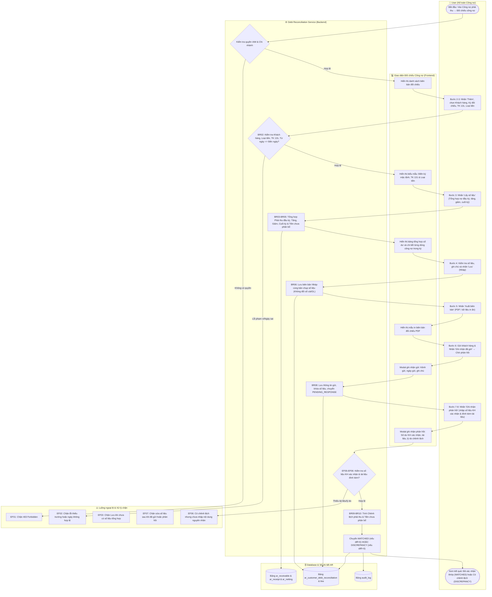
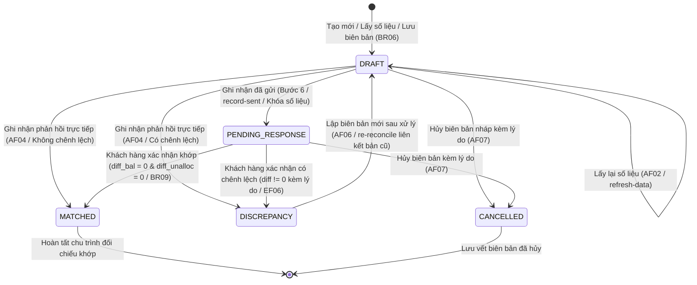

# UC-AR-07: Đối chiếu công nợ khách hàng (Customer Debt Reconciliation / Statement) - Backend Architecture & API Specification

Tài liệu thiết kế kỹ thuật và đặc tả API backend cho use case **UC-AR-07: Đối chiếu công nợ khách hàng**.
Triển khai tuân thủ toàn diện các quy tắc nghiệp vụ (**BR01** đến **BR14**), luồng hoạt động chính (**Activity Flow Bước 1–8**), luồng thay thế (**AF01** đến **AF07**) và luồng ngoại lệ (**EF01** đến **EF09**).

---

## 1. Sơ đồ Hoạt động (Activity Diagram - Mermaid)

Sơ đồ thể hiện luồng tổng hợp số liệu đối chiếu công nợ, gửi khách hàng và ghi nhận xác nhận/chênh lệch:

---

## 2. Sơ đồ Vòng đời Trạng thái Biên bản (State Diagram - Mermaid)

---

## 3. Mô hình Dữ liệu (Database Models)

### 3.1. `CustomerDebtReconciliation` (`ar_customer_debt_reconciliation`)
- **Khóa chính**: `id` (UUID).
- **Mã biên bản**: `number` (Tự sinh theo quy tắc `AR-REC-YYYY-00001`, duy nhất trong công ty).
- **Liên kết tổ chức & khách hàng**:
  - `company`: ForeignKey `Company`.
  - `branch`: ForeignKey `Branch`.
  - `customer`: ForeignKey `Party` (vai trò Khách hàng, trạng thái `ACTIVE`).
- **Phạm vi đối chiếu**:
  - `statement_date`: Ngày lập biên bản.
  - `from_date`, `to_date`: Kỳ đối chiếu (`from_date <= to_date <= today`).
  - `currency`: ForeignKey `Currency`.
  - `receivable_account`: ForeignKey `Account` (TK 131).
  - `contact_person`, `contact_email`, `note`: Thông tin liên hệ và ghi chú.
- **Số liệu tổng hợp đối chiếu (Snapshot tại `data_extracted_at`)**:
  - `opening_balance`: Phải thu đầu kỳ.
  - `period_increase`: Phát sinh tăng trong kỳ.
  - `period_decrease`: Phát sinh giảm trong kỳ (thu tiền, phân bổ, bù trừ, điều chỉnh giảm).
  - `closing_balance`: Phải thu cuối kỳ = `opening + increase - decrease`.
  - `unallocated_receipts`: Tiền khách hàng chưa phân bổ tại `to_date` (BR04).
  - `data_extracted_at`: Thời điểm lấy số liệu.
  - `snapshot_data`: JSON lưu vết cấu trúc dữ liệu tổng hợp.
- **Trạng thái & Ghi nhận gửi**:
  - `status`: `DRAFT` | `PENDING_RESPONSE` | `MATCHED` | `DISCREPANCY` | `CANCELLED`.
  - `sent_at`, `sent_channel`, `sent_by`, `sent_note`.
- **Phản hồi của khách hàng**:
  - `response_date`: Ngày nhận phản hồi.
  - `customer_confirmer_name`: Họ tên người xác nhận phía khách hàng.
  - `customer_confirmed_balance`: Số tiền phải thu khách hàng xác nhận.
  - `customer_confirmed_unallocated`: Số tiền chưa phân bổ khách hàng xác nhận.
  - `balance_difference`: Chênh lệch phải thu (`confirmed_balance - closing_balance`).
  - `unallocated_difference`: Chênh lệch tiền chưa phân bổ (`confirmed_unalloc - unallocated_receipts`).
  - `response_comment`: Ý kiến khách hàng.
  - `difference_reason`: Nội dung / nguyên nhân chênh lệch (bắt buộc khi chênh lệch khác 0).
  - `confirmation_documents`: JSONField danh sách tài liệu đính kèm.
  - `responded_by`, `responded_at`.
- **Lập biên bản mới sau xử lý (AF06)**:
  - `previous_reconciliation`: ForeignKey self (liên kết biên bản tiền nhiệm để truy vết).
- **Hủy biên bản (AF07)**:
  - `cancelled_by`, `cancelled_at`, `cancel_reason`.

### 3.2. `CustomerDebtReconciliationLine` (`ar_customer_debt_reconciliation_line`)
- `reconciliation`: ForeignKey `CustomerDebtReconciliation`.
- `line_no`: Số thứ tự dòng.
- `posting_date`: Ngày hạch toán.
- `document_date`: Ngày chứng từ.
- `document_number`: Số chứng từ (hóa đơn bán, phiếu thu, chứng từ bù trừ, chứng từ điều chỉnh).
- `document_type`: Loại chứng từ (`SALES_INVOICE`, `RECEIPT`, `DEBT_NETTING`, `DEBT_ADJUSTMENT_INCREASE`, `DEBT_ADJUSTMENT_DECREASE`).
- `description`: Diễn giải nghiệp vụ.
- `increase_amount`: Khoản tăng.
- `decrease_amount`: Khoản giảm.
- `receivable`: ForeignKey `Receivable` (Khoản phải thu liên quan nếu có).
- `running_balance`: Số dư lũy kế sau nghiệp vụ.
- `source_entity_type`, `source_entity_id`: Lưu vết đối tượng nguồn.

---

## 4. Danh mục API Endpoints

Base URL: `/api/v1/accounts-receivable/customer-debt-reconciliations/`

| Phương thức | Endpoint | Quyền IAM | Mô tả |
| :--- | :--- | :--- | :--- |
| `GET` | `/` | `AR.RECONCILIATION.VIEW` | Danh sách biên bản đối chiếu (lọc theo `company_id`, `customer_id`, `status`). |
| `POST` | `/` | `AR.RECONCILIATION.CREATE` | Lập biên bản đối chiếu mới ở trạng thái `DRAFT` (BR06). |
| `GET` | `/{id}/` | `AR.RECONCILIATION.VIEW` | Chi tiết biên bản và các dòng giao dịch trong kỳ. |
| `PATCH` | `/{id}/` | `AR.RECONCILIATION.EDIT` | Sửa biên bản ở trạng thái `DRAFT` (EF07). |
| `DELETE` | `/{id}/` | `AR.RECONCILIATION.CANCEL` | Xóa biên bản ở trạng thái `DRAFT`. |
| `GET` | `/extract-data/` | `AR.RECONCILIATION.VIEW` | Truy vấn số liệu tổng hợp công nợ theo kỳ để hiển thị form (Bước 3). |
| `POST` | `/{id}/refresh-data/` | `AR.RECONCILIATION.EDIT` | Lấy lại số liệu đối chiếu khi biên bản ở trạng thái `DRAFT` (AF02, BR07). |
| `POST` | `/{id}/record-sent/` | `AR.RECONCILIATION.SEND` | Ghi nhận gửi biên bản cho khách hàng, chuyển sang `PENDING_RESPONSE` (Bước 6, BR08). |
| `POST` | `/{id}/record-response/` | `AR.RECONCILIATION.RESPOND` | Ghi nhận phản hồi khách hàng, tự tính chênh lệch, chuyển sang `MATCHED` hoặc `DISCREPANCY` (Bước 7-8). |
| `POST` | `/{id}/re-reconcile/` | `AR.RECONCILIATION.CREATE` | Lập biên bản mới sau xử lý chênh lệch, sao chép phạm vi và liên kết bản cũ (AF06, BR12). |
| `POST` | `/{id}/cancel/` | `AR.RECONCILIATION.CANCEL` | Hủy biên bản đối chiếu kèm lý do (AF07, BR14). |
| `GET` | `/{id}/export-pdf/` | `AR.RECONCILIATION.EXPORT` | Xuất dữ liệu biên bản in ấn / PDF (Bước 5, EF08). |

---

## 5. Bảng Đối chiếu Quy tắc Nghiệp vụ (Business Rules)

| Mã BR | Tóm tắt quy tắc | Hiện thực hóa trong Backend | Trạng thái |
| :--- | :--- | :--- | :--- :---: |
| **BR01** | Kiểm tra quyền IAM và phạm vi dữ liệu chi nhánh | `CustomerDebtReconciliationPermission` kiểm tra quyền `AR.RECONCILIATION.*`. | ✅ Đạt |
| **BR02** | Mỗi biên bản 1 khách hàng, 1 loại tiền, 1 TK 131, chi nhánh xác định | Ràng buộc duy nhất trên header; tính toán số liệu đúng đối tượng và tài khoản. | ✅ Đạt |
| **BR03** | Số liệu lấy từ nghiệp vụ đã ghi sổ (`POSTED`), theo ngày hạch toán | Truy vấn nghiệp vụ loại bỏ chứng từ nháp và chứng từ đã hủy; lọc theo `posting_date`. | ✅ Đạt |
| **BR04** | Tiền ứng trước và chưa phân bổ trình bày riêng, không tự bù trừ | Tính riêng `unallocated_receipts`; công thức `closing_balance` không trừ tiền chưa phân bổ. | ✅ Đạt |
| **BR05** | Phát sinh giảm chỉ tính 1 lần theo liên kết nghiệp vụ | Gom độc lập `ReceiptAllocation`, `DebtNettingVoucherLine`, `DebtAdjustmentVoucherLine`. | ✅ Đạt |
| **BR06** | Số liệu đã lưu là bản chụp; biến động sau đó không tự đổi biên bản | Lưu snapshot vào model và bảng lines; không tính toán động khi xem biên bản đã lưu. | ✅ Đạt |
| **BR07** | Chỉ lấy lại số liệu khi ở trạng thái `DRAFT` | `refresh_data` chặn nếu `status != DRAFT`; đổi phạm vi yêu cầu trích xuất lại. | ✅ Đạt |
| **BR08** | Ghi nhận đã gửi chỉ lưu thông tin gửi, không tự gửi email | `record_sent` cập nhật kênh gửi, thời gian gửi và chuyển sang `PENDING_RESPONSE`. | ✅ Đạt |
| **BR09** | Xác nhận khớp chỉ ghi nhận khi cả 2 khoản chênh lệch bằng 0 và có tài liệu | `record_response` chuyển `MATCHED` khi `balance_diff == 0` và `unallocated_diff == 0`. | ✅ Đạt |
| **BR10** | So sánh chênh lệch theo độ chính xác tiền tệ; không bù chéo | So sánh riêng biệt `balance_diff` và `unallocated_diff`. | ✅ Đạt |
| **BR11** | Đối chiếu không sinh bút toán, không trực tiếp đổi công nợ | Không tạo `JournalEntry`; không can thiệp số dư `Receivable.balance`. | ✅ Đạt |
| **BR12** | Đối chiếu lại tạo biên bản mới, giữ nguyên biên bản cũ | `re_reconcile` tạo bản mới liên kết qua `previous_reconciliation`. | ✅ Đạt |
| **BR13** | Người dùng nội bộ ghi nhận phản hồi có tài liệu căn cứ | `record_response` bắt buộc đính kèm `confirmation_documents`. | ✅ Đạt |
| **BR14** | Lưu người thực hiện, thời gian, phiên bản, gửi, phản hồi và hủy | Lưu vết `sent_by`, `responded_by`, `cancelled_by`, `cancel_reason`, `version`. | ✅ Đạt |
