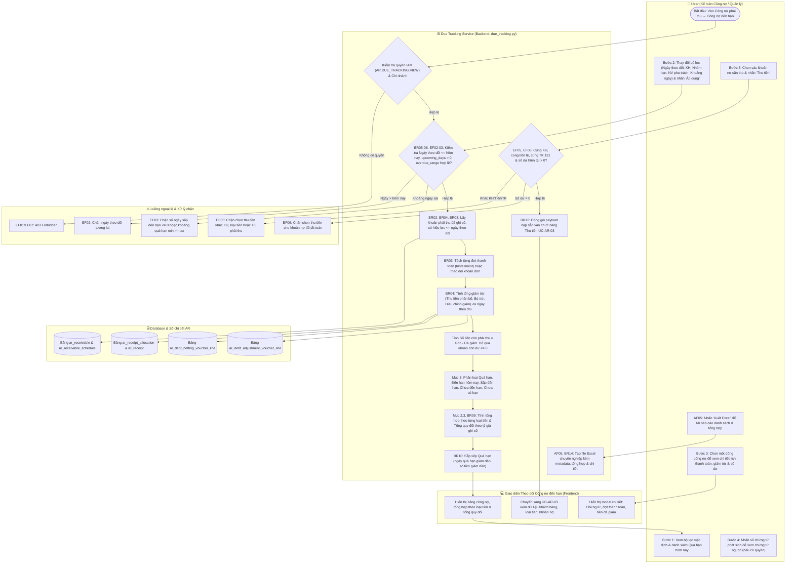
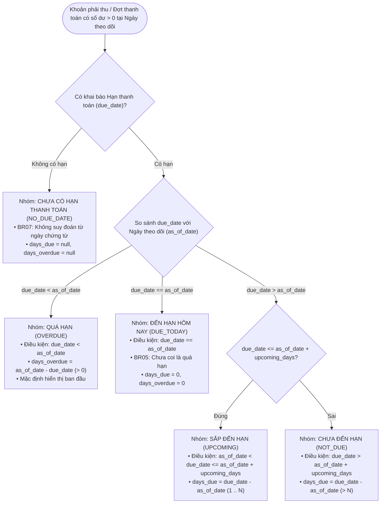

# UC-AR-08: Theo dõi công nợ đến hạn (Due and Overdue Accounts Receivable Tracking) - Backend Architecture & API Specification

Tài liệu thiết kế kỹ thuật và đặc tả API backend cho use case **UC-AR-08: Theo dõi công nợ đến hạn**.
Triển khai tuân thủ toàn diện các quy tắc nghiệp vụ (**BR01** đến **BR14**), luồng hoạt động chính (**Activity Flow Bước 1–5**), luồng thay thế (**AF01** đến **AF08**) và luồng ngoại lệ (**EF01** đến **EF08**).

---

## 1. Sơ đồ Hoạt động (Activity Diagram - Mermaid)

Sơ đồ thể hiện quy trình lọc, theo dõi, phân loại công nợ theo hạn thanh toán, tra cứu chi tiết và chuẩn bị thu tiền khách hàng:

---

## 2. Sơ đồ Phân loại Hạn thanh toán (Due Classification Flow)

Mỗi khoản còn phải thu tại ngày theo dõi (`remaining_balance > 0`) được phân loại vào đúng một trong năm nhóm duy nhất (**Mục 3, BR05, BR06, BR07**):

---

## 3. Kiến trúc Triển khai (Architecture & Components)

### 3.1. Phân quyền IAM & Migration ([`0027_due_tracking_permissions.py`](file:///c:/Users/Admin/LapTrinh/Thue/accounts_receivable/migrations/0027_due_tracking_permissions.py))
- Resource: `AR.DUE_TRACKING` ("Theo dõi công nợ đến hạn").
- Actions:
  - `VIEW`: Xem danh sách, tra cứu chi tiết công nợ đến hạn (`AR.DUE_TRACKING.VIEW`). Fallback tự động: `AR.RECEIVABLE.VIEW`.
  - `EXPORT`: Xuất danh sách Excel (`AR.DUE_TRACKING.EXPORT`). Fallback tự động: `AR.RECEIVABLE.EXPORT`.
- Permission Handler: [`DueTrackingPermission`](file:///c:/Users/Admin/LapTrinh/Thue/accounts_receivable/permissions.py) kế thừa `AccountsReceivablePermission`.

### 3.2. Core Engine ([`accounts_receivable/due_tracking.py`](file:///c:/Users/Admin/LapTrinh/Thue/accounts_receivable/due_tracking.py))
- `validate_due_tracking_filters`: Kiểm tra hợp lệ bộ lọc, giới hạn ngày quá khứ / hiện tại (`EF02`), kiểm tra số ngày nguyên dương và khoảng từ - đến (`EF03`).
- `classify_due_item`: Hàm thuần nhất phân loại theo công thức nghiệp vụ Mục 3.
- `get_due_tracking_report`:
  - Trích xuất toàn bộ công nợ đã ghi sổ `<= as_of_date` (**BR02**).
  - Tách bạch từng đợt thanh toán theo `ReceivableSchedule` (**BR03**).
  - Tính giảm trừ có hiệu lực tại ngày theo dõi từ `ReceiptAllocation`, `DebtNettingVoucherLine`, `DebtAdjustmentVoucherLine` (**BR04**).
  - Tính số dư còn lại và giá trị quy đổi theo tỷ giá ghi sổ ban đầu (**BR09**).
  - Phân loại 5 nhóm và tính tổng hợp đa loại tiền và tổng hợp quy đổi tiền hạch toán (**Mục 2.3**).
  - Lọc theo nhóm hạn, khoảng ngày quá hạn và sắp xếp giảm dần theo ngày quá hạn (**BR10**).
- `get_due_item_detail`: Cung cấp lịch sử phân bổ, bù trừ, điều chỉnh của chứng từ nguồn cho bước tra cứu chi tiết (**Bước 3-4**).
- `prepare_collection_payload`: Kiểm tra điều kiện đồng nhất khách hàng, loại tiền, tài khoản 131 (**EF05**) và số dư hiện tại còn dư (**EF06**), chuẩn bị dữ liệu gọi sang **UC-AR-03** (**Bước 5, AF07, BR12**).
- `export_due_tracking_excel`: Sinh file OpenPyXL chuyên nghiệp có đủ Header, Metadata, Tổng hợp theo loại tiền và Bảng chi tiết từng dòng (**AF05, BR08, BR14**).

### 3.3. RESTful API Endpoints ([`accounts_receivable/views.py`](file:///c:/Users/Admin/LapTrinh/Thue/accounts_receivable/views.py#L870))

| Method | Endpoint | Quyền IAM | Mục đích / Đáp ứng |
|---|---|---|---|
| `GET` | `/api/v1/accounts-receivable/due-tracking/` | `AR.DUE_TRACKING.VIEW` | Lấy danh sách công nợ theo bộ lọc & tổng hợp (**Bước 1-2, AF01-AF04, AF08**) |
| `GET` | `/api/v1/accounts-receivable/due-tracking/item-detail/` | `AR.DUE_TRACKING.VIEW` | Xem chi tiết lịch thanh toán & giảm trừ của khoản nợ (**Bước 3-4**) |
| `POST` | `/api/v1/accounts-receivable/due-tracking/refresh/` | `AR.DUE_TRACKING.VIEW` | Làm mới số liệu tức thời (**AF06**) |
| `GET` | `/api/v1/accounts-receivable/due-tracking/export/` | `AR.DUE_TRACKING.EXPORT` | Xuất báo cáo Excel định dạng XLSX (**AF05, BR14, EF08**) |
| `POST` | `/api/v1/accounts-receivable/due-tracking/prepare-collection/` | `AR.RECEIVABLE.VIEW` | Kiểm tra tính hợp lệ & đóng gói danh sách nợ chuyển sang Thu tiền (**Bước 5, AF07, EF05, EF06, BR12**) |

---

## 4. Ma trận Quy tắc Nghiệp vụ (Business Rules Traceability)

| Mã BR | Tóm tắt quy tắc | Hiện thực kỹ thuật trong Codebase |
|---|---|---|
| **BR01** | Backend kiểm tra quyền và phạm vi dữ liệu độc lập; quyền xem không mặc định có quyền xuất/thu tiền | [`DueTrackingPermission`](file:///c:/Users/Admin/LapTrinh/Thue/accounts_receivable/permissions.py), phân quyền độc lập `AR.DUE_TRACKING.VIEW` và `AR.DUE_TRACKING.EXPORT`. |
| **BR02** | Chỉ lấy khoản phải thu phát sinh từ chứng từ đã ghi sổ, có hiệu lực và còn số dư tại ngày theo dõi | `rec_qs.filter(posting_date__lte=as_of_date).exclude(status=ReceivableStatus.REVERSED)` |
| **BR03** | Nếu có nhiều đợt thanh toán, theo dõi từng đợt riêng; không hiển thị dòng tổng gây cộng trùng | Khi `rec.schedules.exists()`, duyệt qua từng `ReceivableSchedule`, không cộng dồn bản ghi cha. |
| **BR04** | Số dư tại ngày theo dõi tính theo các nghiệp vụ tăng, giảm có hiệu lực đến ngày đó; tiền thu chưa phân bổ không tự giảm | Lọc `ReceiptAllocation`, `DebtNettingVoucherLine`, `DebtAdjustmentVoucherLine` có ngày hiệu lực/ghi sổ `<= as_of_date`. |
| **BR05** | `Số ngày quá hạn = Ngày theo dõi - Hạn thanh toán`. Hạn trùng ngày theo dõi chưa coi là quá hạn | `due_date < as_of_date` -> `days_overdue = as_of_date - due_date`. Nếu `due_date == as_of_date` -> xếp vào `DUE_TODAY`. |
| **BR06** | `Số ngày còn đến hạn = Hạn thanh toán - Ngày theo dõi`. Tính theo ngày lịch | `(due_date - as_of_date).days`, tính toán thuần túy theo `datetime.date`. |
| **BR07** | Khoản chưa có hạn thanh toán xếp riêng (`NO_DUE_DATE`), không suy đoán hạn | `due_date is None` -> category `NO_DUE_DATE`, `days_due=None`, `days_overdue=None`. |
| **BR08** | Xem ngày quá khứ dùng số liệu và lịch có hiệu lực ngày đó; nhân viên phụ trách dùng phân công hiện tại | Tính toán số dư quá khứ qua biến động lũy kế; thông tin `owner` lấy từ `Party` hiện tại và ghi chú rõ ràng trên xuất báo cáo. |
| **BR09** | Không cộng trực tiếp tiền khác loại; quy đổi dùng tỷ giá ghi sổ ban đầu | Phân rã tổng hợp theo từng `currency_code`; tính `base_remaining_balance = remaining * rec.exchange_rate`. |
| **BR10** | Danh sách quá hạn sắp xếp số ngày quá hạn giảm dần, sau đó số tiền còn phải thu giảm dần | `sort_key`: `(-(it["days_overdue"] or 0), -it["remaining_balance"])`. |
| **BR11** | Nhóm hạn chỉ phản ánh thời điểm đến hạn, không thay đổi sổ kế toán hay số dư công nợ | Đọc dữ liệu (Read-only query engine), không sinh bút toán hay sửa đổi trạng thái model. |
| **BR12** | Chuyển sang thu tiền truyền danh sách khoản phải thu & đợt thanh toán; kiểm tra lại quyền & số dư | API `prepare-collection` kiểm tra quyền, số dư trực tiếp trong DB và trả về cấu trúc nạp sang UC-AR-03. |
| **BR13** | Không cho phép sửa trực tiếp hạn thanh toán trên màn hình này | Endpoint thuần query và action điều phối, không cung cấp API cập nhật hạn thanh toán trực tiếp. |
| **BR14** | Kết quả hiển thị và xuất có ngày theo dõi, bộ lọc, loại tiền và thời điểm lấy dữ liệu | Trả về khối metadata `as_of_date`, `filters`, `data_extracted_at`, `assigned_staff_note` trên cả API và file Excel. |
