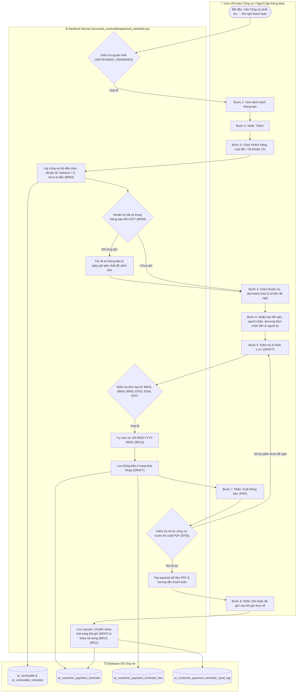
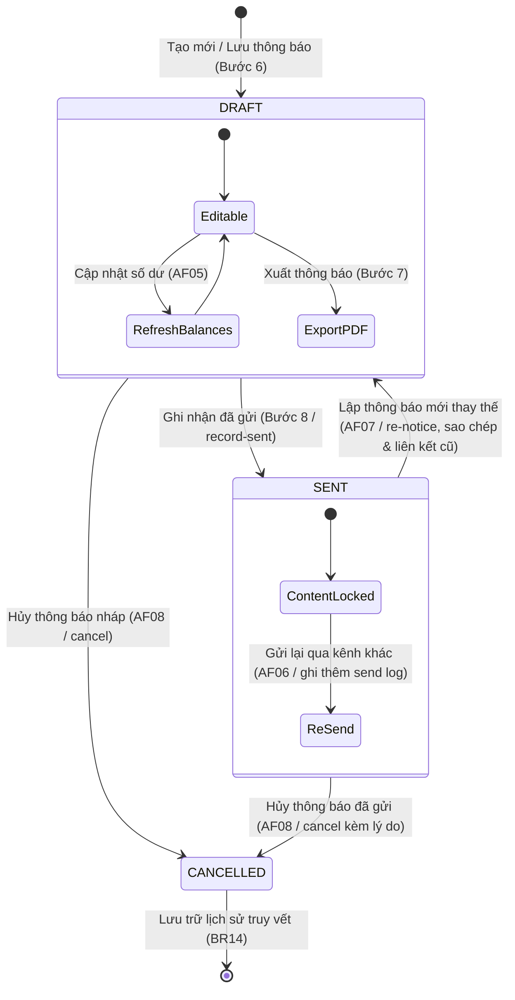
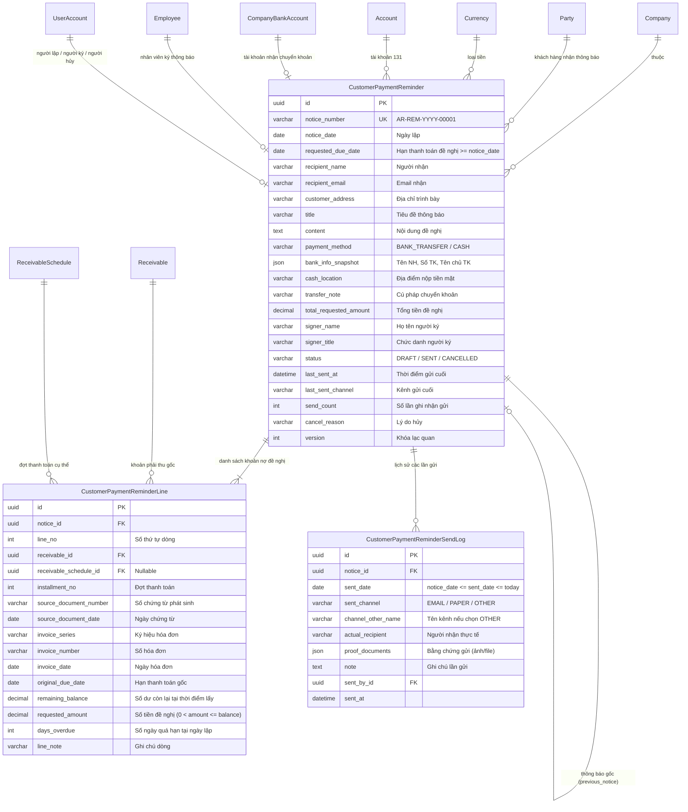

# UC-AR-09: Lập thông báo đề nghị thanh toán (Customer Payment Reminder / Notice) - Backend Architecture & API Specification

Tài liệu thiết kế kỹ thuật và đặc tả API backend cho use case **UC-AR-09: Lập thông báo đề nghị thanh toán**.
Hệ thống triển khai tuân thủ đầy đủ 14 quy tắc nghiệp vụ (**BR01** – **BR14**), luồng hoạt động chính (**Activity Flow Bước 1–8**), luồng thay thế (**AF01** – **AF08**) và luồng ngoại lệ (**EF01** – **EF10**).

> [!NOTE]
> Thông báo đề nghị thanh toán là tài liệu nhắc nợ và giao tiếp với khách hàng; **không tạo bút toán sổ cái**, **không giữ chỗ số dư công nợ** và **không làm thay đổi số dư công nợ** (BR06, BR12). Việc thu tiền của khách hàng sau khi nhận thông báo phải được ghi nhận qua chứng từ thu tiền (UC-AR-03) và phân bổ công nợ (UC-AR-04).

---

## 1. Sơ đồ Hoạt động (Activity Diagram - Mermaid)



---

## 2. Sơ đồ Vòng đời Trạng thái Thông báo (State Machine Diagram)



---

## 3. Sơ đồ Thực thể Dữ liệu (Entity Relationship Diagram - ERD)



---

## 4. Danh mục API Endpoints

Tất cả các API được ánh xạ dưới hai tiền tố router tương thích:
- `/api/v1/accounts-receivable/payment-reminders/`
- `/api/v1/accounts-receivable/customer-payment-reminders/`

| Phương thức | Endpoint | Quyền IAM | Mô tả |
| :--- | :--- | :--- | :--- |
| `GET` | `/payment-reminders/?company_id=...` | `AR.PAYMENT_REMINDER.VIEW` | Danh sách thông báo (hỗ trợ tìm kiếm, lọc trạng thái, khách hàng) |
| `POST` | `/payment-reminders/?company_id=...` | `AR.PAYMENT_REMINDER.CREATE` | Lập thông báo đề nghị thanh toán mới (trạng thái `DRAFT`) |
| `GET` | `/payment-reminders/{id}/?company_id=...` | `AR.PAYMENT_REMINDER.VIEW` | Xem chi tiết thông báo, các dòng công nợ và lịch sử gửi |
| `PUT / PATCH` | `/payment-reminders/{id}/?company_id=...` | `AR.PAYMENT_REMINDER.EDIT` | Sửa thông báo ở trạng thái Nháp (chặn khi đã gửi) |
| `DELETE` | `/payment-reminders/{id}/?company_id=...` | `AR.PAYMENT_REMINDER.CANCEL` | Xóa thông báo ở trạng thái Nháp (chặn xóa khi đã gửi) |
| `GET` | `/payment-reminders/eligible-receivables/?...` | `AR.PAYMENT_REMINDER.VIEW` | Lấy danh sách các khoản nợ còn dư đủ điều kiện kèm cảnh báo BR09 |
| `GET` | `/payment-reminders/default-customer-info/?customer_id=...` | `AR.PAYMENT_REMINDER.VIEW` | Lấy người nhận, email, địa chỉ mặc định từ hồ sơ khách hàng |
| `POST` | `/payment-reminders/create-from-due-tracking/` | `AR.PAYMENT_REMINDER.CREATE` | AF01: Lập thông báo nhanh từ danh sách công nợ đến hạn UC-AR-08 |
| `POST` | `/payment-reminders/{id}/refresh-balances/` | `AR.PAYMENT_REMINDER.EDIT` | AF05: Cập nhật lại số dư công nợ mới nhất khi thông báo còn nháp |
| `POST` | `/payment-reminders/{id}/record-sent/` | `AR.PAYMENT_REMINDER.SEND` | Step 8 & AF06: Ghi nhận đã gửi thông báo, lưu log và khóa nội dung |
| `POST` | `/payment-reminders/{id}/re-notice/` | `AR.PAYMENT_REMINDER.CREATE` | AF07: Lập thông báo mới từ thông báo đã gửi với số dư mới |
| `POST` | `/payment-reminders/{id}/cancel/` | `AR.PAYMENT_REMINDER.CANCEL` | AF08: Hủy thông báo, ghi nhận lý do và người hủy |
| `GET` | `/payment-reminders/{id}/export-pdf/` | `AR.PAYMENT_REMINDER.EXPORT` | Step 7: Kiểm tra số dư & xuất payload dữ liệu in PDF |

---

## 5. Quy tắc Nghiệp vụ & Triển khai Kỹ thuật

| Mã BR | Quy tắc nghiệp vụ | Xử lý tại Backend (`payment_reminder.py`) |
| :--- | :--- | :--- |
| **BR01** | Kiểm tra quyền và phạm vi dữ liệu | Xác thực `PaymentReminderPermission`, phân quyền chi nhánh và token người dùng. |
| **BR02** | Mỗi thông báo chỉ gồm 1 KH, 1 loại tiền, 1 TK 131 | Toàn bộ dòng trong thông báo phải khớp chính xác `customer_id`, `currency_id`, `account_id` với header. Vi phạm trả lỗi 400 (EF04). |
| **BR03** | Chỉ chọn khoản nợ đã ghi sổ, có hiệu lực, còn dư | Lọc `status in (OPEN, PARTIALLY_PAID)`, `balance > 0`, `reversed_at is null`. Không lấy đơn bán hoặc hóa đơn chưa ghi nợ. |
| **BR04** | Không chọn trùng cùng khoản nợ và đợt thanh toán | Kiểm tra trùng `(receivable_id, receivable_schedule_id)` cả ở tầng service và Database Unique Constraint. |
| **BR05** | Số tiền đề nghị > 0 và <= số dư còn lại | Kiểm tra `0 < requested_amount <= remaining_balance`. Tính `total_requested_amount = sum(lines)`. |
| **BR06** | Không giữ chỗ số dư, không phát sinh bút toán | Lưu và xuất PDF hoàn toàn không sinh Journal Entry, không giảm `Receivable.balance`. |
| **BR07** | Tiền ứng trước / chưa phân bổ không tự khấu trừ | Hướng dẫn người dùng phân bổ tại UC-AR-04 trước khi lập thông báo nếu muốn giảm số dư. |
| **BR08** | Hạn đề nghị không sửa hạn gốc của công nợ | `requested_due_date` chỉ dùng hiển thị trên thông báo; giữ nguyên `receivable.due_date` và phân loại quá hạn gốc. |
| **BR09** | Cảnh báo công nợ đã có trong thông báo ĐÃ GỬI | Endpoint `eligible-receivables` tra cứu thông báo `SENT` gần nhất chưa hủy, trả về `prior_sent_reminder` kèm số thông báo và ngày gửi. |
| **BR10** | Ghi nhận đã gửi lưu kênh bên ngoài, không gửi email tự động | `record-sent` lưu chi tiết kênh (`EMAIL`, `PAPER`, `OTHER`), người nhận thực tế, bằng chứng; không phụ thuộc dịch vụ mail ngoài. |
| **BR11** | Khóa nội dung thông báo Đã gửi | Chặn cập nhật PUT/PATCH trên thông báo `SENT`. Muốn sửa phải gọi `re-notice` (AF07) để sinh bản mới. |
| **BR12** | Thu tiền phải ghi nhận bằng chứng từ thu riêng | Khách hàng chuyển khoản được ghi nhận qua phiếu thu UC-AR-03; thông báo không tự đổi trạng thái nợ thành đã thu. |
| **BR13** | Không tự tính tiền phạt hoặc lãi chậm trả | Chỉ đề nghị đúng số dư nợ gốc hợp lệ đã được ghi nhận vào tài khoản phải thu. |
| **BR14** | Lưu vết toàn diện lịch sử thông báo | Lưu `data_extracted_at`, người tạo, người ký, lịch sử các lần gửi `CustomerPaymentReminderSendLog`, liên kết `previous_notice`, lý do hủy. |

---

## 6. Ma trận Xử lý Luồng Thay thế (AF) & Luồng Ngoại lệ (EF)

| Mã Flow | Mô tả tình huống | Xử lý Backend & Phản hồi |
| :--- | :--- | :--- |
| **AF01** | Lập từ công nợ đến hạn (UC-AR-08) | Endpoint `/create-from-due-tracking/` nhận danh sách khoản nợ, xác thực tính đồng nhất và điền sẵn dữ liệu form. |
| **AF02** | Đề nghị thanh toán một phần | Cho phép nhập `requested_amount < remaining_balance`. Phần còn lại vẫn được theo dõi bình thường trong sổ công nợ. |
| **AF03** | Đề nghị nhiều khoản / nhiều đợt | Cho phép thêm không giới hạn các khoản nợ / đợt thanh toán cùng khách hàng, tiền tệ và tài khoản 131. |
| **AF04** | Đề nghị khoản chưa đến hạn | Cho phép chọn khoản chưa đến hạn (`due_date > notice_date`), tính `days_overdue = 0`, trình bày riêng hạn gốc và hạn đề nghị. |
| **AF05** | Cập nhật số dư khi còn nháp | Endpoint `/refresh-balances/` lấy lại số dư thực tế, trả về danh sách `discrepancies` nếu có dòng đã hết dư hoặc bị vượt số dư. |
| **AF06** | Gửi lại thông báo đã gửi | Gọi `/record-sent/` trên thông báo `SENT`: giữ nguyên nội dung, thêm bản ghi vào `send_logs`, tăng `send_count`. |
| **AF07** | Thay đổi thông báo đã gửi | Gọi `/re-notice/`: tạo thông báo `DRAFT` mới với số thông báo mới, lấy số dư hiện tại, liên kết `previous_notice`. |
| **AF08** | Hủy thông báo | Gọi `/cancel/`: yêu cầu lý do hủy, chuyển sang `CANCELLED`, lưu `cancel_reason`, `cancelled_by`, `cancelled_at`. |
| **EF01** | Không có quyền hoặc ngoài phạm vi | Chặn thao tác, trả về mã lỗi HTTP `403 Forbidden`. |
| **EF02** | Thiếu trường bắt buộc hoặc chưa có dòng | Chặn lưu, trả về HTTP `400 Bad Request` kèm chi tiết lỗi từng trường. |
| **EF03** | Số tiền đề nghị <= 0 hoặc vượt số dư | Chặn lưu, trả về HTTP `400 Bad Request` nêu rõ số tiền tối đa được phép đề nghị. |
| **EF04** | Khác khách hàng, tiền tệ hoặc tài khoản | Chặn lưu chung trên một thông báo, trả về HTTP `400 Bad Request`. |
| **EF05** | Nợ đã thanh toán hoặc giảm trước khi xuất PDF | `export-pdf` kiểm tra lại số dư trong DB; nếu giảm dưới số tiền đề nghị thì chặn xuất và yêu cầu cập nhật lại số dư. |
| **EF06** | Ngày đề nghị < ngày lập hoặc ngày gửi sai | `requested_due_date < notice_date` hoặc `sent_date < notice_date` hoặc `sent_date > today` bị chặn với HTTP `400`. |
| **EF07** | TK ngân hàng không active / sai tiền hoặc người ký inactive | Chặn lưu, yêu cầu chọn tài khoản ngân hàng đang hoạt động cùng loại tiền, hoặc người ký đang làm việc. |
| **EF08** | Sửa trực tiếp thông báo đã gửi | Chặn thao tác PUT/PATCH khi `status != DRAFT`, trả về HTTP `400` yêu cầu lập thông báo mới. |
| **EF09** | Xung đột phiên bản (Optimistic lock) | Gửi `version` cũ hơn DB sẽ bị chặn HTTP `400 Conflict`, yêu cầu tải lại trang. |
| **EF10** | Xóa thông báo đã gửi | Chặn DELETE trên thông báo `SENT`, chỉ cho phép xóa thông báo `DRAFT`. |

---

## 7. Kết quả Kiểm thử Tự động (Automated Test Execution Summary)

Bộ kiểm thử tự động toàn diện được cài đặt tại file:
`c:\Users\Admin\LapTrinh\Thue\accounts_receivable\test_payment_reminder.py`

### Kết quả chạy kiểm thử use case UC-AR-09:
```
Ran 23 tests in 35.850s
OK
```

### Chi tiết 23 ca kiểm thử:
1. `test_step1_and_step2_list_and_default_customer_info`: Xem danh sách và thông tin liên hệ mặc định của khách hàng.
2. `test_step3_eligible_receivables_endpoint`: Tra cứu công nợ đủ điều kiện kèm ngày quá hạn và đợt thanh toán.
3. `test_step4_to_step6_create_draft_payment_reminder`: Tạo thông báo nháp, sinh số tự động, lưu snapshot ngân hàng và người ký.
4. `test_step7_export_pdf_payload`: Xuất payload PDF kèm thông tin hai bên, chi tiết nợ, số tiền bằng chữ và hướng dẫn thanh toán.
5. `test_step8_record_sent_transitions_to_sent_and_locks`: Ghi nhận đã gửi, lưu send log, chuyển trạng thái sang `SENT` và khóa sửa.
6. `test_af01_create_from_due_tracking`: Khởi tạo thông báo nhanh từ danh sách công nợ đến hạn UC-AR-08.
7. `test_af04_request_not_yet_due_items`: Đề nghị khoản chưa đến hạn, giữ nguyên hạn gốc, hiển thị hạn đề nghị riêng.
8. `test_af05_refresh_balances_detects_changes`: Phát hiện và cảnh báo khi số dư công nợ bị giảm do thu tiền bên ngoài.
9. `test_af06_resend_notice_appends_send_log`: Gửi lại thông báo đã gửi, bổ sung lịch sử gửi và tăng số lần gửi.
10. `test_af07_re_notice_creates_new_reminder_linked_to_previous`: Lập thông báo mới từ bản đã gửi, lấy số dư mới và liên kết bản cũ.
11. `test_af08_cancel_notice_records_reason_and_user`: Hủy thông báo kèm lý do hủy, người hủy và thời gian hủy.
12. `test_ef01_permission_denied_for_unauthorized_user`: Chặn người dùng không có quyền truy cập (403 Forbidden).
13. `test_ef02_missing_required_fields_and_empty_lines`: Chặn thiếu trường bắt buộc hoặc danh sách dòng rỗng (400 Bad Request).
14. `test_ef03_requested_amount_zero_or_exceeding_balance`: Chặn số tiền đề nghị bằng 0 hoặc vượt quá số dư còn lại.
15. `test_ef04_mixed_customer_currency_or_account`: Chặn lưu chung công nợ khác khách hàng hoặc khác loại tiền.
16. `test_ef05_export_pdf_fails_if_balance_dropped_below_requested`: Chặn xuất PDF nếu số dư thực tế giảm dưới số tiền đề nghị.
17. `test_ef06_invalid_dates`: Chặn ngày đề nghị trước ngày lập, ngày gửi trước ngày lập hoặc ngày gửi tương lai.
18. `test_ef07_bank_account_inactive_or_currency_mismatch_or_signer_inactive`: Chặn tài khoản ngân hàng không active, sai loại tiền hoặc nhân viên ký đã nghỉ việc.
19. `test_ef09_optimistic_lock_version_conflict`: Chặn xung đột phiên bản khi có người khác đã cập nhật thông báo.
20. `test_ef10_destroy_sent_or_cancelled_reminder_blocked`: Chặn xóa thông báo đã gửi (chỉ cho phép xóa bản nháp).
21. `test_br04_no_duplicate_receivable_and_schedule_in_same_notice`: Chặn trùng khoản nợ và đợt thanh toán trong cùng thông báo.
22. `test_br09_prior_sent_reminder_alert_in_eligible_receivables`: Hiển thị cảnh báo kèm số thông báo và ngày gửi gần nhất khi khoản nợ đã có trong thông báo đã gửi.
23. `test_cash_payment_method_requires_cash_location`: Bắt buộc nhập địa điểm nhận tiền mặt khi chọn phương thức tiền mặt.

### Kết quả chạy kiểm thử hồi quy các module liên quan (Reconciliation & Due Tracking):
```
Ran 41 tests in 52.249s
OK
```
Toàn bộ các use case kế thừa và liên kết (**UC-AR-07**, **UC-AR-08**) đều vượt qua 100% kiểm thử hồi quy.
