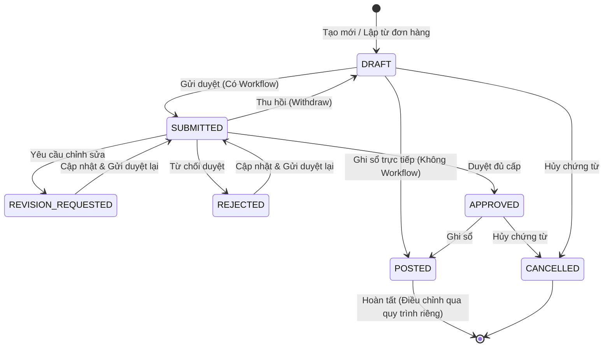

# TÀI LIỆU THIẾT KẾ KỸ THUẬT VÀ ĐẶC TẢ API BACKEND
## USE CASE UC-SAL-04: GHI NHẬN BÁN DỊCH VỤ (SALES SERVICE DOCUMENT / INVOICE)

---

### 1. Tổng quan Kiến trúc và Luồng Xử lý

Use case **UC-SAL-04: Ghi nhận bán dịch vụ** hỗ trợ lập chứng từ bán dịch vụ, tính thuế, chiết khấu; ghi nhận doanh thu, thuế đầu ra và khoản phải thu (131) hoặc tiền thu ngay (111/112); liên kết hồ sơ hoàn thành dịch vụ / nghiệm thu và hóa đơn tài chính (Tax Invoice).
Đặc thù nghiệp vụ:
- **BR-SAL-04-09**: Chứng từ bán dịch vụ **không tạo phiếu xuất kho** và **không tạo bút toán giá vốn hàng bán (632 / 156)**.
- Chi phí cung cấp dịch vụ được hạch toán riêng qua các phân hệ chi phí / kế toán tổng hợp.
- Chỉ cho phép chọn mặt hàng thuộc danh mục có phân loại **Dịch vụ (`SERVICE`)**.
- Hỗ trợ luồng phê duyệt đa cấp (Approval Workflow) hoặc ghi sổ trực tiếp khi không cấu hình workflow.

#### 1.1. Luồng Trạng thái Chứng từ (Status Flow)

#### 1.2. Hạch toán Kế toán (Journal Entry) khi Ghi sổ (Posting)
- **Chưa thu tiền (`UNPAID`)**:
  - Nợ TK 131 (Phải thu của khách hàng) = Tổng thanh toán (`total_amount`)
  - Có TK 5113 / 511 (Doanh thu bán dịch vụ) = Doanh thu thuần (`subtotal - discount_amount`)
  - Có TK 33311 (Thuế GTGT đầu ra) = Tổng tiền thuế (`tax_amount`)
  - Đồng thời tạo bản ghi công nợ phải thu (`Receivable`) liên kết với chứng từ.
- **Thu tiền mặt (`CASH`)**:
  - Nợ TK 111 (Tiền mặt) = Tổng thanh toán
  - Có TK 5113 / 511 = Doanh thu thuần
  - Có TK 33311 = Tổng tiền thuế
- **Thu qua ngân hàng (`BANK`)**:
  - Nợ TK 112 (Tiền gửi ngân hàng) = Tổng thanh toán (yêu cầu chọn tài khoản ngân hàng của doanh nghiệp)
  - Có TK 5113 / 511 = Doanh thu thuần
  - Có TK 33311 = Tổng tiền thuế

---

### 2. Danh mục API Endpoints

Base URL: `/api/v1/sales/service-sales/`

| HTTP Method | Đường dẫn API | Hành động & Mô tả | Tham số / Body chính |
| --- | --- | --- | --- |
| `GET` | `/api/v1/sales/service-sales/?company_id=...` | Danh sách chứng từ bán dịch vụ có phân trang, lọc theo khách hàng, ngày, trạng thái | `company_id`, `customer_id`, `status`, `from_date`, `to_date` |
| `GET` | `/api/v1/sales/service-sales/defaults/?company_id=...` | Lấy giá trị mặc định cho form tạo mới (ngày hiện tại, VND, tỷ giá = 1, Chưa thu tiền, TK 131/5113/33311) | `company_id`, `customer_id` |
| `GET` | `/api/v1/sales/service-sales/prepare_from_order/?company_id=...&order_id=...` | Kế thừa dữ liệu từ Đơn bán hàng (chỉ lấy các dòng dịch vụ chưa được ghi nhận đủ) | `company_id`, `order_id` |
| `POST` | `/api/v1/sales/service-sales/?company_id=...` | Tạo mới chứng từ lưu Nháp (`DRAFT`). Tự động sinh số mã `DV-YYYY-NNNNNN` | Header + `lines` |
| `GET` | `/api/v1/sales/service-sales/{id}/?company_id=...` | Xem chi tiết chứng từ bán dịch vụ | `company_id` |
| `PUT / PATCH` | `/api/v1/sales/service-sales/{id}/?company_id=...` | Sửa chứng từ ở trạng thái `DRAFT`, `REVISION_REQUESTED`, hoặc `REJECTED` (Kiểm tra optimistic lock qua `version`) | Header + `lines` |
| `DELETE` | `/api/v1/sales/service-sales/{id}/?company_id=...` | Xóa chứng từ Nháp chưa có chứng từ phụ thuộc | `company_id` |
| `POST` | `/api/v1/sales/service-sales/{id}/submit/?company_id=...` | Gửi duyệt chứng từ | `notes` |
| `POST` | `/api/v1/sales/service-sales/{id}/withdraw/?company_id=...` | Thu hồi chứng từ đang Chờ duyệt về Nháp | `reason` |
| `POST` | `/api/v1/sales/service-sales/{id}/approve/?company_id=...` | Phê duyệt chứng từ (chuyển `APPROVED` khi đủ cấp) | `comments` |
| `POST` | `/api/v1/sales/service-sales/{id}/request_revision/?company_id=...` | Yêu cầu sửa chứng từ (chuyển `REVISION_REQUESTED`) | `comments` (bắt buộc) |
| `POST` | `/api/v1/sales/service-sales/{id}/reject/?company_id=...` | Từ chối duyệt chứng từ (chuyển `REJECTED`) | `comments` (bắt buộc) |
| `POST` | `/api/v1/sales/service-sales/{id}/post/?company_id=...` | Ghi sổ chứng từ, tạo bút toán GL, cập nhật công nợ và nguồn đơn bán | Không yêu cầu body |
| `POST` | `/api/v1/sales/service-sales/{id}/unpost/?company_id=...` | Bỏ ghi sổ chứng từ (chuyển về `DRAFT`/`APPROVED`, hủy bút toán GL) | Không yêu cầu body |
| `POST` | `/api/v1/sales/service-sales/{id}/cancel/?company_id=...` | Hủy chứng từ chưa ghi sổ | `reason` (bắt buộc) |
| `POST` | `/api/v1/sales/service-sales/{id}/link_invoice/?company_id=...` | Liên kết hóa đơn tài chính đầu ra (`TaxInvoice`) tương ứng | `invoice_id`, `invoice_link_notes` |

---

### 3. Business Rules và Xử lý Ngoại lệ

| Mã lỗi / Quy tắc | Tình huống | Hành vi hệ thống |
| --- | --- | --- |
| **BR-SAL-04-01 / EF-01** | Quyền hạn và phạm vi dữ liệu | Kiểm tra quyền IAM `SAL.SERVICE_SALE` (`VIEW`, `CREATE`, `EDIT`, `SUBMIT`, `APPROVE`, `POST`, `CANCEL`). Kiểm tra truy cập theo `company_id` và `branch_id`. Trả về `403 Forbidden` nếu vi phạm. |
| **BR-SAL-04-02 / EF-03** | Mặt hàng phải là Dịch vụ | Chặn thêm mặt hàng có `item_type != 'SERVICE'`. Số lượng > 0, đơn giá >= 0, chiết khấu không vượt thành tiền. Trả về `400 Bad Request`. |
| **BR-SAL-04-03 / EF-07** | Kiểm tra phần còn lại của đơn hàng nguồn | Khi liên kết dòng đơn bán hàng, kiểm tra tổng số lượng đã ghi nhận không vượt quá số lượng trên đơn. Trả về `400 Bad Request` nếu vượt quá. |
| **BR-SAL-04-04** | Làm tròn số theo loại tiền | Làm tròn thành tiền, chiết khấu, tiền thuế và tổng tiền từng dòng theo quy định của loại tiền (mặc định 2 chữ số thập phân cho ngoại tệ, 0 cho VND). Tổng tiền chứng từ bằng tổng các dòng. |
| **BR-SAL-04-05 / EF-06** | Nghiệm thu dịch vụ | Nếu chứng từ hoặc dịch vụ yêu cầu biên bản nghiệm thu (`service_acceptance_required = True`), khi ghi sổ bắt buộc phải có thông tin số biên bản (`acceptance_document_number`) và ngày nghiệm thu (`acceptance_date`). |
| **BR-SAL-04-06** | Luồng phê duyệt | Nếu có quy trình duyệt cho `SAL.SERVICE_SALE`, chứng từ phải qua trạng thái `APPROVED` trước khi ghi sổ. Nếu không có, cho phép ghi sổ trực tiếp từ `DRAFT`. |
| **BR-SAL-04-07 / EF-04 / EF-05** | Kiểm tra kỳ kế toán & tài khoản | Ngày hạch toán phải nằm trong kỳ kế toán đang mở (`is_closed=False`). Các tài khoản 131/111/112, 5113, 33311 phải đang hoạt động (`is_active=True`) và cho phép hạch toán (`is_postable=True`). |
| **BR-SAL-04-08 / AF-03** | Hạch toán theo hình thức thanh toán | Tự động chọn tài khoản Nợ: 131 nếu `UNPAID`, 111 nếu `CASH`, 112 nếu `BANK`. Bắt buộc chọn `company_bank_account` nếu chọn `BANK`. |
| **BR-SAL-04-09** | Không phát sinh tồn kho / xuất kho | Không tạo bất kỳ phiếu xuất kho hoặc bút toán Nợ 632 / Có 156. |
| **BR-SAL-04-11 / EF-08** | Liên kết hóa đơn | Cho phép liên kết với `TaxInvoice` tương ứng nếu cùng khách hàng, cùng loại tiền và tổng tiền khớp. Không phát sinh thêm bút toán doanh thu. |
| **BR-SAL-04-12 / EF-10** | Tính toàn vẹn trạng thái | Không cho phép sửa trực tiếp chứng từ `POSTED` hoặc `CANCELLED`. Muốn sửa phải bỏ ghi sổ hoặc lập chứng từ điều chỉnh. |
| **BR-SAL-04-13 / EF-09** | Optimistic Locking | Kiểm tra trường `version`. Nếu `version` gửi lên khác với trong DB, báo lỗi xung đột `EF-09: Chứng từ vừa được người khác cập nhật`. |

---

### 4. Danh mục File Mã nguồn

- **Models**: [sales/models.py](file:///c:/Users/Admin/LapTrinh/Thue/sales/models.py) (`ServiceSale`, `ServiceSaleLine`, `ServiceSaleCounter`)
- **Services**: [sales/service_sale_services.py](file:///c:/Users/Admin/LapTrinh/Thue/sales/service_sale_services.py)
- **Serializers**: [sales/service_serializers.py](file:///c:/Users/Admin/LapTrinh/Thue/sales/service_serializers.py)
- **Views**: [sales/service_views.py](file:///c:/Users/Admin/LapTrinh/Thue/sales/service_views.py)
- **URLs**: [sales/urls.py](file:///c:/Users/Admin/LapTrinh/Thue/sales/urls.py)
- **Test Suite**: [sales/test_service_sale_uc_sal_04.py](file:///c:/Users/Admin/LapTrinh/Thue/sales/test_service_sale_uc_sal_04.py)
