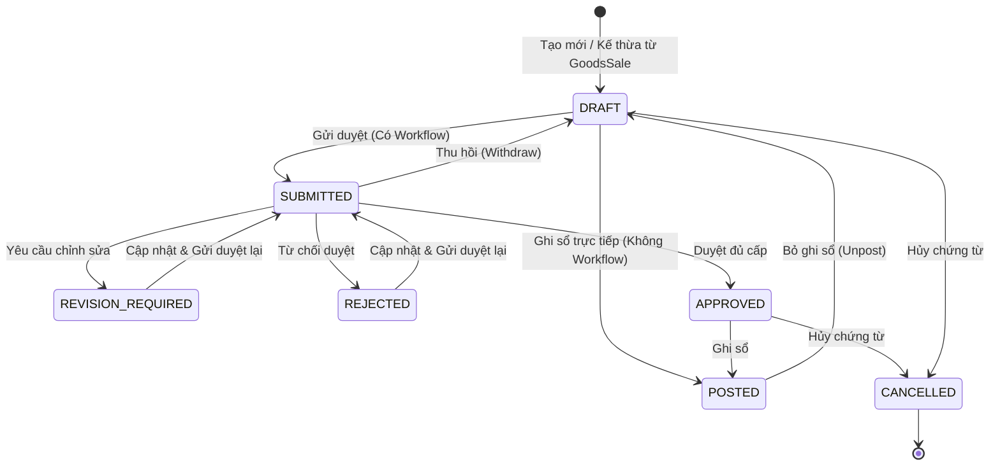

# TÀI LIỆU THIẾT KẾ KỸ THUẬT VÀ ĐẶC TẢ API BACKEND
## USE CASE UC-SAL-05: GHI NHẬN HÀNG BÁN TRẢ LẠI (SALES RETURN / MERCHANDISE RETURN)

---

### 1. Tổng quan Kiến trúc và Luồng Xử lý

Use case **UC-SAL-05: Ghi nhận hàng bán trả lại** hỗ trợ lập chứng từ hàng bán trả lại phát sinh từ chứng từ bán hàng hóa (`GoodsSale` / UC-SAL-03) đã ghi sổ (`POSTED`); tính toán giảm trừ doanh thu (TK 5212 / 521), điều chỉnh giảm thuế GTGT đầu ra (Nợ TK 33311), giảm trừ công nợ phải thu (Có TK 131) hoặc theo dõi khoản tiền phải hoàn trả lại cho khách hàng; đồng thời liên kết nhập lại hàng vào kho (Nợ TK 156 / Có TK 632) theo đơn giá vốn của đợt xuất bán ban đầu.

#### 1.1. Luồng Trạng thái Chứng từ (Status Flow)

#### 1.2. Hạch toán Kế toán (Journal Entry) khi Ghi sổ (Posting)
- **Bút toán Giảm trừ Doanh thu, Thuế & Công nợ (BR-SAL-05-08)**:
  - **Nợ TK 5212 / 521** (Hàng bán bị trả lại): Tổng tiền hàng trả trừ chiết khấu tương ứng (`subtotal - discount_amount`).
  - **Nợ TK 33311** (Thuế GTGT đầu ra): Thuế điều chỉnh giảm tương ứng (`tax_amount`).
  - **Có TK 131** (Phải thu của khách hàng): Tổng giá trị trả lại (`total_amount`).
- **Bút toán Nhập lại Kho & Hoàn giảm Giá vốn (BR-SAL-05-09)**:
  - Khi hình thức kho là **Lập phiếu nhập kho kèm theo (`ATTACH_INWARD`)**:
    - Hệ thống tự động tạo và ghi sổ phiếu nhập kho `InventoryTransaction` (loại `RETURN` tham chiếu phiếu xuất gốc `original_transaction` hoặc `RECEIPT`).
    - **Nợ TK 1561** (Hàng hóa): Tổng giá vốn hàng trả lại (`cogs_amount = return_quantity * unit_cost`).
    - **Có TK 632** (Giá vốn hàng bán): Tổng giá vốn hàng trả lại (`cogs_amount`).
  - Khi hình thức kho là **Liên kết phiếu nhập kho đã có (`LINK_EXISTING`)**:
    - Không tạo phiếu nhập và không hạch toán lại 156/632 (tránh ghi nhận trùng BR-SAL-05-10).
  - Khi hình thức kho là **Không quản lý kho (`NO_INVENTORY`)**:
    - Chỉ áp dụng với mặt hàng không theo dõi tồn kho (`track_inventory = False`). Không tạo phiếu nhập kho.
- **Đối trừ Công nợ & Theo dõi Hoàn tiền (BR-SAL-05-11, AF-05)**:
  - Nếu chứng từ bán nguồn có công nợ `Receivable`:
    - Giảm số dư công nợ `balance -= min(balance, total_amount)`, cập nhật `adjustment_amount`.
    - Phần chênh lệch vượt quá số dư công nợ (hoặc đơn bán đã thanh toán ngay `CASH`/`BANK`) được chuyển sang `refundable_amount` để theo dõi hoàn tiền.
  - Hỗ trợ thao tác hoàn tiền cho khách qua API action `refund`: hạch toán Nợ TK 131 / Có TK 111 (hoặc 112).

---

### 2. Danh mục API Endpoints

Base URL: `/api/v1/sales/sales-returns/`

| HTTP Method | Đường dẫn API | Hành động & Mô tả | Tham số / Body chính |
| --- | --- | --- | --- |
| `GET` | `/api/v1/sales/sales-returns/?company_id=...` | Danh sách chứng từ hàng bán trả lại (phân trang, lọc khách hàng, ngày, trạng thái) | `company_id`, `customer_id`, `status`, `from_date`, `to_date` |
| `GET` | `/api/v1/sales/sales-returns/defaults/?company_id=...` | Lấy giá trị mặc định form (ngày hiện tại, VND, `ATTACH_INWARD`, tài khoản 5212/33311/131/156/632) | `company_id`, `goods_sale_id`, `customer_id` |
| `GET` | `/api/v1/sales/sales-returns/prepare_from_sale/?company_id=...&goods_sale_id=...` | Lấy danh sách dòng hàng hóa còn được trả từ đơn bán nguồn đã ghi sổ | `company_id`, `goods_sale_id` |
| `POST` | `/api/v1/sales/sales-returns/?company_id=...` | Tạo mới chứng từ lưu Nháp (`DRAFT`). Tự động sinh số mã `TL-YYYY-NNNNNN` | Header + `lines` |
| `GET` | `/api/v1/sales/sales-returns/{id}/?company_id=...` | Xem chi tiết chứng từ hàng bán trả lại | `company_id` |
| `PUT / PATCH` | `/api/v1/sales/sales-returns/{id}/?company_id=...` | Sửa chứng từ ở trạng thái `DRAFT`, `REVISION_REQUIRED`, hoặc `REJECTED` (Kiểm tra optimistic lock qua `version`) | Header + `lines` |
| `DELETE` | `/api/v1/sales/sales-returns/{id}/?company_id=...` | Xóa chứng từ Nháp chưa ghi sổ (giải phóng số lượng giữ chỗ) | `company_id` |
| `POST` | `/api/v1/sales/sales-returns/{id}/submit/?company_id=...` | Gửi duyệt chứng từ | `notes` |
| `POST` | `/api/v1/sales/sales-returns/{id}/withdraw/?company_id=...` | Thu hồi chứng từ đang Chờ duyệt về Nháp | `reason` |
| `POST` | `/api/v1/sales/sales-returns/{id}/approve/?company_id=...` | Phê duyệt chứng từ (chuyển `APPROVED` khi đủ cấp) | `comment` |
| `POST` | `/api/v1/sales/sales-returns/{id}/request_revision/?company_id=...` | Yêu cầu sửa chứng từ (chuyển `REVISION_REQUIRED`) | `comment` (bắt buộc) |
| `POST` | `/api/v1/sales/sales-returns/{id}/reject/?company_id=...` | Từ chối duyệt chứng từ (chuyển `REJECTED`) | `comment` (bắt buộc) |
| `POST` | `/api/v1/sales/sales-returns/{id}/post/?company_id=...` | Ghi sổ chứng từ, tạo bút toán GL, tạo phiếu nhập kho và điều chỉnh công nợ | Không yêu cầu body |
| `POST` | `/api/v1/sales/sales-returns/{id}/unpost/?company_id=...` | Bỏ ghi sổ chứng từ (hủy bút toán GL, đảo kho, phục hồi công nợ) | `reason` |
| `POST` | `/api/v1/sales/sales-returns/{id}/cancel/?company_id=...` | Hủy chứng từ chưa ghi sổ (giải phóng số lượng giữ chỗ) | `reason` (bắt buộc) |
| `POST` | `/api/v1/sales/sales-returns/{id}/refund/?company_id=...` | Lập chứng từ hoàn tiền cho khách (chi tiền mặt/ngân hàng) | `amount`, `payment_method` (`CASH`/`BANK`), `company_bank_account` |
| `POST` | `/api/v1/sales/sales-returns/{id}/link_invoice/?company_id=...` | Liên kết hóa đơn xử lý trả lại (`TaxInvoice`) | `invoice_id`, `invoice_link_notes` |

---

### 3. Business Rules và Xử lý Ngoại lệ

| Mã quy tắc / Ngoại lệ | Nghiệp vụ | Hành vi hệ thống |
| --- | --- | --- |
| **BR-SAL-05-01 / EF-01** | Quyền hạn và phạm vi dữ liệu | Kiểm tra quyền IAM `SAL.SALES_RETURN` (`VIEW`, `CREATE`, `EDIT`, `SUBMIT`, `APPROVE`, `POST`, `UNPOST`, `CANCEL`, `REFUND`). Kiểm tra dữ liệu theo đơn vị làm việc. Trả về `403 Forbidden` nếu vi phạm. |
| **BR-SAL-05-02 / EF-02 / EF-03** | Kiểm tra nguồn bán hàng & mặt hàng | Nguồn phải là `GoodsSale` đã ghi sổ (`POSTED`), cùng khách hàng. **Chặn trả hàng dịch vụ (`item.item_type == 'SERVICE'`) hoặc hàng ngoài dòng bán nguồn**. Trả về `400 Bad Request`. |
| **BR-SAL-05-03 / EF-03** | Giới hạn số lượng trả lại | Số lượng trả > 0 và không vượt quá số lượng còn được trả (`sold_quantity - already_returned_posted - already_returned_pending`). Trả về `400 Bad Request` nếu vượt quá. |
| **BR-SAL-05-04** | Đơn giá, chiết khấu và thuế | Đơn giá trả lại cố định theo đơn giá nguồn, không cho sửa. Chiết khấu và tiền thuế được phân bổ theo tỷ lệ số lượng. **Lần trả cuối cùng nhận toàn bộ phần chênh lệch làm tròn còn lại** để đảm bảo tổng các lần trả bằng đúng giá trị dòng gốc. |
| **BR-SAL-05-05 / AF-08** | Giữ chỗ số lượng trả lại | Chứng từ chưa ghi sổ (`DRAFT`, `PENDING_APPROVAL`, `APPROVED`) tạm giữ số lượng trả. Khi xóa, hủy (`cancel`) hoặc giảm số lượng, hệ thống tự động giải phóng phần tương ứng. |
| **BR-SAL-05-06** | Luồng phê duyệt | Nếu có quy trình duyệt cho `SAL.SALES_RETURN`, chứng từ phải qua trạng thái `APPROVED` trước khi ghi sổ. Nếu không có, cho phép ghi sổ trực tiếp từ `DRAFT`. |
| **BR-SAL-05-07 / EF-04 / EF-05** | Kiểm tra kỳ kế toán & tài khoản | Ngày hạch toán phải nằm trong kỳ kế toán đang mở (`status == 'OPEN'`). Các tài khoản 5212/521, 33311, 131, 156, 632 phải đang hoạt động (`status == 'ACTIVE'`) và cho phép hạch toán (`is_postable == True`). |
| **BR-SAL-05-08 / BR-SAL-05-09** | Bút toán ghi sổ | Hạch toán cân bằng: Nợ 5212/521, Nợ 33311, Có 131; Nợ 1561, Có 632 theo đúng giá vốn xuất gốc. |
| **BR-SAL-05-10 / AF-03 / EF-06** | Phiếu nhập kho liên kết | Khi chọn `LINK_EXISTING`, liên kết với phiếu nhập có sẵn, không tạo phiếu nhập mới và không ghi nhận tồn kho/giá vốn lần nữa. |
| **BR-SAL-05-11 / AF-05 / EF-07** | Đối trừ công nợ & hoàn tiền | Đối trừ giảm số dư phải thu `Receivable`. Phần còn dư theo dõi qua `refundable_amount`. Chặn hoàn tiền vượt quá số tiền còn phải hoàn (`EF-07`). |
| **BR-SAL-05-12 / AF-09** | Liên kết hóa đơn | Ghi sổ không tự phát hành hóa đơn; liên kết hóa đơn điều chỉnh/trả lại không tạo thêm bút toán doanh thu/thuế. |
| **BR-SAL-05-13 / EF-09** | Toàn vẹn trạng thái & unpost | Chặn sửa/hủy trực tiếp chứng từ `POSTED`. Muốn sửa phải bỏ ghi sổ (`unpost`). Chặn bỏ ghi sổ khi đã phát sinh hoàn tiền cho khách. |
| **BR-SAL-05-14 / EF-08 / EF-10** | Concurrency & Atomic Transaction | Kiểm tra phiên bản (`version`) chống ghi đè đồng thời. Toàn bộ thao tác ghi sổ, tạo phiếu nhập kho, tạo GL và cập nhật công nợ được thực hiện trong cùng transaction (`@transaction.atomic`). |

---

### 4. Danh mục File Mã nguồn

- **Models**: [sales/models.py](file:///c:/Users/Admin/LapTrinh/Thue/sales/models.py) (`SalesReturn`, `SalesReturnLine`, `SalesReturnCounter`)
- **Workflow Registration**: [approval_workflows/validation.py](file:///c:/Users/Admin/LapTrinh/Thue/approval_workflows/validation.py) (`SAL.SALES_RETURN`)
- **Migrations**:
  - [sales/migrations/0013_alter_approvaldecision_document_type_salesreturn_and_more.py](file:///c:/Users/Admin/LapTrinh/Thue/sales/migrations/0013_alter_approvaldecision_document_type_salesreturn_and_more.py)
  - [sales/migrations/0014_seed_sales_return_permissions.py](file:///c:/Users/Admin/LapTrinh/Thue/sales/migrations/0014_seed_sales_return_permissions.py)
- **Services**: [sales/sales_return_services.py](file:///c:/Users/Admin/LapTrinh/Thue/sales/sales_return_services.py)
- **Serializers**: [sales/sales_return_serializers.py](file:///c:/Users/Admin/LapTrinh/Thue/sales/sales_return_serializers.py)
- **Views**: [sales/sales_return_views.py](file:///c:/Users/Admin/LapTrinh/Thue/sales/sales_return_views.py)
- **URLs**: [sales/urls.py](file:///c:/Users/Admin/LapTrinh/Thue/sales/urls.py)
- **Test Suite**: [sales/test_sales_return_uc_sal_05.py](file:///c:/Users/Admin/LapTrinh/Thue/sales/test_sales_return_uc_sal_05.py)
