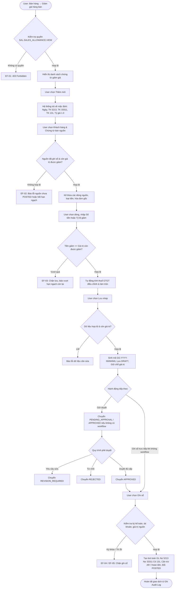

# TÀI LIỆU THIẾT KẾ KỸ THUẬT VÀ ĐẶC TẢ API BACKEND
## USE CASE UC-SAL-06: GHI NHẬN GIẢM GIÁ HÀNG BÁN (SALES ALLOWANCE / PRICE REDUCTION)

---

### 1. Tổng quan Kiến trúc và Luồng Xử lý

Use case **UC-SAL-06: Ghi nhận giảm giá hàng bán** cho phép lập chứng từ giảm giá sau bán hàng (cho cả Hàng hóa `GoodsSale` theo UC-SAL-03 và Dịch vụ `ServiceSale` theo UC-SAL-04); ghi nhận giảm trừ doanh thu, điều chỉnh thuế GTGT đầu ra và công nợ phải thu của khách hàng; liên kết chứng từ bán nguồn và hóa đơn liên quan.

> [!IMPORTANT]
> **Quy tắc cốt lõi BR-SAL-06-11**: Giảm giá hàng bán **không thay đổi số lượng bán, tồn kho hoặc giá vốn hàng bán (COGS)**. Hệ thống **không tạo phiếu nhập/xuất kho** và **không phát sinh bút toán Nợ 156 / Có 632**.

#### 1.1. Activity Diagram (Luồng hoạt động tổng thể)



---

### 2. Cấu trúc Mô hình Dữ liệu (Database Models)

#### 2.1. Bảng `sal_sales_allowance` (`SalesAllowance`)
Kế thừa từ `SalesDocument`:

| Tên trường | Kiểu dữ liệu | Null / Blank | Mô tả |
| :--- | :--- | :--- | :--- |
| `id` | UUID | PK | Khóa chính tự sinh |
| `company` | FK (`organization.Company`) | Không | Doanh nghiệp làm việc |
| `branch` | FK (`organization.Branch`) | Có | Chi nhánh thực hiện |
| `number` | CharField(80) | Không | Mã chứng từ duy nhất (`GG-YYYY-NNNNNN`) |
| `document_date` | DateField | Không | Ngày chứng từ giảm giá |
| `posting_date` | DateField | Không | Ngày hạch toán sổ cái |
| `customer` | FK (`master_data.Party`) | Không | Khách hàng của giao dịch |
| `goods_sale` | FK (`sales.GoodsSale`) | Có | Chứng từ bán hàng hóa nguồn (UC-SAL-03) |
| `service_sale` | FK (`sales.ServiceSale`) | Có | Chứng từ bán dịch vụ nguồn (UC-SAL-04) |
| `currency` | FK (`master_data.Currency`) | Không | Loại tiền giao dịch (kế thừa từ nguồn) |
| `exchange_rate` | DecimalField(20, 8) | Không | Tỷ giá hạch toán |
| `allowance_reason` | CharField(500) | Không | Lý do giảm giá hàng bán |
| `original_tax_invoice` | FK (`tax_management.TaxInvoice`) | Có | Hóa đơn bán gốc kế thừa từ nguồn |
| `tax_invoice` | FK (`tax_management.TaxInvoice`) | Có | Hóa đơn điều chỉnh giảm giá liên kết (AF-08) |
| `invoice_link_notes` | CharField(255) | Có | Ghi chú liên kết hóa đơn |
| `subtotal` | DecimalField(20, 4) | Không | Tổng tiền giảm giá trước thuế |
| `tax_amount` | DecimalField(20, 4) | Không | Tổng thuế GTGT điều chỉnh giảm |
| `total_amount` | DecimalField(20, 4) | Không | Tổng giá trị giảm giá (subtotal + tax_amount) |
| `refundable_amount` | DecimalField(20, 4) | Không | Số tiền phải hoàn trả lại cho khách hàng |
| `refunded_amount` | DecimalField(20, 4) | Không | Số tiền đã chi hoàn trả cho khách hàng |
| `status` | CharField(30) | Không | Trạng thái chứng từ (`DocumentStatus`) |
| `approval_required` | BooleanField | Không | Bắt buộc phê duyệt theo cấu hình |
| `workflow_snapshot` | JSONField | Có | Snapshot cấu hình phê duyệt |
| `journal_entry` | OneToOne (`general_ledger.JournalEntry`)| Có | Bút toán sổ cái khi ghi sổ |
| `posted_at` | DateTimeField | Có | Thời điểm ghi sổ |
| `posted_by` | FK (`iam.UserAccount`) | Có | Người thực hiện ghi sổ |
| `version` | PositiveIntegerField | Không | Số phiên bản khóa lạc quan (Optimistic Lock) |
| `attachments` | JSONField | Có | Danh sách tệp đính kèm |

#### 2.2. Bảng `sal_sales_allowance_line` (`SalesAllowanceLine`)

| Tên trường | Kiểu dữ liệu | Null / Blank | Mô tả |
| :--- | :--- | :--- | :--- |
| `id` | UUID | PK | Khóa chính tự sinh |
| `allowance` | FK (`sales.SalesAllowance`) | Không | Chứng từ giảm giá chủ quản (`related_name="lines"`) |
| `line_no` | PositiveIntegerField | Không | Số thứ tự dòng (1, 2, 3...) |
| `goods_sale_line` | FK (`sales.GoodsSaleLine`) | Có | Dòng bán hàng hóa nguồn |
| `service_sale_line` | FK (`sales.ServiceSaleLine`) | Có | Dòng bán dịch vụ nguồn |
| `item` | FK (`master_data.Item`) | Không | Mặt hàng hoặc dịch vụ được giảm giá |
| `description` | CharField(500) | Có | Diễn giải chi tiết |
| `uom` | FK (`master_data.UnitOfMeasure`) | Có | Đơn vị tính |
| `net_sales_value` | DecimalField(20, 4) | Không | Giá trị bán sau chiết khấu trước thuế của dòng |
| `returned_value` | DecimalField(20, 4) | Không | Giá trị đã trả lại trước thuế (UC-SAL-05) |
| `already_reduced_value`| DecimalField(20, 4) | Không | Tổng tiền đã giảm trên các chứng từ POSTED khác |
| `remaining_value` | DecimalField(20, 4) | Không | Giá trị còn được giảm tại thời điểm lập dòng |
| `entry_method` | CharField(20) | Không | `BY_AMOUNT` (Theo số tiền) hoặc `BY_PERCENT` (Theo tỷ lệ) |
| `allowance_rate` | DecimalField(9, 4) | Không | Tỷ lệ giảm giá (0 < rate <= 100) khi chọn BY_PERCENT |
| `allowance_amount` | DecimalField(20, 4) | Không | Tiền giảm giá trước thuế |
| `tax_rate` | FK (`master_data.TaxRate`) | Có | Thuế suất lấy từ dòng bán nguồn |
| `tax_amount` | DecimalField(20, 4) | Không | Tiền thuế GTGT điều chỉnh giảm |
| `line_total` | DecimalField(20, 4) | Không | Tổng giá trị giảm dòng (`allowance_amount + tax_amount`) |
| `revenue_deduction_account` | FK (`general_ledger.Account`) | Có | TK giảm trừ doanh thu (5213, 521, 511) |
| `tax_account` | FK (`general_ledger.Account`) | Có | TK thuế đầu ra điều chỉnh giảm (33311) |
| `receivable_account` | FK (`general_ledger.Account`) | Có | TK công nợ phải thu khách hàng (131) |

---

### 3. Ma trận Quy tắc Nghiệp vụ (Business Rules Matrix)

| Mã BR | Tên quy tắc | Triển khai Backend |
| :--- | :--- | :--- |
| **BR-SAL-06-01** | Kiểm tra quyền & phạm vi | Kiểm tra qua IAM permissions `SAL.SALES_ALLOWANCE` (`VIEW`, `CREATE`, `EDIT`, `SUBMIT`, `APPROVE`, `REJECT`, `POST`, `UNPOST`, `CANCEL`, `REFUND`). |
| **BR-SAL-06-02** | Liên kết dòng bán nguồn | Chỉ chấp nhận dòng thuộc `GoodsSale` hoặc `ServiceSale` ở trạng thái `POSTED`. Không được nhập dòng tự do ngoài chứng từ nguồn. |
| **BR-SAL-06-03** | Khống chế tiền giảm giá | Tiền giảm giá trước thuế phải lớn hơn 0 và nhỏ hơn hoặc bằng `remaining_value` của dòng nguồn. |
| **BR-SAL-06-04** | Kiểm tra giá trị khả dụng & giữ chỗ | Công thức: `Giá trị còn được giảm = NetSales - ĐãTrảLại - ĐãGiảm (POSTED) - ĐangGiữ (DRAFT, PENDING, APPROVED)`. Loại trừ chính chứng từ đang sửa. |
| **BR-SAL-06-05** | Tính thuế điều chỉnh | Kế thừa nhóm thuế từ nguồn. Tiền thuế giảm không vượt quá số thuế còn lại sau trả hàng và các lần giảm giá trước. |
| **BR-SAL-06-06** | Làm tròn & xử lý chênh lệch | Làm tròn từng dòng theo loại tiền tệ (VND = 0 chữ số thập phân). Lần giảm hết giá trị còn lại nhận phần chênh lệch làm tròn thuế còn lại của dòng nguồn. |
| **BR-SAL-06-07** | Giữ chỗ & giải phóng hạn ngạch | Chứng từ chưa ghi sổ giữ hạn ngạch. Khi xóa, hủy (`CANCEL`), hoặc điều chỉnh giảm số tiền, hạn ngạch được hoàn trả ngay lập tức. |
| **BR-SAL-06-08** | Quy trình phê duyệt | Áp dụng cấu hình Workflow. Nếu không có cấu hình workflow, người dùng có quyền được ghi sổ trực tiếp từ trạng thái `DRAFT`. |
| **BR-SAL-06-09** | Kỳ kế toán & Tài khoản | Ngày hạch toán phải thuộc kỳ kế toán `OPEN`. Các tài khoản 5213, 33311, 131 phải `ACTIVE`, `is_postable = True` và thuộc cùng `company`. |
| **BR-SAL-06-10** | Bút toán Sổ cái khi Ghi sổ | Tạo JournalEntry tự động: <br>• **Nợ TK 5213 / 521**: `subtotal` (Tổng tiền giảm trước thuế)<br>• **Nợ TK 33311**: `tax_amount` (Tổng thuế GTGT điều chỉnh)<br>• **Có TK 131**: `total_amount` (Tổng giá trị giảm trừ công nợ) |
| **BR-SAL-06-11** | Tuyệt đối không ảnh hưởng kho & COGS | Không tạo phiếu nhập/xuất kho (`InventoryTransaction`). Không điều chỉnh số lượng tồn kho `StockBalance`. Không hạch toán tài khoản 156 / 632. |
| **BR-SAL-06-12** | Đối trừ công nợ & Hoàn tiền | Tự động cấn trừ số dư phải thu `Receivable.balance` của chứng từ bán nguồn. Nếu nguồn đã thanh toán đủ hoặc tiền giảm lớn hơn nợ còn lại, phần dư chuyển vào `refundable_amount` để chi hoàn tiền. |
| **BR-SAL-06-13** | Quản lý hóa đơn liên quan | Hóa đơn điều chỉnh liên kết qua `link_tax_invoice` không tạo lại bút toán giảm doanh thu và thuế lần 2. |
| **BR-SAL-06-14** | Ràng buộc sửa / hủy / xóa | Chỉ sửa chứng từ ở trạng thái `DRAFT`, `REVISION_REQUIRED`, `REJECTED`. Chứng từ `POSTED` chỉ được xử lý qua chức năng `unpost` hoặc quy trình điều chỉnh. Chỉ xóa `DRAFT`. |
| **BR-SAL-06-15** | Khóa lạc quan & Audit Trail | Kiểm tra trường `version` trong mọi thao tác cập nhật. Ghi nhận đầy đủ vết kiểm toán qua `record_audit` cho mọi hành vi nghiệp vụ. |

---

### 4. Danh sách Endpoint API

Base URL: `/api/v1/sales/sales-allowances/`

#### 4.1. Lấy giá trị mặc định khi tạo mới
- **Endpoint**: `GET /api/v1/sales/sales-allowances/defaults/`
- **Query Params**:
  - `company_id` (bắt buộc): UUID của doanh nghiệp.
  - `customer_id` (tùy chọn): UUID khách hàng.
  - `goods_sale_id` (tùy chọn): UUID chứng từ bán hàng hóa.
  - `service_sale_id` (tùy chọn): UUID chứng từ bán dịch vụ.
- **Phản hồi**:
```json
{
  "document_date": "2026-10-09",
  "posting_date": "2026-10-09",
  "currency": "VND",
  "currency_id": "8bb34571-081d-4078-a28a-77e8a937a098",
  "exchange_rate": "1.0",
  "customer": "1a706da2-b132-4521-874e-5bb69e8b3940",
  "goods_sale": "3c98ba82-2735-430b-98ee-1a9317d7ab32",
  "goods_sale_number": "BH-2026-000012",
  "service_sale": null,
  "source_type": "GOODS_SALE",
  "allowance_reason": "",
  "revenue_deduction_account": "7c12...",
  "tax_account": "6a34...",
  "receivable_account": "5e91..."
}
```

#### 4.2. Kế thừa dòng từ chứng từ bán nguồn (Prepare from Sale)
- **Endpoint**: `GET /api/v1/sales/sales-allowances/prepare_from_sale/`
- **Query Params**:
  - `company_id` (bắt buộc): UUID của công ty.
  - `goods_sale_id` hoặc `service_sale_id` (bắt buộc 1 trong 2).
- **Phản hồi**:
```json
{
  "company": "c88f3411-...",
  "customer": "1a706da2-...",
  "customer_name": "Công Ty TNHH Thương Mại Toàn Cầu",
  "source_type": "GOODS_SALE",
  "goods_sale": "3c98ba82-...",
  "goods_sale_number": "BH-2026-000012",
  "currency": "VND",
  "exchange_rate": "1.0",
  "original_tax_invoice": null,
  "lines": [
    {
      "goods_sale_line_id": "fa91...",
      "line_no": 1,
      "item_id": "dd12...",
      "item_code": "LAPTOP_HP",
      "item_name": "Laptop HP ProBook",
      "uom_id": "bb01...",
      "uom_name": "Cái",
      "quantity": "10.000000",
      "unit_price": "20000000.0000",
      "net_sales_value": "190000000.0000",
      "returned_value": "0.0000",
      "already_reduced_value": "0.0000",
      "remaining_value": "190000000.0000",
      "tax_rate_id": "ee45...",
      "tax_rate_code": "VAT10",
      "tax_rate_percent": "10.00",
      "revenue_deduction_account": "7c12...",
      "tax_account": "6a34...",
      "receivable_account": "5e91..."
    }
  ]
}
```

#### 4.3. Tạo mới chứng từ giảm giá (Lưu nháp)
- **Endpoint**: `POST /api/v1/sales/sales-allowances/`
- **Request Body**:
```json
{
  "company": "c88f3411-...",
  "branch": "a190...",
  "document_date": "2026-10-09",
  "posting_date": "2026-10-09",
  "customer": "1a706da2-...",
  "goods_sale": "3c98ba82-...",
  "allowance_reason": "Hàng sai quy cách nhẹ, thỏa thuận giảm giá",
  "lines": [
    {
      "goods_sale_line": "fa91...",
      "entry_method": "BY_AMOUNT",
      "allowance_amount": "20000000",
      "revenue_deduction_account": "7c12...",
      "tax_account": "6a34...",
      "receivable_account": "5e91..."
    }
  ]
}
```
- **Phản hồi**: `201 Created` kèm thông tin chi tiết và mã sinh tự động `GG-2026-000001`.

#### 4.4. Trình duyệt & Phê duyệt Workflow
- `POST /api/v1/sales/sales-allowances/{id}/submit/` (Body: `{"notes": "..."}`)
- `POST /api/v1/sales/sales-allowances/{id}/withdraw/` (Body: `{"reason": "..."}`)
- `POST /api/v1/sales/sales-allowances/{id}/approve/` (Body: `{"comment": "..."}`)
- `POST /api/v1/sales/sales-allowances/{id}/request_revision/` (Body: `{"comment": "..."}`)
- `POST /api/v1/sales/sales-allowances/{id}/reject/` (Body: `{"comment": "..."}`)

#### 4.5. Ghi sổ chứng từ giảm giá (Post)
- **Endpoint**: `POST /api/v1/sales/sales-allowances/{id}/post/`
- **Hành vi**:
  1. Kiểm tra kỳ kế toán đang `OPEN`.
  2. Kiểm tra tính hợp lệ của tài khoản 5213, 33311, 131.
  3. Kiểm tra khóa hạn ngạch nguồn không bị vượt mức.
  4. Tạo `JournalEntry` cân đối Nợ/Có.
  5. Cấn trừ nợ phải thu `Receivable.balance` hoặc tính `refundable_amount`.
  6. Chuyển trạng thái chứng từ sang `POSTED` và ghi Audit Log.

#### 4.6. Bỏ ghi sổ chứng từ giảm giá (Unpost)
- **Endpoint**: `POST /api/v1/sales/sales-allowances/{id}/unpost/`
- **Body**: `{"reason": "Lý do bỏ ghi sổ"}`
- **Hành vi**: Kiểm tra chưa phát sinh hoàn tiền (`refunded_amount == 0`), đảo ngược cấn trừ Receivable, xóa bút toán JournalEntry, chuyển về `DRAFT`.

#### 4.7. Chi hoàn tiền cho khách hàng (Customer Refund)
- **Endpoint**: `POST /api/v1/sales/sales-allowances/{id}/refund/`
- **Body**:
```json
{
  "amount": "11000000",
  "payment_method": "BANK",
  "company_bank_account": "88aa...",
  "notes": "Chuyển khoản trả lại tiền giảm giá cho khách"
}
```
- **Phản hồi**:
```json
{
  "status": "SUCCESS",
  "sales_allowance_id": "a901...",
  "refunded_amount": "11000000.0000",
  "remaining_refundable": "0.0000",
  "journal_entry_id": "18cf..."
}
```

#### 4.8. Liên kết hóa đơn điều chỉnh (Link Tax Invoice)
- **Endpoint**: `POST /api/v1/sales/sales-allowances/{id}/link_invoice/`
- **Body**: `{"invoice_id": "uuid...", "notes": "Hóa đơn điều chỉnh số 000123"}`

---

### 5. Kết quả Kiểm thử Tự động (Unit & Integration Tests)

File kiểm thử: `sales/test_sales_allowance_uc_sal_06.py`

| STT | Tên ca kiểm thử | Mô tả & Quy tắc kiểm tra | Kết quả |
| :---: | :--- | :--- | :---: |
| 1 | `test_01_create_draft_allowance_fixed_amount` | Tạo chứng từ giảm giá theo số tiền cố định (`BY_AMOUNT`), sinh mã tự động `GG-YYYY-NNNNNN`, tính đúng thuế GTGT và tổng tiền. | **PASS** |
| 2 | `test_02_create_allowance_by_percent` | Tạo chứng từ giảm giá theo tỷ lệ (`BY_PERCENT`), tính tiền giảm giá trên giá trị còn lại khả dụng (AF-03, BR-SAL-06-03). | **PASS** |
| 3 | `test_03_prepare_from_sale_goods_and_service` | Kế thừa dữ liệu từ cả `GoodsSale` (UC-SAL-03) và `ServiceSale` (UC-SAL-04), tính giá trị bán, đã trả, đã giảm và còn lại. | **PASS** |
| 4 | `test_04_validation_exceeding_remaining_value_and_invalid_rates` | Chặn giảm vượt quá giá trị còn lại, chặn tỷ lệ > 100%, chặn lập giảm giá từ chứng từ bán chưa ghi sổ (EF-02, EF-03, BR-SAL-06-03). | **PASS** |
| 5 | `test_05_post_allowance_gl_and_br_sal_06_11_no_inventory_impact` | **Quy tắc BR-SAL-06-11**: Ghi sổ tạo bút toán GL Nợ 5213, Nợ 33311, Có 131; cấn trừ Receivable; **tuyệt đối không tạo phiếu kho, không thay đổi tồn kho, không hạch toán 156/632**. | **PASS** |
| 6 | `test_06_multiple_allowances_and_remainder_rounding` | Kiểm tra nhiều lần giảm giá liên tiếp trên cùng 1 dòng, giữ chỗ giá trị giữa các chứng từ chưa ghi sổ và làm tròn thuế lần cuối (BR-SAL-06-04, BR-SAL-06-06). | **PASS** |
| 7 | `test_07_sales_allowance_on_service_sale` | Lập và ghi sổ giảm giá cho chứng từ bán dịch vụ `ServiceSale`, ghi nhận giảm trừ công nợ phải thu của dịch vụ. | **PASS** |
| 8 | `test_08_approval_workflow_lifecycle` | Vòng đời phê duyệt đầy đủ: Submit → Withdraw → Submit → Request Revision → Resubmit → Approve → Post → Unpost. | **PASS** |
| 9 | `test_09_customer_refund_for_excess_allowance` | Hoàn tiền cho khách hàng khi giao dịch bán đã thanh toán đủ hoặc tiền giảm vượt quá công nợ còn lại; tạo bút toán hoàn tiền Nợ 131 / Có 111-112 (AF-04, BR-SAL-06-12). | **PASS** |
| 10 | `test_10_optimistic_locking_and_cancel_releases_reservation` | Kiểm tra xung đột phiên bản khóa lạc quan (BR-SAL-06-15, EF-08), và hủy chứng từ giải phóng toàn bộ hạn ngạch giữ chỗ (AF-07, BR-SAL-06-07). | **PASS** |

**Tổng kết kiểm thử**:
- Module `sales.test_sales_allowance_uc_sal_06`: **10 / 10 tests PASSED (100%)**.
- Toàn bộ module `sales`: **63 / 63 tests PASSED (100%)**.
