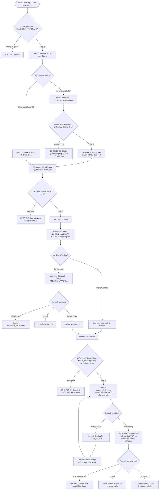

# TÀI LIỆU THIẾT KẾ KỸ THUẬT VÀ ĐẶC TẢ API BACKEND
## USE CASE UC-SAL-07: LẬP HÓA ĐƠN ĐẦU RA (SALES TAX INVOICE ISSUANCE / OUTGOING INVOICES)

---

### 1. Tổng quan Kiến trúc và Luồng Xử lý

Use case **UC-SAL-07: Lập hóa đơn đầu ra** cho phép lập hóa đơn bán hàng hóa/dịch vụ từ chứng từ bán hàng nguồn (`GoodsSale` theo UC-SAL-03, `ServiceSale` theo UC-SAL-04, `SalesOrder` theo UC-SAL-02) hoặc nhập trực tiếp (AF-02); kiểm tra, phê duyệt theo workflow và chuyển phát hành qua hệ thống hóa đơn điện tử; lưu số hóa đơn, tệp XML/PDF và liên kết đồng bộ sang phân hệ thuế `tax_management.TaxInvoice`.

> [!IMPORTANT]
> **Quy tắc hạch toán kế toán BR-SAL-07-12**: Lập và phát hành hóa đơn đầu ra **không tự ghi nhận lại doanh thu, thuế GTGT hay công nợ phải thu (AR)** đã hạch toán trên chứng từ bán nguồn (`GoodsSale`, `ServiceSale`). Hệ thống tạo bản ghi `TaxInvoice(direction="OUTPUT", source="SALES")` trong `tax_management` để quản lý hóa đơn điện tử và kê khai thuế, đồng thời cập nhật liên kết `tax_invoice` ngược lại chứng từ bán nguồn.

> [!TIP]
> **Quy tắc kiểm soát phát hành & chống gửi trùng BR-SAL-07-11**: Mỗi hóa đơn có mã `issue_control_code` duy nhất. Trường hợp lỗi hoặc mất kết nối mạng, hệ thống giữ trạng thái `ISSUE_FAILED`, yêu cầu User kiểm tra nguyên nhân và dùng action `retry_issue` thay vì tạo mới để tránh bị cấp trùng số hóa đơn.

#### 1.1. Activity Diagram (Luồng hoạt động tổng thể)



---

### 2. Cấu trúc Mô hình Dữ liệu (Database Models)

#### 2.1. Bảng `sal_sales_invoice` (`SalesInvoice`)
Kế thừa từ `SalesDocument`:

| Tên trường | Kiểu dữ liệu | Null / Blank | Mô tả |
| :--- | :--- | :--- | :--- |
| `id` | UUID | PK | Khóa chính tự sinh |
| `company` | FK (`organization.Company`) | Không | Doanh nghiệp phát hành hóa đơn |
| `branch` | FK (`organization.Branch`) | Có | Chi nhánh thực hiện |
| `number` | CharField(80) | Không | Mã nội bộ duy nhất (`HD-YYYY-NNNNNN`) |
| `document_date` | DateField | Không | Ngày tạo chứng từ nội bộ |
| `invoice_date` | DateField | Không | Ngày lập hóa đơn điện tử |
| `customer` | FK (`master_data.Party`) | Không | Đối tượng khách hàng |
| `invoice_category` | CharField(20) | Không | Loại hóa đơn (`VAT`, `SALES`, `EXPORT`, `OTHER`) |
| `invoice_series` | CharField(50) | Không | Ký hiệu hóa đơn (vd: `1C26TAA`) |
| `template_code` | CharField(50) | Có | Mẫu số hóa đơn (vd: `1/001`) |
| `invoice_number` | CharField(50) | Có | Số hóa đơn chính thức (7 chữ số, vd: `0000001`) sau khi phát hành |
| `seller_name` | CharField(255) | Không | Tên đơn vị bán (snapshot từ Company) |
| `seller_tax_code` | CharField(50) | Không | Mã số thuế đơn vị bán |
| `seller_address` | CharField(500) | Có | Địa chỉ đơn vị bán |
| `buyer_name` | CharField(255) | Không | Tên người mua |
| `buyer_legal_name` | CharField(255) | Có | Tên công ty / đơn vị người mua |
| `buyer_tax_code` | CharField(50) | Có | Mã số thuế người mua (nếu là doanh nghiệp) |
| `buyer_address` | CharField(500) | Có | Địa chỉ người mua |
| `buyer_email` | EmailField | Có | Email nhận hóa đơn điện tử |
| `payment_method` | CharField(30) | Không | Hình thức thanh toán (`CASH`, `BANK`, `CASH_OR_BANK`) |
| `goods_sale` | FK (`sales.GoodsSale`) | Có | Chứng từ bán hàng hóa nguồn |
| `service_sale` | FK (`sales.ServiceSale`) | Có | Chứng từ bán dịch vụ nguồn |
| `sales_order` | FK (`sales.SalesOrder`) | Có | Đơn bán hàng nguồn |
| `currency` | FK (`master_data.Currency`) | Không | Đồng tiền giao dịch (mặc định VND) |
| `exchange_rate` | DecimalField(20, 8) | Không | Tỷ giá hạch toán |
| `subtotal` | DecimalField(20, 4) | Không | Tổng tiền hàng chưa thuế |
| `discount_amount` | DecimalField(20, 4) | Không | Tổng chiết khấu thương mại |
| `tax_amount` | DecimalField(20, 4) | Không | Tổng tiền thuế GTGT |
| `total_amount` | DecimalField(20, 4) | Không | Tổng tiền thanh toán (Subtotal - Discount + Tax) |
| `status` | CharField(30) | Không | Trạng thái (`DRAFT`, `PENDING_APPROVAL`, `REVISION_REQUIRED`, `REJECTED`, `APPROVED`, `ISSUING`, `ISSUE_FAILED`, `ISSUED`, `CANCELLED`) |
| `approval_required` | BooleanField | Không | Yêu cầu phê duyệt trước khi phát hành |
| `workflow_snapshot` | JSONField | Có | Snapshot quy trình phê duyệt |
| `connector` | FK (`tax_management.ConnectorConfig`) | Có | Cấu hình kết nối cổng HĐĐT |
| `transaction_code` | CharField(150) | Có | Mã giao dịch gửi nhận với nhà cung cấp HĐĐT |
| `issue_control_code`| CharField(150) | Có | Mã kiểm soát phát hành duy nhất chống gửi trùng |
| `tax_invoice` | FK (`tax_management.TaxInvoice`) | Có | Liên kết bản ghi hóa đơn thuế tương ứng |
| `xml_file_url` | CharField(500) | Có | Đường dẫn tệp dữ liệu XML của hóa đơn |
| `pdf_file_url` | CharField(500) | Có | Đường dẫn bản thể hiện PDF |
| `lookup_url` | CharField(500) | Có | Đường dẫn tra cứu hóa đơn điện tử |
| `lookup_code` | CharField(100) | Có | Mã tra cứu hóa đơn |
| `issue_error_message` | TextField | Có | Nội dung lỗi nếu nhà cung cấp từ chối |
| `issued_at` | DateTimeField | Có | Thời điểm phát hành thành công |
| `issued_by` | FK (`iam.UserAccount`) | Có | Người thực hiện phát hành |
| `version` | PositiveIntegerField | Không | Số phiên bản khóa lạc quan (Optimistic Lock) |

#### 2.2. Bảng `sal_sales_invoice_line` (`SalesInvoiceLine`)

| Tên trường | Kiểu dữ liệu | Null / Blank | Mô tả |
| :--- | :--- | :--- | :--- |
| `id` | UUID | PK | Khóa chính tự sinh |
| `invoice` | FK (`sales.SalesInvoice`) | Không | Hóa đơn đầu ra chủ quản (`related_name="lines"`) |
| `line_no` | PositiveIntegerField | Không | Số thứ tự dòng trên hóa đơn |
| `item` | FK (`master_data.Item`) | Có | Mặt hàng / dịch vụ danh mục |
| `item_name` | CharField(255) | Không | Tên hàng hóa/dịch vụ hiển thị trên hóa đơn |
| `description` | CharField(500) | Có | Diễn giải chi tiết nội dung dòng |
| `uom` | FK (`master_data.UnitOfMeasure`) | Có | Đơn vị tính |
| `quantity` | DecimalField(20, 4) | Không | Số lượng xuất hóa đơn (> 0) |
| `unit_price` | DecimalField(20, 4) | Không | Đơn giá chưa thuế |
| `amount` | DecimalField(20, 4) | Không | Thành tiền (Số lượng × Đơn giá) |
| `discount_rate` | DecimalField(5, 2) | Không | Tỷ lệ chiết khấu (%) |
| `discount_amount` | DecimalField(20, 4) | Không | Tiền chiết khấu dòng |
| `tax_rate` | FK (`master_data.TaxRate`) | Có | Nhóm thuế / Thuế suất GTGT |
| `tax_amount` | DecimalField(20, 4) | Không | Tiền thuế GTGT dòng |
| `line_total` | DecimalField(20, 4) | Không | Tổng cộng dòng (Thành tiền - Chiết khấu + Thuế) |
| `goods_sale_line` | FK (`sales.GoodsSaleLine`) | Có | Dòng bán hàng hóa nguồn |
| `service_sale_line`| FK (`sales.ServiceSaleLine`) | Có | Dòng bán dịch vụ nguồn |
| `order_line` | FK (`sales.SalesOrderLine`) | Có | Dòng đơn hàng nguồn |

#### 2.3. Bảng `sal_sales_invoice_counter` (`SalesInvoiceCounter`)

Quản lý sinh số thứ tự nội bộ hóa đơn độc lập theo từng năm và doanh nghiệp: `HD-YYYY-NNNNNN`.

---

### 3. Chi tiết API Endpoints

Router prefix: `/api/v1/sales/sales-invoices/`

| HTTP Method | URI Endpoint | Action / Quyền IAM | Mục đích |
| :--- | :--- | :--- | :--- |
| `GET` | `/defaults/` | `SAL.SALES_INVOICE.VIEW` | Lấy dữ liệu mặc định: hồ sơ người bán, ký hiệu, mẫu, người mua |
| `GET` | `/prepare_from_sale/` | `SAL.SALES_INVOICE.CREATE` | Trích xuất dòng và hạn ngạch số lượng còn lại từ chứng từ bán |
| `GET` | `/` | `SAL.SALES_INVOICE.VIEW` | Danh sách hóa đơn, hỗ trợ tìm kiếm, lọc theo ngày, trạng thái |
| `POST` | `/` | `SAL.SALES_INVOICE.CREATE` | Tạo mới hóa đơn đầu ra ở trạng thái `DRAFT`, giữ chỗ hạn ngạch nguồn |
| `GET` | `/{id}/` | `SAL.SALES_INVOICE.VIEW` | Chi tiết hóa đơn và các dòng |
| `PUT` / `PATCH`| `/{id}/` | `SAL.SALES_INVOICE.EDIT` | Cập nhật hóa đơn ở trạng thái cho phép (`DRAFT`, `REVISION_REQUIRED`, `REJECTED`) |
| `DELETE` | `/{id}/` | `SAL.SALES_INVOICE.EDIT` | Xóa hóa đơn `DRAFT`, tự động giải phóng hạn ngạch nguồn |
| `POST` | `/{id}/submit/` | `SAL.SALES_INVOICE.SUBMIT` | Gửi duyệt hóa đơn theo Workflow (`DRAFT` → `PENDING_APPROVAL`) |
| `POST` | `/{id}/withdraw/` | `SAL.SALES_INVOICE.SUBMIT` | Thu hồi yêu cầu duyệt về `DRAFT` |
| `POST` | `/{id}/approve/` | `SAL.SALES_INVOICE.APPROVE`| Phê duyệt hóa đơn (`PENDING_APPROVAL` → `APPROVED`) |
| `POST` | `/{id}/request_revision/`| `SAL.SALES_INVOICE.REJECT`| Yêu cầu chỉnh sửa (`PENDING_APPROVAL` → `REVISION_REQUIRED`) |
| `POST` | `/{id}/reject/` | `SAL.SALES_INVOICE.REJECT` | Từ chối duyệt (`PENDING_APPROVAL` → `REJECTED`) |
| `POST` | `/{id}/issue/` | `SAL.SALES_INVOICE.ISSUE` | Phát hành hóa đơn điện tử (cấp số, sinh XML/PDF, đồng bộ TaxInvoice) |
| `POST` | `/{id}/retry_issue/` | `SAL.SALES_INVOICE.RETRY_ISSUE` | Thử lại phát hành hóa đơn lỗi bằng mã kiểm soát chống trùng |
| `POST` | `/{id}/cancel/` | `SAL.SALES_INVOICE.CANCEL` | Hủy hóa đơn chưa phát hành, giải phóng hạn ngạch nguồn |
| `POST` | `/{id}/send_email/`| `SAL.SALES_INVOICE.SEND_EMAIL` | Gửi email thông báo đường dẫn tra cứu hóa đơn tới khách hàng |

#### 3.1. Ví dụ Request & Response

##### a. Chuẩn bị dữ liệu từ chứng từ bán nguồn (`GET /prepare_from_sale/`)
**Query Params**: `company_id={uuid}&goods_sale_id={uuid}`
**Response 200 OK**:
```json
{
  "company": "1b1a7d6e-8260-4966-8803-b541315fb291",
  "customer": "b965f3a0-7b24-4f40-8431-a0a382025345",
  "customer_name": "Công Ty TNHH Đại Phát Khang",
  "source_type": "GOODS_SALE",
  "goods_sale": "e5bfa78f-a9cb-46c5-a6a9-858a74209930",
  "goods_sale_number": "BH-SAL07-1718000000",
  "currency": "VND",
  "exchange_rate": "1",
  "lines": [
    {
      "source_line_id": "7649d282-3d71-4648-9363-f2fa102dbdca",
      "goods_sale_line_id": "7649d282-3d71-4648-9363-f2fa102dbdca",
      "line_no": 1,
      "item_id": "060d4023-ebc9-4d6a-86a0-e5554160a359",
      "item_code": "LAPTOP_DELL",
      "item_name": "Laptop Dell Latitude",
      "uom_id": "80ff8998-356a-4934-bc23-c9779dfba261",
      "uom_name": "Cái",
      "total_quantity": "10.0000",
      "already_invoiced_quantity": "0.0000",
      "pending_quantity": "0.0000",
      "remaining_quantity": "10.0000",
      "unit_price": "15000000.0000",
      "discount_amount": "5000000.0000",
      "tax_rate_percent": "10.00"
    }
  ]
}
```

##### b. Phát hành hóa đơn (`POST /{id}/issue/`)
**Response 200 OK**:
```json
{
  "id": "23faeb59-67d4-4cf1-b753-37b9576c9ad7",
  "number": "HD-2026-000001",
  "invoice_number": "0000001",
  "status": "ISSUED",
  "invoice_series": "1C26TAA",
  "template_code": "1/001",
  "subtotal": "150000000.0000",
  "discount_amount": "5000000.0000",
  "tax_amount": "14500000.0000",
  "total_amount": "159500000.0000",
  "xml_file_url": "/media/invoices/SAL07_CO/2026/1C26TAA_0000001.xml",
  "pdf_file_url": "/media/invoices/SAL07_CO/2026/1C26TAA_0000001.pdf",
  "lookup_url": "https://hoadondientu.gdt.gov.vn/tra-cuu?code=C28B5E41A9",
  "lookup_code": "C28B5E41A9",
  "tax_invoice": "f516a8b7-6ecf-4cf4-b81f-e95e86d2673e",
  "issued_at": "2026-10-09T04:47:00Z"
}
```

---

### 4. Bảng Quy tắc Nghiệp vụ (Business Rules Matrix)

| Mã BR | Tên quy tắc | Mô tả chi tiết & Cơ chế Backend |
| :--- | :--- | :--- |
| **BR-SAL-07-01** | Phân quyền & Phạm vi dữ liệu | Kiểm tra quyền IAM riêng biệt: `VIEW`, `CREATE`, `EDIT`, `SUBMIT`, `APPROVE`, `REJECT`, `ISSUE`, `RETRY_ISSUE`, `CANCEL`, `SEND_EMAIL` theo `company_id` và `branch_id`. |
| **BR-SAL-07-02** | Liên kết dòng nguồn | Lưu khóa ngoại trực tiếp tới `goods_sale_line`, `service_sale_line` hoặc `order_line`. Số lượng lập không được vượt quá số lượng chưa lập hóa đơn. |
| **BR-SAL-07-03** | Tính đồng nhất của nguồn | Chứng từ nguồn tổng hợp trên cùng một hóa đơn phải cùng doanh nghiệp, cùng khách hàng và cùng loại tiền tệ. |
| **BR-SAL-07-04** | Kiểm tra hạn ngạch nguồn | Tính toán: `remaining_qty = total_qty - already_issued_qty - pending_reserved_qty`. Loại trừ chính hóa đơn hiện tại khi kiểm tra cập nhật. |
| **BR-SAL-07-05** | Giữ chỗ hạn ngạch nguồn | Hóa đơn ở các trạng thái chưa phát hành (`DRAFT`, `PENDING_APPROVAL`, `APPROVED`, `ISSUING`) tự động giữ chỗ số lượng. Khi xóa hoặc hủy (`CANCELLED`), hạn ngạch lập tức được giải phóng. |
| **BR-SAL-07-06** | Kế thừa đơn giá, thuế, chiết khấu | Kế thừa chính xác đơn giá, chiết khấu và thuế suất từ chứng từ bán nguồn. Cho phép điều chỉnh tên hiển thị trước khi phê duyệt/phát hành. |
| **BR-SAL-07-07** | Tính toán & Làm tròn số tiền | Tiền hàng = Số lượng × Đơn giá; Tiền chịu thuế = Thành tiền - Chiết khấu; Tiền thuế = Tiền chịu thuế × Thuế suất; Tổng tiền = Tiền chịu thuế + Tiền thuế. Làm tròn tiền theo số chữ số thập phân của loại tiền (VND = 0 chữ số). |
| **BR-SAL-07-08** | Quy trình phê duyệt Workflow | Nếu có cấu hình Workflow phê duyệt, hóa đơn phải được duyệt đầy đủ cấp chuyển sang `APPROVED` mới được phát hành. Chỉnh sửa hóa đơn đã duyệt bắt buộc phải trình duyệt lại. |
| **BR-SAL-07-09** | Tiền điều kiện phát hành | Bắt buộc kiểm tra hồ sơ người bán (Tên, MST), ký hiệu hóa đơn hoạt động, ngày hóa đơn hợp lệ, và MST người mua (đối với người mua là doanh nghiệp). |
| **BR-SAL-07-10** | Cấp số chính thức & Bất biến | Số hóa đơn chính thức 7 số (vd: `0000001`) và các tệp XML/PDF do hệ thống sinh ra khi phát hành thành công và không cho phép chỉnh sửa trực tiếp. |
| **BR-SAL-07-11** | Chống gửi trùng (Idempotency) | Mỗi hóa đơn gán một `issue_control_code` duy nhất (`ISSUE-{company}-{number}-{uuid}`). Lỗi mạng hoặc lỗi hệ thống phải tra cứu hoặc gọi `retry_issue` thay vì tạo yêu cầu mới. |
| **BR-SAL-07-12** | Không hạch toán kép & Đồng bộ thuế | Lập hóa đơn không sinh lại bút toán GL hay công nợ AR. Tự động sinh `TaxInvoice(direction="OUTPUT", source="SALES")` và backlink `tax_invoice` về `GoodsSale` / `ServiceSale`. |
| **BR-SAL-07-13** | Xử lý sau phát hành | Hóa đơn `ISSUED` không được phép sửa đổi hoặc xóa; mọi sai sót được xử lý thông qua quy trình xử lý hóa đơn sai sót riêng biệt. |
| **BR-SAL-07-14** | Audit Log & Khóa lạc quan | Ghi nhận Audit Log toàn bộ thao tác (`CREATE`, `EDIT`, `SUBMIT`, `WITHDRAW`, `APPROVE`, `ISSUE`, `CANCEL`, `SEND_EMAIL`); kiểm soát xung đột dữ liệu bằng trường `version`. |

---

### 5. Kết quả Kiểm thử Tự động (Automated Test Suite)

Toàn bộ 12 ca kiểm thử chuyên biệt cho UC-SAL-07 được thực thi thành công trong file test [test_sales_invoice_uc_sal_07.py](file:///c:/Users/Admin/LapTrinh/Thue/sales/test_sales_invoice_uc_sal_07.py):

| STT | Phương thức test | Mô tả kịch bản kiểm thử | Kết quả |
| :---: | :--- | :--- | :---: |
| 1 | `test_01_defaults_endpoint` | Kiểm tra API lấy thông tin mặc định người bán, mẫu số, ký hiệu, người mua từ nguồn | **PASSED** |
| 2 | `test_02_create_draft_invoice_direct_entry` | Kiểm tra lập hóa đơn trực tiếp (AF-02), sinh mã nội bộ `HD-YYYY-NNNNNN`, tính thuế và tổng tiền | **PASSED** |
| 3 | `test_03_prepare_from_sale_goods_service_order` | Kiểm tra trích xuất dòng và hạn ngạch từ `GoodsSale`, `ServiceSale` và `SalesOrder` | **PASSED** |
| 4 | `test_04_create_invoice_from_goods_sale_and_partial_reservation` | Kiểm tra lập hóa đơn một phần (4/10 cái) và giữ chỗ hạn ngạch unissued invoice (BR-SAL-07-04) | **PASSED** |
| 5 | `test_05_exceed_remaining_quantity_blocked` | Chặn lập hóa đơn vượt quá số lượng nguồn còn lại (EF-03, BR-SAL-07-02) | **PASSED** |
| 6 | `test_06_issue_sales_invoice_success` | Phát hành thành công: cấp số 7 chữ số, sinh file XML/PDF, tạo TaxInvoice và cập nhật backlink | **PASSED** |
| 7 | `test_07_issue_failure_and_retry` | Giả lập lỗi nhà cung cấp → `ISSUE_FAILED`, chặn sửa thường, thực hiện `retry_issue` thành công | **PASSED** |
| 8 | `test_08_approval_workflow_lifecycle` | Chu trình duyệt đầy đủ: Submit → Withdraw → Revision Required → Approve → Issue | **PASSED** |
| 9 | `test_09_download_and_send_email` | Gửi email thông báo hóa đơn điện tử cho khách hàng và ghi audit log (AF-07) | **PASSED** |
| 10 | `test_10_optimistic_locking_and_immutability` | Kiểm tra khóa lạc quan (`version` conflict) và chặn sửa/xóa hóa đơn đã phát hành | **PASSED** |
| 11 | `test_11_delete_and_cancel_releases_reservation` | Xóa hóa đơn nháp và hủy hóa đơn lập tức giải phóng hạn ngạch giữ chỗ của nguồn | **PASSED** |
| 12 | `test_12_service_sale_and_sales_order_invoicing` | Kiểm tra phát hành hóa đơn từ bán dịch vụ và đơn bán hàng, cập nhật `invoiced_quantity` | **PASSED** |

**Tổng kiểm thử phân hệ Bán hàng (Sales Module)**: **75/75 tests PASSED** (100%).
