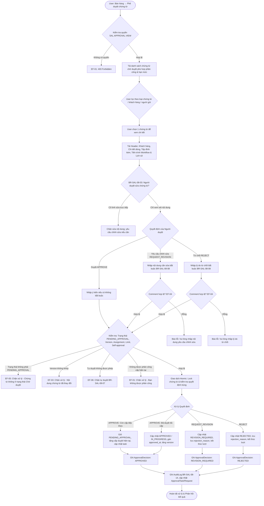

# TÀI LIỆU THIẾT KẾ KỸ THUẬT VÀ ĐẶC TẢ API BACKEND
## USE CASE UC-SAL-08: PHÊ DUYỆT CHỨNG TỪ BÁN HÀNG (SALES DOCUMENT APPROVAL WORKSPACE)

---

### 1. Tổng quan Kiến trúc và Luồng Xử lý

Use case **UC-SAL-08: Phê duyệt chứng từ bán hàng** cung cấp không gian làm việc tập trung (Centralized Approval Workspace) cho phép người có thẩm quyền kiểm tra nội dung chứng từ, phê duyệt (`APPROVE`), yêu cầu chỉnh sửa (`REQUEST_REVISION`), hoặc từ chối (`REJECT`) theo cấu hình Workflow phê duyệt động của doanh nghiệp; đồng thời hỗ trợ người lập thu hồi yêu cầu (`WITHDRAW`) khi chứng từ còn đang chờ xử lý.

Không gian phê duyệt bán hàng hỗ trợ toàn bộ 8 loại chứng từ bán hàng thuộc phân hệ Sales:
1. `QUOTATION` – Báo giá bán (`SalesQuotation`, UC-SAL-01)
2. `ORDER` – Đơn bán hàng (`SalesOrder`, UC-SAL-02)
3. `CONTRACT` – Hợp đồng bán hàng (`SalesContract`)
4. `GOODS_SALE` – Bán hàng hóa (`GoodsSale`, UC-SAL-03)
5. `SERVICE_SALE` – Bán dịch vụ (`ServiceSale`, UC-SAL-04)
6. `SALES_RETURN` – Hàng bán trả lại (`SalesReturn`, UC-SAL-05)
7. `SALES_ALLOWANCE` – Giảm giá hàng bán (`SalesAllowance`, UC-SAL-06)
8. `SALES_INVOICE` – Hóa đơn đầu ra (`SalesInvoice`, UC-SAL-07)

> [!IMPORTANT]
> **Quy tắc độc lập nghiệp vụ hạch toán BR-SAL-08-11**: Duyệt đủ các cấp chỉ cập nhật trạng thái nghiệp vụ tương ứng của chứng từ (`APPROVED` / `CONFIRMED` / `IN_PROGRESS`); **tuyệt đối không tự động ghi sổ kế toán (GL), không tự động xuất/nhập kho (Inventory), không tự động thu/chi tiền và không tự động phát hành hóa đơn điện tử**. Các nghiệp vụ hạch toán này phải do người dùng có thẩm quyền tương ứng thực hiện tại màn hình chức năng chuyên biệt.

> [!TIP]
> **Kiểm soát xử lý đồng thời & phiên bản BR-SAL-08-04, BR-SAL-08-13**: Hệ thống áp dụng khóa bi quan `select_for_update()` trong giao dịch nguyên tử `transaction.atomic()` kết hợp kiểm tra phiên bản lạc quan (`version` matching) để ngăn ngừa xung đột dữ liệu và ngăn chặn quyết định trùng lặp từ nhiều người duyệt đồng thời.

---

#### 1.1. Activity Diagram (Luồng hoạt động chính & Luồng thay thế)



---

### 2. Cấu trúc Mô hình Dữ liệu (Database Models)

#### 2.1. Bản ghi Quyết định Phê duyệt `sal_approval_decision` (`ApprovalDecision`)

| Tên trường | Kiểu dữ liệu | Thuộc tính | Mô tả |
| :--- | :--- | :--- | :--- |
| `id` | UUID | PK, default=uuid4 | Định danh duy nhất của quyết định |
| `company` | FK (`organization.Company`) | on_delete=PROTECT | Doanh nghiệp sở hữu chứng từ |
| `document_type` | CharField(20) | Choices | Loại chứng từ: `QUOTATION`, `ORDER`, `CONTRACT`, `GOODS_SALE`, `SERVICE_SALE`, `SALES_RETURN`, `SALES_ALLOWANCE`, `SALES_INVOICE` |
| `document_id` | UUIDField | Indexed | Khóa chính của chứng từ nguồn được phê duyệt |
| `document_version` | PositiveIntegerField | default=1 | Phiên bản chứng từ tại thời điểm đưa ra quyết định |
| `workflow_version` | CharField(50) | blank=True | Phiên bản quy trình Workflow áp dụng |
| `level` | PositiveSmallIntegerField | default=1 | Cấp duyệt đã xử lý (1, 2, 3,...) |
| `decision` | CharField(20) | Choices | Kết quả: `SUBMITTED`, `APPROVED`, `REJECTED`, `REVISION_REQUIRED`, `WITHDRAWN` |
| `actor` | FK (`iam.UserAccount`) | on_delete=PROTECT | Tài khoản người dùng thực hiện quyết định |
| `comment` | CharField(1000) | blank=True | Ý kiến phê duyệt / lý do từ chối / nội dung yêu cầu sửa / lý do thu hồi |
| `decided_at` | DateTimeField | auto_now_add=True | Thời điểm hệ thống ghi nhận quyết định |

#### 2.2. Trường dữ liệu trên các Chứng từ Nguồn Bán hàng (`SalesDocument`)

Tất cả 8 mô hình chứng từ bán hàng đều kế thừa hoặc hỗ trợ đồng bộ các trường phục vụ quy trình phê duyệt:
- `status`: Trạng thái chứng từ (`DRAFT`, `PENDING_APPROVAL`, `APPROVED`, `REJECTED`, `REVISION_REQUIRED`, `CANCELLED`, `IN_PROGRESS`, `POSTED`).
- `version`: Số phiên bản chứng từ (tăng sau mỗi quyết định hoặc cập nhật nội dung).
- `workflow_snapshot`: Cấu hình workflow cố định tại thời điểm gửi duyệt (`levels`, `steps`, `allow_self_approval`).
- `approval_required`: Boolean xác định chứng từ có áp dụng phê duyệt hay không.
- `submitted_at`: Thời điểm gửi duyệt gần nhất.
- `approved_at`: Thời điểm hoàn tất phê duyệt cấp cuối cùng.
- `rejection_reason`: Lý do từ chối hoặc nội dung yêu cầu chỉnh sửa.
- `withdrawal_reason`: Lý do thu hồi yêu cầu của người lập.

---

### 3. Quy tắc Nghiệp vụ (Business Rules)

| Mã BR | Quy tắc nghiệp vụ chi tiết |
| :--- | :--- |
| **BR-SAL-08-01** | **Điều kiện người duyệt hợp lệ**: Có quyền phê duyệt (`SAL.APPROVAL.APPROVE` hoặc quyền duyệt riêng của loại chứng từ) chưa đủ để xử lý; User phải được phân công trong danh sách approvers của cấp hiện tại và thuộc phạm vi chi nhánh dữ liệu được cấp. |
| **BR-SAL-08-02** | **Hiệu lực yêu cầu & Trạng thái chứng từ**: Chỉ cho phép xử lý quyết định khi chứng từ nguồn đang ở trạng thái Chờ duyệt (`PENDING_APPROVAL`). |
| **BR-SAL-08-03** | **Không sửa trực tiếp tại màn hình duyệt**: Người duyệt chỉ có quyền xem nội dung và tệp đính kèm. Muốn thay đổi nội dung, người duyệt phải chọn **Yêu cầu chỉnh sửa** để người lập cập nhật từ chứng từ nguồn. |
| **BR-SAL-08-04** | **Kiểm soát phiên bản (Optimistic Concurrency)**: Kiểm tra đối soát `version` của chứng từ trước khi lưu quyết định. Nếu chứng từ đã bị sửa đổi hoặc có thao tác khác làm thay đổi version, chặn quyết định và yêu cầu tải lại. |
| **BR-SAL-08-05** | **Thứ tự các cấp duyệt**: Các cấp duyệt phải xử lý tuần tự theo cấu hình Workflow; chưa hoàn tất cấp hiện tại thì không được chuyển lên cấp tiếp theo. |
| **BR-SAL-08-06** | **Chế độ duyệt đa người (Multi-approver mode)**: Hỗ trợ chế độ duyệt một người chấp thuận (`ANY_ONE`) hoặc tất cả người phân công chấp thuận (`ALL_OF`/`MINIMUM`). Yêu cầu chỉnh sửa hoặc từ chối sẽ kết thúc ngay lượt duyệt. |
| **BR-SAL-08-07** | **Kiểm soát tự phê duyệt (Self-approval)**: Mặc định nghiêm cấm người lập tự phê duyệt chứng từ do chính mình tạo; chỉ cho phép khi cấu hình Workflow bật cờ `allow_self_approval = True`. |
| **BR-SAL-08-08** | **Bắt buộc nhập ý kiến khi từ chối/yêu cầu sửa**: Quyết định `REJECT` và `REQUEST_REVISION` bắt buộc phải có nội dung ý kiến (1–500 ký tự). Quyết định `APPROVE` không bắt buộc nhập ý kiến. |
| **BR-SAL-08-09** | **Quyền thu hồi yêu cầu (Withdrawal)**: Người lập chứng từ có quyền thu hồi yêu cầu đang ở trạng thái `PENDING_APPROVAL`. Khi thu hồi thành công, chứng từ quay về trạng thái `DRAFT`, ghi nhận quyết định `WITHDRAWN`. |
| **BR-SAL-08-10** | **Gửi duyệt lại bắt đầu từ cấp đầu tiên**: Khi chứng từ bị từ chối hoặc yêu cầu chỉnh sửa, sau khi người lập cập nhật và gửi duyệt lại, lượt duyệt mới được tạo và bắt đầu lại từ cấp 1; kết quả duyệt cũ không được tái sử dụng. |
| **BR-SAL-08-11** | **Duyệt không tự động ghi sổ/xuất kho/phát hành**: Duyệt đủ cấp chỉ cập nhật trạng thái chứng từ (`APPROVED` / `CONFIRMED`); không tự ghi sổ kế toán, không xuất/nhập kho và không phát hành hóa đơn. |
| **BR-SAL-08-12** | **Bất biến Workflow Snapshot**: Workflow được lưu snapshot tại thời điểm gửi duyệt; thay đổi cấu hình quy trình sau thời điểm gửi không làm ảnh hưởng đến yêu cầu đang xử lý. |
| **BR-SAL-08-13** | **Kiểm soát xử lý đồng thời & Giao dịch**: Quyết định phê duyệt, chuyển trạng thái, tăng version và lưu lịch sử thực hiện trong cùng một giao dịch `transaction.atomic()` với khóa `select_for_update()`, ngăn chặn quyết định trùng lặp. |
| **BR-SAL-08-14** | **Audit Log & Truy vết**: Ghi nhận `AuditLog` chi tiết cho tất cả các hành động duyệt, yêu cầu sửa, từ chối và thu hồi; lưu đầy đủ trạng thái trước/sau và lý do xử lý. |

---

### 4. Luồng Thay thế (Alternative Flows) & Luồng Ngoại lệ (Exception Flows)

#### 4.1. Luồng Thay thế (Alternative Flows)
- **AF-01: Mở từ thông báo / Deep-link**: User truy cập trực tiếp qua thông báo; hệ thống kiểm tra phân công và mở chi tiết chứng từ.
- **AF-02: Yêu cầu chỉnh sửa**: User chọn `REQUEST_REVISION`, nhập nội dung cần chỉnh sửa; hệ thống chuyển chứng từ về `REVISION_REQUIRED`, lưu ý kiến vào `rejection_reason` và kết thúc lượt duyệt.
- **AF-03: Từ chối chứng từ**: User chọn `REJECT`, nhập lý do; hệ thống chuyển chứng từ sang `REJECTED`, lưu lý do vào `rejection_reason` và kết thúc yêu cầu duyệt.
- **AF-04: Thu hồi yêu cầu duyệt**: Người lập mở chứng từ nguồn hoặc Workspace, chọn `Thu hồi` (`WITHDRAW`), nhập lý do; hệ thống kiểm tra quyền người lập, chuyển chứng từ về `DRAFT` và lưu quyết định `WITHDRAWN`.
- **AF-05: Gửi duyệt lại**: Người lập sửa đổi chứng từ từ trạng thái `REVISION_REQUIRED` hoặc `REJECTED`, bấm gửi duyệt lại để khởi động lại quy trình từ cấp 1.
- **AF-06: Tra cứu lịch sử phê duyệt**: Mở timeline tra cứu toàn bộ các lượt duyệt, cấp duyệt, người xử lý, quyết định, ý kiến và thời gian.

#### 4.2. Luồng Ngoại lệ (Exception Flows)
- **EF-01**: User không có quyền phê duyệt hoặc không được phân công tại cấp duyệt hiện tại -> Chặn thao tác, trả về `403 Forbidden`.
- **EF-02**: Yêu cầu đã được người khác xử lý hoặc không còn ở trạng thái `PENDING_APPROVAL` -> Chặn thao tác, trả về `400 Bad Request`.
- **EF-03**: Phiên bản chứng từ không khớp với phiên bản gửi duyệt (`version mismatch`) -> Chặn thao tác, trả về `400 Bad Request`.
- **EF-04**: Thiếu ý kiến khi chọn `REQUEST_REVISION` hoặc `REJECT` -> Báo lỗi validation `400 Bad Request` ("Vui lòng nhập nội dung...").
- **EF-05**: Chứng từ nguồn ở trạng thái khác (vd: `DRAFT`, `APPROVED`) -> Chặn quyết định, trả về `400 Bad Request`.
- **EF-06**: Người tạo tự duyệt nhưng Workflow cấu hình không cho phép (`allow_self_approval=False`) -> Chặn thao tác, trả về `400 Bad Request`.
- **EF-07**: Giá trị chứng từ vượt hạn mức phê duyệt của User được cấu hình tại bước -> Chặn thao tác, trả về `400 Bad Request`.
- **EF-08**: Xung đột ghi nhận đồng thời -> Rollback toàn bộ giao dịch, đảm bảo không lưu trạng thái dở dang.

---

### 5. Chi tiết Đặc tả API Endpoints

#### 5.1. Danh sách Chứng từ Chờ Duyệt (Pending Inbox)
- **Method & URI**: `GET /api/v1/sales/approvals/pending/`
- **Query Parameters**:
  - `company_id` (UUID, bắt buộc): ID công ty làm việc.
  - `document_type` (String, tùy chọn): Lọc theo loại chứng từ (`QUOTATION`, `ORDER`, `CONTRACT`, `GOODS_SALE`, `SERVICE_SALE`, `SALES_RETURN`, `SALES_ALLOWANCE`, `SALES_INVOICE`).
- **Quyền yêu cầu**: `SAL.APPROVAL.VIEW` (hoặc quyền duyệt của từng loại chứng từ).
- **Quy tắc**: Tự động lọc chỉ hiển thị các chứng từ mà User hiện tại có quyền và được phân công xử lý tại cấp duyệt hiện tại.
- **Response `200 OK`**:
```json
[
  {
    "document_type": "ORDER",
    "document_type_name": "Đơn bán hàng",
    "document_id": "7f9a8b1c-2d3e-4f5a-6b7c-8d9e0f1a2b3c",
    "number": "SO-2026-0001",
    "document_date": "2026-10-09",
    "creator_id": "11111111-2222-3333-4444-555555555555",
    "creator_name": "Nguyễn Văn Lập Đơn",
    "customer_id": "aaaa-bbbb-cccc-dddd",
    "customer_name": "Công Ty TNHH Đại Phát",
    "customer_code": "KH001",
    "branch_id": "eeee-ffff-0000-1111",
    "branch_name": "Chi nhánh Bán hàng 01",
    "currency_code": "VND",
    "total_amount": "15000000.0000",
    "current_level": 1,
    "total_levels": 2,
    "submitted_at": "2026-10-09T08:30:00Z",
    "version": 1,
    "status": "PENDING_APPROVAL",
    "due_date": null,
    "notes": "Đơn hàng gấp khách dự án"
  }
]
```

---

#### 5.2. Xem Chi tiết Chứng từ Chờ Duyệt (Review Detail)
- **Method & URI**: `GET /api/v1/sales/approvals/detail/`
- **Query Parameters**:
  - `company_id` (UUID, bắt buộc)
  - `document_type` (String, bắt buộc)
  - `document_id` (UUID, bắt buộc)
- **Quyền yêu cầu**: `SAL.APPROVAL.VIEW`
- **Response `200 OK`**:
```json
{
  "document_type": "ORDER",
  "document_type_name": "Đơn bán hàng",
  "document_id": "7f9a8b1c-2d3e-4f5a-6b7c-8d9e0f1a2b3c",
  "number": "SO-2026-0001",
  "document_date": "2026-10-09",
  "posting_date": "2026-10-09",
  "status": "PENDING_APPROVAL",
  "version": 1,
  "currency_code": "VND",
  "total_amount": "15000000.0000",
  "notes": "Đơn hàng gấp",
  "attachments": [],
  "creator": {
    "id": "11111111-2222-3333-4444-555555555555",
    "name": "Nguyễn Văn Lập Đơn",
    "submitted_at": "2026-10-09T08:30:00Z"
  },
  "customer": {
    "id": "aaaa-bbbb-cccc-dddd",
    "code": "KH001",
    "name": "Công Ty TNHH Đại Phát",
    "tax_code": "0102030405",
    "address": "123 Lê Duẩn, Q1, TP. HCM"
  },
  "branch": {
    "id": "eeee-ffff-0000-1111",
    "name": "Chi nhánh Bán hàng 01",
    "code": "CN01"
  },
  "lines": [
    {
      "id": "line-1-uuid",
      "line_no": 1,
      "item_id": "item-1-uuid",
      "item_code": "SP01",
      "item_name": "Sản Phẩm A",
      "uom_id": "uom-1-uuid",
      "uom_name": "Cái",
      "quantity": "10.000000",
      "unit_price": "1500000.0000",
      "total_amount": "15000000.0000",
      "description": ""
    }
  ],
  "workflow": {
    "current_level": 1,
    "total_levels": 2,
    "is_final_level": false,
    "allow_self_approval": false,
    "can_approve": true
  },
  "history": []
}
```

---

#### 5.3. Thực hiện Quyết định Phê duyệt (Execute Approval Decision)
- **Method & URI**: `POST /api/v1/sales/approvals/decide/`
- **Quyền yêu cầu**: `SAL.APPROVAL.APPROVE` (hoặc quyền duyệt riêng của loại chứng từ).
- **Request Body**:
```json
{
  "company_id": "99999999-aaaa-bbbb-cccc-dddddddddddd",
  "document_type": "ORDER",
  "document_id": "7f9a8b1c-2d3e-4f5a-6b7c-8d9e0f1a2b3c",
  "action": "APPROVE",
  "comment": "Đồng ý phê duyệt đơn bán hàng theo bảng giá chuẩn.",
  "version": 1
}
```
*Ghi chú*:
- `action`: `APPROVE`, `REQUEST_REVISION`, hoặc `REJECT`.
- `comment`: Bắt buộc khi `action` là `REQUEST_REVISION` hoặc `REJECT`; tối đa 500 ký tự.
- `version`: Số phiên bản hiện tại để kiểm soát đồng thời (nếu không khớp sẽ báo lỗi 400).
- **Response `200 OK`**:
```json
{
  "message": "Phê duyệt chứng từ thành công.",
  "status": "APPROVED",
  "document_id": "7f9a8b1c-2d3e-4f5a-6b7c-8d9e0f1a2b3c",
  "document_type": "ORDER",
  "version": 2
}
```

---

#### 5.4. Thu hồi Yêu cầu Phê duyệt (Withdraw Request)
- **Method & URI**: `POST /api/v1/sales/approvals/withdraw/`
- **Quyền yêu cầu**: `SAL.APPROVAL.VIEW` (Kiểm tra người thực hiện phải là người tạo/người gửi hoặc superuser).
- **Request Body**:
```json
{
  "company_id": "99999999-aaaa-bbbb-cccc-dddddddddddd",
  "document_type": "ORDER",
  "document_id": "7f9a8b1c-2d3e-4f5a-6b7c-8d9e0f1a2b3c",
  "reason": "Cần điều chỉnh lại đơn giá chiết khấu trước khi gửi duyệt lại",
  "version": 1
}
```
- **Response `200 OK`**:
```json
{
  "message": "Thu hồi yêu cầu phê duyệt thành công.",
  "status": "DRAFT",
  "document_id": "7f9a8b1c-2d3e-4f5a-6b7c-8d9e0f1a2b3c",
  "document_type": "ORDER",
  "version": 2
}
```

---

#### 5.5. Tra cứu Lịch sử Phê duyệt (Approval History Timeline)
- **Method & URI**: `GET /api/v1/sales/approvals/history/`
- **Query Parameters**:
  - `company_id` (UUID, bắt buộc)
  - `document_id` (UUID, bắt buộc)
  - `document_type` (String, tùy chọn)
- **Quyền yêu cầu**: `SAL.APPROVAL.VIEW`
- **Response `200 OK`**:
```json
[
  {
    "id": "dec-1-uuid",
    "level": 1,
    "decision": "APPROVED",
    "decision_name": "Phê duyệt",
    "actor_id": "approver-1-uuid",
    "actor_name": "Trưởng phòng Kinh doanh",
    "comment": "Duyệt cấp 1",
    "decided_at": "2026-10-09T09:15:00Z",
    "document_version": 1,
    "workflow_version": "v1"
  },
  {
    "id": "dec-2-uuid",
    "level": 2,
    "decision": "APPROVED",
    "decision_name": "Phê duyệt",
    "actor_id": "approver-2-uuid",
    "actor_name": "Giám đốc Khối Bán hàng",
    "comment": "Chấp thuận hoàn tất",
    "decided_at": "2026-10-09T09:45:00Z",
    "document_version": 2,
    "workflow_version": "v1"
  }
]
```

---

### 6. Kết quả Kiểm thử Tự động (Automated Test Suite)

Bộ kiểm thử tự động được triển khai đầy đủ tại file [test_sales_approval_uc_sal_08.py](file:///c:/Users/Admin/LapTrinh/Thue/sales/test_sales_approval_uc_sal_08.py), bao phủ toàn diện 15 kịch bản thử nghiệm:

| STT | Tên Test Case | Kịch bản kiểm thử & Quy tắc nghiệp vụ | Kết quả |
| :---: | :--- | :--- | :---: |
| 1 | `test_01_pending_inbox_aggregates_all_sales_document_types` | Tổng hợp danh sách chờ duyệt từ Quotation, Order, GoodsSale; kiểm tra lọc theo `document_type` | **PASSED** |
| 2 | `test_02_detail_endpoint_inspection` | Đọc chi tiết chứng từ với thông tin khách hàng, dòng hàng, workflow, cờ `can_approve` | **PASSED** |
| 3 | `test_03_single_level_approve_decision` | Duyệt 1 cấp chuyển sang `APPROVED`, tăng version; không tự ghi sổ kế toán (BR-SAL-08-11) | **PASSED** |
| 4 | `test_04_multi_level_approve_decision` | Duyệt 2 cấp: cấp 1 duyệt giữ `PENDING_APPROVAL`, cấp 2 duyệt hoàn tất `APPROVED` (BR-SAL-08-05) | **PASSED** |
| 5 | `test_05_rejection_requires_comment_br_sal_08_08` | Từ chối bắt buộc có lý do; từ chối thành công chuyển `REJECTED`, lưu lý do (EF-04, BR-SAL-08-08) | **PASSED** |
| 6 | `test_06_request_revision_requires_comment_br_sal_08_08` | Yêu cầu sửa bắt buộc có nội dung; chuyển sang `REVISION_REQUIRED`, lưu ý kiến (EF-04, BR-SAL-08-08) | **PASSED** |
| 7 | `test_07_block_self_approval_br_sal_08_07` | Chặn người lập tự phê duyệt khi snapshot cấu hình `allow_self_approval=False` (BR-SAL-08-07, EF-06) | **PASSED** |
| 8 | `test_08_allow_self_approval_when_configured` | Cho phép người lập tự duyệt khi snapshot cấu hình `allow_self_approval=True` | **PASSED** |
| 9 | `test_09_unassigned_user_blocked_br_sal_08_01` | Chặn User có quyền phê duyệt nhưng không được phân công tại cấp hiện tại (BR-SAL-08-01, EF-01) | **PASSED** |
| 10 | `test_10_unauthorized_user_blocked_ef_01` | Chặn User không có quyền phê duyệt truy cập pending inbox và decide (EF-01) | **PASSED** |
| 11 | `test_11_optimistic_locking_version_mismatch_br_sal_08_04` | Chặn quyết định khi version chứng từ không khớp (BR-SAL-08-04, EF-03) | **PASSED** |
| 12 | `test_12_non_pending_document_blocked_br_sal_08_02` | Chặn quyết định khi chứng từ không ở trạng thái Chờ duyệt (BR-SAL-08-02, EF-05) | **PASSED** |
| 13 | `test_13_prevent_duplicate_approval_by_same_user_at_same_step` | Ngăn chặn quyết định trùng lặp bởi cùng một người duyệt tại cùng một bước (BR-SAL-08-06, BR-SAL-08-13) | **PASSED** |
| 14 | `test_14_creator_withdraw_pending_request_af_04` | Người lập thu hồi yêu cầu thành công về `DRAFT`; chặn người khác thu hồi (AF-04, BR-SAL-08-09) | **PASSED** |
| 15 | `test_15_approval_history_endpoint_and_audit_logging` | Tra cứu lịch sử timeline phê duyệt và kiểm tra ghi nhận `AuditLog` chuẩn (AF-06, BR-SAL-08-14) | **PASSED** |

> [!NOTE]
> Toàn bộ 90/90 kiểm thử thuộc toàn bộ phân hệ Sales (`sales` test suite) đã chạy thành công 100% với cờ `--keepdb` mà không gặp bất kỳ lỗi hồi quy nào.
