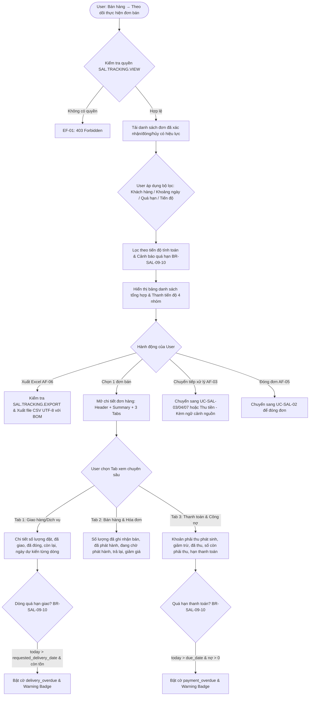

# TÀI LIỆU THIẾT KẾ KỸ THUẬT VÀ ĐẶC TẢ API BACKEND
## USE CASE UC-SAL-09: THEO DÕI THỰC HIỆN ĐƠN BÁN (SALES ORDER FULFILLMENT TRACKING WORKSPACE)

---

### 1. Tổng quan Kiến trúc và Luồng Xử lý

Use case **UC-SAL-09: Theo dõi thực hiện đơn bán** cung cấp không gian làm việc tập trung (Fulfillment Tracking Workspace) cho phép người dùng có thẩm quyền theo dõi toàn diện tiến độ của từng đơn bán hàng đã xác nhận (`APPROVED`, `CLOSED`, hoặc `CANCELLED` sau xác nhận) xuyên suốt toàn bộ vòng đời thực hiện: từ giao hàng/nghiệm thu dịch vụ, ghi nhận doanh thu xuất kho, lập hóa đơn điện tử cho đến quản lý công nợ và thu tiền thực tế.

Không gian theo dõi bao quát 4 nhóm tiến độ độc lập và liên kết chặt chẽ:
1. **Giao hàng / Hoàn thành dịch vụ (`fulfillment_status`)**: Đo lường tiến độ xuất kho hoặc biên bản nghiệm thu dịch vụ so với số lượng đặt hàng trừ đi phần đã đóng đơn (`NOT_STARTED`, `PARTIALLY_FULFILLED`, `FULFILLED`, `CLOSED_REMAINDER`).
2. **Ghi nhận bán hàng (`sales_status`)**: Đo lường tiến độ lập và ghi sổ chứng từ bán hàng hóa (`GoodsSale`, UC-SAL-03) hoặc dịch vụ (`ServiceSale`, UC-SAL-04) đã ghi sổ (`POSTED`) có liên kết tới dòng đơn bán (`NOT_RECORDED`, `PARTIALLY_RECORDED`, `FULLY_RECORDED`).
3. **Lập hóa đơn (`invoicing_status`)**: Đo lường tiến độ phát hành hóa đơn đầu ra (`SalesInvoice`, UC-SAL-07) có trạng thái `ISSUED` căn cứ theo chính sách lập hóa đơn của đơn hàng (`ORDER` - theo đơn hàng, hoặc `DELIVERY` - theo số lượng thực tế đã giao) (`NOT_READY`, `NOT_INVOICED`, `PARTIALLY_INVOICED`, `FULLY_INVOICED`).
4. **Thanh toán & Công nợ (`payment_status`)**: Phản ánh nghĩa vụ công nợ thực tế phát sinh từ chứng từ bán đã ghi sổ, các khoản giảm trừ (hàng bán trả lại `SalesReturn`, giảm giá hàng bán `SalesAllowance`), và các khoản thanh toán thực tế đã phân bổ (`NO_RECEIVABLE`, `UNPAID`, `PARTIALLY_PAID`, `PAID`, `SETTLED_BY_CREDIT`).

> [!IMPORTANT]
> **Quy tắc không coi giá trị đơn là công nợ BR-SAL-09-07, BR-SAL-09-09**: Nếu đơn hàng chưa phát sinh chứng từ bán hàng ghi sổ kế toán công nợ, trạng thái thanh toán hiển thị **`NO_RECEIVABLE` ("Chưa phát sinh phải thu")**. Hệ thống **tuyệt đối không coi toàn bộ tổng giá trị đơn bán là công nợ** khi chưa giao hàng hoặc chưa lập chứng từ kế toán ghi sổ.

> [!TIP]
> **Tính toán tiến độ theo liên kết dòng nguồn BR-SAL-09-02**: Hệ thống liên kết chính xác theo từng dòng nguồn (`order_line_id` / `goods_sale_line` / `service_sale_line`); không bao giờ tự động cộng gộp chứng từ chỉ vì có cùng khách hàng hoặc cùng mã hàng hóa.

---

#### 1.1. Activity Flow Diagram



---

### 2. Danh mục Quy tắc Nghiệp vụ (Business Rules Matrix)

| Mã BR | Tên quy tắc | Nội dung chi tiết | Hiện thực kỹ thuật |
| :--- | :--- | :--- | :--- |
| **BR-SAL-09-01** | Kiểm tra quyền truy cập và phạm vi dữ liệu | Backend kiểm tra quyền xem theo dõi đơn (`SAL.TRACKING.VIEW` hoặc `SAL.ORDER.VIEW`), phạm vi chi nhánh/kho và quyền xem chứng từ liên quan. | `SalesPermission` với `action_permissions` ánh xạ tới mã quyền tương ứng. |
| **BR-SAL-09-02** | Liên kết dòng nguồn độc lập | Tính tiến độ theo liên kết từng dòng nguồn (`order_line`); không cộng chứng từ chỉ vì cùng khách hàng hoặc cùng hàng hóa. | Lọc qua ForeignKey `order_line_id` trên `GoodsSaleLine`, `ServiceSaleLine`, `SalesInvoiceLine`, `SalesReturnLine`, `SalesAllowanceLine`. |
| **BR-SAL-09-03** | Hiệu lực chứng từ giao hàng / dịch vụ | Chỉ tính giao hàng/hoàn thành từ chứng từ thực hiện có hiệu lực (`POSTED`). Phiếu xuất kho đã được liên kết với giao hàng không được cộng thêm lần nữa. | Duyệt qua các chứng từ bán hoặc biên bản giao nhận có hiệu lực, khấu trừ tránh cộng lặp. |
| **BR-SAL-09-04** | Trạng thái nhóm Giao hàng / Dịch vụ | • Không có phần thực hiện: `NOT_STARTED`<br>• Có thực hiện nhưng còn phải làm: `PARTIALLY_FULFILLED`<br>• Thực hiện đủ: `FULFILLED`<br>• Có phần đã đóng và không còn phải làm: `CLOSED_REMAINDER`. | So khớp `delivered_qty` và `closed_qty` với `ordered_qty` trên từng dòng và tổng đơn. |
| **BR-SAL-09-05** | Điều kiện ghi nhận bán hàng và hóa đơn | Ghi nhận bán hàng chỉ tính chứng từ `POSTED`; hóa đơn chỉ tính `ISSUED`. Chứng từ `DRAFT`, `PENDING_APPROVAL`, `APPROVED` không tính là hoàn tất mà theo dõi riêng ở `pending_invoice_quantity`. | Phân loại trạng thái chứng từ rõ ràng giữa `POSTED`/`ISSUED` và các chứng từ chờ phát hành. |
| **BR-SAL-09-06** | Chính sách lập hóa đơn (`invoicing_policy`) | • Theo số lượng đặt (`ORDER`): phần phải lập theo số lượng xác nhận chưa đóng.<br>• Theo số lượng giao (`DELIVERY`): phần phải lập theo số đã giao/hoàn thành. Nếu chưa có số lượng đã giao, hiển thị `NOT_READY` ("Chưa đến bước lập hóa đơn"). | Đọc trường `invoicing_policy` của `SalesOrder`, áp dụng điều kiện kiểm tra ngưỡng giao hàng. |
| **BR-SAL-09-07** | Căn cứ phát sinh công nợ | Công nợ lấy từ chứng từ kế toán đã ghi sổ (`POSTED`); khoản thu chỉ tính khi đã ghi sổ và được phân bổ cho giao dịch thuộc đơn. | Chỉ tính phát sinh công nợ khi có `GoodsSale`/`ServiceSale` trạng thái `POSTED`. |
| **BR-SAL-09-08** | Công thức xác định số còn phải thu | **Số còn phải thu** = Khoản phải thu phát sinh − Giảm trừ đã đối trừ (trả lại, giảm giá) − Khoản thu đã phân bổ.<br>Khoản ứng trước chưa phân bổ theo dõi riêng. | `remaining_receivable_amount = max(0, net_receivable - total_collected)`. |
| **BR-SAL-09-09** | Trạng thái nhóm Thanh toán | • Chưa phát sinh chứng từ bán: `NO_RECEIVABLE`<br>• Chưa có khoản thu và còn phải thu: `UNPAID`<br>• Có khoản thu nhưng còn phải thu: `PARTIALLY_PAID`<br>• Đã thu hết bằng tiền: `PAID`<br>• Hết phải thu do giảm trừ/bù trừ: `SETTLED_BY_CREDIT`. | Kiểm tra phân tầng theo thứ tự ưu tiên các chỉ số tài chính. |
| **BR-SAL-09-10** | Điều kiện cảnh báo quá hạn | • Quá hạn giao/hoàn thành: Ngày hiện tại sau ngày dự kiến (`today > requested_delivery_date`) và dòng còn phải thực hiện (`remaining_qty > 0`).<br>• Quá hạn thanh toán: Sau hạn thanh toán (`today > due_date`) và còn nợ (`remaining_receivable_amount > 0`). | Cập nhật boolean flags: `delivery_overdue`, `payment_overdue` và mảng thông điệp cảnh báo `warning_messages`. |
| **BR-SAL-09-11** | Độc lập hàng trả lại và giảm giá | Trả lại và giảm giá được hiển thị riêng; không tự giảm số đã giao lịch sử hoặc tạo nghĩa vụ giao bù. Giao bù phải phát sinh nghiệp vụ riêng. | Theo dõi `returned_quantity` và `allowance_amount` trên các cột riêng biệt. |
| **BR-SAL-09-12** | Tính bảo toàn chứng từ khi đóng/hủy đơn | Đóng/hủy đơn không xóa chứng từ đã phát sinh; hóa đơn và công nợ liên quan vẫn được theo dõi đầy đủ. | Các liên kết ngoại khóa giữ nguyên và tính toán chính xác số liệu lịch sử. |
| **BR-SAL-09-13** | Kiểm tra quyền và số dư tại chức năng đích | Các nút xử lý tiếp chỉ chuyển hướng sang use case tương ứng; use case đích phải kiểm tra lại quyền, trạng thái và phần nguồn còn lại. | Endpoint cung cấp đầy đủ liên kết và tham số số dư khả dụng (`remaining_quantity`, `remaining_receivable_amount`). |
| **BR-SAL-09-14** | Bất biến dữ liệu & An toàn loại tiền/ĐVT | Không cho phép chỉnh sửa trực tiếp tiến độ; tự động cập nhật khi chứng từ thay đổi hiệu lực. Không cộng gộp các loại tiền tệ khác nhau hoặc các đơn vị tính khác nhau. | ViewSet kế thừa `ReadOnlyModelViewSet` (chỉ cho phép GET), nhóm theo từng đơn vị tiền tệ/UOM. |

---

### 3. Cấu trúc Mô hình Dữ liệu và Ma trận Trạng thái

#### 3.1. Ma trận Trạng thái Tiến độ (Progress Status Matrix)

| Nhóm tiến độ | Mã trạng thái | Tên tiếng Việt hiển thị | Ý nghĩa nghiệp vụ |
| :--- | :--- | :--- | :--- |
| **Fulfillment / Delivery** | `NOT_STARTED` | Chưa thực hiện | Chưa có số lượng giao hàng nào có hiệu lực |
| | `PARTIALLY_FULFILLED` | Thực hiện một phần | Đã giao một phần và vẫn còn số lượng phải thực hiện |
| | `FULFILLED` | Hoàn tất | Đã giao đủ 100% số lượng đặt hàng chưa đóng |
| | `CLOSED_REMAINDER` | Kết thúc phần còn lại | Có phần đã đóng đơn và không còn tồn đọng phải giao |
| **Sales Recording** | `NOT_RECORDED` | Chưa ghi nhận | Chưa có chứng từ bán hàng nào được ghi sổ |
| | `PARTIALLY_RECORDED` | Ghi nhận một phần | Đã ghi sổ một phần doanh thu bán hàng |
| | `FULLY_RECORDED` | Đã ghi nhận đủ | Toàn bộ số lượng đặt (trừ phần đóng) đã được ghi nhận bán |
| **Invoicing** | `NOT_READY` | Chưa đến bước lập hóa đơn | Áp dụng chính sách theo giao hàng nhưng chưa có hàng giao |
| | `NOT_INVOICED` | Chưa lập | Đã đủ điều kiện lập hóa đơn nhưng chưa phát hành hóa đơn nào |
| | `PARTIALLY_INVOICED` | Lập một phần | Đã phát hành một phần hóa đơn |
| | `FULLY_INVOICED` | Đã lập đủ | Đã phát hành đủ 100% hóa đơn cho số lượng hợp lệ |
| **Payment & AR** | `NO_RECEIVABLE` | Chưa phát sinh phải thu | Chưa ghi sổ chứng từ bán hàng, chưa hình thành nợ phải thu |
| | `UNPAID` | Chưa thanh toán | Đã phát sinh nợ nhưng chưa nhận được khoản thu nào |
| | `PARTIALLY_PAID` | Thanh toán một phần | Đã nhận thanh toán một phần công nợ |
| | `PAID` | Đã thanh toán đủ | Đã thanh toán hết 100% công nợ bằng tiền |
| | `SETTLED_BY_CREDIT` | Không còn phải thu | Hết công nợ do đối trừ hàng trả lại hoặc giảm giá |

---

### 4. Đặc tả API Backend (RESTful Endpoints)

Base URL: `/api/v1/sales/tracking/`

#### 4.1. `GET /api/v1/sales/tracking/` - Danh sách Theo dõi Đơn bán (Workspace List)

- **Quyền hạn**: `SAL.TRACKING.VIEW` hoặc `SAL.ORDER.VIEW`
- **Query Parameters**:
  - `company_id` (UUID, bắt buộc): Doanh nghiệp làm việc
  - `branch_id` (UUID, tùy chọn): Chi nhánh
  - `customer_id` (UUID, tùy chọn): Khách hàng
  - `salesperson_id` (UUID, tùy chọn): Nhân viên phụ trách
  - `order_date_from` (YYYY-MM-DD, tùy chọn): Ngày lập từ ngày
  - `order_date_to` (YYYY-MM-DD, tùy chọn): Ngày lập đến ngày
  - `search` (String, tùy chọn): Tìm kiếm theo số đơn bán hoặc tên khách hàng
  - `fulfillment_status` (Enum, tùy chọn): `NOT_STARTED`, `PARTIALLY_FULFILLED`, `FULFILLED`, `CLOSED_REMAINDER`
  - `sales_status` (Enum, tùy chọn): `NOT_RECORDED`, `PARTIALLY_RECORDED`, `FULLY_RECORDED`
  - `invoicing_status` (Enum, tùy chọn): `NOT_READY`, `NOT_INVOICED`, `PARTIALLY_INVOICED`, `FULLY_INVOICED`
  - `payment_status` (Enum, tùy chọn): `NO_RECEIVABLE`, `UNPAID`, `PARTIALLY_PAID`, `PAID`, `SETTLED_BY_CREDIT`
  - `overdue_type` (Enum, tùy chọn): `DELIVERY_OVERDUE`, `PAYMENT_OVERDUE`, `ANY`

- **Response JSON (200 OK)**:
```json
{
  "count": 1,
  "next": null,
  "previous": null,
  "results": [
    {
      "id": "e6a0d2f0-1a2b-4c3d-8e4f-0123456789ab",
      "order_number": "SO-2026-0001",
      "order_date": "2026-10-01",
      "customer_id": "c1a2b3c4-d5e6-7f8a-9b0c-1d2e3f4a5b6c",
      "customer_name": "Công ty TNHH Khách Hàng Tiêu Biểu",
      "salesperson_id": "u1a2b3c4-d5e6-7f8a-9b0c-1d2e3f4a5b6c",
      "salesperson_name": "Nguyễn Văn Phụ Trách",
      "branch_id": "b1a2b3c4-d5e6-7f8a-9b0c-1d2e3f4a5b6c",
      "branch_name": "Chi nhánh Hà Nội",
      "currency_code": "VND",
      "total_amount": "11000000.0000",
      "order_status": "APPROVED",
      "requested_delivery_date": "2026-10-08",
      "total_ordered_quantity": "10.0000",
      "total_delivered_quantity": "4.0000",
      "total_closed_quantity": "0.0000",
      "total_remaining_quantity": "6.0000",
      "delivery_progress_rate": "40.00",
      "fulfillment_status": "PARTIALLY_FULFILLED",
      "fulfillment_label": "Thực hiện một phần",
      "total_recorded_sales_quantity": "4.0000",
      "sales_progress_rate": "40.00",
      "sales_status": "PARTIALLY_RECORDED",
      "sales_label": "Ghi nhận một phần",
      "total_invoiced_quantity": "0.0000",
      "total_pending_invoice_quantity": "4.0000",
      "invoicing_rate": "0.00",
      "invoicing_status": "NOT_INVOICED",
      "invoicing_label": "Chưa lập",
      "total_receivable_incurred": "4400000.0000",
      "total_credit_reduction": "0.0000",
      "net_receivable": "4400000.0000",
      "total_collected_amount": "0.0000",
      "remaining_receivable_amount": "4400000.0000",
      "payment_rate": "0.00",
      "payment_status": "UNPAID",
      "payment_label": "Chưa thanh toán",
      "delivery_overdue": true,
      "payment_overdue": false,
      "warning_messages": ["Quá hạn giao hàng/hoàn thành dịch vụ."]
    }
  ]
}
```

---

#### 4.2. `GET /api/v1/sales/tracking/{id}/` - Chi tiết Toàn diện Đơn bán (Order Tracking Detail)

- **Quyền hạn**: `SAL.TRACKING.VIEW` hoặc `SAL.ORDER.VIEW`
- **Response JSON (200 OK)**:
  Bao gồm thông tin tổng hợp (`summary`), chi tiết theo từng dòng (`lines`) và dữ liệu phân rã cho 3 tab chuyên sâu:
  - `delivery_tab`: Danh sách dòng kèm số lượng đặt, đã giao, đã đóng, còn lại, ngày hẹn và tiến độ.
  - `sales_invoice_tab`: Số lượng đã bán, đã xuất hóa đơn, chờ xuất, hàng trả lại, giảm giá và danh sách chứng từ liên kết.
  - `payment_tab`: Phải thu phát sinh, giảm trừ công nợ, đã thu, còn phải thu, hạn thanh toán và chứng từ thanh toán.

---

#### 4.3. `GET /api/v1/sales/tracking/{id}/delivery-tab/` - Chi tiết Tab Giao hàng / Dịch vụ
- **Mục đích**: Tải nhanh dữ liệu phục vụ riêng cho tab Giao hàng & Tiến độ thực hiện của đơn bán.

#### 4.4. `GET /api/v1/sales/tracking/{id}/sales-invoice-tab/` - Chi tiết Tab Bán hàng & Hóa đơn
- **Mục đích**: Tải dữ liệu phục vụ đối chiếu doanh thu đã ghi sổ và trạng thái hóa đơn điện tử đầu ra.

#### 4.5. `GET /api/v1/sales/tracking/{id}/payment-tab/` - Chi tiết Tab Thanh toán & Công nợ
- **Mục đích**: Tải dữ liệu công nợ, phân bổ thu tiền và quản lý hạn nợ của đơn bán.

---

#### 4.6. `GET /api/v1/sales/tracking/export/` - Xuất Danh sách Theo dõi ra CSV (AF-06)

- **Quyền hạn**: `SAL.TRACKING.EXPORT` hoặc `SAL.ORDER.EXPORT`
- **Output**: File tải về với MIME `text/csv; charset=utf-8` kèm tiền tố UTF-8 BOM (`\ufeff`) đảm bảo hiển thị ký tự tiếng Việt hoàn hảo trên Microsoft Excel.

---

### 5. Kết quả Kiểm thử Tự động (Unit Test Suite)

Toàn bộ 11 test cases trong test suite `sales.test_sales_order_tracking_uc_sal_09` đã được thực thi và vượt qua 100%:

| STT | Tên Test Case | Mục tiêu kiểm thử | Trạng thái |
| :---: | :--- | :--- | :---: |
| 1 | `test_01_tracking_list_and_filters` | Danh sách theo dõi và bộ lọc cơ bản (khách hàng, nhân viên, khoảng ngày) | **PASS** |
| 2 | `test_02_fulfillment_status_progression_br_sal_09_04` | 4 trạng thái giao hàng: `NOT_STARTED`, `PARTIALLY_FULFILLED`, `FULFILLED`, `CLOSED_REMAINDER` | **PASS** |
| 3 | `test_03_sales_recording_progress_br_sal_09_05` | Tiến độ ghi nhận bán hàng: Chỉ tính chứng từ `POSTED`, bỏ qua `DRAFT` | **PASS** |
| 4 | `test_04_invoicing_policy_order_vs_delivery_br_sal_09_06` | Chính sách hóa đơn theo `ORDER` vs `DELIVERY` (`NOT_READY` khi chưa giao) | **PASS** |
| 5 | `test_05_payment_and_receivable_tracking_br_sal_09_07_08_09` | Tiến độ công nợ: `NO_RECEIVABLE` ban đầu, `UNPAID` $\to$ `PARTIALLY_PAID` $\to$ `SETTLED_BY_CREDIT` | **PASS** |
| 6 | `test_06_delivery_overdue_alert_br_sal_09_10` | Cảnh báo quá hạn giao hàng khi `today > requested_delivery_date` | **PASS** |
| 7 | `test_07_payment_overdue_alert_br_sal_09_10` | Cảnh báo quá hạn thanh toán khi `today > due_date` và còn nợ | **PASS** |
| 8 | `test_08_three_tabs_detail_views` | Truy vấn chi tiết theo từng Tab độc lập (`delivery-tab`, `sales-invoice-tab`, `payment-tab`) | **PASS** |
| 9 | `test_09_csv_export_af_06` | Xuất danh sách theo dõi ra file CSV UTF-8 với BOM chuẩn xác | **PASS** |
| 10 | `test_10_filter_by_computed_statuses_and_validation` | Lọc theo các trường tính toán động và kiểm tra validation ngày | **PASS** |
| 11 | `test_11_permission_and_data_scope_security_ef_01_br_sal_09_01` | Kiểm soát bảo mật IAM: Chặn 403 khi thiếu quyền hoặc thiếu ngữ cảnh | **PASS** |
