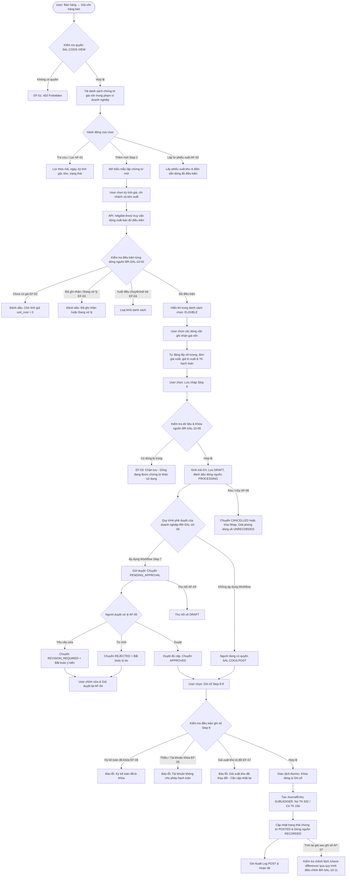

# TÀI LIỆU THIẾT KẾ KỸ THUẬT VÀ ĐẶC TẢ API BACKEND
## USE CASE UC-SAL-10: GHI NHẬN GIÁ VỐN HÀNG BÁN (COST OF GOODS SOLD RECORDING)

---

### 1. Tổng quan Kiến trúc và Luồng Xử lý

Use case **UC-SAL-10: Ghi nhận giá vốn hàng bán** cung cấp không gian làm việc và quy trình nghiệp vụ cho phép kế toán lập, phê duyệt và ghi sổ chứng từ ghi nhận giá vốn của hàng hóa đã xuất bán, căn cứ trực tiếp trên kết quả tính giá xuất kho từ phân hệ Kho (`inventory.ValuationRun` / `InventoryTransactionLine.unit_cost`).

Quy trình này hoàn tất vòng lặp hạch toán giá vốn đối với các giao dịch bán hàng không lập phiếu xuất kèm theo (hoặc xuất kho trước - tính giá xuất kho sau), đồng thời đảm bảo kiểm soát chặt chẽ ngăn chặn hạch toán trùng lặp giá vốn giữa các chứng từ.

> [!IMPORTANT]
> **Quy tắc bảo toàn tồn kho & công nợ BR-SAL-10-10**: Ghi nhận giá vốn tại UC-SAL-10 **tuyệt đối không thực hiện xuất kho lần nữa, không thay đổi số lượng tồn kho vật lý hay tồn kho sổ sách, không thay đổi doanh thu, thuế GTGT đầu ra và không thay đổi công nợ phải thu của khách hàng**. Chứng từ chỉ tạo bút toán kế toán: **Nợ TK Giá vốn hàng bán (TK 632) / Có TK Hàng tồn kho (TK 156...)**.

> [!TIP]
> **Kiểm soát chống hạch toán trùng 3 lớp (Anti-Duplication Control)**:
> 1. **Lớp 1 (BR-SAL-10-03)**: Loại trừ các dòng xuất kho đã được hạch toán giá vốn trực tiếp bởi chứng từ Bán hàng hóa (`GoodsSaleLine.cogs_amount > 0` và trạng thái `POSTED`).
> 2. **Lớp 2 (BR-SAL-10-05, EF-03)**: Mỗi dòng xuất kho chỉ được nằm trong duy nhất một chứng từ giá vốn đang xử lý (`PROCESSING`); giữ nguồn khi lưu, tự động giải phóng (`UNRECORDED`) khi bỏ chọn, xóa hoặc hủy chứng từ.
> 3. **Lớp 3 (BR-SAL-10-07, EF-07)**: Kiểm tra lại phiên bản và giá trị tính giá mới nhất tại thời điểm ghi sổ; nếu giá xuất kho thay đổi trước khi ghi sổ, hệ thống chặn ghi sổ và yêu cầu cập nhật lại chứng từ.

---

#### 1.1. Activity Flow Diagram

---

### 2. Danh mục Quy tắc Nghiệp vụ (Business Rules Matrix)

| Mã BR | Tên quy tắc | Nội dung chi tiết | Hiện thực kỹ thuật |
| :--- | :--- | :--- | :--- |
| **BR-SAL-10-01** | Kiểm soát quyền truy cập & Phạm vi dữ liệu | Backend kiểm tra quyền `SAL.COGS.*` và phạm vi chi nhánh/kho của người dùng đối với từng thao tác. | `SalesPermission` tích hợp phân quyền `SAL.COGS.VIEW`, `CREATE`, `EDIT`, `DELETE`, `POST`, `CANCEL`, `APPROVE`. |
| **BR-SAL-10-02** | Điều kiện dòng xuất kho nguồn | Chỉ cho phép ghi nhận các dòng xuất bán có hiệu lực (`POSTED`), đã có kết quả tính giá (`unit_cost > 0`, `line_value > 0`), loại trừ xuất kho điều chuyển, xuất lắp ráp hoặc nội bộ. | `get_eligible_outward_lines` lọc `transaction_type=ISSUE`, `status=POSTED`, `unit_cost > 0`. |
| **BR-SAL-10-03** | Chống hạch toán trùng với chứng từ bán hàng | Dòng xuất kho đã được ghi nhận giá vốn trực tiếp qua chứng từ bán hàng (`GoodsSaleLine.cogs_amount > 0` trạng thái `POSTED`) không được ghi nhận lại tại UC này. | Kiểm tra đối chiếu bảng `sal_goods_sale_line` trước khi đưa vào nguồn và trước khi lưu. |
| **BR-SAL-10-04** | Bất biến số lượng & giá trị xuất kho | Số lượng, đơn giá và giá trị xuất kho lấy nguyên bản từ kết quả tính giá xuất kho; không cho phép người dùng nhập giá bán hoặc sửa trực tiếp giá trị tính giá. | API lấy trực tiếp `inv_line.quantity`, `inv_line.unit_cost`, `inv_line.line_value`, bỏ qua mọi giá trị giá sửa đổi từ client. |
| **BR-SAL-10-05** | Khóa nguồn độc quyền trong quá trình xử lý | Mỗi dòng xuất kho chỉ nằm trong một chứng từ giá vốn đang xử lý; giữ nguồn (`PROCESSING`) khi lưu, giải phóng (`UNRECORDED`) khi bỏ chọn, xóa hoặc hủy. | Kiểm tra xung đột khóa `CostOfGoodsSoldLine` trên mọi chứng từ chưa bị hủy (`status != CANCELLED`). |
| **BR-SAL-10-06** | Phân nhánh quy trình phê duyệt | Doanh nghiệp có Workflow: phải duyệt đủ cấp trước khi ghi sổ; không áp dụng Workflow: người dùng có quyền `SAL.COGS.POST` được ghi sổ trực tiếp từ Nháp. | Phương thức `post` kiểm tra `cogs.status in [APPROVED, DRAFT]`. |
| **BR-SAL-10-07** | Kiểm tra phiên bản tính giá trước ghi sổ | Trước khi ghi sổ, kiểm tra lại `unit_cost` và `line_value` của từng dòng nguồn; nếu giá đã thay đổi do tính lại giá xuất kho, chặn ghi sổ và yêu cầu cập nhật lại chứng từ (EF-07). | Đối chiếu `inv_line.refresh_from_db()` với `line.unit_cost` và `line.cogs_amount`. |
| **BR-SAL-10-08** | Điều kiện kỳ kế toán và tài khoản | Ngày hạch toán phải thuộc kỳ kế toán đang mở (`status=OPEN`); các tài khoản Nợ 632 và Có 156 phải đang hoạt động (`ACTIVE`) và cho phép hạch toán (`is_postable=True`). | Xác thực qua bảng `gl_period` và `gl_account`. |
| **BR-SAL-10-09** | Bút toán hạch toán giá vốn | Khi ghi sổ, tự động tạo bút toán Sổ cái: Nợ TK Giá vốn hàng bán (TK 632) / Có TK Hàng tồn kho (TK 156...) theo đúng giá trị xuất kho của từng dòng. | Sinh `JournalEntry` kiểu `SUBLEDGER` và các cặp `JournalLine` đối ứng tương ứng. |
| **BR-SAL-10-10** | Tính độc lập của nghiệp vụ giá vốn | Ghi nhận giá vốn không xuất kho lần nữa, không thay đổi số lượng tồn kho vật lý/sổ sách, không thay đổi doanh thu, thuế hoặc công nợ khách hàng. | Chỉ tác động bảng `sal_cogs` và bảng hạch toán Sổ cái `gl_journal_entry` / `gl_journal_line`. |
| **BR-SAL-10-11** | Xử lý chênh lệch sau khi tính lại giá | Nếu giá xuất kho bị tính lại sau khi đã ghi sổ, hệ thống chỉ tính toán phần chênh lệch qua endpoint `/check-difference/` để lập chứng từ điều chỉnh, không ghi nhận lại toàn bộ. | Endpoint `check_difference` đối chiếu giá trị đã ghi nhận với giá trị hiện tại của dòng nguồn. |
| **BR-SAL-10-12** | Quy tắc chỉnh sửa và xóa chứng từ | Chỉ cho phép sửa ở `DRAFT`, `REVISION_REQUIRED`, `REJECTED`; `PENDING_APPROVAL` phải thu hồi trước khi sửa; chỉ xóa chứng từ ở trạng thái `DRAFT`. | Chặn sửa khi `POSTED` hoặc `PENDING_APPROVAL`. |
| **BR-SAL-10-13** | Giao dịch nguyên tử & Kiểm soát phiên bản | Kiểm soát xử lý đồng thời qua trường `version`; việc tạo bút toán kế toán và cập nhật trạng thái nguồn phải nằm trong cùng giao dịch nguyên tử `@transaction.atomic`. | Áp dụng `select_for_update()` kết hợp ghi `record_audit` cho mọi hành động. |

---

### 3. Cấu trúc Mô hình Dữ liệu (Database Models)

#### 3.1. Bảng Chứng từ Giá vốn `sal_cogs` (`CostOfGoodsSold`)
Kế thừa từ `SalesDocument`:

| Tên trường | Kiểu dữ liệu | Thuộc tính | Diễn giải |
| :--- | :--- | :--- | :--- |
| `id` | UUID | PK, default=uuid4 | Định danh duy nhất của chứng từ |
| `company` | FK (`organization.Company`) | on_delete=PROTECT | Doanh nghiệp sở hữu |
| `branch` | FK (`organization.Branch`) | Nullable, PROTECT | Chi nhánh thực hiện |
| `warehouse` | FK (`master_data.Warehouse`) | Nullable, PROTECT | Kho hàng xuất chính |
| `number` | CharField(80) | Unique per company | Mã chứng từ tự sinh (VD: `GV2026-00001`) |
| `document_date` | DateField | Required | Ngày chứng từ (mặc định ngày hiện tại) |
| `posting_date` | DateField | Required | Ngày hạch toán (phải thuộc kỳ mở) |
| `costing_period` | CharField(50) | Blank=True | Kỳ tính giá xuất kho liên quan |
| `inventory_transaction` | FK (`inventory.InventoryTransaction`) | Nullable, PROTECT | Phiếu xuất kho nguồn (nếu lập từ 1 phiếu) |
| `goods_sale` | FK (`sales.GoodsSale`) | Nullable, PROTECT | Chứng từ bán hàng liên quan (nếu có) |
| `customer` | FK (`master_data.Party`) | Nullable, PROTECT | Khách hàng liên quan (nếu có) |
| `currency` | FK (`master_data.Currency`) | PROTECT | Đồng tiền hạch toán |
| `description` | CharField(500) | Default | Diễn giải ("Ghi nhận giá vốn hàng bán") |
| `total_cogs_amount` | DecimalField(24, 4) | Default=0 | Tổng giá trị giá vốn của các dòng |
| `status` | CharField(30) | Choices | `DRAFT`, `PENDING_APPROVAL`, `REVISION_REQUIRED`, `REJECTED`, `APPROVED`, `POSTED`, `CANCELLED` |
| `journal_entry` | OneToOne (`gl_journal_entry`) | Nullable, PROTECT | Bút toán Sổ cái liên kết khi đã ghi sổ |
| `version` | PositiveIntegerField | Default=1 | Phiên bản chứng từ (kiểm soát concurrency) |
| `created_by` | FK (`iam.UserAccount`) | PROTECT | Người tạo chứng từ |
| `posted_by` | FK (`iam.UserAccount`) | Nullable, PROTECT | Người ghi sổ chứng từ |
| `posted_at` | DateTimeField | Nullable | Thời điểm ghi sổ thành công |

#### 3.2. Bảng Dòng Giá vốn `sal_cogs_line` (`CostOfGoodsSoldLine`)

| Tên trường | Kiểu dữ liệu | Thuộc tính | Diễn giải |
| :--- | :--- | :--- | :--- |
| `id` | UUID | PK, default=uuid4 | Định danh duy nhất của dòng |
| `cogs` | FK (`sal_cogs`) | CASCADE | Chứng từ giá vốn cha |
| `line_no` | PositiveIntegerField | Required | Số thứ tự dòng (1, 2, 3...) |
| `inventory_transaction_line` | FK (`inv_transaction_line`) | PROTECT | Liên kết dòng xuất kho nguồn |
| `item` | FK (`master_data.Item`) | PROTECT | Hàng hóa xuất bán |
| `warehouse` | FK (`master_data.Warehouse`) | PROTECT | Kho hàng xuất |
| `uom` | FK (`master_data.UnitOfMeasure`) | PROTECT | Đơn vị tính |
| `quantity` | DecimalField(22, 6) | Check > 0 | Số lượng xuất bán |
| `costing_method` | CharField(30) | Blank=True | Phương pháp tính giá (`MOVING_AVERAGE`, `FIFO`...) |
| `unit_cost` | DecimalField(26, 10) | Check >= 0 | Đơn giá xuất kho từ kết quả tính giá |
| `cogs_amount` | DecimalField(24, 4) | Check >= 0 | Giá trị xuất kho (`line_value`) của dòng |
| `cogs_account` | FK (`gl_account`) | PROTECT | Tài khoản Nợ giá vốn (TK 632) |
| `inventory_account` | FK (`gl_account`) | PROTECT | Tài khoản Có hàng tồn kho (TK 156) |
| `costing_version` | PositiveIntegerField | Default=1 | Phiên bản kết quả tính giá |
| `source_status` | CharField(20) | Choices | `UNRECORDED`, `PROCESSING`, `RECORDED` |

---

### 4. Đặc tả API Backend (RESTful Endpoints)

Base URL: `/api/v1/sales/cogs/`

| Phương thức | Endpoint | Chức năng & Nghiệp vụ | Phân quyền yêu cầu |
| :--- | :--- | :--- | :--- |
| `GET` | `/api/v1/sales/cogs/` | Danh sách chứng từ giá vốn hàng bán (lọc theo công ty, chi nhánh, kho, kỳ, trạng thái, ngày) | `SAL.COGS.VIEW` |
| `GET` | `/api/v1/sales/cogs/{id}/` | Chi tiết chứng từ giá vốn (thông tin chung, danh sách dòng, tài khoản, bút toán GL liên kết) | `SAL.COGS.VIEW` |
| `POST` | `/api/v1/sales/cogs/` | Lập chứng từ giá vốn mới ở trạng thái Nháp (tự sinh mã, khóa dòng nguồn `PROCESSING`) | `SAL.COGS.CREATE` |
| `PUT` / `PATCH` | `/api/v1/sales/cogs/{id}/` | Cập nhật chứng từ ở trạng thái `DRAFT`, `REVISION_REQUIRED`, `REJECTED` (giải phóng dòng bỏ chọn) | `SAL.COGS.EDIT` |
| `DELETE` | `/api/v1/sales/cogs/{id}/` | Xóa chứng từ Nháp (giải phóng toàn bộ dòng nguồn về `UNRECORDED`) | `SAL.COGS.DELETE` |
| `GET` | `/api/v1/sales/cogs/eligible-lines/` | Truy vấn các dòng xuất kho nguồn đủ điều kiện ghi nhận giá vốn | `SAL.COGS.VIEW` |
| `POST` | `/api/v1/sales/cogs/{id}/submit/` | Gửi duyệt chứng từ (chuyển sang `PENDING_APPROVAL`) | `SAL.COGS.EDIT` |
| `POST` | `/api/v1/sales/cogs/{id}/withdraw/` | Thu hồi chứng từ đang Chờ duyệt về Nháp (`DRAFT`) | `SAL.COGS.EDIT` |
| `POST` | `/api/v1/sales/cogs/{id}/approve/` | Phê duyệt chứng từ (chuyển sang `APPROVED`) | `SAL.COGS.APPROVE` |
| `POST` | `/api/v1/sales/cogs/{id}/request-revision/` | Yêu cầu chỉnh sửa chứng từ (bắt buộc nhập ý kiến, chuyển `REVISION_REQUIRED`) | `SAL.COGS.APPROVE` |
| `POST` | `/api/v1/sales/cogs/{id}/reject/` | Từ chối phê duyệt chứng từ (bắt buộc nhập lý do, chuyển `REJECTED`) | `SAL.COGS.APPROVE` |
| `POST` | `/api/v1/sales/cogs/{id}/post/` | Ghi sổ kế toán: Kiểm tra kỳ, tài khoản, giá xuất kho; tạo bút toán Nợ 632 / Có 156 | `SAL.COGS.POST` |
| `POST` | `/api/v1/sales/cogs/{id}/cancel/` | Hủy chứng từ chưa ghi sổ (bắt buộc lý do, giải phóng dòng về `UNRECORDED`) | `SAL.COGS.CANCEL` |
| `GET` | `/api/v1/sales/cogs/{id}/check-difference/` | So sánh giá trị đã ghi nhận với kết quả tính giá mới nhất (xử lý chênh lệch AF-07) | `SAL.COGS.VIEW` |

---

### 5. Kết quả Kiểm thử Tự động (Unit Test Suite)

Tập test case chuyên biệt: [`sales/test_cogs_uc_sal_10.py`](file:///c:/Users/Admin/LapTrinh/Thue/sales/test_cogs_uc_sal_10.py) đã vượt qua **11/11 test cases (100% PASS)**:

| STT | Tên Test Case | Nội dung & Mục tiêu kiểm thử | Kết quả |
| :---: | :--- | :--- | :---: |
| 1 | `test_01_eligible_outward_lines_query` | Truy vấn dòng xuất kho đủ điều kiện: loại trừ xuất điều chuyển, hàng chưa tính giá (đơn giá = 0) và hàng đã ghi nhận | **PASS** |
| 2 | `test_02_create_cogs_voucher_draft` | Lập chứng từ nháp, tự sinh mã `GV2026-xxxxx`, tính tổng giá vốn, đánh dấu dòng nguồn `PROCESSING` | **PASS** |
| 3 | `test_03_anti_duplication_locking` | Chặn trùng lặp 400 Bad Request khi cố tình đưa dòng đang xử lý vào chứng từ khác (EF-03) | **PASS** |
| 4 | `test_04_update_cogs_voucher_and_line_release` | Sửa chứng từ nháp, giải phóng dòng bỏ chọn về `UNRECORDED` và kiểm tra concurrency version (EF-08) | **PASS** |
| 5 | `test_05_delete_and_cancel_actions` | Xóa chứng từ Nháp và hủy chứng từ, tự động giải phóng toàn bộ dòng nguồn về `UNRECORDED` | **PASS** |
| 6 | `test_06_approval_workflow_lifecycle` | Toàn bộ vòng đời duyệt: `submit` $\to$ `withdraw` $\to$ `request-revision` $\to$ `reject` $\to$ `approve` | **PASS** |
| 7 | `test_07_post_cogs_voucher_creates_journal_entry` | Ghi sổ chứng từ: tạo bút toán Sổ cái Nợ 632 / Có 156, cập nhật trạng thái nguồn `RECORDED` | **PASS** |
| 8 | `test_08_closed_accounting_period_validation` | Chặn ghi sổ 400 Bad Request khi ngày hạch toán thuộc kỳ kế toán đã khóa (EF-06) | **PASS** |
| 9 | `test_09_costing_price_changed_before_posting` | Chặn ghi sổ 400 Bad Request khi kết quả tính giá xuất kho thay đổi sau khi lập chứng từ (EF-07) | **PASS** |
| 10 | `test_10_check_difference_after_posting` | Kiểm tra chênh lệch giá vốn sau khi ghi sổ qua `/check-difference/` phục vụ điều chỉnh (AF-07) | **PASS** |
| 11 | `test_11_security_and_permissions` | Kiểm soát bảo mật IAM: từ chối 403 Forbidden khi thiếu quyền hoặc thiếu doanh nghiệp (EF-01) | **PASS** |
