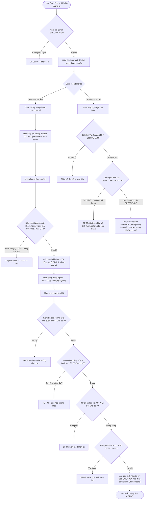
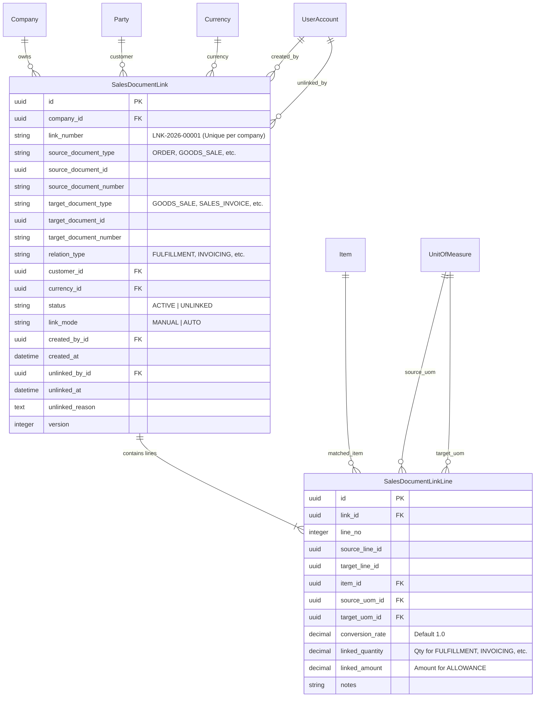

# TÀI LIỆU THIẾT KẾ KỸ THUẬT VÀ ĐẶC TẢ API BACKEND
## USE CASE UC-SAL-11: LIÊN KẾT CHỨNG TỪ BÁN HÀNG (SALES DOCUMENT LINKAGE & TRACEABILITY WORKSPACE)

---

### 1. Tổng quan Kiến trúc và Luồng Xử lý

Use case **UC-SAL-11: Liên kết chứng từ bán hàng** cung cấp nền tảng quản lý liên kết, đối chiếu dòng chi tiết và truy vết toàn diện chuỗi giao dịch bán hàng (Sales Traceability & Progress Tracking) từ Báo giá (`QUOTATION`), Đơn bán (`ORDER`), Hợp đồng (`CONTRACT`), Giao hàng (`DELIVERY`), Bán hàng (`GOODS_SALE`), Bán dịch vụ (`SERVICE_SALE`), Hóa đơn đầu ra (`SALES_INVOICE`), Hàng bán trả lại (`SALES_RETURN`), Giảm giá hàng bán (`SALES_ALLOWANCE`), Giá vốn hàng bán (`COGS`) và Giao dịch kho (`INVENTORY_TRANSACTION`).

> [!IMPORTANT]
> **Quy tắc độc lập hạch toán và chứng từ gốc (BR-SAL-11-11, BR-SAL-11-12)**:
> - Liên kết **tuyệt đối không tự động tạo bút toán sổ cái (GL)**, không tự phát hành hóa đơn điện tử, không tự tạo phiếu nhập/xuất kho hoặc phiếu thu/chi tiền.
> - Liên kết chỉ ghi nhận quan hệ nghiệp vụ, đối chiếu hạn mức số lượng/giá trị và cập nhật tiến độ thực hiện giao dịch bán hàng.
> - Phân bổ công nợ và thu tiền được thực hiện độc lập tại phân hệ Công nợ phải thu (`accounts_receivable`); việc liên kết tham chiếu với chứng từ thanh toán không được coi là đã thanh toán công nợ.

> [!TIP]
> **Kiểm soát hạn mức và đa quan hệ độc lập (BR-SAL-11-06, BR-SAL-11-07)**:
> - Hệ thống hỗ trợ mô hình quan hệ linh hoạt: **Một nguồn – Nhiều đích** (AF-04) và **Nhiều nguồn – Một đích** (AF-03).
> - Giới hạn phân bổ được tính toán độc lập theo từng loại quan hệ (`relation_type`): Số lượng đã giao hàng (`FULFILLMENT`) **không làm giảm** số lượng được phép lập hóa đơn (`INVOICING`) khi cùng tham chiếu một dòng đơn hàng gốc.
> - Cơ chế kiểm tra dung lượng còn lại (Remaining Capacity Checking) ngăn chặn triệt để việc phân bổ trùng lặp hoặc vượt quá số lượng/giá trị ban đầu của chứng từ nguồn và đích.

---

#### 1.1. Activity Diagram (Luồng hoạt động chính & Luồng ngoại lệ)



---

#### 1.2. Entity Relationship Diagram (ERD)



---

### 2. Ma trận Cặp Chứng từ Hỗ trợ (BR-SAL-11-03)

Hệ thống kiểm soát chặt chẽ tính tương thích nghiệp vụ giữa loại chứng từ nguồn, loại chứng từ đích và loại quan hệ liên kết:

| Loại quan hệ (`relation_type`) | Chứng từ nguồn (`source`) | Chứng từ đích (`target`) | Ý nghĩa nghiệp vụ | Yêu cầu đối chiếu dòng |
| :--- | :--- | :--- | :--- | :--- |
| **`DATA_INHERITANCE`**<br>(Kế thừa dữ liệu) | `QUOTATION`<br>`ORDER`<br>`CONTRACT`<br>`INVENTORY_TRANSACTION` | `ORDER`<br>`GOODS_SALE` / `SERVICE_SALE` / `SALES_INVOICE`<br>`ORDER` / `GOODS_SALE` / `SERVICE_SALE`<br>`COGS` | Tạo chứng từ tiếp theo kế thừa từ dữ liệu nguồn | Bắt buộc số lượng |
| **`FULFILLMENT`**<br>(Thực hiện giao hàng/dịch vụ) | `ORDER`<br>`DELIVERY`<br>`INVENTORY_TRANSACTION` | `DELIVERY` / `GOODS_SALE` / `SERVICE_SALE`<br>`GOODS_SALE`<br>`GOODS_SALE` / `DELIVERY` | Ghi nhận tiến độ thực hiện giao hàng hóa hoặc nghiệm thu dịch vụ | Bắt buộc số lượng |
| **`INVOICING`**<br>(Lập hóa đơn) | `ORDER`<br>`DELIVERY`<br>`GOODS_SALE`<br>`SERVICE_SALE`<br>`CONTRACT` | `SALES_INVOICE`<br>`SALES_INVOICE`<br>`SALES_INVOICE`<br>`SALES_INVOICE`<br>`SALES_INVOICE` | Đối chiếu số lượng đã lập hóa đơn GTGT / Bán hàng | Bắt buộc số lượng |
| **`RETURN`**<br>(Trả lại) | `GOODS_SALE`<br>`INVENTORY_TRANSACTION` | `SALES_RETURN`<br>`SALES_RETURN` | Giảm trừ số lượng bán khi có hàng bị trả lại | Bắt buộc số lượng |
| **`ALLOWANCE`**<br>(Giảm giá) | `GOODS_SALE`<br>`SERVICE_SALE` | `SALES_ALLOWANCE`<br>`SALES_ALLOWANCE` | Giảm trừ giá trị trước thuế sau bán | Bắt buộc giá trị trước thuế (`linked_amount`) |
| **`REFERENCE`**<br>(Tham chiếu) | **Bất kỳ loại chứng từ bán hàng nào** | **Bất kỳ loại chứng từ bán hàng nào** | Tham chiếu chéo giữa các chứng từ cùng giao dịch | Không bắt buộc dòng; không tính hạn mức |

---

### 3. Ma trận Quy tắc Nghiệp vụ (Business Rules)

| Mã BR | Quy tắc | Mô tả chi tiết & Xử lý ngoại lệ |
| :--- | :--- | :--- |
| **BR-SAL-11-01** | Kiểm tra quyền & phạm vi | Kiểm tra quyền `SAL.LINK.VIEW`, `SAL.LINK.CREATE`, `SAL.LINK.UNLINK` theo đúng phạm vi doanh nghiệp (`company_id`). Từ chối `403 Forbidden` nếu thiếu quyền (EF-01). |
| **BR-SAL-11-02** | Ràng buộc cùng Doanh nghiệp & Khách hàng | Chứng từ nguồn và đích phải cùng một doanh nghiệp. Với các quan hệ nghiệp vụ (`DATA_INHERITANCE`, `FULFILLMENT`, `INVOICING`, `RETURN`, `ALLOWANCE`), hai bên phải cùng khách hàng (`customer_id`). Quan hệ tính theo giá trị (`ALLOWANCE`) phải cùng loại tiền (`currency_id`) (EF-02). |
| **BR-SAL-11-03** | Cặp chứng từ hợp lệ | Cặp chứng từ `(source_document_type, target_document_type)` phải nằm trong danh mục hỗ trợ của `relation_type`. Ngoại lệ quan hệ `REFERENCE` cho phép bất kỳ cặp chứng từ nào cùng doanh nghiệp (EF-03). |
| **BR-SAL-11-04** | Đối chiếu chi tiết cấp dòng | Liên kết ảnh hưởng tiến độ bắt buộc phải có ít nhất 1 dòng đối chiếu chi tiết (`lines`). Liên kết ở cấp chứng từ thuần túy chỉ áp dụng cho `REFERENCE`. |
| **BR-SAL-11-05** | Khớp hàng hóa & Quy đổi đơn vị tính | Dòng nguồn và đích phải cùng hàng hóa/dịch vụ (`item_id`). Nếu khác đơn vị tính, người dùng phải cung cấp tỷ lệ quy đổi hợp lệ (`conversion_rate > 0`) (EF-04). |
| **BR-SAL-11-06** | Giới hạn theo từng loại quan hệ | Hạn mức phân bổ được theo dõi độc lập theo từng loại quan hệ. Phần đã giao (`FULFILLMENT`) không bị trừ vào phần lập hóa đơn (`INVOICING`) dù cùng tham chiếu 1 dòng đơn bán. |
| **BR-SAL-11-07** | Không phân bổ trùng số lượng / giá trị | Tổng số lượng liên kết đang hiệu lực (`status=ACTIVE`) trên dòng nguồn/đích trong cùng loại quan hệ không được vượt quá số lượng/giá trị gốc của dòng đó (EF-05). |
| **BR-SAL-11-08** | Chống tự liên kết & Chống liên kết trùng lặp | Chặn liên kết chứng từ với chính nó (`source_id == target_id`). Chặn tạo trùng lặp cặp dòng `(source_line_id, target_line_id)` cùng loại quan hệ đang hiệu lực (EF-06). |
| **BR-SAL-11-09** | Bảo vệ liên kết Tự động (AUTO) | Liên kết sinh tự động từ thao tác tạo chứng từ nguồn (`link_mode=AUTO`) không được phép gỡ thủ công trực tiếp qua API liên kết; người dùng phải thao tác qua chứng từ nghiệp vụ tương ứng. |
| **BR-SAL-11-10** | Điều kiện gỡ liên kết Thủ công (MANUAL) | Liên kết phân bổ thủ công chỉ được phép gỡ khi chứng từ đích còn ở trạng thái Bản nháp (`DRAFT`). Chặn gỡ nếu chứng từ đích đã ghi sổ (`POSTED`), duyệt (`APPROVED`) hoặc phát hành (`ISSUED`) (EF-09). Liên kết `REFERENCE` được phép gỡ tự do. |
| **BR-SAL-11-11** | Độc lập hạch toán | Không tự tạo bút toán kế toán, không tự xuất/nhập kho, không tự phát hành hóa đơn khi lưu liên kết. |
| **BR-SAL-11-12** | Độc lập thanh toán | Phân bổ thanh toán thực hiện tại chức năng công nợ; liên kết `REFERENCE` với phiếu thu không làm thay đổi trạng thái nợ của chứng từ. |
| **BR-SAL-11-13** | Bảo lưu lịch sử & Bắt buộc lý do gỡ | Khi gỡ liên kết, chuyển trạng thái sang `UNLINKED`, bắt buộc cung cấp lý do (`unlinked_reason`), ghi nhận người gỡ (`unlinked_by`) và thời điểm gỡ (`unlinked_at`). Tuyệt đối không xóa vật lý bản ghi. |
| **BR-SAL-11-14** | Giao dịch nguyên tử & Audit Log | Toàn bộ thao tác tạo và gỡ liên kết thực hiện trong `transaction.atomic()`, tăng `version`, sinh mã tự động duy nhất (`LNK-YYYY-NNNNN`) và ghi `AuditLog` với `module_code="SAL"`. |

---

### 4. Danh mục Quyền hạn IAM

| Mã Quyền (`code`) | Tên quyền | Nhóm tài nguyên | Hành động |
| :--- | :--- | :--- | :--- |
| `SAL.LINK.VIEW` | Xem liên kết chứng từ bán hàng | `SAL.LINK` | Tra cứu danh sách, chi tiết, lịch sử và dòng đối chiếu |
| `SAL.LINK.CREATE` | Thiết lập liên kết chứng từ bán hàng | `SAL.LINK` | Ghép dòng và lưu liên kết mới |
| `SAL.LINK.UNLINK` | Gỡ liên kết chứng từ bán hàng | `SAL.LINK` | Gỡ liên kết đang hiệu lực, nhập lý do và giải phóng hạn mức |

*Cơ chế Fallback: Người dùng có quyền `SAL.ORDER.VIEW` hoặc `SAL.GOODS_SALE.VIEW` được tự động cấp quyền xem `SAL.LINK.VIEW`.*

---

### 5. Đặc tả REST API Endpoints

Mọi API tuân thủ tiền tố chuẩn `/api/v1/sales/` và yêu cầu xác thực JWT Bearer Token.

#### 5.1. `POST /api/v1/sales/links/` – Thiết lập liên kết chứng từ

- **Mô tả**: Thiết lập liên kết mới giữa chứng từ nguồn và đích, kèm đối chiếu chi tiết từng dòng.
- **Quyền yêu cầu**: `SAL.LINK.CREATE`
- **Request Body**:
```json
{
  "company_id": "3fa85f64-5717-4562-b3fc-2c963f66afa6",
  "source_document_type": "ORDER",
  "source_document_id": "d1e2f3a4-5b6c-7d8e-9f0a-1b2c3d4e5f6a",
  "target_document_type": "GOODS_SALE",
  "target_document_id": "e2f3a4b5-6c7d-8e9f-0a1b-2c3d4e5f6a7b",
  "relation_type": "FULFILLMENT",
  "notes": "Liên kết thực hiện đơn hàng đợt 1",
  "lines": [
    {
      "source_line_id": "a1b2c3d4-e5f6-7a8b-9c0d-1e2f3a4b5c6d",
      "target_line_id": "b2c3d4e5-f6a7-8b9c-0d1e-2f3a4b5c6d7e",
      "linked_quantity": 5.0,
      "conversion_rate": 1.0,
      "notes": "Giao 5 máy tính đợt 1"
    }
  ]
}
```
- **Response `201 Created`**:
```json
{
  "id": "c3d4e5f6-a7b8-9c0d-1e2f-3a4b5c6d7e8f",
  "company": "3fa85f64-5717-4562-b3fc-2c963f66afa6",
  "link_number": "LNK-2026-00001",
  "source_document_type": "ORDER",
  "source_document_id": "d1e2f3a4-5b6c-7d8e-9f0a-1b2c3d4e5f6a",
  "source_document_number": "SO-2026-0001",
  "target_document_type": "GOODS_SALE",
  "target_document_id": "e2f3a4b5-6c7d-8e9f-0a1b-2c3d4e5f6a7b",
  "target_document_number": "BH-2026-0001",
  "relation_type": "FULFILLMENT",
  "relation_type_display": "Thực hiện giao hàng/dịch vụ",
  "customer": "f4a5b6c7-d8e9-0f1a-2b3c-4d5e6f7a8b9c",
  "customer_code": "KH_ALPHA",
  "customer_name": "Công Ty TNHH Alpha",
  "currency": "a1b2c3d4-0000-0000-0000-000000000001",
  "currency_code": "VND",
  "notes": "Liên kết thực hiện đơn hàng đợt 1",
  "status": "ACTIVE",
  "status_display": "Đang hiệu lực",
  "link_mode": "MANUAL",
  "link_mode_display": "Thủ công",
  "created_by": "11111111-2222-3333-4444-555555555555",
  "created_by_name": "Nguyễn Văn A",
  "created_at": "2026-10-09T14:30:00+07:00",
  "unlinked_by": null,
  "unlinked_by_name": "",
  "unlinked_at": null,
  "unlinked_reason": "",
  "version": 1,
  "lines": [
    {
      "id": "77777777-8888-9999-aaaa-bbbbbbbbbbbb",
      "line_no": 1,
      "source_line_id": "a1b2c3d4-e5f6-7a8b-9c0d-1e2f3a4b5c6d",
      "target_line_id": "b2c3d4e5-f6a7-8b9c-0d1e-2f3a4b5c6d7e",
      "item": "99999999-8888-7777-6666-555555555555",
      "item_code": "SP_MAYTINH",
      "item_name": "Máy tính để bàn Dell",
      "source_uom": "33333333-4444-5555-6666-777777777777",
      "source_uom_name": "Cái",
      "target_uom": "33333333-4444-5555-6666-777777777777",
      "target_uom_name": "Cái",
      "conversion_rate": "1.00000000",
      "linked_quantity": "5.000000",
      "linked_amount": null,
      "notes": "Giao 5 máy tính đợt 1"
    }
  ]
}
```

---

#### 5.2. `POST /api/v1/sales/links/{id}/unlink/` – Gỡ liên kết

- **Mô tả**: Gỡ liên kết đang hiệu lực, kiểm tra điều kiện chứng từ đích (chỉ cho gỡ khi đích còn `DRAFT` đối với quan hệ nghiệp vụ) và giải phóng số lượng/giá trị đã phân bổ.
- **Quyền yêu cầu**: `SAL.LINK.UNLINK`
- **Request Body**:
```json
{
  "reason": "Điều chỉnh kế hoạch phân bổ giao hàng cho hợp đồng khác"
}
```
- **Response `200 OK`**:
```json
{
  "id": "c3d4e5f6-a7b8-9c0d-1e2f-3a4b5c6d7e8f",
  "link_number": "LNK-2026-00001",
  "status": "UNLINKED",
  "status_display": "Đã gỡ",
  "unlinked_by": "11111111-2222-3333-4444-555555555555",
  "unlinked_by_name": "Nguyễn Văn A",
  "unlinked_at": "2026-10-09T14:45:00+07:00",
  "unlinked_reason": "Điều chỉnh kế hoạch phân bổ giao hàng cho hợp đồng khác",
  "version": 2
}
```

---

#### 5.3. `GET /api/v1/sales/links/matchable-lines/` – Tra cứu dòng đối chiếu & Hạn mức còn lại

- **Mô tả**: Hỗ trợ giao diện ghép dòng (Activity Flow bước 5). Tính toán số lượng/giá trị đã phân bổ (`allocated_quantity` / `allocated_amount`) và phần còn lại (`remaining_quantity` / `remaining_amount`) của từng dòng nguồn và đích theo loại quan hệ được chọn.
- **Quyền yêu cầu**: `SAL.LINK.VIEW`
- **Query Parameters**:
  - `company_id`: UUID doanh nghiệp (bắt buộc)
  - `source_type`: Loại chứng từ nguồn (bắt buộc)
  - `source_id`: UUID chứng từ nguồn (bắt buộc)
  - `target_type`: Loại chứng từ đích (bắt buộc)
  - `target_id`: UUID chứng từ đích (bắt buộc)
  - `relation_type`: Loại quan hệ nghiệp vụ (bắt buộc)
- **Response `200 OK`**:
```json
{
  "source": {
    "document_type": "ORDER",
    "document_id": "d1e2f3a4-5b6c-7d8e-9f0a-1b2c3d4e5f6a",
    "document_number": "SO-2026-0001",
    "lines": [
      {
        "line_id": "a1b2c3d4-e5f6-7a8b-9c0d-1e2f3a4b5c6d",
        "line_no": 1,
        "item_id": "99999999-8888-7777-6666-555555555555",
        "item_code": "SP_MAYTINH",
        "item_name": "Máy tính để bàn Dell",
        "uom_id": "33333333-4444-5555-6666-777777777777",
        "uom_name": "Cái",
        "quantity": "10.000000",
        "allocated_quantity": "3.000000",
        "remaining_quantity": "7.000000",
        "amount": "10000000.0000",
        "allocated_amount": "0.0000",
        "remaining_amount": "10000000.0000"
      }
    ]
  },
  "target": {
    "document_type": "GOODS_SALE",
    "document_id": "e2f3a4b5-6c7d-8e9f-0a1b-2c3d4e5f6a7b",
    "document_number": "BH-2026-0001",
    "lines": [
      {
        "line_id": "b2c3d4e5-f6a7-8b9c-0d1e-2f3a4b5c6d7e",
        "line_no": 1,
        "item_id": "99999999-8888-7777-6666-555555555555",
        "item_code": "SP_MAYTINH",
        "item_name": "Máy tính để bàn Dell",
        "uom_id": "33333333-4444-5555-6666-777777777777",
        "uom_name": "Cái",
        "quantity": "10.000000",
        "allocated_quantity": "3.000000",
        "remaining_quantity": "7.000000",
        "amount": "10000000.0000",
        "allocated_amount": "0.0000",
        "remaining_amount": "10000000.0000"
      }
    ]
  }
}
```

---

#### 5.4. `GET /api/v1/sales/links/document-links/` – Truy vết liên kết theo chứng từ

- **Mô tả**: Trả về toàn bộ liên kết mà chứng từ xuất hiện với vai trò là **Nguồn** hoặc **Đích** (AF-01).
- **Quyền yêu cầu**: `SAL.LINK.VIEW`
- **Query Parameters**:
  - `company_id`: UUID doanh nghiệp
  - `document_type`: Loại chứng từ (`ORDER`, `GOODS_SALE`, v.v.)
  - `document_id`: UUID chứng từ cần tra cứu
- **Response `200 OK`**: Danh sách `SalesDocumentLinkDetailSerializer`.

---

#### 5.5. `GET /api/v1/sales/links/{id}/history/` – Lịch sử liên kết & Audit Log

- **Mô tả**: Tra cứu lịch sử vòng đời liên kết kèm chi tiết các bản ghi nhật ký hệ thống `AuditLog` (AF-07).
- **Quyền yêu cầu**: `SAL.LINK.VIEW`
- **Response `200 OK`**:
```json
{
  "link_id": "c3d4e5f6-a7b8-9c0d-1e2f-3a4b5c6d7e8f",
  "link_number": "LNK-2026-00001",
  "status": "UNLINKED",
  "link_mode": "MANUAL",
  "created_at": "2026-10-09T14:30:00+07:00",
  "unlinked_at": "2026-10-09T14:45:00+07:00",
  "unlinked_reason": "Điều chỉnh kế hoạch phân bổ",
  "audit_logs": [
    {
      "id": "aaaabbbb-cccc-dddd-eeee-ffffffffffff",
      "action_code": "UNLINK",
      "actor_name": "Nguyễn Văn A",
      "occurred_at": "2026-10-09T14:45:00+07:00",
      "reason": "Điều chỉnh kế hoạch phân bổ",
      "result": "SUCCESS"
    },
    {
      "id": "11112222-3333-4444-5555-666677778888",
      "action_code": "CREATE",
      "actor_name": "Nguyễn Văn A",
      "occurred_at": "2026-10-09T14:30:00+07:00",
      "reason": "",
      "result": "SUCCESS"
    }
  ]
}
```

---

### 6. Ma trận Kiểm thử Tự động (18 Tests Coverage Matrix)

Toàn bộ 18 kịch bản kiểm thử trong `sales/test_sales_link_uc_sal_11.py` được thực thi và xác minh thành công (`Ran 18 tests in 19.104s. OK`):

| STT | Tên Test Case | Luồng / BR Kiểm tra | Kết quả |
| :---: | :--- | :--- | :---: |
| 1 | `test_01_create_link_order_to_goods_sale_success` | Luồng chính 1–8, BR-SAL-11-03, BR-SAL-11-04, Audit Log `CREATE` | **PASS** |
| 2 | `test_02_create_reference_link_without_lines` | AF-05, BR-SAL-11-04 (Tham chiếu không bắt buộc dòng) | **PASS** |
| 3 | `test_03_get_matchable_lines_and_remaining_capacities` | Luồng chính bước 5, AF-01 (API tính toán số dư còn lại) | **PASS** |
| 4 | `test_04_remaining_capacity_limit_exceeded_fails` | EF-05, BR-SAL-11-06, BR-SAL-11-07 (Chặn vượt quá số lượng còn lại) | **PASS** |
| 5 | `test_05_different_relation_types_do_not_exhaust_each_other` | BR-SAL-11-06 (Khác loại quan hệ không bị trừ hạn mức lẫn nhau) | **PASS** |
| 6 | `test_06_customer_mismatch_fails_business_relations` | EF-02, BR-SAL-11-02 (Chặn khi hai chứng từ khác khách hàng) | **PASS** |
| 7 | `test_07_item_mismatch_fails` | EF-04, BR-SAL-11-05 (Chặn khi ghép dòng khác mặt hàng) | **PASS** |
| 8 | `test_08_duplicate_active_link_pair_fails` | EF-06, BR-SAL-11-08 (Chặn tạo trùng cặp dòng cùng quan hệ đang hiệu lực) | **PASS** |
| 9 | `test_09_self_link_fails` | BR-SAL-11-08 (Chặn liên kết chứng từ với chính nó) | **PASS** |
| 10 | `test_10_invalid_pair_for_relation_fails` | EF-03, BR-SAL-11-03 (Chặn cặp chứng từ không phù hợp quan hệ) | **PASS** |
| 11 | `test_11_unlink_reference_link_success` | AF-06, BR-SAL-11-10, BR-SAL-11-13 (Gỡ tham chiếu & ghi AuditLog `UNLINK`) | **PASS** |
| 12 | `test_12_unlink_business_link_checks_target_status` | BR-SAL-11-10, EF-09 (Chỉ cho gỡ phân bổ khi đích còn `DRAFT`) | **PASS** |
| 13 | `test_13_unlink_auto_link_rejected` | BR-SAL-11-09 (Chặn người dùng gỡ trực tiếp liên kết Tự động `AUTO`) | **PASS** |
| 14 | `test_14_cancelled_document_cannot_be_linked` | EF-07 (Chặn liên kết chứng từ đã bị hủy `CANCELLED`) | **PASS** |
| 15 | `test_15_document_links_query_and_history` | AF-01, AF-07 (Tra cứu theo chứng từ và xem lịch sử liên kết) | **PASS** |
| 16 | `test_16_permission_enforcement` | EF-01, BR-SAL-11-01 (Chặn người dùng thiếu quyền `SAL.LINK.CREATE`) | **PASS** |
| 17 | `test_17_allowance_amount_link_and_currency_check` | BR-SAL-11-02, BR-SAL-11-07 (Liên kết theo giá trị & chặn khác loại tiền) | **PASS** |
| 18 | `test_18_unit_of_measure_conversion` | BR-SAL-11-05 (Ghép dòng khác ĐVT có tỷ lệ quy đổi hợp lệ) | **PASS** |
