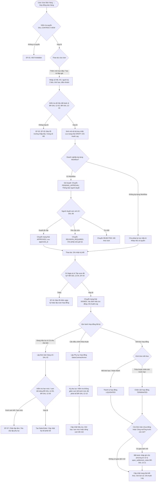

# TÀI LIỆU THIẾT KẾ KỸ THUẬT VÀ ĐẶC TẢ API BACKEND
## USE CASE UC-SAL-12: QUẢN LÝ HỢP ĐỒNG BÁN HÀNG (SALES CONTRACT MANAGEMENT)

---

### 1. Tổng quan Kiến trúc và Luồng Xử lý

Use case **UC-SAL-12: Quản lý hợp đồng bán hàng** phụ trách toàn bộ vòng đời của văn bản hợp đồng thương mại và phụ lục hợp đồng với khách hàng:
- Tạo lập hợp đồng trực tiếp hoặc kế thừa từ Báo giá (`SalesQuotation`, UC-SAL-01).
- Hỗ trợ 2 hình thức giá trị: **Giá trị cố định** (`FIXED` - cam kết số lượng/giá trị chi tiết từng dòng) và **Hạn mức hợp đồng** (`LIMIT` - trần giá trị gồm thuế cho toàn hợp đồng).
- Quy trình phê duyệt nội bộ linh hoạt (gửi duyệt, phê duyệt qua Workflow, thu hồi, trả về Nháp từ Đã duyệt).
- Nghiệp vụ ghi nhận ký kết văn bản hợp đồng thực tế (bắt buộc ngày ký và tệp scan hợp đồng đã ký).
- Tính toán và hiển thị hiệu lực hợp đồng động (`NOT_YET_EFFECTIVE`, `EFFECTIVE`, `EXPIRED`) dựa trên ngày hiện tại và các phụ lục đã ký có hiệu lực.
- Kiểm soát phân bổ và phát sinh Đơn bán hàng (`SalesOrder`, UC-SAL-02), ngăn chặn vượt cam kết/hạn mức.
- Quản lý phụ lục hợp đồng (`SalesContractAnnex`), cập nhật phạm vi hiệu lực và cam kết mà không làm gián đoạn lịch sử giao dịch.
- Quy trình thanh lý và chấm dứt hợp đồng trước hạn với cơ chế rà soát giao dịch mở (đơn hàng, công nợ, khoản ứng trước) và phương án xử lý bắt buộc.

> [!IMPORTANT]
> **Quy tắc độc lập kế toán & kho BR-SAL-12-14**: Ghi nhận ký kết hợp đồng chỉ xác lập khung pháp lý và cam kết thương mại; **tuyệt đối không tự động phát sinh doanh thu, không ghi nhận công nợ, không ghi sổ kế toán (GL), không xuất kho vật tư và không phát hành hóa đơn**. Doanh thu và công nợ chỉ phát sinh khi thực hiện giao hàng/bán dịch vụ (UC-SAL-03, UC-SAL-04) hoặc lập hóa đơn (UC-SAL-07).

> [!TIP]
> **Kiểm soát tính toàn vẹn và xung đột đồng thời BR-SAL-12-10, BR-SAL-12-14, EF-10**: Mọi thao tác cập nhật trạng thái, ghi nhận ký kết, lập phụ lục và phân bổ đơn bán đều được thực thi trong giao dịch nguyên tử `transaction.atomic()` với khóa bi quan `select_for_update()` và kiểm soát trường `version` lạc quan.

---

#### 1.1. Activity Diagram (Quy trình Vòng đời Hợp đồng Bán hàng)



---

### 2. Cấu trúc Mô hình Dữ liệu (Database Models)

#### 2.1. Hợp đồng Bán hàng `sal_contract` (`SalesContract`)

Kế thừa các trường hệ thống từ `AbstractAuditableModel` (`id`, `created_at`, `updated_at`, `created_by`, `updated_by`).

| Tên trường | Kiểu dữ liệu | Thuộc tính | Mô tả |
| :--- | :--- | :--- | :--- |
| `id` | UUID | PK, default=uuid4 | Định danh duy nhất hợp đồng |
| `code` | CharField(50) | Indexed | Mã nội bộ hợp đồng tự sinh định dạng `HDBH-YYYY-XXXX` |
| `contract_number` | CharField(100) | Indexed | Số hợp đồng trên văn bản thực tế (duy nhất trong doanh nghiệp, BR-SAL-12-02) |
| `title` | CharField(255) | | Tiêu đề / tên hợp đồng ngắn gọn |
| `company` | FK (`organization.Company`) | on_delete=PROTECT | Doanh nghiệp sở hữu hợp đồng |
| `branch` | FK (`organization.Branch`) | on_delete=SET_NULL, null=True | Chi nhánh thực hiện hợp đồng |
| `customer` | FK (`master_data.Customer`) | on_delete=PROTECT | Khách hàng đối tác |
| `customer_representative` | CharField(255) | blank=True | Người đại diện khách hàng ký hợp đồng |
| `customer_representative_position`| CharField(100) | blank=True | Chức vụ người đại diện khách hàng |
| `company_signer` | FK (`master_data.Employee`) | null=True, on_delete=SET_NULL | Người ký đại diện phía doanh nghiệp |
| `company_signer_name` | CharField(255) | blank=True | Họ tên người ký đại diện doanh nghiệp |
| `company_signer_position` | CharField(100) | blank=True | Chức vụ người ký phía doanh nghiệp |
| `assigned_employee` | FK (`master_data.Employee`) | null=True, on_delete=SET_NULL | Nhân viên kinh doanh phụ trách hợp đồng |
| `quotation` | FK (`sales.SalesQuotation`) | null=True, on_delete=SET_NULL | Báo giá nguồn được kế thừa nếu có |
| `document_date` | DateField | | Ngày lập hợp đồng trên hệ thống |
| `signed_date` | DateField | null=True | Ngày ký trên văn bản thực tế (bắt buộc khi ghi nhận ký kết) |
| `start_date` | DateField | | Ngày bắt đầu hiệu lực |
| `end_date` | DateField | | Ngày kết thúc hiệu lực (`end_date >= start_date`) |
| `currency` | FK (`master_data.Currency`) | on_delete=PROTECT | Loại tiền tệ của hợp đồng (mặc định VND) |
| `exchange_rate` | DecimalField(18, 6) | default=1 | Tỷ giá quy đổi về đồng tiền hạch toán |
| `value_type` | CharField(20) | Choices | `FIXED` (Giá trị cố định) hoặc `LIMIT` (Hạn mức hợp đồng) |
| `contract_limit` | DecimalField(18, 2) | default=0 | Trần giá trị gồm thuế đối với hợp đồng hạn mức |
| `total_amount` | DecimalField(18, 2) | default=0 | Tổng giá trị hợp đồng gồm thuế (tính từ các dòng đối với `FIXED`) |
| `payment_terms_text` | TextField | | Thỏa thuận điều khoản thanh toán chi tiết (bắt buộc) |
| `delivery_terms` | TextField | | Điều kiện giao hàng và nghiệm thu bàn giao (bắt buộc) |
| `signed_file` | FileField | null=True | Tệp scan hợp đồng đã có chữ ký/đóng dấu các bên (bắt buộc khi ký kết) |
| `status` | CharField(30) | Choices | `DRAFT`, `PENDING_APPROVAL`, `REVISION_REQUIRED`, `REJECTED`, `APPROVED`, `SIGNED`, `LIQUIDATED`, `TERMINATED`, `CANCELLED` |
| `cancellation_reason` | TextField | blank=True | Lý do hủy hợp đồng chưa ký |
| `liquidation_reason` | TextField | blank=True | Lý do thanh lý hoặc chấm dứt trước hạn |
| `liquidated_at` | DateTimeField | null=True | Thời điểm ghi nhận thanh lý / chấm dứt |
| `liquidation_file` | FileField | null=True | Tệp scan biên bản thanh lý / thỏa thuận chấm dứt |
| `open_settlement_notes` | TextField | blank=True | Ghi chú phương án xử lý các đơn/công nợ/ứng trước còn mở khi kết thúc hợp đồng |
| `version` | PositiveIntegerField | default=1 | Khóa phiên bản phục vụ Optimistic Concurrency Control |

#### 2.2. Chi tiết Hàng hóa/Dịch vụ Hợp đồng `sal_contract_line` (`SalesContractLine`)

| Tên trường | Kiểu dữ liệu | Thuộc tính | Mô tả |
| :--- | :--- | :--- | :--- |
| `id` | UUID | PK, default=uuid4 | Khóa chính dòng chi tiết |
| `contract` | FK (`SalesContract`) | related_name="lines", CASCADE | Hợp đồng bán hàng chủ quản |
| `line_no` | PositiveIntegerField | | Số thứ tự dòng (1, 2, 3,...) |
| `item` | FK (`master_data.Item`) | on_delete=PROTECT | Hàng hóa hoặc dịch vụ cam kết |
| `description` | CharField(255) | | Diễn giải quy cách / phạm vi cung ứng |
| `uom` | FK (`master_data.UnitOfMeasure`) | on_delete=PROTECT | Đơn vị tính hợp lệ |
| `quantity` | DecimalField(18, 4) | default=0 | Số lượng cam kết theo hợp đồng cố định |
| `maximum_quantity` | DecimalField(18, 4) | default=0 | Hạn mức số lượng tối đa (đồng bộ tự động với `quantity`) |
| `unit_price` | DecimalField(18, 4) | default=0 | Đơn giá chưa thuế theo thỏa thuận |
| `discount_rate` | DecimalField(5, 2) | default=0 | Tỷ lệ chiết khấu dòng (0% - 100%) |
| `discount_amount` | DecimalField(18, 2) | default=0 | Tiền chiết khấu dòng (không vượt thành tiền) |
| `tax_rate` | FK (`master_data.TaxRate`) | null=True, on_delete=SET_NULL | Nhóm thuế suất áp dụng |
| `tax_amount` | DecimalField(18, 2) | default=0 | Tiền thuế GTGT dòng |
| `line_total` | DecimalField(18, 2) | default=0 | Tổng giá trị dòng gồm thuế (`Thành tiền - CK + Thuế`) |
| `expected_delivery_date` | DateField | null=True | Ngày giao hàng dự kiến (nằm trong thời hạn hợp đồng) |
| `allocated_quantity` | DecimalField(18, 4) | default=0 | Số lượng đã phân bổ vào các Đơn bán hàng còn hiệu lực |
| `allocated_amount` | DecimalField(18, 2) | default=0 | Giá trị gồm thuế đã phân bổ vào các Đơn bán hàng |
| `quotation_line` | FK (`SalesQuotationLine`) | null=True, on_delete=SET_NULL | Dòng báo giá nguồn kế thừa |

#### 2.3. Phụ lục Hợp đồng `sal_contract_annex` (`SalesContractAnnex`)

| Tên trường | Kiểu dữ liệu | Thuộc tính | Mô tả |
| :--- | :--- | :--- | :--- |
| `id` | UUID | PK, default=uuid4 | Khóa chính phụ lục hợp đồng |
| `contract` | FK (`SalesContract`) | related_name="annexes", CASCADE | Hợp đồng bán hàng gốc |
| `annex_number` | CharField(100) | | Số phụ lục (không trùng trong cùng hợp đồng) |
| `title` | CharField(255) | | Tiêu đề tóm tắt phụ lục |
| `signed_date` | DateField | null=True | Ngày ký phụ lục văn bản |
| `effective_date` | DateField | | Ngày phụ lục bắt đầu phát sinh hiệu lực pháp lý |
| `change_summary` | TextField | | Diễn giải chi tiết các nội dung điều chỉnh |
| `status` | CharField(30) | Choices | `DRAFT`, `PENDING_APPROVAL`, `APPROVED`, `SIGNED`, `CANCELLED` |
| `signed_file` | FileField | null=True | Tệp scan văn bản phụ lục đã ký |
| `changes_payload` | JSONField | default=dict | Cấu trúc dữ liệu các trường thay đổi (hạn mức, ngày kết thúc, dòng số lượng/giá...) |
| `version` | PositiveIntegerField | default=1 | Khóa phiên bản xử lý đồng thời |

#### 2.4. Bảng đếm số Hợp đồng `sal_contract_counter` (`SalesContractCounter`)

| Tên trường | Kiểu dữ liệu | Thuộc tính | Mô tả |
| :--- | :--- | :--- | :--- |
| `id` | UUID | PK | Khóa chính bảng đếm |
| `company` | FK (`organization.Company`) | | Doanh nghiệp |
| `fiscal_year` | PositiveIntegerField | | Năm tài chính |
| `last_number` | PositiveIntegerField | default=0 | Số thứ tự tăng dần phục vụ sinh mã định dạng `HDBH-YYYY-XXXX` |

---

### 3. Ma trận Quy tắc Nghiệp vụ (Business Rules) & Xử lý Ngoại lệ (Exceptions)

| BR Code | Tên quy tắc & Nội dung thực thi | Xử lý Ngoại lệ (EF) |
| :--- | :--- | :--- |
| **BR-SAL-12-01** | **Kiểm soát Quyền & Phạm vi Dữ liệu**: Kiểm tra quyền truy cập tương ứng trên từng hành động (`SAL.CONTRACT.VIEW`, `CREATE`, `UPDATE`, `SIGN`, `ANNEX`, `LIQUIDATE`, `CANCEL`). Chi nhánh và đơn vị làm việc phải thuộc phạm vi công ty được cấp. | **EF-01**: Trả về HTTP 403 Forbidden hoặc từ chối thao tác nếu vượt thẩm quyền. |
| **BR-SAL-12-02** | **Tính duy nhất của Số Hợp đồng & Thông tin Đại diện**: Số hợp đồng (`contract_number`) không được trùng trong cùng doanh nghiệp. Bắt buộc có khách hàng, người đại diện khách hàng và người ký đại diện doanh nghiệp. | **EF-02**: Trả về HTTP 400 Validation Error; ngăn chặn ghi đè trùng số hợp đồng. |
| **BR-SAL-12-03** | **Thời hạn & Giá trị Hợp lệ**: Ngày kết thúc không được trước ngày bắt đầu (`end_date >= start_date`). Giá trị hoặc hạn mức phải lớn hơn 0. Hợp đồng `FIXED` bắt buộc có ít nhất một dòng chi tiết hợp lệ. | **EF-03**: Chặn lưu hợp đồng; chỉ rõ trường ngày hoặc dòng chi tiết cần chỉnh sửa. |
| **BR-SAL-12-04** | **Phê duyệt Nội bộ vs Ghi nhận Ký kết**: Phê duyệt nội bộ (`APPROVED`) chỉ xác nhận nội dung hợp đồng được ban lãnh đạo thông qua. Chỉ chuyển sang `SIGNED` khi người dùng nhập đủ ngày ký và đính kèm tệp văn bản hợp đồng đã ký. | **EF-04**: Ngăn chặn chuyển sang `SIGNED` nếu thiếu ngày ký hoặc tệp đính kèm. |
| **BR-SAL-12-05** | **Điều kiện Lập Đơn Bán hàng**: Chỉ cho phép lập đơn bán hàng từ hợp đồng đang ở trạng thái `SIGNED` và có hiệu lực tính đến thời điểm lập đơn (`EFFECTIVE`). Tái kiểm tra hiệu lực khi xác nhận đơn. | **EF-06**: Chặn lập đơn mới nếu hợp đồng chưa đến hiệu lực, đã hết hạn, hoặc đã thanh lý/chấm dứt. |
| **BR-SAL-12-06** | **Kiểm soát Hạn mức & Cam kết dòng**: Hợp đồng `FIXED` kiểm soát số lượng và giá trị từng dòng cam kết (`remaining_quantity >= order_quantity`). Hợp đồng `LIMIT` kiểm soát trần tổng giá trị gồm thuế của các đơn bán liên kết. | **EF-07**: Chặn phát sinh đơn bán nếu vượt số lượng còn lại của dòng hoặc vượt hạn mức hợp đồng. |
| **BR-SAL-12-07** | **Không cộng trùng & Giải phóng phân bổ**: Không cộng trùng giá trị đơn hàng với chứng từ bán hàng hay hóa đơn phát sinh từ đơn đó. Đơn bán hàng bị hủy (`CANCELLED`) hoặc đóng (`CLOSED`) giải phóng phần chưa thực hiện về lại hợp đồng. | Không có lỗi phát sinh; hệ thống tự động loại trừ đơn hủy/đóng khỏi lũy kế phân bổ. |
| **BR-SAL-12-08** | **Nguyên tắc Bất biến của Hợp đồng Đã ký**: Nghiêm cấm sửa trực tiếp khách hàng, loại tiền, giá trị, thời hạn và điều khoản cam kết của hợp đồng ở trạng thái `SIGNED`. Mọi thay đổi bắt buộc phải thông qua Phụ lục hợp đồng. | **EF-09**: Chặn trực tiếp API cập nhật hợp đồng `SIGNED`; thông báo lập phụ lục. |
| **BR-SAL-12-09** | **Hiệu lực Phụ lục Hợp đồng**: Phụ lục hợp đồng chỉ được áp dụng tính toán và thay thế khi đã ký (`SIGNED`) và ngày hiện tại đã đạt đến ngày hiệu lực (`effective_date <= current_date`). Giữ nguyên lịch sử gốc. | Phụ lục chưa ký hoặc chưa đến ngày hiệu lực không làm biến động thông số hợp đồng. |
| **BR-SAL-12-10** | **Bảo toàn Phần đã Phân bổ khi Lập Phụ lục**: Phụ lục giảm cam kết số lượng dòng hoặc hạn mức không được phép thấp hơn giá trị/số lượng đã phân bổ vào các đơn bán đang có hiệu lực. | **EF-08**: Chặn áp dụng phụ lục; yêu cầu điều chỉnh các đơn hàng đang ràng buộc trước. |
| **BR-SAL-12-11** | **Xử lý Giao dịch Mở khi Thanh lý/Chấm dứt**: Thanh lý hoặc chấm dứt hợp đồng không tự động xóa sổ công nợ, không tự hủy đơn hàng và không tự hoàn tiền. Nếu còn đơn bán chưa đóng hoặc công nợ/ứng trước mở, bắt buộc phải nhập ghi chú phương án xử lý (`open_settlement_notes`). | Chặn thanh lý/chấm dứt nếu có giao dịch mở nhưng để trống `open_settlement_notes`. |
| **BR-SAL-12-12** | **Tính Độc lập của Trả hàng / Giảm giá**: Hàng bán trả lại hoặc giảm giá phát sinh sau này không tự động khôi phục hạn mức của hợp đồng, trừ khi có thỏa thuận/phụ lục hợp đồng quy định bổ sung. | Đảm bảo tính nhất quán của hạn mức đã thực hiện thực tế. |
| **BR-SAL-12-13** | **Quy tắc Hủy và Xóa Hợp đồng**: Chỉ cho phép Hủy (`CANCELLED`) đối với hợp đồng chưa ký kết (`DRAFT`, `REVISION_REQUIRED`, `REJECTED`, `APPROVED`) và bắt buộc nhập lý do. Chỉ cho phép Xóa vĩnh viễn hợp đồng `DRAFT` chưa từng phát sinh liên kết nghiệp vụ. | Ngăn chặn hủy hợp đồng `SIGNED` (phải dùng thanh lý/chấm dứt) và chặn xóa hợp đồng đã liên kết. |
| **BR-SAL-12-14** | **Kiểm soát Phiên bản, Audit Log & Không tự phát sinh Hạch toán**: Mọi hành động làm biến động dữ liệu đều ghi nhật ký kiểm toán `audit_log`, kiểm tra xung đột phiên bản qua `version`, và cam kết ký kết hợp đồng không tự sinh bút toán kế toán. | **EF-10**: Chặn ghi đè dữ liệu khi phiên bản bị sai lệch do người khác cập nhật trước. |

---

### 4. Chi tiết RESTful API Endpoints

Tất cả các endpoint thuộc nhóm hợp đồng bán hàng được định tuyến tại tiền tố `/api/sales/contracts/`.

#### 4.1. Danh sách và Chi tiết Hợp đồng

- **Danh sách hợp đồng**: `GET /api/sales/contracts/`
  - *Query Params*: `status`, `validity_status`, `customer`, `assigned_employee`, `search`, `page`, `page_size`.
  - *Response*: Danh sách hợp đồng kèm trạng thái nghiệp vụ, trạng thái hiệu lực động (`validity_status`), người ký, giá trị tổng và hạn mức.
- **Chi tiết hợp đồng**: `GET /api/sales/contracts/{id}/`
  - *Response*: Toàn bộ header hợp đồng, thông tin đại diện hai bên, điều khoản thanh toán & giao hàng, chi tiết các dòng cam kết (kèm số lượng/giá trị đã phân bổ và còn lại), danh sách phụ lục và các đơn bán hàng liên kết.

#### 4.2. Khởi tạo và Quản lý Hợp đồng

- **Tạo mới hợp đồng**: `POST /api/sales/contracts/`
  - *Body Payload*:
    ```json
    {
      "contract_number": "HD-2026/SAL-001",
      "title": "Hợp đồng cung cấp vật tư thiết bị mạng",
      "customer": "d16c52bb-f522-42fe-b586-44474753ba5e",
      "customer_representative": "Nguyễn Văn A",
      "customer_representative_position": "Giám đốc",
      "company_signer_name": "Trần Thị B",
      "company_signer_position": "Tổng Giám đốc",
      "assigned_employee": "3645bcfd-f954-473e-adce-f6c6a469bb58",
      "start_date": "2026-10-01",
      "end_date": "2026-12-31",
      "value_type": "FIXED",
      "payment_terms_text": "Thanh toán 3 đợt trong vòng 30 ngày kể từ khi nhận đủ hàng và hóa đơn.",
      "delivery_terms": "Giao hàng tại kho bên Mua trong vòng 15 ngày kể từ ngày đặt hàng.",
      "lines": [
        {
          "item": "d128d50f-2420-40e1-b4ef-1473fa58a74e",
          "description": "Switch Cisco 24 Port Gigabit",
          "uom": "30f9bfdb-b9ca-4ff4-af08-be92f5e1ad37",
          "quantity": "50.0000",
          "unit_price": "12000000.00",
          "discount_rate": "5.00",
          "tax_rate": "d820cfbb-ecda-40a2-afba-54e4c2534f9a"
        }
      ]
    }
    ```
- **Tạo hợp đồng từ Báo giá (AF-02)**: `POST /api/sales/contracts/create-from-quotation/`
  - *Body Payload*:
    ```json
    {
      "quotation_id": "452b485a-0158-450f-be89-c454e99f57fa",
      "contract_number": "HDBH-2026/BG-088",
      "title": "Hợp đồng triển khai theo Báo giá BG-2026-0088",
      "start_date": "2026-10-15",
      "end_date": "2027-04-15",
      "customer_representative": "Lê Văn C",
      "customer_representative_position": "Trưởng phòng Mua sắm",
      "company_signer_name": "Phạm Văn D",
      "company_signer_position": "Giám đốc Kinh doanh",
      "payment_terms_text": "Thanh toán 100% trong vòng 14 ngày làm việc sau khi nghiệm thu.",
      "delivery_terms": "Triển khai lắp đặt tại chi nhánh bên Mua."
    }
    ```
  - *Logic*: Tự động kế thừa khách hàng, loại tiền tệ, danh mục hàng hóa, đơn giá, chiết khấu và thuế suất từ báo giá đã được duyệt.

#### 4.3. Quy trình Phê duyệt và Ký kết Hợp đồng

- **Gửi duyệt hợp đồng**: `POST /api/sales/contracts/{id}/submit-approval/`
  - Chuyển trạng thái sang `PENDING_APPROVAL` (hoặc `APPROVED` nếu hệ thống không cấu hình Workflow).
- **Thu hồi yêu cầu duyệt (AF-03)**: `POST /api/sales/contracts/{id}/withdraw/`
  - Áp dụng khi hợp đồng đang `PENDING_APPROVAL`, đưa trở lại trạng thái `DRAFT`.
- **Đưa về Nháp từ Đã duyệt (AF-03)**: `POST /api/sales/contracts/{id}/return-to-draft/`
  - Cho phép người có thẩm quyền thu hồi hợp đồng `APPROVED` về `DRAFT` để chỉnh sửa lại trước khi ký kết.
- **Ghi nhận ký kết văn bản (Bước 8-9, BR-SAL-12-04)**: `POST /api/sales/contracts/{id}/record-signed/`
  - *Body Payload (Multipart/JSON)*:
    ```json
    {
      "signed_date": "2026-10-10",
      "signed_file": "<file binary / multipart upload>"
    }
    ```
  - *Logic*: Xác thực ngày ký và tệp văn bản hợp đồng đã ký có chữ ký đóng dấu đầy đủ. Cập nhật trạng thái `SIGNED`, xác định hiệu lực động và mở quyền lập đơn bán hàng.

#### 4.4. Vận hành Thực hiện: Lập Đơn bán hàng (AF-05)

- **Lập Đơn bán hàng từ Hợp đồng**: `POST /api/sales/contracts/{id}/create-sales-order/`
  - *Body Payload*:
    ```json
    {
      "order_date": "2026-10-12",
      "lines": [
        {
          "contract_line_id": "764ea622-c4ad-4d4b-9724-4f7f631bdcf8",
          "quantity": "20.0000"
        }
      ]
    }
    ```
  - *Logic*: Kiểm tra hợp đồng đang ở trạng thái `SIGNED` và đang hiệu lực (`EFFECTIVE`). Kiểm tra số lượng phân bổ của từng dòng cam kết (với `FIXED`) hoặc hạn mức hợp đồng (với `LIMIT`). Kế thừa điều khoản thanh toán, giao hàng và tạo `SalesOrder` liên kết nguồn `CONTRACT`.

#### 4.5. Quản lý Phụ lục Hợp đồng (AF-06, BR-SAL-12-08, BR-SAL-12-09, BR-SAL-12-10)

- **Thêm phụ lục hợp đồng**: `POST /api/sales/contracts/{id}/annexes/`
  - *Body Payload*:
    ```json
    {
      "annex_number": "PL-01/HD-2026",
      "title": "Phụ lục gia hạn thời gian và bổ sung số lượng",
      "effective_date": "2026-10-15",
      "change_summary": "Gia hạn hợp đồng đến 31/03/2027 và tăng số lượng dòng 1 thêm 20 thiết bị",
      "changes_payload": {
        "end_date": "2027-03-31",
        "lines": [
          {
            "line_id": "764ea622-c4ad-4d4b-9724-4f7f631bdcf8",
            "quantity": "70.0000"
          }
        ]
      }
    }
    ```
- **Ghi nhận ký kết phụ lục**: `POST /api/sales/contracts/{id}/sign-annex/`
  - *Body Payload*:
    ```json
    {
      "annex_id": "3e9b11e2-b881-4203-b0fc-94c038481ff2",
      "signed_date": "2026-10-14",
      "signed_file": "<file binary / multipart upload>"
    }
    ```
  - *Logic*: Kiểm tra ràng buộc BR-SAL-12-10: Cam kết sau điều chỉnh không được thấp hơn phần đã phân bổ vào các đơn bán đang có hiệu lực. Khi đến ngày hiệu lực, hệ thống tự động áp dụng các thay đổi vào thông số hợp đồng.
- **Hủy phụ lục**: `POST /api/sales/contracts/{id}/cancel-annex/`
  - *Body Payload*: `{"annex_id": "uuid", "reason": "Thương thảo không thành công"}`

#### 4.6. Kiểm tra Giao dịch Mở, Thanh lý và Chấm dứt Hợp đồng (AF-07, BR-SAL-12-11)

- **Rà soát giao dịch mở**: `GET /api/sales/contracts/{id}/open-transactions/`
  - *Response*:
    ```json
    {
      "has_open": true,
      "open_orders_count": 1,
      "open_orders": [
        {
          "id": "e605d3c8-8869-42b7-a36f-e3c35bba6512",
          "number": "SO-2026-0012",
          "status": "CONFIRMED",
          "total_amount": "240000000.00"
        }
      ],
      "open_receivables_count": 0,
      "open_receivables": [],
      "open_advances_count": 0,
      "open_advances": []
    }
    ```
- **Thanh lý hợp đồng**: `POST /api/sales/contracts/{id}/liquidate/`
  - *Body Payload*:
    ```json
    {
      "liquidation_date": "2026-10-15",
      "reason": "Hoàn thành toàn bộ nghĩa vụ cung ứng theo hợp đồng",
      "liquidation_file": "<file biên bản thanh lý>",
      "open_settlement_notes": "Đơn hàng SO-2026-0012 tiếp tục thực hiện giao nốt theo kế hoạch đã thống nhất."
    }
    ```
  - *Logic*: Nếu còn đơn hàng chưa đóng hoặc công nợ/ứng trước mở, bắt buộc phải có `open_settlement_notes` để giải trình phương án xử lý theo BR-SAL-12-11.
- **Chấm dứt hợp đồng trước hạn**: `POST /api/sales/contracts/{id}/terminate/`
  - *Body Payload*:
    ```json
    {
      "termination_date": "2026-10-15",
      "reason": "Hai bên thỏa thuận chấm dứt hợp tác trước thời hạn do thay đổi kế hoạch kinh doanh",
      "liquidation_file": "<file biên bản thỏa thuận chấm dứt>",
      "open_settlement_notes": "Các bên hoàn tất đối soát công nợ trước ngày 30/10/2026."
    }
    ```
- **Hủy hợp đồng chưa ký (AF-08, BR-SAL-12-13)**: `POST /api/sales/contracts/{id}/cancel/`
  - *Body Payload*: `{"cancellation_reason": "Khách hàng thay đổi yêu cầu báo giá"}`
  - *Logic*: Chỉ cho phép hủy hợp đồng chưa ký (`DRAFT`, `PENDING_APPROVAL`, `REVISION_REQUIRED`, `REJECTED`, `APPROVED`). Không cho phép hủy hợp đồng `SIGNED`.

---

### 5. Kiểm thử Tự động & Kết quả Xác minh (Automated Test Suite)

Tất cả các tình huống nghiệp vụ và luồng ngoại lệ đã được tự động hóa tại bộ kiểm thử `sales.test_sales_contract_uc_sal_12`:

| STT | Mã Test Case | Mục tiêu kiểm thử | Quy tắc kiểm chứng | Kết quả |
| :---: | :--- | :--- | :--- | :---: |
| 1 | `test_01_create_fixed_contract_success` | Tạo hợp đồng giá trị cố định hợp lệ, tự sinh mã nội bộ, tính tổng tiền | BR-SAL-12-02, BR-SAL-12-03 | **PASS** |
| 2 | `test_02_create_fixed_contract_validation_errors` | Kiểm tra bắt buộc: Trùng số HĐ, thiếu dòng, ngày kết thúc trước ngày bắt đầu | EF-02, EF-03, BR-SAL-12-03 | **PASS** |
| 3 | `test_03_create_limit_contract` | Tạo hợp đồng hạn mức không cần dòng chi tiết, kiểm tra hạn mức lớn hơn 0 | BR-SAL-12-03, BR-SAL-12-06 | **PASS** |
| 4 | `test_04_create_from_quotation` | Kế thừa dữ liệu báo giá nguồn đã được chấp thuận vào hợp đồng | AF-02, BR-SAL-12-02 | **PASS** |
| 5 | `test_05_update_and_recall_draft` | Sửa hợp đồng ở trạng thái Nháp và thu hồi yêu cầu khi đang chờ duyệt | AF-03 | **PASS** |
| 6 | `test_06_approval_workflow` | Quy trình phê duyệt đầy đủ qua workflow: gửi duyệt, duyệt, trả về nháp | AF-04, BR-SAL-12-04 | **PASS** |
| 7 | `test_07_record_signed` | Ghi nhận ký kết yêu cầu ngày ký và tệp đính kèm scan văn bản | BR-SAL-12-04, EF-04 | **PASS** |
| 8 | `test_08_validity_status_periods` | Tính toán hiệu lực động: Chưa đến hiệu lực, Đang hiệu lực, Hết hiệu lực | Table 3, BR-SAL-12-05 | **PASS** |
| 9 | `test_09_create_sales_order_from_fixed_contract` | Lập đơn bán từ hợp đồng cố định, trừ lũy kế số lượng/tiền dòng cam kết | AF-05, BR-SAL-12-05, BR-SAL-12-06 | **PASS** |
| 10 | `test_10_create_sales_order_from_limit_contract` | Lập đơn bán từ hợp đồng hạn mức, trừ lũy kế tổng hạn mức khả dụng | AF-05, BR-SAL-12-06 | **PASS** |
| 11 | `test_11_create_order_when_not_effective_or_ended_fails` | Chặn lập đơn bán khi hợp đồng chưa đến ngày hiệu lực hoặc đã kết thúc | EF-06, BR-SAL-12-05 | **PASS** |
| 12 | `test_12_create_order_exceeds_commitment_fails` | Chặn lập đơn bán vượt số lượng cam kết còn lại hoặc vượt hạn mức | EF-07, BR-SAL-12-06 | **PASS** |
| 13 | `test_13_annex_lifecycle_and_effective_application` | Vòng đời phụ lục: thêm, ký, cập nhật ngày kết thúc và tăng cam kết | AF-06, BR-SAL-12-08, BR-SAL-12-09 | **PASS** |
| 14 | `test_14_annex_cannot_reduce_below_allocated` | Chặn phụ lục giảm cam kết thấp hơn phần đã phân bổ vào các đơn mở | EF-08, BR-SAL-12-10 | **PASS** |
| 15 | `test_15_liquidate_contract_with_open_transactions` | Thanh lý hợp đồng cảnh báo giao dịch mở và bắt buộc ghi chú phương án | AF-07, BR-SAL-12-11 | **PASS** |
| 16 | `test_16_terminate_contract` | Chấm dứt hợp đồng trước hạn cập nhật trạng thái `TERMINATED` | AF-07, BR-SAL-12-11 | **PASS** |
| 17 | `test_17_cancel_contract_rule` | Cho phép hủy hợp đồng chưa ký; chặn hủy hợp đồng đã ký kết | AF-08, BR-SAL-12-13 | **PASS** |
| 18 | `test_18_delete_draft_contract_only` | Chỉ cho phép xóa hợp đồng Nháp chưa có liên kết nghiệp vụ | AF-08, BR-SAL-12-13 | **PASS** |

#### Kết quả thực thi kiểm thử:
- **Suite UC-SAL-12**: `Ran 18 tests in 28.378s` $\to$ **OK**
- **Toàn bộ phân hệ Sales (Regression check UC-SAL-01 đến UC-SAL-12)**: `Ran 148 tests in 200.717s` $\to$ **OK (148/148 PASS, 0 failures, 0 errors)**.
