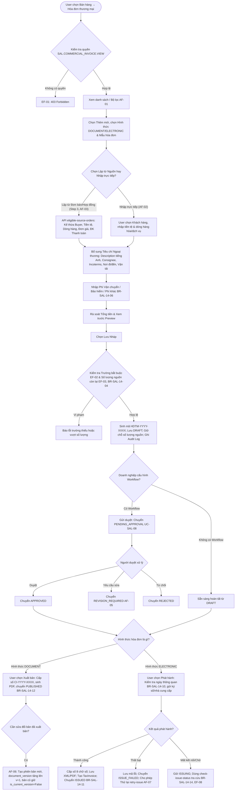
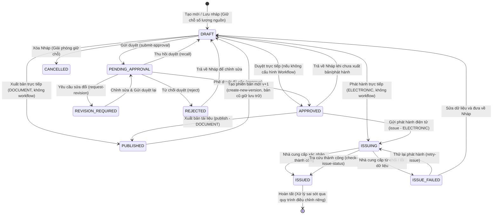

# TÀI LIỆU THIẾT KẾ KỸ THUẬT VÀ ĐẶC TẢ API BACKEND
## USE CASE UC-SAL-14: LẬP HÓA ĐƠN THƯƠNG MẠI (COMMERCIAL INVOICE ISSUE)

---

### 1. Tổng quan Kiến trúc và Luồng Nghiệp vụ

Use case **UC-SAL-14: Lập hóa đơn thương mại** xử lý toàn diện chu trình lập, phê duyệt, xuất bản và phát hành hóa đơn thương mại cho các giao dịch xuất khẩu hàng hóa và dịch vụ quốc tế. Thiết kế hệ thống tuân thủ chặt chẽ các thông lệ thanh toán quốc tế (UCP 600, Incoterms 2020), quy định xuất khẩu hải quan Việt Nam, và các quy định pháp luật về hóa đơn điện tử (Nghị định 123/2020/NĐ-CP, Thông tư 78/2021/TT-BTC, và Nghị định 70/2025/NĐ-CP):

- **Hai Hình thức Hóa đơn Độc lập (BR-SAL-14-02)**:
  1. **Commercial Invoice dạng tài liệu (`DOCUMENT`)**:
     - Phục vụ bộ hồ sơ giao dịch ngoại thương, thủ tục hải quan, mở L/C hoặc chứng từ nhờ thu ngân hàng.
     - Cấp số nội bộ theo định dạng `CI-YYYY-XXXX` khi User thực hiện thao tác **Xuất bản (`publish`)**, lưu trữ và xuất tệp PDF chính thức.
     - Hỗ trợ cơ chế quản lý phiên bản (**Document Versioning**) theo **AF-06, BR-SAL-14-12, EF-10**: khi cần sửa đổi bản đã xuất bản, hệ thống nhân bản thành một bản Nháp mới với số hiệu phiên bản tăng dần (`document_version = v + 1`, mã bổ sung hậu tố `-V2`, `-V3`), giữ nguyên bản gốc với trạng thái lưu trữ (`is_current_version = False`) để phục vụ kiểm toán và truy vết ngoại thương.
  2. **Hóa đơn thương mại điện tử (`ELECTRONIC`)**:
     - Áp dụng khi doanh nghiệp sử dụng hình thức hóa đơn điện tử kết nối với cơ quan thuế hoặc nhà cung cấp dịch vụ hóa đơn điện tử.
     - Cấp số hóa đơn chính thức dạng 8 chữ số (`00000001`) từ bộ đếm điện tử `SalesCommercialInvoiceCounter` theo năm và ký hiệu mẫu (`invoice_series`), đồng bộ tự động sang `tax_management.TaxInvoice` (loại `ORIGINAL`, chiều `OUTPUT`), sinh đường dẫn tệp XML/PDF có chữ ký số và mã giao dịch tra cứu.
- **Tính toán Giá trị & Phí Bổ sung (BR-SAL-14-06, BR-SAL-14-07)**:
  - Thành tiền từng dòng: `line_amount = (quantity * unit_price) - discount_amount`.
  - Phí bổ sung: Tiền cước vận chuyển (`freight_charge`), phí bảo hiểm (`insurance_charge`), và chi phí khác (`other_charges`) được khai báo riêng, cùng đồng tiền với hóa đơn. Chỉ cộng các khoản phí chưa nằm trong đơn giá Incoterms.
  - Tổng giá trị hóa đơn: `total_amount = total_lines_amount + total_charges + total_tax_amount`.
- **Kiểm soát Nguồn & Hạn mức Số lượng (BR-SAL-14-03, BR-SAL-14-04, BR-SAL-14-05)**:
  - Nguồn kế thừa: Đơn bán hàng (`SalesOrder`), Hợp đồng bán (`SalesContract`), hoặc Chứng từ bán hàng (`SalesInvoice`).
  - Kiểm tra đồng nhất: Nguồn phải cùng khách hàng (`customer`) và cùng loại tiền (`currency`).
  - Hệ thống tính toán và kiểm soát chặt chẽ số lượng nguồn:
    - `used_quantity`: Số lượng đã xuất bản trên hóa đơn tài liệu (`PUBLISHED`) hoặc đã phát hành thành công trên hóa đơn điện tử (`ISSUED`).
    - `held_quantity`: Số lượng đang được giữ chỗ bởi các hóa đơn chưa hoàn tất (`DRAFT`, `PENDING_APPROVAL`, `APPROVED`, `ISSUING`).
    - Khi lưu hoặc xuất bản/phát hành, phần giữ chỗ của chính hóa đơn hiện tại được loại trừ (`current_invoice_id`) để không tự chặn chính nó.
    - **Không tính trùng hai lần (BR-SAL-14-05)**: Nếu cùng một giao dịch lập cả bản tài liệu và hóa đơn điện tử có liên kết với nhau, hệ thống nhận diện và không trừ trùng tiến độ giao hàng/đơn bán.
- **Kiểm tra Thời điểm Lập Hóa đơn Xuất khẩu (BR-SAL-14-10, EF-06)**:
  - Đối với xuất khẩu hàng hóa sử dụng hóa đơn điện tử, ngày hóa đơn (`invoice_date`) phải tuân thủ mốc hoàn tất thủ tục hải quan (`customs_clearance_date`): ngày hóa đơn không được trước ngày thông quan.
- **Độc lập Kế toán & Kho hàng (BR-SAL-14-13)**:
  - Thao tác lập, xuất bản, hoặc phát hành hóa đơn thương mại **tuyệt đối không tự động sinh bút toán doanh thu, công nợ, thu tiền hoặc phiếu xuất kho** lần nữa trên sổ cái (GL) để bảo đảm nguyên tắc phân tách trách nhiệm và tránh hạch toán trùng lặp.
- **Nhật ký Kiểm toán & Tra cứu Trạng thái (BR-SAL-14-14, EF-08, EF-09)**:
  - Mọi thao tác tạo, sửa, duyệt, xuất bản, phát hành, thu hồi đều ghi nhận Audit Log chi tiết.
  - Khi phát hành điện tử gặp sự cố mạng hoặc phản hồi chậm, hóa đơn được giữ ở trạng thái `ISSUING`. Hệ thống cung cấp cơ chế tra cứu trạng thái giao dịch (`check-issue-status`) trước khi cho phép thử lại (`retry-issue`), ngăn chặn rủi ro phát hành trùng hóa đơn.

---

### 1.1. Activity Diagram (Quy trình Lập và Xử lý Hóa đơn Thương mại)



---

### 1.2. Sơ đồ Chuyển đổi Trạng thái (State Machine)



---

### 2. Mô hình Thực thể Dữ liệu (Database Models)

#### 2.1. Bảng `sal_commercial_invoice_counter`
Quản lý dải số định danh và số hóa đơn chính thức không bị trùng lặp:
- `id` (UUID, PK)
- `company` (FK → `organization.Company`)
- `year` (PositiveIntegerField)
- `counter_type` (CharField: `INTERNAL_CODE`, `DOCUMENT`, `ELECTRONIC`)
- `value` (PositiveIntegerField, default=0)
- `Constraint`: Unique `(company, year, counter_type)`.

#### 2.2. Bảng `sal_commercial_invoice` (Kế thừa `SalesDocument`)
Lưu trữ thông tin tiêu đề hóa đơn thương mại:
- `id` (UUID, PK)
- `company` (FK → `organization.Company`)
- `branch` (FK → `organization.Branch`, nullable)
- `code` (CharField(50)): Mã nội bộ tự sinh (ví dụ: `HDTM-2026-0001`, hoặc `HDTM-2026-0001-V2`).
- `number` (CharField(50)): Số chứng từ / Số xuất bản chính thức (`CI-2026-0001` hoặc `00000001`).
- `invoice_number` (CharField(50)): Số hóa đơn thương mại chính thức cấp khi xuất bản hoặc phát hành.
- `invoice_form` (CharField(20)): `DOCUMENT` (Bản tài liệu) hoặc `ELECTRONIC` (Hóa đơn thương mại điện tử).
- `template_code` (CharField(50)): Mẫu hóa đơn áp dụng (`COMM_INV_EN`, `COMM_INV_BIL`, `COMM_EINV_01`).
- `invoice_series` (CharField(20)): Ký hiệu hóa đơn điện tử (ví dụ: `1C26TEB`).
- `invoice_date` (DateField): Ngày lập hóa đơn.
- **Người bán (Seller)**: `seller_name`, `seller_address`, `seller_tax_code`, `seller_contact`.
- **Người mua (Buyer)**: `customer` (FK → `master_data.Party`), `buyer_name`, `buyer_address`, `buyer_country`, `buyer_tax_code`, `buyer_email`.
- **Người nhận hàng (Consignee)**: `consignee_name`, `consignee_address`, `consignee_country`.
- **Chứng từ Nguồn**:
  - `sales_contract` (FK → `sales.SalesContract`, nullable).
  - `sales_order` (FK → `sales.SalesOrder`, nullable).
  - `source_sales_document_type` (CharField(50)), `source_sales_document_id` (UUIDField).
- **Thanh toán & Ngân hàng**:
  - `currency` (FK → `master_data.Currency`).
  - `exchange_rate` (DecimalField(18, 6), default=1).
  - `payment_terms` (CharField(255)).
  - `beneficiary_bank` (FK → `master_data.Bank`, nullable).
  - `beneficiary_bank_account` (FK → `master_data.CompanyBankAccount`, nullable).
  - `beneficiary_bank_info` (TextField: tên NH, số TK, chủ TK, SWIFT).
- **Vận tải & Incoterms**:
  - `incoterms_term` (FOB, CIF, CFR, EXW, FCA, CIP, DPU, DAP, DDP...).
  - `incoterms_version` (2020, 2010).
  - `incoterms_location` (Hải Phòng, Cát Lái, Nội Bài...).
  - `incoterms` (CharField(255): Chuỗi tổng hợp điều kiện Incoterms).
  - `transport_method` (SEA, AIR, ROAD, RAIL, MULTIMODAL, OTHER).
  - `port_of_loading`, `port_of_discharge`, `vessel_flight_no`.
  - `bill_of_lading_number`, `bill_of_lading_date`.
- **Thông quan Hải quan**:
  - `customs_declaration_number` (CharField(100)).
  - `customs_clearance_date` (DateField).
- **Chi phí & Tổng giá trị**:
  - `freight_charge`, `insurance_charge`, `other_charges`, `total_charges`.
  - `total_lines_amount`, `total_tax_amount`, `subtotal`, `tax_amount`, `fee_amount`, `total_amount`.
- **Quản lý Phiên bản (AF-06, BR-SAL-14-12)**:
  - `document_version` (PositiveIntegerField, default=1).
  - `is_current_version` (BooleanField, default=True).
  - `parent_invoice` (FK → self, nullable).
- **Phát hành Điện tử**:
  - `tax_invoice` (FK → `tax_management.TaxInvoice`, nullable).
  - `transaction_code`, `issue_control_code`, `xml_file_url`, `pdf_file_url`, `lookup_url`, `lookup_code`.
  - `issue_error_message`, `issued_at`, `issued_by`.
- **Trạng thái**:
  - `status`: `DRAFT`, `PENDING_APPROVAL`, `REVISION_REQUIRED`, `REJECTED`, `APPROVED`, `PUBLISHED`, `ISSUING`, `ISSUE_FAILED`, `ISSUED`, `CANCELLED`.
  - `version` (PositiveIntegerField, phục vụ Optimistic Locking EF-09).

#### 2.3. Bảng `sal_commercial_invoice_line`
Chi tiết hàng hóa/dịch vụ xuất khẩu:
- `id` (UUID, PK)
- `invoice` (FK → `SalesCommercialInvoice`, cascade delete)
- `line_no` (PositiveIntegerField, 1-indexed)
- `item` (FK → `master_data.Item`, nullable)
- `item_name`, `description` (Mô tả tên tiếng Anh / ngoại thương)
- `hs_code`, `origin_country`
- `uom` (FK → `master_data.UnitOfMeasure`, nullable), `uom_name`
- `quantity`, `unit_price`, `discount_amount`, `line_amount`
- `package_quantity`, `net_weight`, `gross_weight`
- `tax_rate` (FK → `master_data.TaxRate`, nullable), `tax_rate_percentage`, `tax_amount`, `line_total`
- `source_order_line` (FK → `sales.SalesOrderLine`, nullable)
- `source_contract_line` (FK → `sales.SalesContractLine`, nullable)
- `source_sales_line_id` (UUIDField, nullable)

---

### 3. Phân quyền và Tích hợp Phê duyệt

Hệ thống đã khai báo và nạp migration quyền truy cập trong phân hệ IAM (`iam_permission`):
1. `SAL.COMMERCIAL_INVOICE.VIEW`: Xem danh sách và chi tiết hóa đơn thương mại.
2. `SAL.COMMERCIAL_INVOICE.CREATE`: Lập mới hóa đơn thương mại.
3. `SAL.COMMERCIAL_INVOICE.EDIT`: Chỉnh sửa hóa đơn thương mại ở trạng thái cho phép.
4. `SAL.COMMERCIAL_INVOICE.DELETE`: Xóa hóa đơn ở trạng thái Nháp.
5. `SAL.COMMERCIAL_INVOICE.APPROVE`: Phê duyệt, yêu cầu sửa đổi hoặc từ chối duyệt.
6. `SAL.COMMERCIAL_INVOICE.PUBLISH`: Xuất bản Commercial Invoice dạng tài liệu (`DOCUMENT`).
7. `SAL.COMMERCIAL_INVOICE.ISSUE`: Phát hành hóa đơn thương mại điện tử (`ELECTRONIC`).
8. `SAL.COMMERCIAL_INVOICE.CANCEL`: Hủy bỏ hóa đơn thương mại.
9. `SAL.COMMERCIAL_INVOICE.RETRY`: Thử lại phát hành hóa đơn thương mại điện tử lỗi.

Tích hợp hoàn toàn với module [approval_services.py](file:///c:/Users/Admin/LapTrinh/Thue/sales/approval_services.py) và [permissions.py](file:///c:/Users/Admin/LapTrinh/Thue/sales/permissions.py), hỗ trợ kiểm tra linh hoạt mã đơn vị làm việc qua HTTP Header `X-Company-ID`.

---

### 4. Chi tiết Danh sách API Endpoints

Tất cả các API được định tuyến tại prefix: `/api/v1/sales/commercial-invoices/`

| STT | Phương thức | URL / Endpoint | Quyền yêu cầu | Mô tả chức năng |
|---|---|---|---|---|
| 1 | `GET` | `/` | `VIEW` | Danh sách hóa đơn thương mại kèm bộ lọc đa năng (`customer`, `invoice_form`, `status`, `date_from`, `date_to`, `is_current_version`, `search`). |
| 2 | `POST` | `/` | `CREATE` | Lập mới hóa đơn thương mại (tự sinh mã, tính toán tổng tiền, lưu giữ chỗ hạn mức nguồn). |
| 3 | `GET` | `/{id}/` | `VIEW` | Xem chi tiết thông tin hóa đơn và các dòng hàng hóa/dịch vụ. |
| 4 | `PUT` / `PATCH` | `/{id}/` | `EDIT` | Cập nhật hóa đơn thương mại ở trạng thái `DRAFT` hoặc `REVISION_REQUIRED`. |
| 5 | `DELETE` | `/{id}/` | `DELETE` | Xóa hóa đơn ở trạng thái `DRAFT`, tự động giải phóng giữ chỗ nguồn. |
| 6 | `GET` | `/eligible-source-orders/` | `VIEW` | Lấy danh sách các đơn bán hàng đủ điều kiện kèm số lượng còn lại từng dòng. |
| 7 | `POST` | `/preview/` | `CREATE`/`VIEW` | Xem trước bản tính toán thành tiền, thuế, phí và tổng giá trị trước khi lưu. |
| 8 | `POST` | `/{id}/submit-approval/` | `EDIT` | Gửi duyệt hóa đơn qua Workflow (chuyển `PENDING_APPROVAL`, hoặc `APPROVED` nếu không có workflow). |
| 9 | `POST` | `/{id}/approve/` | `APPROVE` | Phê duyệt hóa đơn thương mại (chuyển sang `APPROVED`). |
| 10 | `POST` | `/{id}/request-revision/` | `APPROVE` | Yêu cầu người lập chỉnh sửa bổ sung thông tin (chuyển sang `REVISION_REQUIRED`). |
| 11 | `POST` | `/{id}/reject/` | `APPROVE` | Từ chối phê duyệt hóa đơn thương mại (chuyển sang `REJECTED`). |
| 12 | `POST` | `/{id}/return-to-draft/` | `EDIT` | Thu hồi / đưa hóa đơn về trạng thái `DRAFT` khi chưa xuất bản/phát hành. |
| 13 | `POST` | `/{id}/publish/` | `PUBLISH` | Xuất bản Commercial Invoice dạng tài liệu: cấp số `CI-YYYY-XXXX`, sinh PDF, chuyển `PUBLISHED`. |
| 14 | `POST` | `/{id}/create-new-version/` | `CREATE`/`EDIT` | Tạo phiên bản mới (`document_version = v + 1`) từ Commercial Invoice đã xuất bản (AF-06, BR-SAL-14-12). |
| 15 | `POST` | `/{id}/issue/` | `ISSUE` | Phát hành hóa đơn điện tử: kiểm tra ngày thông quan hải quan, cấp số 8 chữ số, đồng bộ `TaxInvoice`. |
| 16 | `POST` | `/{id}/check-issue-status/` | `VIEW`/`ISSUE` | Tra cứu trạng thái phát hành khi kết nối treo ở trạng thái `ISSUING` (EF-08, BR-SAL-14-14). |
| 17 | `POST` | `/{id}/retry-issue/` | `RETRY` | Thử lại phát hành hóa đơn sau khi đã khắc phục nguyên nhân lỗi (AF-07). |
| 18 | `GET` | `/{id}/download-pdf/` | `VIEW` | Tải về tệp PDF Commercial Invoice hoặc hóa đơn điện tử (AF-08). |
| 19 | `GET` | `/{id}/download-xml/` | `VIEW` | Tải về tệp dữ liệu XML hóa đơn điện tử đã phát hành. |
| 20 | `POST` | `/{id}/send-email/` | `VIEW` | Gửi hóa đơn thương mại qua email cho đối tác khách hàng (AF-08). |

---

### 5. Ma trận Quy tắc Nghiệp vụ (Business Rules Matrix)

| Mã BR | Tên quy tắc nghiệp vụ | Mô tả thực thi chi tiết | Cơ chế kiểm soát & Mã Ngoại lệ |
|---|---|---|---|
| **BR-SAL-14-01** | Kiểm tra quyền & Phạm vi | Kiểm tra tài khoản, phân quyền thao tác (`VIEW`, `CREATE`, `EDIT`, `DELETE`, `APPROVE`, `PUBLISH`, `ISSUE`), và cô lập dữ liệu theo chi nhánh/công ty. | **EF-01**: Trả về `403 Forbidden`. |
| **BR-SAL-14-02** | Phân định hình thức hóa đơn | Lưu riêng hình thức `DOCUMENT` và `ELECTRONIC`. Chức năng `publish` chỉ áp dụng cho `DOCUMENT`; `issue` chỉ áp dụng cho `ELECTRONIC`. Xuất PDF không được coi là đã phát hành HĐĐT. | **EF-05**: Báo lỗi phương thức xử lý không đúng với hình thức HĐ. |
| **BR-SAL-14-03** | Tính đồng nhất của nguồn | Nguồn tổng hợp phải cùng một đối tác người mua (`customer`), cùng đồng tiền giao dịch (`currency`), và các điều khoản thương mại tương thích. | **EF-03**: Báo lỗi từ chối nếu dòng nguồn không cùng khách hàng hoặc loại tiền. |
| **BR-SAL-14-04** | Kiểm soát số lượng nguồn & Giữ chỗ | Số lượng lập hóa đơn không được vượt quá số lượng còn lại của dòng nguồn: `remaining_quantity = order_qty - (used_qty + held_qty)`. Cho phép trừ loại phần đang giữ của chính hóa đơn hiện tại. | **EF-03**: Báo lỗi số lượng vượt quá phần còn lại của dòng nguồn. |
| **BR-SAL-14-05** | Liên kết tài liệu & HĐĐT cùng giao dịch | Bản tài liệu và HĐĐT của cùng một giao dịch được liên kết chéo (`source_sales_document_id`). Không tính thành hai lần trừ tiến độ trên đơn bán hàng. | Hệ thống deduplicate khi kiểm tra dòng nguồn trùng. |
| **BR-SAL-14-06** | Tính toán phí bổ sung | Phí vận chuyển (`freight`), bảo hiểm (`insurance`), và phí khác (`other`) phải cùng loại tiền hóa đơn, giá trị không âm, và chỉ cộng khi chưa nằm trong đơn giá Incoterms. | **EF-04**: Báo lỗi nếu phí âm hoặc đơn vị tiền tệ không tương thích. |
| **BR-SAL-14-07** | Làm tròn & Tổng giá trị | Tổng tiền hóa đơn = Tổng thành tiền dòng + Tổng chi phí + Tổng thuế (sau làm tròn). | **EF-04**: Chặn lưu nếu chênh lệch tính toán. |
| **BR-SAL-14-08** | Không tự gán thuế suất 0% | Hệ thống không tự động gán thuế suất 0% chỉ vì khách hàng có địa chỉ ở nước ngoài; lấy chính xác theo phân loại thuế nghiệp vụ hoặc dòng nguồn. | Ngăn chặn áp sai quy định chính sách thuế GTGT xuất khẩu. |
| **BR-SAL-14-09** | Tuân thủ Workflow phê duyệt | Nếu doanh nghiệp có cấu hình Workflow (`SAL.COMMERCIAL_INVOICE`), chứng từ phải được duyệt đủ cấp (`APPROVED`) trước khi xuất bản hoặc phát hành. Nếu sửa đổi sau khi duyệt, phải duyệt lại. | Chặn xuất bản/phát hành trực tiếp nếu chưa đạt `APPROVED`. |
| **BR-SAL-14-10** | Thời điểm lập HĐĐT xuất khẩu | Kiểm tra ngày lập hóa đơn (`invoice_date`) so với ngày thông quan hải quan (`customs_clearance_date`): ngày hóa đơn không được trước ngày thông quan. | **EF-06**: Chặn phát hành thông thường, hiển thị cảnh báo vi phạm thời điểm. |
| **BR-SAL-14-11** | Xác nhận phát hành thành công | Chỉ chuyển sang `ISSUED` khi nhà cung cấp HĐĐT xác nhận thành công. Đồng bộ `TaxInvoice` (OUTPUT), cấp số chính thức, lưu trữ XML/PDF. | **EF-07**: Chuyển sang `ISSUE_FAILED`, lưu chi tiết lỗi để xử lý. |
| **BR-SAL-14-12** | Quản lý phiên bản bản tài liệu | Bản `DOCUMENT` đã xuất bản không được sửa trực tiếp. Muốn sửa phải gọi `create-new-version` để tạo bản Nháp mới (`document_version = v + 1`). Bản cũ giữ nguyên với `is_current_version = False`. | **EF-10**: Chặn sửa/xóa trực tiếp bản đã xuất bản. |
| **BR-SAL-14-13** | Độc lập sổ cái và kho hàng | Lập, duyệt, xuất bản, hoặc phát hành hóa đơn thương mại không tự động hạch toán ghi nhận doanh thu, công nợ, thu tiền hoặc phiếu xuất kho lần nữa. | Giữ vững nguyên tắc phân tách kế toán - ngoại thương. |
| **BR-SAL-14-14** | Nhật ký kiểm toán & Xử lý mất kết nối | Ghi nhận Audit Log đầy đủ; kiểm tra phiên bản concurrency (`version`). Khi gặp sự cố mạng chưa rõ kết quả phát hành, giữ trạng thái `ISSUING` và dùng tra cứu trước khi cho thử lại. | **EF-08**: Giữ `ISSUING`, chặn phát hành trùng lặp. |

---

### 6. Kết quả Kiểm thử Tự động (Unit Test Suite)

Toàn bộ 20 kịch bản kiểm thử tự động chuyên sâu đã được xây dựng tại [sales/test_sales_commercial_invoice_uc_sal_14.py](file:///c:/Users/Admin/LapTrinh/Thue/sales/test_sales_commercial_invoice_uc_sal_14.py) và đã vượt qua 100%:

```
Ran 20 tests in 16.641s
OK
```

1. `test_01_view_permissions_and_list_filter`: Kiểm tra quyền xem, bộ lọc đa năng theo khách hàng, hình thức hóa đơn và tìm kiếm từ khóa (BR-SAL-14-01, AF-01).
2. `test_02_eligible_source_orders_api`: Kiểm tra API lấy danh sách đơn bán đủ điều kiện và tính toán chính xác số lượng còn lại (Step 3, AF-03).
3. `test_03_create_commercial_invoice_document_success`: Kiểm tra tạo mới Commercial Invoice tài liệu từ dòng đơn bán hàng thành công, tự sinh mã nội bộ `HDTM-2026-0001` (Step 2, Step 3, Step 7).
4. `test_04_create_commercial_invoice_direct_input`: Kiểm tra tạo hóa đơn trực tiếp không qua chứng từ nguồn, mặc định loại tiền VND (AF-02).
5. `test_05_validation_missing_required_fields`: Kiểm tra chặn lưu khi thiếu khách hàng, loại tiền, mô tả tiếng Anh hoặc điều khoản thanh toán (EF-02).
6. `test_06_validation_exceeding_source_order_quantity`: Kiểm tra chặn lưu khi số lượng dòng vượt quá số lượng còn lại của nguồn (EF-03, BR-SAL-14-04).
7. `test_07_validation_mismatched_customer_or_currency_source`: Kiểm tra chặn tổng hợp khi dòng nguồn khác khách hàng hoặc khác loại tiền với hóa đơn (BR-SAL-14-03, EF-03).
8. `test_08_charges_and_total_calculation`: Kiểm tra tính toán cước vận chuyển, bảo hiểm, phí khác và tổng giá trị hóa đơn (BR-SAL-14-06, BR-SAL-14-07).
9. `test_09_preview_endpoint`: Kiểm tra API xem trước bản in và tính toán tạm tính (Step 6).
10. `test_10_update_draft_and_concurrency_optimistic_locking`: Kiểm tra cập nhật bản Nháp và cơ chế khóa lạc quan chống ghi đè dữ liệu (EF-09, AF-05).
11. `test_11_delete_draft_and_release_held_quantity`: Kiểm tra xóa bản Nháp và tự động giải phóng số lượng giữ chỗ nguồn (AF-09, EF-10).
12. `test_12_workflow_approval_cycle`: Kiểm tra toàn bộ chu trình phê duyệt: gửi duyệt, yêu cầu sửa, từ chối, và phê duyệt đủ cấp (Step 8, AF-05, BR-SAL-14-09).
13. `test_13_publish_commercial_invoice_document`: Kiểm tra xuất bản bản tài liệu: cấp số `CI-YYYY-XXXX`, sinh URL PDF, và chuyển trạng thái `PUBLISHED` (Step 9).
14. `test_14_create_new_version_from_published_invoice`: Kiểm tra tạo phiên bản mới `v+1` từ bản đã xuất bản, đánh dấu bản cũ `is_current_version=False` (AF-06, BR-SAL-14-12, EF-10).
15. `test_15_issue_electronic_commercial_invoice_success`: Kiểm tra phát hành HĐĐT thành công: cấp số 8 chữ số, sinh XML/PDF, đồng bộ `TaxInvoice` (AF-04, BR-SAL-14-11, BR-SAL-14-13).
16. `test_16_issue_electronic_customs_clearance_date_timing`: Kiểm tra chặn phát hành khi ngày lập hóa đơn trước ngày thông quan hải quan (BR-SAL-14-10, EF-06).
17. `test_17_issue_failure_and_retry`: Kiểm tra xử lý lỗi phát hành từ nhà cung cấp (`ISSUE_FAILED`) và thực hiện thử lại thành công (`retry-issue`) (EF-07, AF-07).
18. `test_18_check_issue_status_polling`: Kiểm tra tra cứu trạng thái giao dịch khi treo ở trạng thái `ISSUING` (EF-08, BR-SAL-14-14).
19. `test_19_download_and_send_email_endpoints`: Kiểm tra các API tải tệp PDF, XML và gửi hóa đơn qua email (AF-08).
20. `test_20_audit_log_and_link_service_integration`: Kiểm tra nhật ký kiểm toán Audit Log và tích hợp liên kết chứng từ với phân hệ UC-SAL-11 (BR-SAL-14-14, UC-SAL-11).
